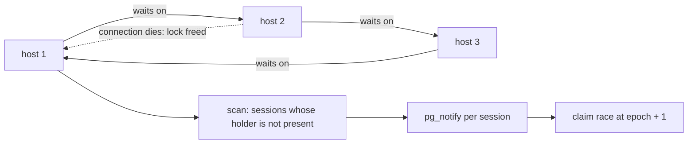

# Atlas architecture

Authoritative. Where the code disagrees about _mechanism_, the code wins; where it disagrees about
_intent_, change the code. Every load-bearing claim here was established by a spike, not by
argument — the evidence is in [research/](research/), and the loop's seams are in
[core-contract.md](core-contract.md).

The decisions this design applies are recorded in
[0018](decisions/0018-v2-pod-first-architecture.md) and
[0021](decisions/0021-v2-loop-runs-on-the-agent-host.md): the loop runs on the agent host, and
sandboxes only execute. One decision, D2 (the local control plane), is still open and is marked
where it matters.

Anchors in [research/](research/) are `file:line` at the commit each file names and may have drifted.

## What Atlas is

A coding-agent harness in the shape of Claude Code. The agentic loop is ours: we make raw model calls
and own every decision the loop makes — what context the model sees, which tools may run, when a
human is asked, what happens on rewind. Because the calls are raw, Atlas is model-agnostic by
construction; Claude and Codex subscription credentials are one provider implementation, not a
foundation.

## 1. Why the architecture was rewritten

v1 was born as one process: the TUI owned the loop, the log, the metadata and the UI. Rule 2 ("One
record", below) held because there was one place to write. Pods moved the loop into a container, and
every piece of state that used to have one home got two or three, joined by best-effort replication
with no ownership rules: six places assigned thread seqs, nine API code paths appended to the log
beside about sixty in the pod, twelve kinds of change could be started by either tier, five protocols
connected three tiers, and many "alive" signals advanced independently of the transcript, so a frozen
transcript looked healthy. On 2026-11-01 a cloud session lost about 560 events of visible state to a
sequence-number fork between the API and the pod
([incident](research/incident-2026-11-01-seq466.md)). Patching each seam kept the fork; the rewrite
changed who owns what and kept the business logic. The v1 code is gone, and its tables are frozen in
the `v1_archive` schema ([data/v1-archive.md](data/v1-archive.md)).

## 2. What stays

- `core` stays pure. Context is still a fresh projection of the log on every step (rule 1).
- The event log is still the one record of a thread (rule 2), now enforced across tiers.
- The loop, tools, providers, assembly, compaction logic, prompts, hooks, skills and sub-agent
  semantics moved over and were not rewritten.
- The port idea, now the plugin contract (P8): every capability declares its runtime slot and its
  transport.
- Wire version negotiation ([0017](decisions/0017-wire-protocol-skew.md)).

## 3. The tiers

```
  clients             control plane                       runtimes
  web / mac / tui <-> record + inbox + leases + views <-> agent hosts run the loop (cloud: Render, one app with the API, 0030)
                      (cloud: NestJS + Postgres;          sandboxes execute only:
                       local: atlasd over SQLite [D2, open]) cloud Vercel sandbox daemon | local docker | in-process
```

| Tier                   | Owns                                                                                                                                                                                                                                                                                  | Does not own                                                                 |
| ---------------------- | ------------------------------------------------------------------------------------------------------------------------------------------------------------------------------------------------------------------------------------------------------------------------------------- | ---------------------------------------------------------------------------- |
| **Client**             | Rendering views, sending commands, caches. It owns drafts: the CP keeps a copy of each composer draft so a draft survives leaving the app                                                                                                                                             | Any fact. It never infers state with heuristics                              |
| **Control plane (CP)** | The durable record, the inbox, holder leases, materialized views, external observations (GitHub), config, credentials, identity                                                                                                                                                       | Allocating thread seqs; the workspace                                        |
| **Runtime**            | Split by [0021](decisions/0021-v2-loop-runs-on-the-agent-host.md): the **agent host** runs the loop for the sessions it holds and allocates thread seqs; the **sandbox** holds the world (workspace, git, processes, files) and executes what the agent host calls through its daemon | The durable record. A sandbox disk is a cache of the record plus world state |

Clients and pods are agnostic to where the other is: a client talks to _a_ control plane, a pod
talks to _a_ control plane, and neither needs to know whether the other is local or cloud.

"Local" is a placement, not a different architecture. An in-process TUI session is a pod that runs
inside the TUI's process and speaks the same protocol over loopback.

**A session lives in exactly one control plane and never syncs between them.** Cloud sessions
live in the cloud CP; local sessions live in the local CP. There is no replication between control
planes.

**D2 (open): the local control plane.** Recommended: a daemon, `atlasd`, running the same
`control` library over SQLite. The Mac host and the TUI connect to it or start it, and local pods
treat it like any control plane. The alternative, requiring cloud sign-in and using the cloud CP
for local sessions, loses offline work and makes local a different shape. The daemon is built
after the cloud slice, so nothing in the cloud slices depends on the answer; the `control` library
is storage-agnostic so that either answer fits.

### The pod boundary

A cloud pod is an Agent37 VM (`type: 'vm'`, region `us`) from the sandbox template, with the Atlas
home mounted at `/atlas` and auto-sleep after 1800 idle seconds
(`packages/pods/src/sandbox/agent37/agent37-create.ts:18-50`). The image is a runtime toolkit with
nothing Atlas-versioned baked in (`infra/sandbox-image/README.md`); the daemon arrives as a bundle
the API serves at `GET /agent/daemon/bundle` (`apps/api/src/agent/AGENTS.md:83`).

**What crosses at birth** is one object, the create body's `env`
(`packages/pods/src/sandbox/agent37/agent37-create.ts:44-50`):
- `DAEMON_TOKEN`, a per-pod secret the agent host presents on every daemon call.
- `ATLAS_DAEMON_BUNDLE_URL` and `ATLAS_DAEMON_HOME`, where the daemon comes from and where it lives.
- `ATLAS_SANDBOX_NAME`, the pod's name in logs and metrics.
- `DAEMON_PORT`, the port the daemon listens on.

No model credential, API token, user secret or repository enters the pod at birth. The daemon
removes `DAEMON_TOKEN` from its own environment before it starts a workload
(`apps/daemon/src/index.ts:40`, `apps/daemon/src/ops/terminal/pty.ts:28`), so a shell the agent runs
does not inherit the credential the host uses to drive it. Credentials, settings and the record
reach a session as control-plane state, and every tool call arrives over the daemon: a pod holds the
world, the control plane holds the record (0021).

## 4. Ownership principles

**P1. One writer per fact.** Every piece of state names exactly one writer. Everything else is a
replica that says how far behind it may be. Each row in the §6 table follows this rule.

**P2. Two streams per session: inbox in, log out.**
- _Inbox_: operator inputs (send, take-back, stop, model change, rename, rewind request). Only the
  CP creates inbox entries, each with a monotonic inbox id (D4). The holder consumes entries and
  records the inbox id it consumed in the log (`input-consumed{inboxId}`). Take-back of an entry
  the holder has not consumed is a CP-only delete. Once the holder has consumed it, take-back is a
  request to the holder.
- _Log_: only the current holder allocates seqs (D1). The CP stores the durable copy and accepts
  an append only when `epoch == current && seq == head+1 && prevHash` matches. Under this rule the
  seq-466 interleaving cannot happen: two sends become inbox ids 1 and 2, and the holder turns them
  into seqs 466 and 467.

**P3. Event identity is end to end.** The pod mints `id` at append time and every copy keeps it.
Each event carries `prevHash`, the hash of the previous event, so "are these two copies the same
up to seq N" is one comparison. Hydration verifies the hash instead of trusting the head number.
This replaces the three equality notions found in v1 (API content equality, host pod-copy id
equality, checkpoint digest of id+seq+type).

**P4. Epoch fencing replaces liveness guessing.** The CP grants one holder lease per session at
epoch N. The holder is an agent host ([0021](decisions/0021-v2-loop-runs-on-the-agent-host.md)).
Every move, wake, resize, rollover or recreation increments the epoch. The CP rejects
writes from an older epoch. A holder that loses its lease stops its loop. Parking becomes: flush the
log, release the lease. The fence replaces the wake-claim CAS, checkpoint revision races, the
`park-refused unflushed` guard and most of the runtime checkpoint's job.

**P5. The log only grows (D3).** Rewind, summarise, compact and loop-cut become appended events
(`history-rewound{toSeq}`, `history-summarised{range}`) that the assembly rules and view folds
interpret. Nothing truncates or replaces history, so replication is append-only and no rebase path
exists to forget. Garbage collection of dead branches is a storage policy, not semantics. This
changes how rewind is implemented, not what the user sees.

**P6. Views are pure folds in core, materialized by the CP.** Branch, worktree, PR links, status,
unread, subscriptions summary, title, model: each is a function `fold(log[, observations]) -> view`
in `core`. The CP computes each view at a log position and ships it with that position. Clients
render views and never re-fold or guess. The branch-match PR fallback and the project-baseBranch
checkout fallback (the reason the incident thread showed `staging`) disappear: an unknown value is
shown as unknown. Session status is `fold(log) ∧ holder lease liveness`, not a separately written
`working` column.

**P7. Commands are durable through the CP. Only ephemeral data goes direct.** A client may keep a
direct socket to the pod, but that socket carries only ephemeral things: token deltas, live tool
output, the PTY, file browsing and an interrupt _hint_. Anything that must survive goes through the
inbox or comes from the record. A
stop is both: a direct hint for latency and a durable inbox entry for truth.

**P8. Features are modules with a contract.** A feature (GitHub/PR, subscriptions, shells,
services, sub-agents, memory, previews) declares:
`events` (schemas it emits) · `views` (pure folds) · `commands` (inbox entries it accepts) ·
`pod` (pod handlers) · `control` (CP handlers: observations, side effects) · `client` (headless
client state) · `transport` (none, or which stream). It is registered the way ports are today, and
typecheck fails if a slot is missing. Native plugins and native commands are built on this
contract. §7 gives the package shape.

## 5. Protocol: one, three directions

| Direction                                 | Carries                                                                                                                                                                                                                                                                                                                                                  | Mechanism                                                                                                                           |
| ----------------------------------------- | -------------------------------------------------------------------------------------------------------------------------------------------------------------------------------------------------------------------------------------------------------------------------------------------------------------------------------------------------------- | ----------------------------------------------------------------------------------------------------------------------------------- |
| **Client ⇄ CP**                           | Commands and queries; one ordered session stream per open session (`{log suffix \| view updates}` with a cursor `(epoch, seq)`); the sidebar as one stream of view rows                                                                                                                                                                                  | tRPC plus SSE                                                                                                                       |
| **Pod → CP**                              | `append(epoch, event)`, one transaction per event, hash-chained; `lease.renew`; observation reports. The agent host holds the control library, so these are Postgres writes, not HTTP, and it calls the API for nothing: memory and previews are shared domain packages it evaluates in-process ([0027](decisions/0027-both-backends-own-their-work.md)) | Postgres, direct                                                                                                                    |
| **CP → pod**                              | Inbox entries and lease revocations                                                                                                                                                                                                                                                                                                                      | A `pg_notify` wake in the write transaction; the agent host `LISTEN`s and reads the inbox. No stream is held open (wake path below) |
| **Client ⇄ pod** (direct, ephemeral only) | Deltas, PTY, file tree, interrupt hint                                                                                                                                                                                                                                                                                                                   | WebSocket, authorized by a CP-minted ticket as today                                                                                |
- Streams reconnect with cursors. The API is a long-lived service
  ([0030](decisions/0030-api-and-agent-host-are-one-render-service.md)), not a serverless function,
  but a deploy or a dropped connection still makes reconnect the normal case, not an error path.
- Version negotiation carries over from [0017](decisions/0017-wire-protocol-skew.md). The skew
  check is extended to cover schema structure, not only versions and three enums.
- A log reader never stops at an event body it cannot parse. It skips that event, advances its
  cursor past it, keeps the rest of the page, and reports how many parts it skipped — so a pod that
  has just deployed a new event type costs an older client a few rows, never the session. The agent
  host announces the body types it can write on the ready frame, which lets a client tell "written
  by a newer Atlas" from "corrupt". A surface that registers fewer plugins than the writer builds is
  the bug to fix; the skip is what keeps a rollout from being one.
- Cursor spaces stay distinct: the durable `(epoch, seq)`, and any transport replay cursor. The old
  design conflated three (see [wire-surface](research/wire-surface.md)); this one does not.
- The HTTP prefix `/v1` is the API's route prefix (`/v1/trpc`, `/v1/health`). It names no engine.

**The wake path, as built in slice 3.** The agent host is the holder, so the CP-to-holder direction is a
wake, not a stream the pod holds open:
- A wake is written in the same transaction as what it announces. Posting an inbox entry (message or
  stop), creating a session, and revoking a lease that still has work each call `pg_notify` on one
  channel (`atlas_session_wake`, payload the session id) inside the write. Postgres delivers the
  notification only on commit, so a rolled-back write wakes nobody.
- Each agent host `LISTEN`s on one direct Postgres connection (`DATABASE_DIRECT_URL`; PgBouncer's
  transaction mode cannot `LISTEN`). A wake for a held session re-runs that session's loop; a wake for an
  unheld one rings the host's claim loop.
- A notification is lost while the connection is down, so every (re)connect emits a resync: the host
  rings its claim loop and every held session re-reads its inbox. A lost doorbell costs at most one tick.
- A crashed holder emits no event, so hosts watch each other in a ring. Each host orders the live
  `V2Host` ids, picks its successor (the next id above its own, wrapping to the lowest) and blocks one
  dedicated direct connection in `pg_advisory_lock_shared` on that successor's presence lock. The wait
  returns when the successor's connection dies. The watcher then deletes the successor's `V2Host` row,
  notifies `atlas_host_change`, rings its own claim loop, and retargets to the
  next successor; a dead successor's successor returns at once, so the ring keeps walking. Any
  `atlas_host_change`, a host re-registering under a new id, or a (re)connect of the LISTEN connection
  recomputes the successor. A host also runs the same scan once at start-up, which covers an empty fleet
  and a single host. No timer or scheduled job is involved.
- Redis carries live frames only (token deltas, tool output). Nothing durable and no wake depends on it,
  so an outage costs live streaming and nothing else.

## 6. Where each piece of state moves

| State                                    | Writers before this design                                            | Single writer                                                            | Replicas                                                                 |
| ---------------------------------------- | --------------------------------------------------------------------- | ------------------------------------------------------------------------ | ------------------------------------------------------------------------ |
| Thread events / seq                      | pod (4 allocators) + API (send, append, open, wake, archive, history) | holder (an agent host, 0021)                                             | CP record (durable), clients (views, log suffix)                         |
| Operator input                           | WS send (pod intake) + API send (Postgres append)                     | CP inbox                                                                 | pod consumes; `input-consumed` in log                                    |
| History edits                            | API rewind/replace/summarise/fork + pod rewind/compact/loop-cut       | holder, as appended events (P5)                                          | none needed                                                              |
| Child / teammate threads                 | API create/open + pod spawn + registerChild                           | holder mints and logs `agent-spawned`; CP materializes rows from the log | CP rows are a view                                                       |
| Title, model                             | API rename/chooseModel + serve requests + forwarding + home copy      | inbox command → holder logs `title-set` / `model-set`                    | view                                                                     |
| PR links, branch, worktree               | events + session meta + client heuristics                             | pod-logged changes to the git ref set (`refs/heads`, worktrees; 0020)    | view: local branches except the default, with PR state joined by github  |
| Subscriptions                            | runtime registry + event projection + GithubSubscription rows         | CP, in the request transaction                                           | clients (announced view); the log gets a `record`                        |
| PR state / checks                        | GitHub → CP cache, pod cache, client merge                            | CP observation store                                                     | joined into views; pod reads it                                          |
| Activity / status                        | pod → Thread.working etc., checkpoint, boot steps                     | fold(log) + lease liveness                                               | view                                                                     |
| Runtime checkpoint                       | pod file + API mirror                                                 | mostly gone; lease + log replace it                                      | none                                                                     |
| Accounts, secrets, settings, MCP         | CP + pod whole-file rewrite + harness writes                          | CP                                                                       | pod gets a read-only, revisioned lease; the pod never writes these files |
| Workspace, git, processes, context files | pod (world) + API/home mirrors                                        | pod                                                                      | mirrors labelled with as-of position, never read as truth                |
| Read cursor                              | API, Mac, TUI separately                                              | CP                                                                       | none                                                                     |
| Drafts, uploads                          | CP (last write wins)                                                  | CP                                                                       | none                                                                     |
| Spend ledger                             | pod + Turn upsert                                                     | holder logs `turn-ended{usage}`                                          | CP view                                                                  |

The `GithubSubscription` row is the truth for a subscription. The control plane writes it in the
request transaction. The log holds only an informational `record` of the change. A subscription
does not roll back on rewind, and a fork does not copy it.

## 7. Package shape

Fixed by [0019](decisions/0019-v2-package-map.md), which amends D5. Foundations live in
`packages/`; native plugins in a top-level `plugins/`; native commands in a top-level `commands/`.
Bun runs TypeScript raw, so a package costs no build step; the maintainer prefers a few large,
cohesive packages where each feature's code sits in one place.

**Foundation packages (`packages/`)**

| Package         | Owns                                                                                                                        |
| --------------- | --------------------------------------------------------------------------------------------------------------------------- |
| `core`          | Pure shared vocabulary: ids, event envelope, assembly, and the record rules (log, inbox, lease, history folds)              |
| `protocol`      | Wire schemas for the three directions (today's `wire`, without sandbox provisioning I/O or the ticket HMAC implementation)  |
| `agent`         | The loop every agent runs: turn runner, retries, intake, tool dispatch, model port. Knows nothing about pods or leases      |
| `pod`           | Hosts agents in a pod: holds the lease, local record cache, replication, inbox consumption (0018 called this `runtime`)     |
| `control`       | The CP library: record, inbox, leases, view materialization. Adapters: Postgres (hosted by `apps/api`), SQLite (D2)         |
| `client`        | The client SDK and headless React hooks shared by web, TUI and Mac: session stream, view cache, commands                    |
| `plugin-sdk`    | The plugin contract (slots), the type-level registries and the loader; native and repo plugins share it                     |
| `commands`      | The command contract: spec, arguments, registry, dispatch as inbox commands, the shared command menu and its hooks          |
| `settings`      | Settings schema and resolution (pure) plus per-tier subpaths; plugins contribute keys                                       |
| `observability` | Telemetry, operational log and (soon) tracing ports; exporters on `/node` ([0023](decisions/0023-observability-package.md)) |

`ui`, `db` and `models` are unchanged.

**Plugins (`plugins/<name>/`).** One workspace package per native plugin (github, subscriptions,
shells, services, crew, sessions, memory, previews). Every plugin has the same subpaths:

| Subpath    | Holds                                                         |
| ---------- | ------------------------------------------------------------- |
| `/core`    | The plugin's events, pure folds (views) and command specs     |
| `/pod`     | Pod-side handlers: tools, hooks, inbox command handlers       |
| `/control` | CP-side handlers: observations, side effects                  |
| `/client`  | Headless client state and hooks; rendering in `web` and `tui` |

**Commands (`commands/`).** One workspace package with a folder per native session command: `spec.ts`,
`pod.ts` (the handler, run in the pod from an inbox command), `client.ts` (headless hooks),
`web.tsx` and `tui.tsx` (rendering; Mac renders the web build). A command that belongs to a feature
lives in that plugin on the same contract.

Rules:
- Plugins never import each other. Anything two plugins share belongs in a foundation package.
- Every command is an inbox command handled in the pod, so it behaves identically on every client.
- Apps compose: each app imports the tier subpaths it needs and registers them. The type-level
  registry (P8) fails typecheck if a plugin is registered without its slots.
- Tier boundaries are enforced by subpath exports plus a restricted-import lint rule.
- Before any feature event leaves `core`, `plugin-sdk` provides a type-level event registry so the
  exhaustive switches over `EventBody` stay exhaustive.

## 8. Order of work

[roadmap.md](roadmap.md) has the slices, their exit criteria, the current state and the
one-slice-per-run workflow. Each slice gets a spec in [slices/](slices/) before it is built, and
merges to `main` on its own. The first milestone was a real cloud session from the web, with a
working thread and tools; what remains is the hardening the roadmap tracks.

## 9. Risks

| Risk                                   | Why it matters                                                                                                                                | Mitigation                                                                                                                                                                                                                                                 |
| -------------------------------------- | --------------------------------------------------------------------------------------------------------------------------------------------- | ---------------------------------------------------------------------------------------------------------------------------------------------------------------------------------------------------------------------------------------------------------- |
| Sub-agent families                     | One session holds several thread logs under one lease. Each log needs the same append rules, and spawn and ending must be events in both logs | Narrowed by [0020](decisions/0020-v2-sub-agent-worktrees-and-peer-sessions.md): teammates become peer sessions, so only short-lived sub-agents with no PR or CI share a lease. Settled in the crew spec; the record core must not assume one log per lease |
| Rewind as append-only (P5)             | Touches assembly rules and `docs/core-contract.md`; the highest-semantic-risk change                                                          | Specified and property-tested in slice 1, before the pod host depends on it                                                                                                                                                                                |
| One service runs the API and the loop  | A deploy cuts every running turn, and an API merge restarts held sessions mid-turn                                                            | The handoff pauses and resumes at once (#2314, [0021](decisions/0021-v2-loop-runs-on-the-agent-host.md)); recovery is the next merge, since the Vercel path is deleted ([0030](decisions/0030-api-and-agent-host-are-one-render-service.md))               |
| D2 stays open too long                 | The local slices cannot be specified                                                                                                          | D2 is needed only at the local slice; cloud slices do not depend on it                                                                                                                                                                                     |
| A saturated sandbox starves the daemon | Tool calls slow or stall, and a lease can look stale while the sandbox is only saturated                                                      | §10: OOM and CPU priority, a memory watchdog, lease renewal and stop that do not wait on the loop                                                                                                                                                          |
| Long threads (~20k events, tens of MB) | A whole-log fold per append, step, request or refresh cannot hold this size ([log-scale](research/log-scale.md))                              | §11: ranged reads only, current state as checkpoints, artifacts out of line, tail-first clients                                                                                                                                                            |
| A pod dies and nobody notices          | An idle dead sandbox is never flagged when liveness is inferred from activity rather than from the holder                                     | §12: the lease is liveness; one reconciler per session acts on expiry                                                                                                                                                                                      |

## 10. Pod resources: the daemon outranks its workloads

The loop no longer runs in the sandbox ([0021](decisions/0021-v2-loop-runs-on-the-agent-host.md)),
so what must survive saturation is the **daemon**: the small in-sandbox process that executes what
the agent host calls (exec, files, grep, background shells, services, stdio MCP, terminal). A sandbox
runs two kinds of process: the **daemon** and the **workloads** the agent starts (shells, services,
test runs, builds). They share the sandbox's CPU, memory and disk. When a workload saturates the
sandbox, every tool call the agent host makes through the daemon slows. In the old design the in-sandbox process was also the
kernel's first OOM victim: it had the largest footprint, at `oom_score_adj` 500. This is OS-level
isolation, not a package boundary.

What a Vercel pod allows (measured 2026-11-02, as root, [pod-saturation](research/pod-saturation.md)):
`oom_score_adj` and negative nice work. Child cgroups with `cpu` and `pids` work **once the root
cgroup is emptied** (every process, pid 1 included, moved into a child first), and a `pids.max` on
the workload group fully contains a fork bomb that otherwise wedges the VM. `memory` delegates the
same way, and `memory.max` on the workload group OOM-kills inside that group only. The layout is
boot state: snapshot/resume is a fresh boot that discards it, so it is applied on every boot. There is no PSI (`/proc/pressure`). #1657 (OOM ordering and
nice) is measured to protect the in-sandbox process from memory exhaustion, not from a fork bomb.

**R1. The daemon survives.** The daemon runs at a strongly negative `oom_score_adj`; every
workload starts with a high one, so the kernel kills workloads first. (#1657, carried into the
sandbox image.)

**R2. The daemon keeps CPU and process slots.** At every boot (create and resume) the pod empties the root cgroup into an
`atlas-serve` group (high `cpu.weight`) and spawns every workload into `atlas-work` (low
`cpu.weight`, `pids.max`), so a fork bomb hits its cap instead of the pod's pid table. Every call
gets its own box under `atlas-work`, and the daemon kills that box when it kills the process — a
cancelled or timed-out call, a stopped shell or service, a terminal — so a workload the daemon kills
takes its whole tree with it. A call that ends on its own only has its process group killed, so a
process that detaches with `setsid` — `agent-browser`'s Chrome daemon — survives the call that
started it and serves the next one, as it would in an ordinary shell. Workload output is read in
bounded chunks so a noisy process cannot monopolise the daemon's event loop.

**R3. Workloads have a memory ceiling.** `memory.max` on the workload group (measured available)
makes the kernel OOM-kill inside `atlas-work` before the sandbox runs out, so the daemon never competes
with a hog for the last page. The daemon reads `memory.events` and reports which
workload was killed and why, so the agent sees it in its context and the operator in the thread view.
The kill scope (one shared group or a child per thread or workload) is fixed in the slice 3 spec.

**R4. Liveness does not wait on the loop.** The agent host renews the lease on its own timer,
independent of turn progress, and its TTL is sized for a saturated sandbox, so a busy sandbox is
never fenced as dead.
Stop (the operator's stop/interrupt button) arrives twice (P7): the direct hint aborts the turn and
kills the running tool's process group, and the inbox entry is the durable record of it. An abort
already kills the tool's process group; what fails under load is the daemon reaching the hint late
because a workload holds the CPU, which R2 prevents.

**If the holder dies anyway**, the design absorbs it: the record is in the control plane, the
lease expires, and a new agent host resumes at the next epoch with nothing forked. At most the unflushed
tail is lost, bounded by the flush cadence. In the old design the same death wedged or lost the
session.

Thresholds, TTLs and the priority mechanism are fixed in the slice 3 spec and measured on a
saturated sandbox, not chosen here.

## 11. Log scale: history is an archive, current state is a checkpoint

v2 must run its longest realistic thread as smoothly as a fresh one. Production on 2026-11-02: the
longest thread was 7,989 events and 8 MB of bodies (one day of work), p50/p90/p99 per thread
177/637/2,056 events, the largest single event 2.9 MB; sessions last hours to days. The design
target is **~20k events (tens of MB) per thread**. The rules below remove whole-log work where
doing so is trivial; they are not tuning for sizes Atlas does not reach, and the nearer limit is a
single large event against the 4 MB API body cap (L5). The
[log-scale census](research/log-scale.md) found that the old design failed this everywhere for one
reason: it used the log as its state database, re-deriving current state by folding history from
seq 0 on every append, step, request and refresh. The rules below separate the two. **The log is an
archive that is
only ever read in ranges; the running session works from current-state checkpoints plus a bounded
tail.**

**L1. Every read is bounded.** Ports expose `readRange({ afterSeq, maxEvents, maxBytes })` and
`readTail({ maxEvents, maxBytes })`, returning `{ events, nextCursor, head }`. There is no "read
all" on any port. `head()` and identity are metadata, never a transcript read. Range bounds have
one convention (exclusive `afterSeq`) across every tier.

**L2. Append is O(batch).** Head seq and head hash live on the thread record and are compared and
swapped there; nothing scans to append. Local storage repairs a torn tail by reading only the final
record, never the file.

**L3. Current state is materialized, not refolded.** Every fold that the loop, the pod or the CP
needs per step or per request (pending calls and approvals, model wait, worktree and checkout,
live contexts, agents, shells and services, subscriptions, owed notices, token totals, the
visible-history mapping of P5) is an incremental step function. Its state is kept at a known
`(epoch, seq)`, advanced in the same transaction as the append, and resumed as checkpoint plus
suffix. This generalizes P6: a view is a fold, and a fold always runs incrementally.

**L4. Assembly reads the model's context, not the transcript.** A step reads the latest summary,
the live context records and the uncompacted tail, so covered history is never converted into
messages, stringified or token-counted. The full log stays available for browsing and rewind.
Compaction planning uses per-event token estimates kept with the record (prefix sums), not
repeated scans.

**L5. Large payloads live out of line.** Tool outputs, images and raw provider data above a size
threshold are stored as artifacts. The event carries a reference, byte length, hash, and a bounded
preview and model-facing summary. Limits are in bytes, not just event counts: 500 events can still
be gigabytes.

**L6. Replication and verification are incremental.** Pull and flush move from a known cursor in
bounded pages until caught up. Chain verification checks a fetched suffix against a trusted head
hash. A history edit knows its affected range; nothing serializes whole logs to find what changed.

**L7. Clients are tail-first with eviction.** Every client follows the TUI's existing window
(`apps/tui/src/composition/thread-reads.ts`: 1500-event pages, 3000 retained, eviction): open at
the tail, page older history on demand, evict distant pages, append by touching only new rows.
Projections run over the window, seeded from CP views, never over the whole history. Rendering is
virtualized below the turn, so one huge turn cannot defeat it.

**L8. Lookups by key are indexed.** Idempotency keys, wake dedupe and subscription ids are columns
with indexes, not `LIKE` searches of event bodies.

Every slice's exit criterion includes a scale check against a seeded long thread, sized to what the
slice touches: append and ranged reads (slice 1), a pod step and resume (slice 3), view
materialization (slice 4), opening and following a session (slice 5).

## 12. Liveness and lifecycle: what the control plane knows about a pod

**Why the lease replaced the clock.** The old design learned that a pod had died only indirectly: a
five-minute sweep looked at running sandboxes whose activity was stale and that held an unanswered
message, then probed the pod's health route. A pod that died mid-turn could look alive for about
fifteen minutes, a pod that died idle was noticed only when someone next connected or woke it, and
nothing in the pod reported its own death.

**The design.** The holder lease (P4) is the liveness signal. The control plane knows a holder is gone
when its lease is not renewed within the TTL, whatever the cause: crash, OOM kill, an agent host deploy,
a stopped sandbox. Status is `fold(log) ∧ lease liveness`, so a dead holder shows as dead within
one TTL, and the reconciler (below) acts on it.

**Kubernetes practices v2 follows.** Atlas's control plane and pods are a small orchestrator, and
these are the parts of Kubernetes' design that fit:

| Kubernetes                                                                                                                                                   | v2                                                                                                                                                                                                                                                                |
| ------------------------------------------------------------------------------------------------------------------------------------------------------------ | ----------------------------------------------------------------------------------------------------------------------------------------------------------------------------------------------------------------------------------------------------------------- |
| [Lease objects](https://kubernetes.io/docs/concepts/architecture/leases/): holder, duration, renew time, transition count                                    | The P4 holder lease; the transition count is the epoch                                                                                                                                                                                                            |
| [Liveness, readiness and startup probes](https://kubernetes.io/docs/tasks/configure-pod-container/configure-liveness-readiness-startup-probes/) are distinct | Lease renewal is liveness (R4). Readiness is "booted, hydrated, consuming the inbox", and only a ready pod is sent work. Boot has its own deadline, so a slow boot is not mistaken for a dead pod                                                                 |
| [Controllers](https://kubernetes.io/docs/concepts/architecture/controller/) reconcile desired state to observed state                                        | One CP reconciler per session: "has unconsumed inbox entries and no live holder" → grant a lease to an agent host and provision a sandbox. It replaces v1's scattered wake claims, rotation recovery and cron sweeps. Every step is idempotent and safe to repeat |
| Restart with backoff (CrashLoopBackOff)                                                                                                                      | Reprovisioning backs off exponentially and is shown as a status with a reason, never a silent loop                                                                                                                                                                |
| [QoS classes set `oom_score_adj`](https://kubernetes.io/docs/concepts/scheduling-eviction/node-pressure-eviction/)                                           | R1: the daemon runs like a Guaranteed pod, workloads like BestEffort                                                                                                                                                                                              |
| Requests and limits are cgroup settings                                                                                                                      | R2/R3: `atlas-serve` and `atlas-work` cgroups with `cpu.weight`, `pids.max`, and `memory.max` if it proves available                                                                                                                                              |
| [Graceful termination](https://kubernetes.io/docs/concepts/workloads/pods/pod-lifecycle/#pod-termination): SIGTERM, a grace period, then kill                | Park = flush the log, release the lease within a grace period; past it, the CP fences the epoch and moves on                                                                                                                                                      |
| Pod conditions with a reason and a transition time                                                                                                           | Views expose status as conditions (`Ready`, `Holding`, `Degraded` with reason and since), not bare booleans                                                                                                                                                       |

Not adopted: running Kubernetes itself. Vercel Sandbox is the runtime; v2 copies the control
patterns, not the platform.

**The held-session loop, as built ([0026](decisions/0026-v2-hosts-pull-sessions.md)).** Each agent host runs
one claim loop (`packages/host/src/holder`). A doorbell (a wake, a resync, a dead peer found by the host
watch, a settled session, a due `retryAfter`) or a 20 s ± 20 % tick runs `claimNext` with `limit` = free
slots; rings coalesce into one call in flight and one queued. The database is the work queue: `claimNext`
is the only way a host takes a session, and the "needs a holder" predicate lives once, inside the claim.
Each claimed lease runs through `runHeld` and then `settle`, the only place a lease is released. A settle
that fails is retried by the loop before it claims more. Retry state (`attempts`, `retryAfter`) lives on
the lease row, so every host honours the backoff and it survives a restart.

Inside `runHeld`, a session's reconciler runs one step at a time and coalesces requests that arrive
meanwhile. A step is three moves:
1. Snapshot: read the inbox once, fold the log into the workspace state, and note whether a turn runs, a
   stop is pending, a message is pending and the idle deadline has passed.
2. Decide: a pure function in `core` (`decideHeldAction`) maps the snapshot to exactly one action: abort the
   turn, consume a stop, prepare the workspace, start a turn, release, or wait.
3. Act, then wait for the next event.

The timers that remain each guard something other than finding work: the claim loop's tick, the daemon
ping, one idle-release deadline armed only while idle, and the handoff deadline during a drain. Model retry
backoff is not an in-memory timer: it is a recorded deadline (0021).

**Session lifecycle.**
- **New session: prepare first, then the first turn.** Creating a session wakes a host, which claims the
  lease, wakes the sandbox and runs the prepare ceremony: wait for the daemon, clone the repositories, run
  the project's setup script. The first turn starts only after `workspace-prepared` is appended. Status is
  `preparing` until then, or `setup-failed` with a reason (`workspace-prepare-failed{reason, inboxHead}`).
  Messages at or below the failure's `inboxHead` keep their place and do not retry the prepare. A newer
  message retries on a fresh runtime. Each clone step leaves a marker, so a retry redoes only what is
  missing. A message never waits for the pod: it is an inbox entry, and the turn reads it when the
  workspace is ready.
- **Session prepared before: the turn starts at once.** A session whose record holds `workspace-prepared`
  (a parked or sleeping sandbox) starts the model turn as soon as the record is open, while the wake runs
  beside it. Only a call that needs the pod waits: it waits on the workspace gate, then on the daemon link,
  and the acknowledgement of earlier tool results runs in the background. The gate resolves when the
  current wake succeeds and fails the call with the reason when it fails, so a failed wake never hangs the
  turn. A newer message retries a failed wake. Plugin resources (instructions, skills, MCP tools) are
  loaded from the record at turn start, so nothing in the turn waits for the pod.
- **Stop is the same at any time.** A stop aborts the turn and interrupts a call that waits on the gate. It
  does not cancel the wake: the pod finishes waking, the prepare records its result, and the normal idle
  release then applies. A stop only marks a first prepare of a brand-new session as stopped.
- **Deploy drain keeps idle sessions parked.** On SIGTERM a host hands off the sessions that have work: a
  running turn, a resumable thread, an actionable inbox entry, or a workspace that is unprepared, preparing
  or failed with a retry pending. An idle, prepared session is released without a wake. The next message
  wakes it through `NOTIFY`, so a deploy no longer wakes every sandbox and restarts every idle clock. The
  handoff settles no call and writes nothing about one: a pod call keeps running in the daemon and the
  next holder collects it. In-flight work gets until the drain cap (240 s of a 260 s budget), and only the
  model stream is aborted at it, so only the in-flight provider request is lost.

**Connection-bound leases (accepted in [0025](decisions/0025-v2-connection-bound-leases.md)).** Renewal
and the reconcile task existed because liveness is something the control plane had to infer from a clock.
Postgres already knows when a connection is gone, so 0025 makes that the liveness signal and
removes every timer that proves or looks for it.
- **One presence lock per host.** An agent host opens a dedicated direct connection (`DATABASE_DIRECT_URL`,
  kernel keepalive on, no statement or idle timeouts) and takes
  `pg_try_advisory_lock(PRESENCE, hostId)` on it, then inserts its `V2Host` row. The lease row is
  `{sessionId, epoch, holderHostId, wantsHolder}`. A lease is live iff its holder's presence lock is
  granted exclusively. A host with 200 sessions uses one lock slot, not 200.
- **The epoch fences; the lock says when a claim is allowed.** Appends compare the epoch under
  `FOR SHARE` on the lease row and never read `pg_locks`. A claim locks the row, refuses if the current
  holder is present or if the claimer is not, and writes `epoch + 1`.
- **Lose the lock connection, lose every lease.** The host stops appending, pauses its loops, registers a
  new host id and reclaims through the normal path. Postgres has already freed the old lock.
- **Death is an event.** Each host keeps one connection blocked in
  `pg_advisory_lock_shared(PRESENCE, successor)`, where the successor is the next host id in a ring. It
  returns when the successor's connection dies; the waker then rings its own host's claim loop, whose
  `claimNext` takes sessions whose holder is not present. The start-up ring covers an empty fleet.



| Measured, 4,000 leases, append = lease read + head update + event insert | 23 locks held |     600 |   3,000 |
| ------------------------------------------------------------------------ | ------------: | ------: | ------: |
| Epoch check only, 8 clients                                              |       1.66 ms | 0.83 ms | 0.59 ms |
| Plus a `pg_locks` read, 8 clients                                        |       1.97 ms | 2.56 ms | 5.22 ms |
| Plus `pg_try_advisory_xact_lock_shared`, 8 clients                       |       1.79 ms | 1.10 ms | 0.99 ms |

The `pg_locks` read scales with every lock in the cluster, so it stays off the append path. Connections
per host are the pool plus three (`LISTEN`, lock, one waiter), independent of fleet size; one waiter per
peer would need N(N−1) backends against a limit of 50. What the lock connection must survive, and what
the host does for each case, is the failure table in [0025](decisions/0025-v2-connection-bound-leases.md).

**Build plan** (each a reviewable PR):
1. **Verify on PlanetScale** (done 2026-11-05; numbers in 0025 Consequences). A test-only script against the real role: `SET tcp_keepalives_*` is allowed,
   no idle-session reaping, a killed connection frees the lock, a transaction-mode URL is detectable.
   Amend 0025 with the numbers.
2. **Presence.** `V2Host` table, a `HostPresence` port with Postgres and in-memory implementations
   (conformance spec shared), the lock connection with `error`/`end` handling and the pooler refusal.
3. **Lease row and fence.** Drop `renewedAt`/`ttlMs`, add `holderHostId`; `claim` and `acceptAppend` in `core`
   take presence as input; `FOR SHARE` in append and `FOR NO KEY UPDATE` in claim; delete `lease-expired`
   and `renew`. A race spec: append against a concurrent claim.
4. **Host.** Delete `LeaseRenewal` and its timers; lock-connection loss fences every held session and
   re-registers; an append transport failure past its deadline closes the lock connection.
5. **Watch ring.** The waiter, successor recompute on `atlas_host_change`, the claim loop's ring on start and on
   wake, and `claimNext` on presence. Delete `reconcile-holders` and its trigger task.
6. **Fault rig.** Cases for SIGKILL, `pg_terminate_backend` of the lock connection, a stalled pool with a
   live lock connection, a partition (`iptables` drop, the proxy frees the lock in about 60 s), a primary restart, and
   three hosts dying in sequence around the ring.

## 13. Archive is read-only, and an archived session costs nothing

**Why archive needed the rules below.** The old archive was not read-only: a send unarchived and
booted the sandbox, Retry ignored the archived flag, a teammate session on the same pod kept its
subscriptions and could wake it, and storage was never freed, so every archived session kept a
stopped sandbox and its latest snapshot until a sweep deleted it hours later.

**v2.** Archive is the operator inbox command of [slices/03-teammates.md](slices/03-teammates.md),
logged as `session-archived`. Because the record lives in the CP and a sandbox is only a cache of
record plus world state (0021), deleting an archived sandbox loses nothing the session needs.

**A1. Archived is a state the CP enforces.** While the latest archive event is `session-archived`,
the command handlers accept only `unarchive` and reads. Every other command — say, retry, resize,
model change, subscribe, a peer's `send_message`, PR/CI deliveries — is refused with a typed
`Archived` rejection. Sending does not unarchive; unarchive is an explicit operator command.
`apps/api/src/api/platform/sessions/session-archived.ts` holds the guard that refuses the
holder-bound calls (`post`, `retry`, `wake`, `wakePod`, `holdPod`) and every command but `rename`
with `SessionArchivedError`. Rename stays allowed because a title is sidebar metadata the archived
session never runs.

**A2. The reconciler never places an archived session.** §12's rule becomes "unconsumed inbox
entries, no live holder, and not archived". Archiving increments the epoch, so a worker mid-turn
stops at its next append and the turn ends with an `archived` outcome. The claim query skips an
archived session outright
(`packages/control/src/postgres/postgres-claim-candidates.ts`), so a message posted to one waits
in its inbox without waking it, and the session gains a holder only by being unarchived. Unarchive
takes the pod's retirement lock first
(`packages/control/src/postgres/postgres-pod-retire-lock.ts`), so it waits for a retirement in
flight and the sweep re-reads the pod inside that lock before it stops or deletes it.

**A3. Archive ends what the session owns.** The control plane ends every subscription row of the
session with reason `archived` and posts an informational `record`. Owed notices are dropped;
shells and services stop. Peers placed on the same pod are unaffected; the pod is released only
when no placed session holds it.

**A4. Archive stops the sandbox; retention deletes it.** The sandbox stops at archive, and the
archive parks the pod. Six hours after archive the sandbox and its snapshots are deleted; the
record, artifacts and views stay.
There is no unsaved-work guard: uncommitted or unpushed work in an archived sandbox is the
operator's to lose. Unarchive after deletion provisions a fresh sandbox and re-clones from the
session's checkout view (slice 4), like any lost sandbox.

**A5. Retention is reconciled, not dispatched once.** A CP reconciler pass ("archived, sandbox
exists, grace elapsed → delete") replaces v1's fire-once cleanup. It is idempotent, so a failed
delete is retried on the next pass.

**A6. Auto-archive.** A session with no inbox activity and no live holder for 72 hours — the web
sidebar's Inactive window (`apps/web/src/features/shell/thread-partition.ts`, `INACTIVE_AFTER_MS`)
— is archived by the CP with actor `clock`. Pinned sessions are exempt.

**A7. Sandboxes stop sooner.** The loop runs on the worker (0021), so a sandbox is needed only while
tools, shells or services run. Its idle stop is 5–10 minutes rather than the old 30; slice 3
measures resume latency before the number is fixed. The worker keeps the lease and the running thread, and the next tool call reprovisions.

| Slice                 | Owns                                                                                 |
| --------------------- | ------------------------------------------------------------------------------------ |
| 3 worker host         | A2 epoch fence on archive; sandbox stop at archive; A7 idle stop and its measurement |
| 4 views               | Archived state in the session view; the checkout view a re-clone starts from         |
| 6 commands            | `archive` / `unarchive` inbox commands; the A1 rejection on web and TUI              |
| 7 subscriptions       | A3 subscription teardown and refused deliveries                                      |
| CP reconciler (3 / 8) | A4/A5 retention pass; A6 auto-archive                                                |
