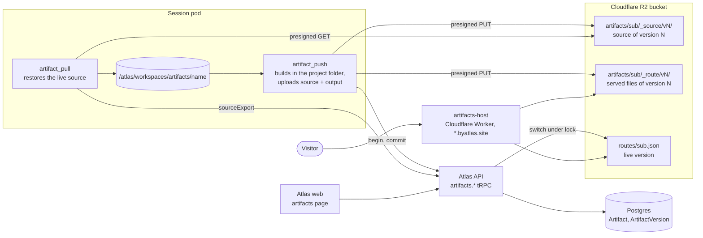
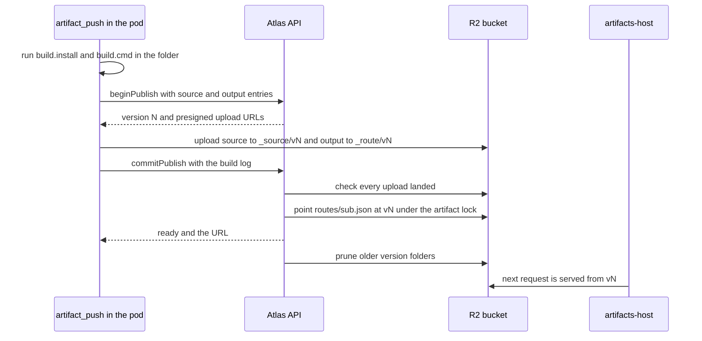
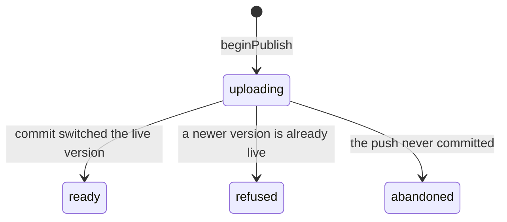

# Artifacts

An artifact is a small app an agent deploys to Atlas with one tool call: a todo app, a calculator,
a demo, a prototype to share. It has a fixed URL (`<subdomain>.byatlas.site`) for its whole life,
and its source lives with it, so any session can pull it, change it and push it again. The last
push wins. There is no version history, no server-side build and no CI.

When an app outgrows that, the agent pulls it and moves it into a real repository.

## Pieces



- **Tools** live in `packages/harness/src/tools/builtin/artifact-*.ts`; they reach the API through
  `CloudArtifactPort` (`packages/harness/src/artifacts`).
- **API** is `apps/api/src/api/cloud/artifacts`: it hands out presigned URLs, records versions and
  switches the live version.
- **Storage paths and the manifest** are shared code in `packages/artifacts`.
- **The host** (`apps/artifacts-host`) reads `routes/<subdomain>.json` and serves the files of the
  version it names.

## A push



- The build runs in the pod with the same environment as the agent's shell (Node, Bun, npm, git).
  `artifact.json` declares it:

  ```json
  {
    "build": { "install": "bun install", "cmd": "bun run build", "outDir": "dist", "timeoutSec": 300 },
    "serve": { "spa": true }
  }
  ```

- Without a `build` block the pushed source is served as it is; the API presigns each source file
  into the served folder too.
- A failed build pushes nothing. The tool returns the log tail and the URL keeps serving the
  current version.
- The commit is synchronous: when the tool returns, the URL serves the new version. Nothing waits
  on a job, so nothing polls.
- Two sessions pushing at once: the per-artifact advisory lock serialises the switch, and a commit
  whose version is not newer than the live one is refused with 409 ("pull, reapply, push again").
- Pruning older folders happens after the switch and never fails a push.

## A pull

`artifact_pull` downloads the source of the live version (never the built output) into
`/atlas/workspaces/artifacts/<name>` in a cloud session, or `<atlas home>/artifacts/<name>`
elsewhere. A folder already linked to the same artifact (its `artifact.json` names the subdomain)
is updated in place; a folder taken by another artifact becomes `<name>-<subdomain>`. Writing under
the artifacts folder never triggers the "outside the project" notice.

## Versions



`ArtifactVersion.status` stores `building` for an upload in progress. Once a version is live, older
rows and their folders are deleted; only the live version is kept. Abandoned uploads are never
served, and the next successful push prunes their folders.

## Limits

2,000 files and 25 MiB per version (source plus output), 500 MiB per user
(`packages/artifacts/src/limits.ts`). Build logs are stored up to 64 KiB.

## Not supported yet

Server-rendered apps. The planned route is the same shape: build a Worker bundle in the pod
(for example with OpenNext for Next.js), push it, and have the API deploy it to Cloudflare Workers
for Platforms, with `artifacts-host` dispatching each subdomain to its Worker.
