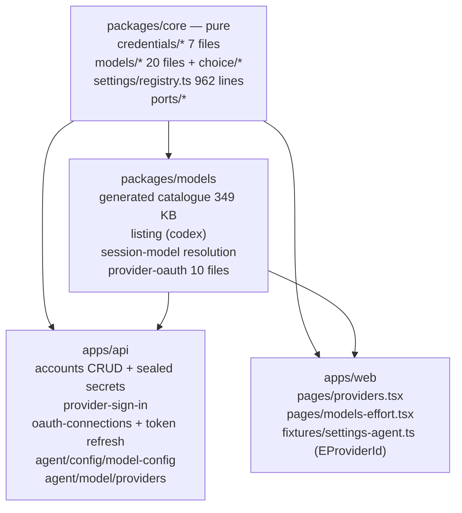
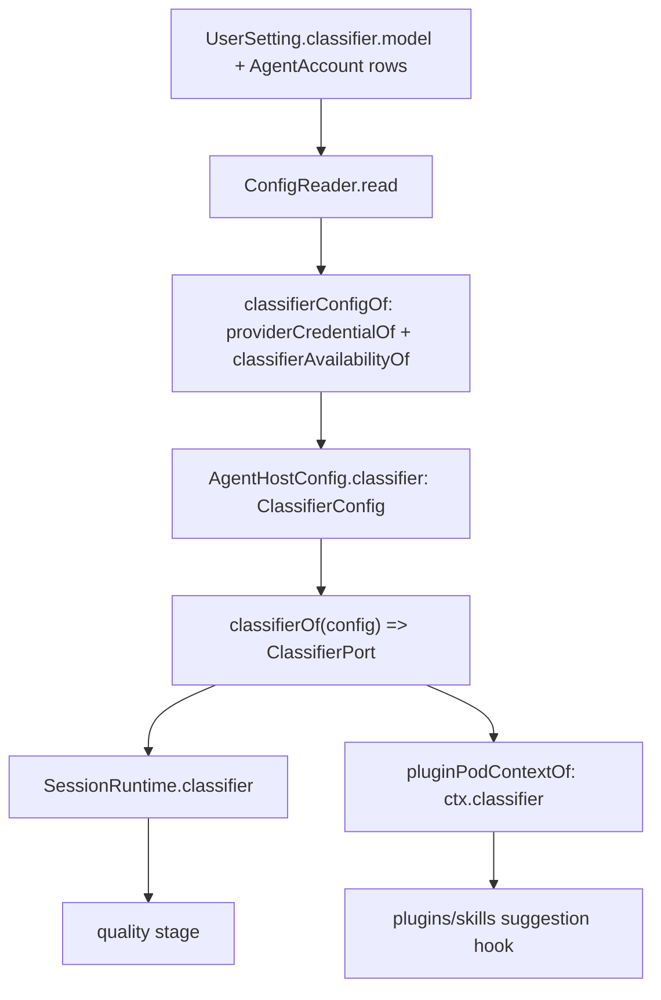

# Spec: the classifier role for v2

> **Approved by Dennis 2026-11-23, with these changes that override the text below:**
> - Build functional first, redesign the page later. One teammate owns this workstream.
> - Every provider key is validated automatically when it is added, on Providers and on the Classifier page: a format check, then one free read call to the provider (for example list models). A key that fails is not saved. The Test button stays.
> - The Classifier page may add a key inline. It creates or reuses the same Providers account, so an OpenAI key is one account with two entry points.
> - "TypeSafe AI" is a provider on the Providers page (used only by the classifier).

Status: **draft for Dennis**, 2026-11-23, second revision. Owner: `packages/classifier` (new),
`packages/credentials` (new), `packages/host`, `apps/api`, `apps/web`.
Anchors read at `ee5fdfdef` (repo `/atlas/workspaces/atlas`); the `#2560` move is quoted from
`origin/main` because this checkout is 13 commits behind it.

Two v2 features ask a classifier yes/no questions about a piece of text: **skill suggestion**
(`skill-suggestion.md`) and the **Jev quality review**
(`jev-quality.md`). This spec gives them one role: one model table, one port, one
setting, one availability rule. A feature that reads the port and finds it off does nothing.

Dennis's direction (2026-11-23, binding):
- The classifier is **its own setting and never a chat model**. It is a system-one classifier,
  not a traditional LLM.
- The operator picks a classifier, sets it up and provides its credentials. If a Vercel AI Gateway
  or an OpenAI key is already connected, the setup is **prefilled**.
- **"Kinda connected, kinda not"**: it shares credentials with the chat models, but it is its own
  model-provider setting.
- Separate packages for models, the classifier, and possibly provider credentials are welcome if
  they are not overkill. **Decide.**

---

## 1. Product contract

- **One operation.** `ClassifierPort.classify` sends one `state` (the context) and named typed
  questions, and gets one probability per question. No streaming, no tools, no conversation.
- **One model per session.** The model is chosen in Settings → Classifier. A caller cannot ask for
  another model, so a feature can never silently use the chat model as a classifier.
- **One credential layer.** The key is the provider account the operator connected in
  Settings → Providers. There is no second credential store and no `decisions.token.*` secret.
  A classifier provider entry that has no account yet can be given one from the Classifier page.
- **Off is a normal state.** No model chosen, provider not connected, or a plan-only connection:
  the classifier is off with a reason. Every feature that needs it turns itself off. The page says
  why. Nothing is logged as an error and nothing is shown as a failure.
- **The host owns it.** The port runs on the agent host, never in the sandbox. A sandbox never sees
  the key and never makes the call.

---

## 2. Census: who owns what today

### 2.1 The four package layers, and the fifth list in the browser



**`packages/models` (`@dltech/atlas-models`).** `package.json:5-8` on `origin/main` exports `.` and
`./provider-oauth`. It holds four different things:

| Part                     | Files                                                                                                                                                    | Depends on                   |
| ------------------------ | -------------------------------------------------------------------------------------------------------------------------------------------------------- | ---------------------------- |
| Generated chat catalogue | `src/generated/*.json` (349 427 bytes), `generated-catalogue.ts`, `generated-card.ts`, `enrich-live-cards.ts`, `fast-models.ts`, `image-capabilities.ts` | core, zod                    |
| Codex listing            | `src/listing/**` (11 files, moved in `#2560`)                                                                                                            | core, zod                    |
| Session model resolution | `src/session-model.ts:1-260`                                                                                                                             | core, the catalogue          |
| Provider sign-in         | `src/provider-oauth/**` (10 files, moved in `#2560`)                                                                                                     | core, zod, `fetch`, `crypto` |

`src/session-model.ts` is where the two halves meet:
- `:93-118` `accountOf`, `parsedAccountsOf` — parse an account row into a core `Account`.
- `:123-148` `chosenFor` — the active account for a provider, else the healthiest
  (`chooseAccount`, `packages/core/src/credentials/selection.ts:34-54`).
- `:150-166` `reachableOf` — is this provider usable at all.
- `:167-183` `fallbackRefOf` — a chat model ref, from `cardsForProvider`.
- `:185-240` `capabilitiesOver`, `defaultMainModelOf`, `sessionModelOf`.

So "which account serves provider X" is a _chat model_ package concern today, and the account code
cannot be used without the catalogue. `apps/api/src/agent/config/model-config.ts:14-25` is the only
importer of those helpers, with `packages/control/src/postgres/postgres-session-model.ts:7,53`.

**`packages/core`** holds two vocabularies and one registry:
- Credentials, pure: `credentials/account.ts:1-93` (`EAuthKind`, `EAuthProvider` 5 members,
  `Account`, `AccountSecret`), `credentials/providers.ts:16-71` (`PROVIDER_SPECS`, login flows),
  `selection.ts`, `refresh.ts:16-49`, `adoption.ts`, `credential-availability.ts:1-130`,
  `credential-availability-policy.ts:1-228`.
- Ports: `ports/credential.port.ts:27-35`, `ports/account-store.port.ts:20-33`,
  `ports/credential-availability.port.ts:12-38`, `ports/secrets.port.ts:1-6`, registered at
  `ports/registry.ts:47-53`.
- The chat model vocabulary: `models/ref.ts`, `models/card.ts`, `models/catalog.ts`,
  `models/choice/resolve-choice.ts`, `models/choice/roles.ts`, `models/cost.ts`.
- The settings registry, `settings/registry.ts` (962 lines), where both vocabularies appear:
  model role rows, `classifier.mode:412`, and the v1 decisions block `:690-760`.

`credential-availability.ts:5-13` imports `models/provider-failure`. The credentials half of core
already depends on the model half, and no rule stops it.

**`apps/api`** owns the storage and the network: `api/platform/accounts/accounts.service.ts:1-282`
and `accounts.router.ts:26-84` (list, create, setActive, active, get, replaceSecret, setStatus,
remove), `api/platform/provider-sign-in/provider-sign-in.service.ts:11-22` (the OAuth attempts,
importing `@dltech/atlas-models/provider-oauth` after `#2560`),
`api/platform/oauth-connections/*` (connection rows, refresh), `agent/tokens/model-token-service.ts:46-139`
(plan token refresh for anthropic and openai only), `agent/config/model-config.ts:60-95`
(account row + sealed secret → `ModelConfig`), `agent/model/providers/index.ts:29-58`
(provider id → AI SDK model), `agent/model/provider-admission.ts:23-44` and
`agent/model/provider-key.ts:12-21`.

**`apps/web`** keeps a fifth provider list of its own: `fixtures/settings-agent.ts:13-19`
(`EProviderId`, 5 members), `:30-61` (`API_KEY_PROVIDERS`), `:63-69` (`KEY_PREFIXES`), mapped to
the API enum in `data/personal/accounts-api.ts:14-20` (`AUTH_PROVIDER_OF`). The Providers page
reads accounts and active ids at `pages/providers.tsx:61-72`; Models & Effort resolves roles at
`pages/models-effort.tsx:34-52` with `data/personal/model-roles.ts:30-37` (`PAGE_ROLES`).

### 2.2 The seams that are tangled

1. **A provider account has four homes.** `EAuthProvider` (core `account.ts:8-14`), `AccountDto`
   (`@dltech/atlas-wire`, used at `accounts.service.ts:1-28`), the row parsing in the model package
   (`session-model.ts:93-118`), and the browser's `EProviderId` plus `AUTH_PROVIDER_OF`
   (`fixtures/settings-agent.ts:13-19`, `accounts-api.ts:14-20`). Four lists, no test that they agree.
2. **The key path lives in the model package.** PKCE and the device/browser logins sit in
   `packages/models/src/provider-oauth/`. A package named _models_ owns the sign-in flow, and only
   a spec (`__tests__/purity-guard.spec.ts`, `origin/main`) keeps it away from the catalogue.
3. **Nothing connects "account connected" to "can answer decisions".** `configuredWith`
   (`model-config.ts:60-95`) resolves chat roles only; `EAuthProvider` has no `typesafe`; the
   Providers page offers 5 keys (`fixtures/settings-agent.ts:30-61`).
4. **Two config systems for one idea.** v1's `decisions.provider|url|model|token`
   (now in `packages/harness/src/settings/v1-only-definitions.ts`, for `decisions.token` only)
   are read by no v2 process. `classifier.mode` (`:412`) has no v2 reader either. This spec deletes both.
5. **A classifier added as a model role would follow the chat model.** `resolveModelChoice`
   (`packages/core/src/models/choice/resolve-choice.ts:120-200`) makes an empty role follow its
   parent. That is the coupling Dennis named, and the reason the classifier gets its own setting.

---

## 3. Package decision

**Three packages, and core keeps the two vocabularies.**

| Package                           | Owns                                                                                                                         | May import                   | May not import                                                |
| --------------------------------- | ---------------------------------------------------------------------------------------------------------------------------- | ---------------------------- | ------------------------------------------------------------- |
| `@dltech/atlas-credentials` (new) | Accounts: row parsing, the chosen account for a provider, reachability, the provider credential shape, the OAuth login flows | `@dltech/atlas-core`, `zod`  | `@dltech/atlas-models`, `@dltech/atlas-classifier`            |
| `@dltech/atlas-models` (exists)   | The chat catalogue, the codex listing, the session model resolution                                                          | `core`, `credentials`, `zod` | `@dltech/atlas-classifier`                                    |
| `@dltech/atlas-classifier` (new)  | The decision model table, the pure translation, the availability rule, the two transports                                    | `core`, `zod`                | `@dltech/atlas-models`, `@dltech/atlas-credentials`, `node:*` |

**The rule each boundary enforces.** Bun's isolated linker refuses an undeclared dependency, so a
package boundary is a compile-time rule and a test is only a test:
- `atlas-credentials` — _the key path never depends on a model catalogue or a classifier_. Today
  this is a spec inside the model package; the boundary makes it the build.
- `atlas-models` — _a chat model can never be offered as a classifier, and a classifier can never
  leak into the chat picker_. Without the boundary, `DECISION_MODELS` and the 349 KB catalogue live
  in one package and an import always resolves.
- `atlas-classifier` — _a classifier is never resolved through `EModelRole` or
  `resolveModelChoice`, so it can never silently become the chat model_. It takes a small
  `ClassifierCredential` of its own instead of importing the credential layer, so it knows only what
  it needs: a key or a plan.

**Why not (a), two packages with credentials left in place.** Then the classifier must reach
`chosenFor` and `parsedAccountsOf` through `@dltech/atlas-models` (`session-model.ts:123-166`), so
it pulls 349 427 bytes of generated catalogue and the chat provider stack into its graph, and rule 2
above stops existing.

**Why not one bigger package.** Same-package imports always resolve, so the rule Dennis asked for
("never a chat model") would have no enforcement at all.

**The cost.** One import path changes for one consumer (`provider-sign-in.service.ts:11-22`), the
account helpers move 60 lines out of `session-model.ts`, and there is one more `package.json`,
`README.md` and purity guard. Slice 1 does this with no behaviour change.

**What stays in core, and why.** `EAuthProvider`, `Account`, `AccountSecret`, `chooseAccount`,
`refreshDecision`, the availability types, `PROVIDER_SPECS` and their ports stay in core: the
settings registry, the record folds and the wire schema all name them, and core's purity rule is
already the right enforcement for pure vocabulary. Moving them behind the credentials package would
make `settings/registry.ts` (a core file) import a package that imports core — a cycle. Core gains
only: `EAuthProvider.Typesafe`, the classifier port and its registry entry, and one setting id.

### 3.1 Exports and moves

```ts
// @dltech/atlas-credentials
export { accountOf, parsedAccountsOf, chosenFor, reachableOf } from './accounts'
export type { AccountRowLike, ActiveAccountRowLike, ParsedAccount } from './accounts'
export { providerCredentialOf } from './accounts' // (args) => ProviderCredential | null
export type { ProviderCredential } from './accounts' // api-key + accountId + apiKey | plan + accountId
export * from './provider-oauth' // the ./provider-oauth subpath, unchanged files
```

| From                                                                                                                      | To                                                                                               |
| ------------------------------------------------------------------------------------------------------------------------- | ------------------------------------------------------------------------------------------------ |
| `packages/models/src/provider-oauth/**` (10 files)                                                                        | `packages/credentials/src/provider-oauth/**`                                                     |
| `packages/models/src/session-model.ts:93-166` (`accountOf`, `parsedAccountsOf`, `chosenFor`, `reachableOf`, `isProvider`) | `packages/credentials/src/accounts.ts`                                                           |
| `packages/models/src/__tests__/purity-guard.spec.ts`, `subpath-walker.ts` (provider-oauth entry only)                     | a purity guard in `packages/credentials`                                                         |
| `packages/models/src/session-model.ts:167-183` (`fallbackRefOf`)                                                          | stays; imports `chosenFor` from credentials                                                      |
| `apps/api/src/agent/model/provider-key.ts`                                                                                | stays; it raises a model-call failure (`withFailureAccount`), which is not credential vocabulary |

Importers to update in slice 1: `apps/api/src/agent/config/model-config.ts:14-25`,
`apps/api/src/api/platform/provider-sign-in/provider-sign-in.service.ts:11-22`,
`packages/control/src/postgres/postgres-session-model.ts:7,53`,
`packages/models/src/__tests__/session-model.spec.ts` (fixtures), `packages/models/package.json:5-8`.

### 3.2 The classifier package

```ts
// packages/classifier/src/models.ts
export enum EClassifierTransport {
  Jev = 'jev',
  OpenAiDecisions = 'openai-decisions',
}

export type DecisionModel = {
  ref: ModelRef // the stored value of classifier.model
  label: string
  transport: EClassifierTransport
  endpoint: string
  model: string
  provider: EAuthProvider // whose account holds the key
}

export const DECISION_MODELS: readonly DecisionModel[] = [
  {
    ref: { providerId: 'typesafe', modelId: 'jev-latest' },
    label: 'Jev, direct (TypeSafe)',
    transport: EClassifierTransport.Jev,
    endpoint: 'https://api.typesafe.ai',
    model: 'jev-latest',
    provider: EAuthProvider.Typesafe,
  },
  {
    ref: { providerId: 'gateway', modelId: 'typesafe-ai/jev' },
    label: 'Jev through Vercel AI Gateway',
    transport: EClassifierTransport.Jev,
    endpoint: 'https://ai-gateway.vercel.sh/typesafe',
    model: 'typesafe-ai/jev-1.14.0',
    provider: EAuthProvider.Gateway,
  },
  {
    ref: { providerId: 'openai', modelId: 'gpt-6-luna' },
    label: 'OpenAI Decisions',
    transport: EClassifierTransport.OpenAiDecisions,
    endpoint: 'https://api.openai.com/v1/decisions',
    model: 'gpt-6-luna',
    provider: EAuthProvider.OpenAI,
  },
]
```

Three fixed models, not the 300-model chat catalogue: a decision model is not a chat model, and
listing chat models here would offer choices the transport cannot speak.

`packages/classifier/src/port.ts` builds the port from a config, on or off, so the host owns no
classifier code:

```ts
export type ClassifierConfig =
  | { on: true; transport: EClassifierTransport; endpoint: string; model: string; apiKey: string }
  | { on: false; reason: string }

export const classifierOf = (config: ClassifierConfig): ClassifierPort
```

The `off` branch answers `{ ok: false, fault: EClassifierFault.Unavailable, detail: reason }`.
`classifier.test` in the API (§6.4) calls the same builder, so a test and a live call cannot drift.

---

## 4. The classifier model

### 4.1 Port (in core)

```ts
// packages/core/src/ports/classifier.port.ts
import type { DecisionAnswer, DecisionQuestion } from './decision.port'

export type ClassifierQuestion = Extract<DecisionQuestion, { type: 'noul' | 'choice' }>

export enum EClassifierFault {
  Unavailable = 'unavailable',
  Rejected = 'rejected',
  Malformed = 'malformed',
  Aborted = 'aborted',
}

export type ClassifierOutcome =
  | { ok: true; answers: Readonly<Record<string, DecisionAnswer>>; model: string }
  | { ok: false; fault: EClassifierFault; detail: string }

export abstract class ClassifierPort {
  abstract classify(args: {
    state: string
    questions: Record<string, ClassifierQuestion>
    signal: AbortSignal
  }): Promise<ClassifierOutcome>
}
```

How it differs from v1's `DecisionPort` (`packages/core/src/ports/decision.port.ts:1-25`):

| v1                    | v2                           | Reason                                                                                                 |
| --------------------- | ---------------------------- | ------------------------------------------------------------------------------------------------------ |
| `score` question kind | **dropped**                  | No policy or feature asks for it (`grep "'score'" packages/core/src` finds only the type).             |
| `model?` per call     | **fixed per instance**       | The model is a setting; a caller-chosen model is how v1 needed the "requested ≠ resolved model" check. |
| `fault: string`       | **enum + detail**            | Features must tell "off" from "broken" without parsing a sentence.                                     |
| built per caller      | **one instance per runtime** | One transport, one budget, one place to log.                                                           |

`DecisionQuestion`/`DecisionAnswer` stay in core and are reused: the quality policy's `questions`
and `interpret` (`plugins/quality/src/policies/single-responsibility/questions.ts:9`, `interpret.ts:288`)
already read them. The narrowing is the `Extract<>` above.

### 4.2 What the outside services offer

| Service                       | Endpoint                                                                                               | Answers                                                                                  | Source                                                                                                                                 |
| ----------------------------- | ------------------------------------------------------------------------------------------------------ | ---------------------------------------------------------------------------------------- | -------------------------------------------------------------------------------------------------------------------------------------- |
| Jev (TypeSafe)                | `POST /v1/systemone`, `Bearer` key                                                                     | `noul` probability of yes; `choice` with `confidence` and per-option `probabilities`     | [docs.typesafe.ai/api/system-one](https://docs.typesafe.ai/api/system-one), [docs.typesafe.ai/models](https://docs.typesafe.ai/models) |
| Jev through Vercel AI Gateway | `POST https://ai-gateway.vercel.sh/typesafe/v1/systemone`, gateway key, model `typesafe-ai/jev-1.14.0` | TypeSafe request and response shapes, `noul` included                                    | [vercel.com/docs/ai-gateway/modalities/decision](https://vercel.com/docs/ai-gateway/modalities/decision)                               |
| OpenAI Decisions              | `POST /v1/decisions`, `Bearer` OpenAI API key, model `gpt-6-luna`                                      | `predicate` probability, `choice` with `probabilities`, `score`; a `refusal` answer type | [developers.openai.com/api/docs/guides/decisions](https://developers.openai.com/api/docs/guides/decisions)                             |

Facts that shape the design:
- Jev prices **input only**: $0.042 per million tokens ($42 per billion), output free, 64k per request,
  32k per question (`docs.typesafe.ai/models`). Its 262k-token long-context mode is experimental and not
  used: TypeSafe says it is less accurate and "not reliable enough to endorse for production". Questions
  fan out in parallel inside one request, so N questions cost N evaluations of the same state.
- OpenAI `gpt-6-luna` prices **$0.10 per 1M uncached input tokens**, output free, up to 400
  questions per request. About 400× cheaper per token than Jev.
- Vercel AI Gateway serves a **Decision** modality over both a TypeSafe-compatible API and an
  OpenAI-compatible `/v1/decisions`, and it can let a _language_ model answer a decision request
  through structured output. §4.4 says why we do not use that path.
- **No decision API accepts an OAuth plan token.** Jev takes an API key; OpenAI's path shows
  `Authorization: Bearer $OPENAI_API_KEY`. A Claude or ChatGPT plan connection cannot drive a
  classifier (§5.3).

### 4.3 Transports (in `packages/classifier`)

**Jev**, ported from `packages/harness/src/classifier/jev-client.ts:24-96`:
- `POST {endpoint}/v1/systemone`, `Authorization: Bearer {key}`, body
  `{ model, state, questions: { [key]: { type, instructions, criteria? } } }`.
- Answer: `answers[key].noul`, or `.choice` + `.probabilities` + `.confidence`.
- Plain `fetch`, no SDK: `@typesafe-ai/sdk` is a dependency for one POST. No retry. Keep the
  doubled-route strip as `classifierBaseUrl` (`jev-client.ts:32-33`) and the 2 000 ms timeout
  (`:10`).
- `429` stays `Rejected`: the caller's deadline decides whether to try again, and neither feature
  retries.

**OpenAI**, ported from `packages/harness/src/classifier/openai-decision-client.ts:39-84`:
`POST {endpoint}`, body `{ model, input, questions: [{ type: 'predicate' | 'choice', name,
instructions, choices? }] }`, answers in question order keyed by `name`. An answer of
`type: 'refusal'` maps to `Rejected` with the refused question name; a missing answer maps to
`Malformed`. 10 000 ms timeout, as in v1.

**Translation is pure**, `packages/classifier/src/translate.ts`: `jevRequestOf`, `jevAnswersOf`,
`decisionsRequestOf`, `decisionsAnswersOf`, tested with plain data. `noul` ↔ `predicate` and
`choice` ↔ `choice` are the only mappings; a question kind with no counterpart throws while the
request is built, not while the answer is read.

### 4.4 A general model as a classifier

A chat model has no decision API. The two ways to force one give a label from structured output,
which is not a probability, or `top_logprobs` on the "yes" token, which is the model's token
likelihood and not the probability that the statement is true (OpenAI documents `logprobs` /
`top_logprobs`, 0–20 output-token log probabilities). Cost: one generative call per question
instead of one per request, a threshold re-measured per model, and no calibration claim.
**Recommendation: do not build it.** When a gateway answers a decision request with a language
model (Vercel AI Gateway does, through structured output), the gateway carries that risk and Atlas
keeps one protocol.

### 4.5 Cost and latency

| State                                 | Jev direct | OpenAI       |
| ------------------------------------- | ---------- | ------------ |
| 3 000 tokens                          | ≈ $0.00013 | ≈ $0.0000003 |
| 12 000 tokens (a large quality scope) | ≈ $0.0005  | ≈ $0.0000012 |

Transport timeouts are 2 000 ms (Jev) and 10 000 ms (OpenAI). Each caller sets a tighter deadline
(skill suggestion 1 200 ms, quality review 1 000 ms) and aborts at it: a slow provider costs one
aborted request, never a stalled turn.

**No durable state, no cache.** One `classify` call is one HTTP request. A memo keyed by scope or
by message would be cross-turn memory that v2 forbids.

---

## 5. The credential relation

### 5.1 How a model entry names its credential

A `DecisionModel` names an `EAuthProvider` (`models.ts`, `provider`). That is the whole relation:
the package knows _which provider's account_ holds the key, and nothing about how the account is
stored, sealed or refreshed. The caller supplies a `credentialOf(provider)` callback.

`EAuthProvider` gains one member (`packages/core/src/credentials/account.ts:8-14`):

```ts
Typesafe = 'typesafe'
```

`PROVIDER_SPECS` (`packages/core/src/credentials/providers.ts:16-71`) gains its entry with
`kinds: [EAuthKind.ApiKey]`, `logins: [ELoginFlow.ApiKey]`, `apiKeyVariable: 'TYPESAFE_API_KEY'`.
No chat model is ever built for it, so `createProviderModel`
(`apps/api/src/agent/model/providers/index.ts:45-58`) needs no case: an unknown provider still
throws `UnsupportedProviderError`, and no chat role can name it.

`ProviderCredential` (in `packages/credentials/src/accounts.ts`) is the one shape both stacks read:

```ts
export type ProviderCredential =
  | { kind: 'api-key'; accountId: string; apiKey: string }
  | { kind: 'plan'; accountId: string }

export const providerCredentialOf = (args: {
  provider: EAuthProvider
  parsed: readonly ParsedAccount<AccountRowLike>[]
  activeAccounts: readonly ActiveAccountRowLike[]
  unseal: (sealedSecret: string) => string
}): ProviderCredential | null
```

It is `chosenFor` + the existing secret parse of `configuredWith`
(`apps/api/src/agent/config/model-config.ts:76-91`), extracted so the chat path and the classifier
path cannot disagree about what "connected" means.

### 5.2 Reuse or add, and what "prefill" means

| Model                   | Account it uses                     | When it is offered                                                              |
| ----------------------- | ----------------------------------- | ------------------------------------------------------------------------------- |
| Jev, direct             | `typesafe` (new key)                | Always a pickable row. Needs a TypeSafe key.                                    |
| Jev through the gateway | `gateway` (existing)                | Always a pickable row. Reuses the AI Gateway key the operator may already have. |
| OpenAI Decisions        | `openai` (existing api-key account) | Always a pickable row. Reuses the OpenAI key.                                   |

**Prefill is a suggestion, never a setting.** On first open, when `classifier.model` is empty, the
page shows the first entry of `DECISION_MODELS` that an existing api-key account can serve, as a
proposal with one button: _Use Jev through Vercel AI Gateway_. Nothing is written and nothing is
called until the operator presses it and saves. So:
- `classifier.model` empty → off, even when a gateway key exists.
- The suggestion order is table order: a Direct-Jev key is chosen first, then the gateway, then
  OpenAI. In practice the first open suggests the gateway (most operators who connected anything
  connected the gateway) or OpenAI.
- Plan-only OpenAI (`kind: 'oauth'`) is _not_ a suggestion candidate (§5.3).

The pure side of this is one function, `suggestedModelOf({ credentialOf })`, in
`packages/classifier/src/availability.ts`.

### 5.3 Why a plan-only account cannot serve a classifier

A plan connection stores OAuth tokens (`AccountSecret` with `kind: 'oauth'`,
`packages/core/src/credentials/account.ts:54-64`). Those tokens are scoped to the provider's own
chat API: `ModelTokenService` refreshes them for `anthropic` and `openai` only
(`apps/api/src/agent/tokens/model-token-service.ts:128-139`), and its Anthropic and OpenAI grant
endpoints are the chat endpoints. Jev wants a TypeSafe API key; OpenAI's Decisions API wants a
platform API key. Neither accepts a plan token. The classifier therefore reads only
`EAuthKind.ApiKey` accounts, and the availability function reports `PlanHasNoKey`.

The classifier also does **not** go through `CredentialAvailabilityPort`
(`packages/core/src/ports/credential-availability.port.ts:12-38`) or provider admission
(`apps/api/src/agent/model/provider-admission.ts:23-44`): admission is keyed by a chat
`{accountId, providerId, modelId}` and exists to cool a chat model down. Registering decision models
there would put classifier ids in the chat availability table, which is the coupling this spec
removes. Cost of not using it: a refused classifier key is reported once, on the settings page's
test result, not as a cooldown.

---

## 6. Availability and wiring

### 6.1 One pure function

```ts
// packages/classifier/src/availability.ts
export type ClassifierCredential =
  | { kind: 'api-key'; accountId: string; apiKey?: string | undefined }
  | { kind: 'plan'; accountId: string }

export enum EClassifierOffReason {
  NoModel = 'no classifier model is set',
  UnknownModel = 'the chosen model is not a decision model',
  NotConnected = 'the provider is not connected',
  PlanHasNoKey = 'the provider is connected by a plan, which has no API key',
}

export type ClassifierAvailability =
  | { on: true; model: DecisionModel; credential: ClassifierCredential & { kind: 'api-key' } }
  | { on: false; reason: EClassifierOffReason; provider?: EAuthProvider | undefined }

export const classifierAvailabilityOf = (args: {
  stored: string | undefined
  credentialOf: (provider: EAuthProvider) => ClassifierCredential | null
}): ClassifierAvailability

export const suggestedModelOf = (args: {
  credentialOf: (provider: EAuthProvider) => ClassifierCredential | null
}): DecisionModel | undefined
```

Order: empty or unparsable `stored` → `NoModel`; a ref not in `DECISION_MODELS` → `UnknownModel`;
`credentialOf(provider)` empty → `NotConnected` with the provider; a plan account →
`PlanHasNoKey`; else `on`.

`apiKey` is optional on purpose: the host fills it (it has the sealed secret), the browser does not
(the accounts query returns `kind` and `provider`, never the key — `accounts-api.ts:22-33`). One
function, two surfaces, the same four states.

### 6.2 Where the choice is stored

One setting, one row (`packages/core/src/settings/registry.ts`, in `ESettingId`):

```ts
ClassifierModel = 'classifier.model',
```

Row: `page: ESettingPage.Models`, `group: 'Classifier'`, `kind: ESettingKind.Model`,
`fallback: ''`, `unsetLabel: 'off'`. The value is the ref of one entry in `DECISION_MODELS`, e.g.
`gateway/typesafe-ai/jev`. Empty means off. It is stored in `UserSetting` and a `ProjectSetting`
overrides it, because `ConfigReader.settingsOf` (`apps/api/src/agent/config/config-reader.ts:198-209`)
already merges project over user.

The registry cannot hold `DECISION_MODELS` without importing the classifier package from core, so
the registry defines the row as a stored model ref and the table is the authority on what the value
may be, enforced by `UnknownModel`.

Removed in the PR that adds the page: the Agent page Decisions and Nudges cards
(`apps/web/src/features/settings/pages/agent.tsx`), the decisions fields of
`data/personal/agent-settings.ts`, `DecisionsKeyRow` and its target in
`parts/agent-key-row.tsx` and `data/personal/agent-keys.ts`, and every decision item of
`fixtures/settings-decisions.ts`, which becomes `fixtures/settings-search.ts` with the search
backend alone.

The core row `decisions.token` stays, and the v1 rows `decisions.provider`, `decisions.url`,
`decisions.model` and `classifier.mode` live in
`packages/harness/src/settings/v1-only-definitions.ts`, because v1 still reads them: `packages/harness/src/composition/policy-bindings.ts:74-79`,
`packages/harness/src/settings/migrate-decisions.ts` and
`apps/tui/src/ui/secret-target.ts:25`. They go when v1 is deleted.

### 6.3 How the host resolves it



- `AgentHostConfig` (`apps/api/src/agent/config/agent-host-config.ts:49-58`) gains
  `classifier: ClassifierConfig`, imported from `@dltech/atlas-classifier`.
- New `apps/api/src/agent/config/classifier-config.ts` builds it from the settings map and the
  accounts `ConfigReader.read` already loads (`config-reader.ts:94-100`): `readOf` from models, then
  `providerCredentialOf` (credentials), then `classifierAvailabilityOf`. The key is never logged and
  never put in an event.
- `SessionRuntime` (`packages/host/src/holder/ports.ts:83-115`) gains `classifier: ClassifierPort`,
  built by `classifierOf(config.classifier)` in `session-runtime-factory.ts`, so callers need no
  branch and the host carries no HTTP client.
- `PluginPodContext` (`packages/plugin-sdk/src/slots.ts:94-114`) gains `classifier: PodClassifier`,
  wired at `packages/host/src/holder/plugin-pod.ts:152`, in the style of `crew` and `resources`,
  with `EMPTY_CLASSIFIER` beside `EMPTY_CREW` (`slots.ts:151-157`):

  ```ts
  export type PodClassifierStatus = { on: true } | { on: false; reason: string }

  export type PodClassifier = {
    status(): PodClassifierStatus
    classify(args: {
      state: string
      questions: Record<string, ClassifierQuestion>
      signal: AbortSignal
    }): Promise<ClassifierOutcome>
  }
  ```

  A plugin sees the status and the answers, never the key. Child sessions receive the same field
  from the same `pluginPodContextOf` call (`packages/host/src/holder/crew/child-runner.ts:44-52`).
- The port joins the registry: `packages/core/src/ports/registry.ts:69-71` gains
  `readonly ClassifierPort: PortRegistryEntry<ClassifierPort> & { readonly transport: 'none' }`.
  `composeHarness` then refuses to build a session without it, per the port rule.

### 6.4 Test connection

One mutation, `classifier.test` in a new
`apps/api/src/api/platform/classifier/classifier.router.ts` + `.service.ts` (wired in the platform
module like `accounts`), input `z.void()`, output
`{ ok: true; model: string; ms: number } | { ok: false; fault: EClassifierFault; detail: string }`.
It reads the saved setting and the account with the same `classifierConfigOf`, builds the port with
`classifierOf`, and sends one `noul` question with a 2 000 ms deadline. It writes nothing. A missing
setting answers `{ ok: false, fault: 'unavailable', detail: 'no classifier model is set' }`.

---

## 7. Settings UI

Settings gets **its own page**, in the Agent group beside Providers and Models & Effort. That is
what "a section of its own" means for a page that also owns a credential and a test: a row inside
Models & Effort has no place for a key entry, a test result or a list of features.

`ESettingsPage.Classifier = 'classifier'` in `settings-nav.ts:20-36`, a nav item after Providers
(`:60-72`), the route folder `apps/web/src/app/(private)/settings/classifier/page.tsx`, and
`PERSONAL_PAGE_STATUS[ESettingsPage.Classifier]` (`status/personal-page-status.ts:4-59`). The
registry spec already fails without the route folder and the status entry
(`__tests__/settings-registry.spec.ts:18-28`, `:67-70`).

### 7.1 States

| State                  | Model row                       | What the page shows under it                                                                                                                                                    |
| ---------------------- | ------------------------------- | ------------------------------------------------------------------------------------------------------------------------------------------------------------------------------- |
| **Not set up**         | `Off`                           | `No classifier is set. Skill suggestion and the Jev code review are off.` When an account can serve one: `Vercel AI Gateway is connected. [Use Jev through Vercel AI Gateway]`. |
| **Set up, working**    | `Jev through Vercel AI Gateway` | `Key: Vercel AI Gateway · AI Gateway key` and `● Working — tested 2 s ago` after a passing test. `[Test]`.                                                                      |
| **Credential missing** | `Jev, direct (TypeSafe)`        | `Off — TypeSafe is not connected.` `[Add a TypeSafe key]` (inline) and `[Open Providers]`.                                                                                      |
| **Provider error**     | `OpenAI Decisions`              | `Off — the provider refused the key (401).` `[Replace key]` `[Test]`.                                                                                                           |

The features card under it is static copy, and its second column comes from the feature's own
switch:

```
Features that use it
  Skill suggestion     On with the classifier      → Skills
  Jev code review      Off — its own switch is off → Code Quality
```

### 7.2 Setup flow

1. **Pick a classifier.** Three rows, each named with the provider it needs. Empty which means off
   stays available as `Off`.
2. **Pick or add its credential.** The page shows `Use the connected Vercel AI Gateway key` when an
   api-key account exists for that provider, or one key field that creates the account through the
   existing `api.accounts.create` (`accounts-api.ts:71-83`). A plan-only account reads
   `ChatGPT is connected by a plan, which cannot serve a classifier. Add an OpenAI API key.`
3. **Test it.** `[Test]` runs `classifier.test`; the result is one line, success or the fault.
4. **Save.** `[Save]` writes `classifier.model`; the state becomes _set up, working_ (or the error
   state if the test failed).

### 7.3 Minimum first version

One page, one card, in this order: the **Model** row with its status line and the suggestion button;
the **Credential** row, shown only when the chosen provider has no usable key; the **Test** button
inside that row; the static **features** card; the page footer `[Save]`. No dialog, no wizard, no
per-feature switches (each feature keeps its own switch on its own page). Follow the existing
patterns: `SettingsPage` / `SettingsSection` / `SettingsCard` / `SettingsRow` from
`settings-layout`, `QueryPage` + `usePersonalSettings` + `useSettingsDraft` as in
`apps/web/src/features/settings/pages/notifications.tsx:33-47`, and the status-dot row of
`parts/agent-key-row.tsx:27-48`.

```
┌─ Classifier ─────────────────────────────────────────────────────┐
│ One model answers the yes/no questions behind skill suggestion    │
│ and the Jev code review. It is never your chat model.            │
│                                                                  │
│  Model                                                            │
│    [ Jev through Vercel AI Gateway            ▾ ]                 │
│    ● Vercel AI Gateway is connected.            [ Test ]          │
│                                                                  │
│  Features that use it                                            │
│    Skill suggestion        On with the classifier        Skills   │
│    Jev code review      Off — its own switch is off  Code Quality │
│                                                                  │
│                                                    [ Save ]       │
└──────────────────────────────────────────────────────────────────┘
```

The copy names the decision model, never "the model", and never appears in Models & Effort, so the
two settings cannot be confused.

---

## 8. Slices

Five PRs. Slice 1 changes no behaviour. Slice 2 is the only one other work depends on. Slices 4 and
5 are the two features and go in either order once slice 2 is in. Slices 1 and 2 are disjoint from
slice 3.

| #   | Title                                                                         | Contents                                                                                                                                                                                                                                                                                                                       | Files                                                                                                                                                                                                                                                                                                                                                                                                                                                                                                                                                                                                                                                                                                                                                                                                                                                                                                                                                                           |
| --- | ----------------------------------------------------------------------------- | ------------------------------------------------------------------------------------------------------------------------------------------------------------------------------------------------------------------------------------------------------------------------------------------------------------------------------ | ------------------------------------------------------------------------------------------------------------------------------------------------------------------------------------------------------------------------------------------------------------------------------------------------------------------------------------------------------------------------------------------------------------------------------------------------------------------------------------------------------------------------------------------------------------------------------------------------------------------------------------------------------------------------------------------------------------------------------------------------------------------------------------------------------------------------------------------------------------------------------------------------------------------------------------------------------------------------------- |
| 1   | `refactor(credentials): move the provider key path below the model catalogue` | Create `@dltech/atlas-credentials`; move the OAuth login flows and the account row parsing/selection; models and the API import it. No behaviour change.                                                                                                                                                                       | new `packages/credentials/{package.json,tsconfig.json,README.md,src/index.ts,src/accounts.ts,src/provider-oauth/**,src/__tests__/purity-guard.spec.ts}`; delete `packages/models/src/provider-oauth/**`; `packages/models/src/session-model.ts:93-166`; `packages/models/{package.json,src/index.ts}`; `packages/credentials` also needs `scripts/check-package-readmes` to pass; `apps/api/src/agent/config/model-config.ts:14-25`; `apps/api/src/api/platform/provider-sign-in/provider-sign-in.service.ts:11-22`; `packages/control/src/postgres/postgres-session-model.ts:7,53`; `apps/web/next.config.ts:42-52` for the new packages                                                                                                                                                                                                                                                                                                                                       |
| 2   | `feat(classifier): add the classifier role and its port`                      | Core: port, registry entry, `classifier.model` row, `EAuthProvider.Typesafe` + spec. New `@dltech/atlas-classifier`: table, translation, availability, two transports, `classifierOf`. Host: `SessionRuntime.classifier`, pod context. API: `classifier-config.ts`, `config-reader.ts`, `session-runtime-factory.ts`, READMEs. | `packages/core/src/ports/classifier.port.ts`, `packages/core/src/ports/registry.ts:69-71`, `packages/core/src/settings/registry.ts` (new row in `ESettingId`), `packages/core/src/credentials/account.ts:8-14`, `providers.ts:16-71`, `packages/core/src/index.ts`, new `packages/classifier/**`, `packages/host/src/holder/ports.ts:83-115`, `packages/host/src/holder/plugin-pod.ts:152`, `packages/plugin-sdk/src/slots.ts:94-157`, `apps/api/src/agent/config/{agent-host-config.ts:49-58,classifier-config.ts,config-reader.ts:88-124}`, `apps/api/src/agent/runtime/session-runtime-factory.ts:300-330`, `packages/core/README.md`, `packages/host/README.md`, `packages/plugin-sdk/README.md`                                                                                                                                                                                                                                                                            |
| 3   | `feat(settings): a Classifier page and its test`                              | The page and its four states, the nav item, the route, the status entry, the `typesafe` Providers row, the `classifier.test` router, and the removal of the dead Decisions rows, Agent card and fixtures.                                                                                                                      | `apps/web/src/features/settings/settings-nav.ts:20-72`, `apps/web/src/app/(private)/settings/classifier/page.tsx`, `apps/web/src/features/settings/pages/classifier.tsx`, `apps/web/src/features/settings/parts/classifier/{classifier-card.tsx,classifier-copy.ts,classifier-credential-row.tsx}` + spec, `apps/web/src/features/settings/status/personal-page-status.ts:4-59`, `apps/web/src/features/settings/fixtures/settings-agent.ts:13-69`, `apps/web/src/features/settings/data/personal/accounts-api.ts:14-20`, `apps/web/src/features/settings/pages/providers.tsx:174-199`, `apps/web/src/features/settings/pages/agent.tsx:113-171`, `apps/web/src/features/settings/data/personal/agent-settings.ts`, `apps/web/src/features/settings/fixtures/settings-decisions.ts`, `packages/core/src/settings/registry.ts:61-65,412-441,690-760`, `apps/api/src/api/platform/classifier/*`, `apps/api/src/api/api.module.ts:88-91`, `packages/core/src/settings/__tests__/*` |
| 4   | Skill suggestion on the port                                                  | See its own spec.                                                                                                                                                                                                                                                                                                              | `plugins/skills/**`                                                                                                                                                                                                                                                                                                                                                                                                                                                                                                                                                                                                                                                                                                                                                                                                                                                                                                                                                             |
| 5   | Jev quality review on the port                                                | See its own spec.                                                                                                                                                                                                                                                                                                              | `plugins/quality/**`, `packages/host/src/quality/**`                                                                                                                                                                                                                                                                                                                                                                                                                                                                                                                                                                                                                                                                                                                                                                                                                                                                                                                            |

Integration owner: slice 1 owns the package boundary; slice 3 owns the page and the dead-code
removal; slices 4 and 5 touch no file of slices 1–3 beyond the ones listed.

### Test plan

**Slice 1 (`packages/credentials/src/__tests__/`, moved files keep their specs).**
- `accounts.spec.ts`: a valid row parses; a row with an unknown provider is dropped; `chosenFor`
  prefers the active account, then the healthiest, then the freshest (`selection.ts:17-27`);
  `providerCredentialOf` returns `api-key` with the key for an api-key account, `plan` for an
  OAuth account, and `null` for none.
- `purity-guard.spec.ts`: the root and the `./provider-oauth` subpath reach `@dltech/atlas-core`
  and `zod` only.
- `bun test` in `packages/models` proves the move changed no answer (`session-model.spec.ts`).

**Slice 2 (`packages/classifier/src/__tests__/`).**
- `availability.spec.ts`: empty, unparsable, a ref not in the table, no account, a plan account,
  an api-key account without the key value (the browser case) → the six outcomes in §6.1 order.
- `suggested.spec.ts`: table order with a gateway key only, with an OpenAI key only, with both,
  with none, and with a plan-only OpenAI account (not suggested).
- `translate.spec.ts`: `noul` → `predicate`; every choice option carried; a Jev `noul` 0.87 → 0.87;
  a Jev `choice` keeps `choice`, `confidence`, `probabilities`; an OpenAI `refusal` → `Rejected`;
  answers out of order still key by `name`; a missing answer → `Malformed`.
- `models.spec.ts`: every ref is unique; every `provider` is an `EAuthProvider`; every transport has
  an endpoint and a request model.
- `jev.spec.ts` / `openai.spec.ts`, with a scripted `fetch`: the bearer key and the model from the
  table; a doubled `/v1/systemone` base is stripped; 429 → `Rejected`; a 200 with an unreadable body
  → `Malformed`; an aborted signal → `Aborted`; the 10 000 ms timer → `Aborted`.
- `port.spec.ts`: `classifierOf({ on: false })` answers `Unavailable` with the reason and never calls
  `fetch`.

**Slice 2, host and config.** `plugin-pod.spec` proves `ctx.classifier.status()` is off for a session
with no classifier. `apps/api/src/agent/config/__tests__/classifier-config.spec.ts`: the setting plus
an api-key account → `on` with the key; no setting → `off` `NoModel`; a plan-only account →
`off` `PlanHasNoKey`; the key appears in no log line.

**Slice 3.** `classifier-card.spec.tsx`: the four states render from the same inputs the page has;
the suggestion button writes nothing until Save; picking a model writes `classifier.model` with the
ref. `classifier-router.spec.ts` with a fake `fetch`: a pass returns `ok` with the model and a
duration; a 401 returns `Rejected`; no setting returns `Unavailable`. `settings-registry.spec.ts`
and `packages/core/src/settings/__tests__` keep passing with the deleted rows.

**Commands.** `bun test` in `packages/core`, `packages/credentials`, `packages/classifier`,
`packages/models`, `packages/host`, `packages/plugin-sdk`, `packages/control`, `apps/api`,
`apps/web`; `turbo run typecheck`; `bunx biome check --write` on the touched files;
`scripts/check-package-readmes.ts` for both new packages.

**Live check (a v2 session, a gateway key connected).** Open Settings → Classifier: the row reads
`Off`, the suggestion reads `Use Jev through Vercel AI Gateway`. Press it, Test (passes), Save. Start
a session: the trace shows one `POST https://ai-gateway.vercel.sh/typesafe/v1/systemone` per feature
call, under the caller's deadline. Then remove the gateway key in Providers and open a new session:
the page reads `Off — the provider is not connected`, and no classifier request leaves the host.

---

## 9. Questions for Dennis

1. **Its own settings page, beside Providers and Models & Effort?** Recommended: **yes**. The
   classifier owns a credential, a test and a list of the features that depend on it; a row inside
   Models & Effort has nowhere to put those, and the two settings would be confused. Cost: one more
   nav item.
2. **Ship the `Test` button in the first version?** Recommended: **yes**. It is the only way to see
   a refused key before a feature silently turns itself off, and it is one small mutation that
   reuses the live port. Cost: one API route and one outbound request per press.
3. **May the Classifier page add its own provider key, or does every key go through Providers?**
   Recommended: **let it add the key inline** (it creates the same api-key account and the Providers
   page lists it). "Set it up and provide credentials" reads as one place, and a TypeSafe key exists
   for no other purpose. Cost: two pages can now create an account.

---

## 10. Out of scope

- A second gateway beyond Vercel (the table takes one entry: one line plus its account provider).
- Logprob-based classification on a chat model (§4.4), and any calibration claim for one.
- `score` questions, multi-turn classification, images, and Jev's long-context header.
- Several classifiers at once, a per-feature classifier, and a per-project classifier model
  (the project override works because the reader merges layers, but there is no separate UI).
- The tool-call judge that v1 drove from the same `DecisionPort` (`classifier.mode`, the nudge
  policy): v1-only, and its setting row is deleted here because nothing in v2 reads it.
- Caching, retries with backoff, streaming, and token booking on the turn ledger.
- A port transport for detached clients: the classifier stays in the host process
  (`transport: 'none'`).
