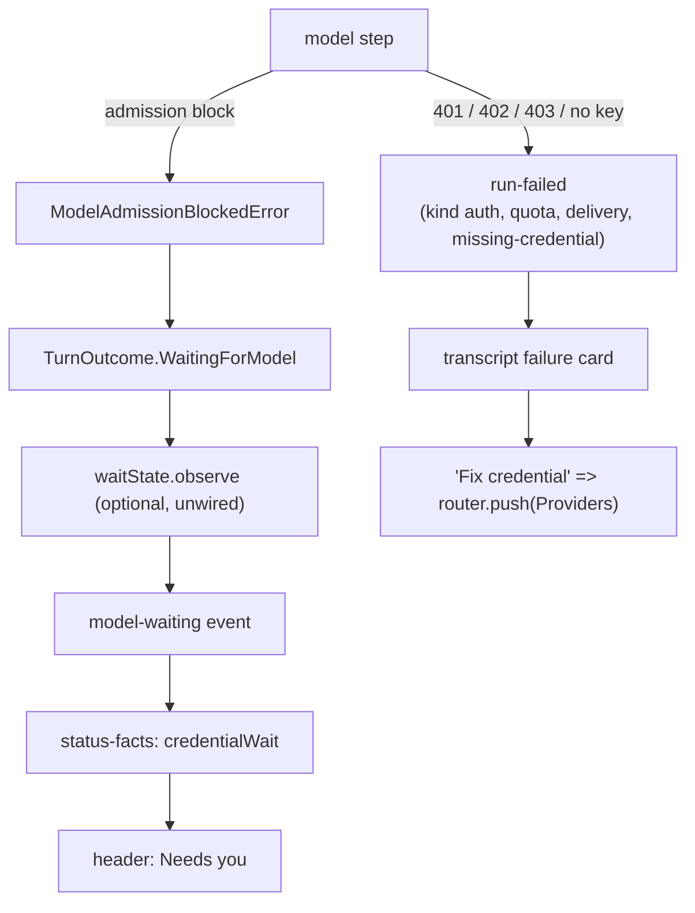

# Spec: credential repair inside the session (v2)

> **Approved by Dennis 2026-11-23.** (1) "Use <account>" switches the provider's active account everywhere, which is intended. (2) A sub-agent's credential failure is shown and repaired in the main session's transcript (proxied from the child), never in the sub-agent panel; after the repair the child retries. (3) No automatic resume when a quota resets; offer "Check again".

Status: **draft for Dennis**, 2026-11-23. Owner: `packages/core` (the repair fold),
`apps/api` (the wait observer), `apps/web` (the card). Anchors were read at `ee5fdfdef` in
`/atlas/workspaces/atlas`; re-check a line before you rely on it.

Prior art: `docs/research/credential-availability/README.md`
is marked "needs triage". Slices 1–3 and 4A merged in v1; 4B is built and parked on
`dennis/credential-availability-slice4b` for v2; 5 and 6 are spec only. This spec takes the
problem and the failure taxonomy from that stack, and rebuilds the repair the v2 way:
`docs/slices/operator-input.md` is the pattern for "the turn waits for the
operator and then resumes".

Both this spec and the classifier spec sit on `@dltech/atlas-credentials`, the package that
`docs/slices/classifier.md` §3 defines (built in #2576) (accounts row parsing, `chosenFor`, the OAuth login flows).
Where this spec says "the credentials package", it means that package.

---

## 1. Product contract

- **The session says what stopped it, where it stopped.** Not a toast, and not a settings page the
  operator has to find. One card in the transcript at the failing point, and the header badge.
- **The card names the cause.** The account label, the provider, the model, the reason
  (expired login, refused key, plan or credit limit, key not delivered), and the reset time when
  the provider stated one.
- **The operator repairs it in place.** Re-sign-in for a plan account, replace the key for an API
  key account, use another connected account, or switch model. The reason decides which actions
  appear. No action is offered that cannot work.
- **The turn continues after the repair, with no second message.** The same turn resumes from the
  failing model step. A tool call that already ran does not run a second time.
- **A repair changes one thing.** It never rewrites the default model and never pauses or disables
  another account. (One exception is a question for Dennis: see §8.1.)
- **No secret reaches the transcript.** The card shows labels and emails only. The key or token
  travels in one request body to the API, and nowhere else.
- **v1 stays as it is.**

**Exit criteria**
1. In a live v2 session whose Claude plan grant was revoked, the transcript shows a card that names
   the account and the reason, the header reads `Needs you`, and nothing spins.
2. Pressing `Re-sign in` runs the provider sign-in in a dialog. On success the card goes away and
   the same turn continues: no second user message, and no repeated tool call.
3. An API key that the provider refuses offers `Replace key`. The turn resumes the same way.
4. A second account on the same provider offers `Use <account>`, and the next step uses it.
5. A plan or credit limit offers the reset time and `Switch model`, and does not offer re-sign-in.
6. A session blocked at admission (`ESessionStatus.WaitingForCredentials`) draws the same card from
   the same fold. `model-wait-cleared` removes it.
7. Every event, tool result and transcript row stays free of the key and the token; a spec asserts
   it.

---

## 2. What exists today

### 2.1 v2: the parts are there, the join is not



| Part                            | Where it is                                                                                                                                                                                                                                                                      | What it does today                                                                                                        |
| ------------------------------- | -------------------------------------------------------------------------------------------------------------------------------------------------------------------------------------------------------------------------------------------------------------------------------- | ------------------------------------------------------------------------------------------------------------------------- |
| Failure classification          | `packages/core/src/models/provider-failure.ts:17-34`                                                                                                                                                                                                                             | `EProviderFailureKind`, `EProviderFailureScope`, `EProviderRetry` from one evidence shape                                 |
| Normalisation at the step       | `apps/api/src/agent/model/failure.ts` (`normalizeProviderFailure`)                                                                                                                                                                                                               | provider SDK error or `CredentialError` → one `NormalizedProviderFailure` with account provenance                         |
| Account on the failure          | `apps/api/src/agent/model/failure-account.ts:7-17`                                                                                                                                                                                                                               | `withFailureAccount` attaches `{accountId, providerId, modelId, authorizationDelivered}`                                  |
| A key the account lacks         | `apps/api/src/agent/model/provider-key.ts:12-21`                                                                                                                                                                                                                                 | `MissingKeyError`, with `authorizationDelivered: false`                                                                   |
| A refused OAuth grant           | `apps/api/src/agent/tokens/model-token-service.ts:110-146`                                                                                                                                                                                                                       | refresh, then `store.reject` + `markExpired` on the accounts that share the connection                                    |
| Admission of a chat model       | `apps/api/src/agent/model/provider-admission.ts:23-44` → `admittedModel`                                                                                                                                                                                                         | per `{accountId, providerId, modelId}` permit from `CredentialAvailabilityPort`                                           |
| Availability vocabulary         | `packages/core/src/credentials/credential-availability.ts:16-49`; port at `packages/core/src/ports/registry.ts:48`                                                                                                                                                               | `AvailabilityKey`, snapshots, permits, revision fence                                                                     |
| Live config read                | `apps/api/src/agent/model/live-model-port.ts:60-63`                                                                                                                                                                                                                              | `step()` refreshes `ModelConfig` **before every step**, so a repaired secret is used by the next attempt in the same hold |
| Which account serves a provider | `apps/api/src/agent/config/model-config.ts:60-95` (`configuredWith`), `packages/core/src/credentials/selection.ts:34-54` (`chooseAccount`)                                                                                                                                       | active account first, else the healthiest                                                                                 |
| Waiting status                  | `packages/core/src/record/views/status-types.ts:9`, `derive-status.ts:36-42`, `status-facts.ts:115-129`                                                                                                                                                                          | `WaitingForCredentials` folded from an open `model-waiting`                                                               |
| Waiting event                   | `packages/core/src/events/body.ts:304`, `schema.ts:290`                                                                                                                                                                                                                          | `model-waiting { waiting: WaitingForModel }`, cleared by `model-wait-cleared`                                             |
| Waiting producer                | `packages/agent/src/loop/waiting-outcome.ts` → `ModelWaitObserver.observe` (`packages/agent/src/loop/loop-ports.ts:5-9`)                                                                                                                                                         | **the observer is optional and no v2 process supplies one** (`packages/agent/src/loop/turn-deps.ts:53`)                   |
| Header badge                    | `apps/web/src/features/sessions/data/session-state.ts:14-23`; labels in `apps/web/src/features/threads/data/header-model.ts:8-22`                                                                                                                                                | `WaitingForCredentials` and `WaitingForOperator` → `Needs you`; badge variant `default` at `:32-38`                       |
| Transcript card                 | `apps/web/src/features/threads/transcript/run-failure-card.tsx:11-33`; filled by `apps/web/src/features/sessions/data/session-run-attention.ts:70-100`                                                                                                                           | title, detail, meta, actions                                                                                              |
| Remedies                        | `packages/core/src/events/run-failure.ts:108-141`                                                                                                                                                                                                                                | auth/quota/missing → `FixCredential`, `Retry`, `SwitchModel`                                                              |
| The only repair today           | `apps/web/src/features/sessions/data/use-session-run-failure.ts:31`                                                                                                                                                                                                              | `router.push(PROVIDERS_HREF)` — the session is left behind and the turn stays failed                                      |
| Repair mutations                | `apps/api/src/api/platform/accounts/accounts.router.ts:59-84` (`replaceSecret`, `setStatus`), `:26-84` (`list`, `create`, `setActive`, `active`, `get`, `remove`); `apps/api/src/api/platform/provider-sign-in/provider-sign-in.service.ts:87-146` (`begin`, `complete`, `poll`) | used by the settings pages today                                                                                          |
| The browser half of sign-in     | `apps/web/src/features/settings/data/personal/use-provider-sign-in.ts:53-60`; `data/personal/accounts-api.ts:36-113`                                                                                                                                                             | a poll loop, a code dialog, key create/replace/activate                                                                   |
| Resume without a message        | `apps/api/src/api/platform/control/sessions.service.ts:479-482` posts `INBOX_KIND_RETRY`; `packages/host/src/holder/intake-entries.ts:44-46` consumes it                                                                                                                         | wake the turn from the log; no user message is appended                                                                   |

**So the gap is exact.** The session can _detect_ every kind of dead credential, and it can _name_
the account. It cannot record a wait (the observer is unwired), it cannot repair (the one action
leaves the session), and it cannot resume (nothing posts a retry).

### 2.2 v1: what was built, and what to keep

| v1 slice                                     | State                                                              | What this spec takes                                                     |
| -------------------------------------------- | ------------------------------------------------------------------ | ------------------------------------------------------------------------ |
| 1 failure classification and bounded retries | merged #1628                                                       | the taxonomy, and that quota/auth are hard stops                         |
| 2 runtime admission gate                     | merged #1633                                                       | `CredentialAvailabilityPort`, `admittedModel` (already in v2)            |
| 3 durable cross-runtime authority            | merged #1638                                                       | the revision fence: an old rejection cannot block a replacement key      |
| 4A truthful waiting                          | merged #1644                                                       | the `WaitingForModel` record and the waiting status (already in v2 core) |
| 4B recheck/pause controls, waiting card      | built, not merged, branch `dennis/credential-availability-slice4b` | the card's copy and the "one issue per account" idea (§2.3)              |
| 5 explicit recovery                          | spec only                                                          | `Switch model` as an explicit, finite action — not automatic fallback    |
| 6 approved fallback                          | spec only                                                          | nothing: out of scope                                                    |

The research stack's own questions (README, "Questions for triage") are answered here:
1. _Where does the barrier live?_ It already lives in the control plane: `admittedModel` asks the
   host's `CredentialAvailabilityPort` before the request (`provider-admission.ts:23-44`). This
   spec does not touch it.
2. _Is waiting a view?_ Yes. `model-waiting` folds into the session status
   (`status-facts.ts:115-129`). There is no `Thread` column.
3. _Are the controls inbox commands?_ No. A repair is an ordinary accounts or sign-in mutation plus
   the `retry` inbox entry. No new inbox kind, no new command.
4. _Slices 5 and 6?_ Only the narrow part of 5 that one session needs: use another account, or
   another model. No family fan-out, no bulk account recovery, no automatic fallback.
5. _Slice 1 for free?_ Yes — the loop already normalises and stops.
6. _The account-wide pause?_ Out of scope (§9). This spec never pauses an account.

### 2.3 One discrepancy with the brief

The brief names `NotConnectedAlert` in `apps/web/src/features/threads/composer-footer.tsx:46`. In
this checkout line 46 renders `NotConfiguredAlert`, which is the sandbox start failure
(`apps/web/src/features/threads/not-configured-alert.tsx:8-19`), and no `NotConnectedAlert` exists
anywhere in the tree or in the reachable history of `apps/web/src/features`. The v1
credential-availability card that the brief means is the model-wait card of slice 4B
(`research/credential-availability/sections/04-waiting-and-controls.md` §"UI"). **Interpretation
used below:** the v1 card was a dock above the composer; v2 has a failure row in the transcript
(`thread-transcript.tsx:150-153`), so the detail lives there and the composer gets one line (§4.3).

---

## 3. The record: one repair episode, folded from the log

No table, no new event kind, no second status column. The log already holds both ways a session
stops for a credential: a `run-failed` whose failure carries the account, and an open
`model-waiting`. The repair is a fold over what is there.

```ts
// packages/core/src/repair/repair-episode.ts
export enum ERepairAction {
  ReSignIn = 're-sign-in',
  ReplaceKey = 'replace-key',
  SwapAccount = 'swap-account',
  SwapModel = 'swap-model',
  CheckAgain = 'check-again',
}

export type CredentialRepair = {
  threadId: ThreadId
  source: 'failure' | 'waiting'
  providerId: string
  modelId: string | null
  accountId: AccountId | null
  kind: ERunFailureKind
  reason: EProviderFailureKind | null
  resetAt: string | null
  since: string
}

export function credentialRepairOf(args: {
  threadId: ThreadId
  events: readonly V2Event[]
}): CredentialRepair | null

export function repairActionsOf(args: {
  repair: CredentialRepair
  accountKind: EAuthKind | null
  otherAccountsOfProvider: number
}): readonly ERepairAction[]
```

**Fold rules.**
- `source: 'failure'` — the last `run-failed` whose `failure.kind` is `Auth`, `Quota`,
  `MissingCredential` or `Delivery`, in the same thread.
- `source: 'waiting'` — an open `model-waiting` (`projectWaiting`,
  `packages/core/src/model-recovery/waiting-projector.ts:47`), when it is later than that failure.
- Cleared by the next `turn-started`, `user-said`, `model-wait-cleared` or `session-stopped`. A
  repair that worked therefore removes its own card on the resume.
- `accountId` comes from `failure.accountId` and is `null` when the request never carried
  authorization (`authorizationDelivered: false`, `provider-key.ts:12-21`) or when the failure
  predates provenance.
- The fold reads no clock and holds no state, so two clients, a reload and a rewind agree.

**Action rules** (pure, in the same file, tested with plain data):

| Condition                                                                   | Action                         |
| --------------------------------------------------------------------------- | ------------------------------ |
| account kind `oauth`, kind `Auth` or `Delivery`                             | `ReSignIn`                     |
| account kind `api-key`                                                      | `ReplaceKey`                   |
| `accountId === null` (no key was ever delivered) and the account is api-key | `ReplaceKey` (creates the key) |
| `otherAccountsOfProvider > 0`                                               | `SwapAccount`                  |
| kind `Auth`, `Quota` or `MissingCredential`                                 | `SwapModel`                    |
| `resetAt !== null`                                                          | `CheckAgain`                   |
| always, when the reason is not a limit                                      | nothing else                   |

A quota failure never offers `ReSignIn`: the login is fine and the plan is spent.

---

## 4. Design

### 4.1 What the session shows

- **Transcript.** The existing failure card stays the detail surface for `source: 'failure'`. For
  `source: 'waiting'` there is no failure row, so the transcript draws one extra row
  (`threads/transcript/repair-card.tsx`) after the last row, from the fold. Both use the same
  presentational component, so the two sources cannot drift.
- **Header.** No new layout. `Needs you` already covers both states
  (`session-state.ts:14-23`). The card carries the detail.
- **Composer.** One line above the composer, from `@dltech/atlas-ui/ai/run-attention-strip`
  (`packages/ui/src/ai/run-attention-strip.tsx`, already used by the run attention dock): the
  account label and the primary action. It is the pointer, not the explanation. Mounted beside
  `OperatorRequestDock` in `apps/web/src/features/sessions/session-view.tsx:288`, so the two docks
  share one place and one order.

```
┌─ transcript ─────────────────────────────────────────────┐
│ … tool results, thinking …                              │
│ ┌─────────────────────────────────────────────────────┐ │
│ │ ⚠ Atlas could not call Claude Opus 5.5              │ │
│ │   Anthropic · dennis@byatlas.io · login expired     │ │
│ │   [Re-sign in] [Use work@byatlas.io] [Switch model] │ │
│ └─────────────────────────────────────────────────────┘ │
└─────────────────────────────────────────────────────────┘
  ⚠ Claude login expired · [Re-sign in]        ← composer strip
```

### 4.2 What each action does

| Action          | Shown when                              | Calls                                                                                                                                                                   | Then                                                                                                                                    |
| --------------- | --------------------------------------- | ----------------------------------------------------------------------------------------------------------------------------------------------------------------------- | --------------------------------------------------------------------------------------------------------------------------------------- |
| `Re-sign in`    | oauth account, `Auth`/`Delivery`        | `useProviderSignIn` (`use-provider-sign-in.ts:53-60`) in a dialog inside the session view → `providerSignIn.begin/complete/poll` (`provider-sign-in.service.ts:87-146`) | sign-in writes a new connection and bumps the account secret (`replaceOrAdd`, `:212-258`); the dialog reports success; the card resumes |
| `Replace key`   | api-key account                         | one masked field → `api.accounts.create` when the account has no key, else `api.accounts.replaceSecret` (`accounts-api.ts:71-92`)                                       | `secretVersion` increments (`accounts.service.ts:208`), so the old rejection is fenced out (`credential-availability.ts:16-31`)         |
| `Use <account>` | a second account exists on the provider | `api.accounts.setActive` (`accounts-api.ts:46-56`)                                                                                                                      | the next `ModelConfig` read resolves that account (`model-config.ts:69-75`)                                                             |
| `Switch model`  | `Auth`, `Quota`, `MissingCredential`    | the existing session model picker (`use-session-model-choice.ts`)                                                                                                       | the next step uses the new provider and rebuilt context                                                                                 |
| `Check again`   | `resetAt !== null`                      | `api.retry` only                                                                                                                                                        | the provider is asked once, with its own reset time as the reason to try                                                                |

**Resume.** Every action that changes a credential ends with one `api.retry`
(`sessions.service.ts:479-482`), which posts `retry` and wakes the turn from the log
(`intake-entries.ts:44-46`). `retry` is not a message: no `user-said` is appended, and
`settleablePendingOf` leaves completed calls alone (`docs/slices/operator-input.md` §2, "A
parked call is never re-run"). The browser runs the sequence:

```
mutation (repair) → await ok → retry → card clears on `turn-started`
```

Two calls, not one new endpoint: both mutations are shipped and tested, and a second endpoint that
wraps them would have to duplicate their authorization. The cost is honest and small: if the tab
closes between them, the account is repaired and the turn is still failed, so the operator presses
`Retry`, which the card already offers.

### 4.3 Wiring: who reads what

- `use-credential-repair.ts` (new, `apps/web/src/features/sessions/data/`) — folds
  `credentialRepairOf` from the transcript events, reads the accounts (`fetchAccounts`) for the
  kind and the other accounts, and returns `{repair, actions, primary}`.
- The card (`threads/transcript/repair-card.tsx`) renders from that and calls back with the chosen
  action. Dialogs: `repair-sign-in-dialog.tsx` and `repair-key-field.tsx`, both inside the session
  feature so they need no navigation.
- `sessionFailureCardOf` (`session-run-attention.ts:84`) stops offering `FixCredential` as a
  navigation. `run-attention-actions.ts:35` maps that remedy to the repair handler instead of
  `router.push`. `PROVIDERS_HREF` stays as the secondary path for a provider with no account at
  all.
- The waiting side needs the observer: a `ModelWaitObserver` in
  `apps/api/src/agent/runtime/model-wait-observer.ts`, appended through the record port as
  `model-waiting` / `model-wait-cleared`, wired where the turn deps are built
  (`packages/agent/src/loop/turn-deps.ts:53` currently receives nothing). It journals the waiting
  record from `waitingOfBlock` (`packages/agent/src/model/waiting-of-block.ts:12-33`) and clears it
  on the next admitted step. `blocked(threadId)` answers from the record it just wrote, so a turn
  does not hammer a blocked key.

### 4.4 Multi-account and the account label

- The card names `repair.accountId` when present. The label comes from the accounts list
  (`useAccountLabel`, `apps/web/src/features/threads/data/use-account-label.ts`).
- `Use <account>` is offered for every other account of that provider that is not expired and not
  paused. It is a **global** switch: `setActive` is per provider, not per session
  (`accounts-api.ts:46-56`). The button says so in one line: "New sessions will use it too."
- An account that `ModelTokenService` expired (`markExpired`, `model-token-service.ts:137-146`) is
  still listed, marked `expired`, and offered for **re-sign-in first**, not as a swap target.

### 4.5 What must never appear

The card, the strip, the dialog error text, any `V2Event`, any tool result and the model's context
carry the account label, the email, the provider, the model and the failure sentence. They never
carry an access token, a refresh token, an API key, a code, or the sealed secret. The key field is
`type="password"` and its value lives in one request body. A spec asserts that no `run-failed`,
`model-waiting` or repair row contains a token-shaped string.

---

## 5. Slices

> **Revised 2026-11-23 while building.** §10 supersedes this table: it adds the sub-agent proxy (approval note 2) and moves the wait observer to `packages/host`. Slice 1 is PR #2612.

Four PRs. Slice 1 is pure and unblocks the rest. Slices 2 and 3 are disjoint by file. Slice 4 is the
small end-to-end proof.

| #   | Title                                                       | Contents                                                                                         | Files                                                                                                                                                                                                                                                                                                                                                                                                                                                                                                                                                                                                  |
| --- | ----------------------------------------------------------- | ------------------------------------------------------------------------------------------------ | ------------------------------------------------------------------------------------------------------------------------------------------------------------------------------------------------------------------------------------------------------------------------------------------------------------------------------------------------------------------------------------------------------------------------------------------------------------------------------------------------------------------------------------------------------------------------------------------------------ |
| 1   | `feat(repair): fold a credential repair from a session log` | `credentialRepairOf`, `repairActionsOf`, enums, specs. No surface reads it yet.                  | new `packages/core/src/repair/{repair-episode.ts,index.ts,__tests__/repair-episode.spec.ts}`, `packages/core/src/index.ts`, `packages/core/README.md`                                                                                                                                                                                                                                                                                                                                                                                                                                                  |
| 2   | `feat(api): record a model wait when a key is blocked`      | the observer and its wiring; the waiting record that `status-facts.ts:115-129` already folds     | new `apps/api/src/agent/runtime/model-wait-observer.ts` + spec, `apps/api/src/agent/runtime/session-runtime-factory.ts` (turn deps), `apps/api/src/api/.../sessions` only if the observer needs the record port it already has                                                                                                                                                                                                                                                                                                                                                                         |
| 3   | `fix(web): repair a dead credential from the session`       | the card, the strip, the two dialogs, `use-credential-repair`, the `FixCredential` handler, copy | new `apps/web/src/features/threads/transcript/repair-card.tsx`, `apps/web/src/features/sessions/data/use-credential-repair.ts`, `apps/web/src/features/sessions/repair-key-dialog.tsx`, `apps/web/src/features/sessions/repair-sign-in-dialog.tsx` + specs; edits `apps/web/src/features/sessions/data/use-session-run-failure.ts:31`, `apps/web/src/features/sessions/data/session-run-attention.ts:70-100`, `apps/web/src/features/threads/data/run-attention-actions.ts:10-40`, `apps/web/src/features/threads/thread-transcript.tsx:80-153`, `apps/web/src/features/sessions/session-view.tsx:288` |
| 4   | `test(repair): prove the resume keeps one turn`             | the end-to-end spec of §6, plus the copy spec                                                    | `apps/web/src/features/sessions/__tests__/credential-repair.spec.tsx`, `packages/host/src/holder/__tests__/retry-resume.spec.ts`                                                                                                                                                                                                                                                                                                                                                                                                                                                                       |

Integration owner: **slice 3**, because it is the only one that joins the other two. Slice 1 must
merge first; slices 2 and 3 may merge in either order, but the waiting card only appears once both
are in.

---

## 6. Test plan

**Slice 1 — `packages/core/src/repair/__tests__/repair-episode.spec.ts`**
- a `run-failed` of kind `Auth` with an account id folds to `{source: 'failure', kind: 'auth'}`;
- `Quota`, `MissingCredential`, `Delivery` also fold; `Network`, `RateLimited`, `Overloaded`,
  `ContextOverflow`, `Other` do not;
- a later `turn-started`, `user-said`, `model-wait-cleared` and `session-stopped` each clear it;
- a `model-waiting` later than a failure wins, and `source` is `waiting`; a legacy
  `operator-input-asked` pair draws nothing (the same rule as `parked-calls.ts`);
- a failure with no `accountId` still folds, with `accountId: null`;
- `repairActionsOf`: oauth+auth → `ReSignIn`, `SwapModel`; api-key+auth → `ReplaceKey`,
  `SwapModel`; api-key with a second account → also `SwapAccount`; quota with `resetAt` →
  `SwapModel`, `CheckAgain` and never `ReSignIn`; a refused key with no account kind → only
  `SwapModel`.

**Slice 2 — `apps/api/src/agent/runtime/__tests__/model-wait-observer.spec.ts`**
- a blocked step appends exactly one `model-waiting` with the key, the generation, the provider and
  the reason, and a second blocked step appends nothing new;
- the first admitted step appends one `model-wait-cleared`;
- the observer never throws into the turn: a failed append is logged and the turn keeps its
  outcome (the same rule as `onReadFailure`, `model-port.ts:57-64`);
- two turns of the same thread do not double-append.

**Slice 3 — web**
- `__tests__/credential-repair.spec.tsx`: the card shows the account label, provider and model; a
  `waiting` source with no failure row draws the extra transcript row; the actions are exactly
  `repairActionsOf` says; `Re-sign in` opens the dialog and does not navigate; `Replace key`
  submits one masked value to `accounts.replaceSecret` and never to a route of its own; `Use
  <account>` calls `setActive` once and shows the "new sessions" line; `Switch model` opens the
  existing picker; every successful action is followed by exactly one `api.retry`, and a failed
  action is followed by none; the strip shows the primary action and nothing when the repair is
  cleared;
- `__tests__/session-run-attention.spec.tsx` (existing): `FixCredential` calls the repair handler,
  not `router.push`.

**Slice 4**
- `packages/host/src/holder/__tests__/retry-resume.spec.ts`: after a `run-failed` of kind `Auth`,
  one `retry` entry wakes the turn; a `tool-result` that had already been appended is not
  re-dispatched; a `retry` on a session with nothing to settle does nothing and appends no
  `user-said`;
- `credential-repair.spec.tsx` (extended): the sequence mutation → retry → `turn-started` clears
  the card, with no second `user-said` in the events.

**Commands.** `bun test` in `packages/core`, `packages/agent`, `packages/host`, `apps/api`,
`apps/web`; `turbo run typecheck`; `bunx biome check --write` on the touched files. Run
`packages/host` and `apps/api` from their own directories so the `bunfig.toml` preload applies.

---

## 7. Live check

With a Claude plan connection in a v2 session:
1. Revoke the app's access at the provider (or replace the account secret out of band so the stored
   grant is dead), then send a message. The transcript shows the repair card naming the account and
   "login expired"; the header reads `Needs you`; the session is not `running`.
2. Press `Re-sign in`, finish the flow, and confirm: one new `model-wait-cleared` or `turn-started`,
   the same turn continues, no second `user-said` appears, and the tool call before the failure has
   one result, not two.
3. Repeat with an OpenAI API key set to a revoked key: `Replace key` resumes the turn the same way.
4. With a second Anthropic account connected: `Use <account>` appears and the next step's
   `model-resolve` span names the other account.
5. Force a plan limit (or use an account already at its limit): the card offers the reset time and
   `Switch model`, and offers no re-sign-in.
6. Search the session's events and the whole transcript for the token and the key: no match.

---

## 8. Questions for Dennis

> **Answered 2026-11-23** by the approval note at the top: (1) yes, global; (2) yes, but in the main transcript, proxied from the child, and the child retries; (3) no, offer `Check again`.
1. **Is a global account switch acceptable for `Use <account>`?** Recommended: **yes**. Accounts are
   chosen per provider (`setActive`), so a session-scoped account pin is a new setting on the
   session. The card says "New sessions will use it too." Cost: one extra sentence, and an
   operator who wanted one session to switch changes the default for a while.
2. **Should the repair also appear for a failing sub-agent, in the parent's crew panel?**
   Recommended: **no, not in this slice**. The parent's own card is the common case; a per-child
   repair needs its own ownership rule and a second surface. Cost: a child that dies on a dead key
   shows only its ending reason until the parent's card appears.
3. **After a quota reset time passes, should the session resume by itself?** Recommended: **no**. A
   request the account may still refuse is the retry storm v1 slice 1 removed. The card offers
   `Check again`, and the operator presses it. Cost: a session can sit until the operator looks.

---

## 9. Out of scope

- v1 sessions, the TUI, serve and the Mac/mobile surfaces beyond the shared web components.
- Slice 4B's Pause, Remove pause and the probe lease; slice 5's family-wide "continue with another
  model" and per-child retarget; slice 6's approved automatic fallback.
- Account-wide blocking or pausing, and any change to `CredentialAvailabilityPort` or the barrier.
- A repair that runs from a sub-agent's own turn, and any `operator_input` reuse: a repair is the
  operator's action on a stopped session, not a tool the model calls.
- Provider deep links to a top-up page beyond the copy sentence.
- Rewinding or restarting the turn. The repair continues the same turn from its log.

---

## 10. Build slices (revised 2026-11-23)

### Decisions taken while building

- Child credential failure is proxied: child `agent-ended` gains optional `failure: RunFailure`; the fold reads it from the main thread. Reason: web main transcript only sees main-thread events (session-view.tsx:68-118); child run-failed lives in the child thread.
- Child model-waiting is written on the parent thread (affectedThreadIds=[childId]). Reason: same visibility; projectWaiting already merges affectedThreadIds.
- Child retry = existing `retry` inbox kind (main-thread only) with payload `{agentId}`; host restarts the child via crew, never starts a main turn. Reason: no new inbox kind; retry stays MAIN_THREAD_ONLY (packages/control/src/inbox-ops.ts:15-22).
- Observer lives in packages/host (held-runner.ts / child-runner.ts build the LoopTurnRunner), not apps/api/src/agent/runtime as the spec says. Spec deviation; update spec.
- SwapModel is not offered for a child repair: the session model picker does not change a child's model.
- Four+ PRs per spec §5 (parent asked for PR URLs, plural).
- ReplaceKey is not offered for a Quota failure: a new key does not lift a plan or credit limit (deviation from spec §3 table).

### Order

Slice 1 (core fold, `agent-ended.failure`, `retry.agentId`) merges first. Slices 2, 3 and 4 touch disjoint files and may merge in any order; slice 4 owns integration. The child card appears once 2 and 4 are in; the child resume once 3 is in.

### Slice 2 — host: record a model wait, and carry a sub-agent's credential failure to the main thread

PR title: `feat(host): record a model wait and proxy a sub-agent credential failure`.

#### Goal

1. The loop's optional `waitState` observer (`packages/agent/src/loop/turn-deps.ts:53`, type `ModelWaitObserver` at `packages/agent/src/loop/loop-ports.ts:5-9`) is supplied by both v2 runners, so an admission block appends `model-waiting` and the next admitted step appends `model-wait-cleared`.
2. A sub-agent's wait is written on the PARENT (main) thread, so the main transcript sees it.
3. A failed sub-agent's `agent-ended` notice carries the structured `failure: RunFailure` (field added in slice 1, `packages/core/src/events/agent-body.ts`).

Spec deviation (logged): the spec put the observer in `apps/api/src/agent/runtime`; the runners are built in `packages/host`, so it lives there.

#### Context

- Producer calls: `packages/agent/src/loop/waiting-outcome.ts:8-23` (`observe` on a blocked step, waiting built by `waitingOfBlock`, `packages/agent/src/model/waiting-of-block.ts:12-33`, `affectedThreadIds: [threadId]`); `packages/agent/src/loop/tracked-turn.ts:260` (`admitted` after every admitted step — it is hot: must be cheap and must append nothing when no wait is open).
- `blocked(threadId)` is read at `packages/agent/src/intake/intake-wake-scheduler.ts:232,254` (check what it gates).
- Main runner: `createLoopRunner` in `packages/host/src/holder/held-runner.ts:160-241` (`new LoopTurnRunner({...})` at ~:208). `record: SessionRecord`, `threadId`, `deps.ids.nextRunId()`, `deps.log` in scope.
- Child runner: `childRunnerOf` in `packages/host/src/holder/crew/child-runner.ts:28-113`; has `record` (child), `parentRecord`, `agentId`; parent thread id is in `ChildRunArgs.parentThreadId` (`crew/child-record.ts:22`, passed at `crew/child-run.ts:78`) — thread it into `childRunnerOf` args.
- Record API: `SessionRecord.append({threadId, runId, drafts})` (port `packages/agent/src/record/agent-record.port.ts:3-11`), `eventCache()` (`packages/host/src/holder/record/record-adapter.ts:101`). Open waits: `projectWaiting(events)` from `@dltech/atlas-core` (`packages/core/src/model-recovery/waiting-projector.ts:47`), group key `waitEpisodeGroupKey`.
- Child ending: `ChildRun.settle(outcome)` `packages/host/src/holder/crew/child-run.ts:305-312` → `end()` :325-336 → `ChildTranscript.ended` `crew/child-transcript.ts:100-121`. `failureOf(outcome)` `crew/child-progress.ts:63-64`. A failed `TurnOutcome` carries `failure?: RunFailure` (`packages/agent/src/loop/turn-outcome.ts:22-28`; filled at `packages/agent/src/loop/run-turn.ts:225-235`).
- Never log or append a secret: the waiting record holds ids, provider, model, reason only.

#### Changes

1. New `packages/host/src/holder/model-wait-observer.ts`:

   ```ts
   export const modelWaitObserverOf = (args: {
     record: SessionRecord          // the record that owns the thread the card is drawn on
     threadId: ThreadId             // the thread the events are appended to (main thread id; for a child, the PARENT thread id)
     newRunId: () => RunId
     log?: LogPort | undefined
   }): ModelWaitObserver
   ```

   - `observe({threadId: waitingThread, waiting})`: read open waits from `record.eventCache()` events of `args.threadId` (use the cache method that returns the thread's visible events; check `RecordCache`); if an open wait with the same `waitEpisodeGroupKey` and generation ≥ already lists `waitingThread`, append nothing; else append `{type:'model-waiting', waiting}`.
   - `admitted({threadId: waitingThread})`: for each open wait whose `affectedThreadIds` includes `waitingThread`, append `{type:'model-wait-cleared', episode, cause}`. No open wait → no append, no await of IO beyond the in-memory cache.
   - `blocked({threadId})`: true when an open credential wait lists that thread (from the cache, synchronous).
   - Every append is wrapped: a thrown append is logged (`log?.error({source:'holder.model-wait', ...})`) and swallowed; the turn keeps its outcome.
   - No in-memory state: answers come from the record (hosts are stateless; see decisions).
2. `held-runner.ts`: pass `waitState: modelWaitObserverOf({record, threadId, newRunId: () => deps.ids.nextRunId(), log: deps.log})` to `new LoopTurnRunner`.
3. `child-runner.ts`: pass `waitState: modelWaitObserverOf({record: args.parentRecord, threadId: args.parentThreadId, ...})`. Add `parentThreadId` to the args and to the call site in `child-run.ts`.
4. Child failure on the ending: in `child-progress.ts` add `runFailureOf(outcome): RunFailure | undefined` (the failed outcome's `failure`). `ChildRun.settle` passes it to `end`, `end` to `ChildTranscript.ended({..., runFailure})`, which adds `failure: runFailure` and `failureKind: runFailure.kind` to the `agent-ended` draft when defined. Keep `failureCause` as is. Keep `child-run.ts` ≤ 342 lines (it is already over 300; do not grow it by more than a few lines — move a helper out if needed).

#### Tests (packages/host, `__tests__/` beside the code; copy the rig style of `crew-child-notice.spec.ts` / `holder-rig.ts`)

- `model-wait-observer.spec.ts` (unit, fake/real record from the rig): a blocked step appends exactly one `model-waiting`; a second observe of the same episode appends nothing; the first `admitted` appends one `model-wait-cleared`, a second appends nothing; `blocked` is true between them; a throwing append is logged and does not throw; a child wait lands on the parent thread with `affectedThreadIds: [childId]`.
- a crew spec: a child whose model step fails with an auth `RunFailure` posts `agent-ended` on the parent with `failure.kind === 'auth'` and the accountId; then `credentialRepairOf({mainThreadId, events})` on the parent events returns `main: false` with that agent.
- Assert no token-shaped string (e.g. `sk-`, `Bearer`) appears in any appended event JSON.

#### Validation

```
cd packages/host && bun test src/holder
cd packages/host && bunx tsc --noEmit -p .
cd packages/agent && bun test src/loop && bunx tsc --noEmit -p .
bunx biome check --write <touched files>
```
Commit `feat(host): record a model wait and proxy a sub-agent credential failure`. Do not push.

### Slice 3 — api + host: retry a sub-agent, and prove the resume keeps one turn

PR title: `feat(api): retry a sub-agent after a credential repair`.

#### Goal

After a repair, the web posts `retry`. Today `retry` is session-scoped and resumes only the main thread. Add an optional `agentId`: a retry with `agentId` restarts that sub-agent's failed turn from its log (no message, no rerun of completed calls) and does NOT start a main-thread turn. Plus the proofs: retry-resume spec and a describeHandoff fault scenario.

#### Context

- Protocol: `packages/protocol/src/api.ts:341-343` `sessionRetryInputSchema = z.strictObject({ sessionId })`. Add `agentId: z.string().min(1).optional()`. Generated router `packages/api-router/src/generated/server.ts:670` uses the schema (regenerate if it is generated in the build graph; do not commit generated output that is gitignored — check `git status`).
- Router `apps/api/src/api/platform/control/sessions.router.ts:211-217`; service `apps/api/src/api/platform/control/sessions.service.ts:481-484` posts `{kind: INBOX_KIND_RETRY, payload: '{}'}`. Validate the agent belongs to the session with the pattern of `threadOf` at `sessions.service.ts:414-424` (NotFound otherwise). Payload becomes `JSON.stringify({agentId})` when given.
- Retry is main-thread-only (`packages/control/src/inbox-ops.ts:15-22`): keep posting it with no threadId.
- Host consumption: `packages/host/src/holder/intake-entries.ts:45-47` consumes retry quietly. The wake comes from the entry counting as pending in `held-snapshot.ts:88-91` (`messagePending`) → `decideHeldAction` (`packages/core/src/execution/held-session-decision.ts:39`) → StartTurn with `resume = isResumableOf(...)`.
- Child restart without a message: `ChildRun.continueTurn()` `packages/host/src/holder/crew/child-run.ts:153-157` (restarts a settled child when its loop state is resumable). `CrewRoom` `packages/host/src/holder/crew/crew-room.ts` has `runOrUndefined(agentId)` :130-134 which reopens a settled child.
- Fault suite: `describeHandoff` in `apps/api/src/agent/testing/handoff-suite.ts` (find it: `grep -rn "export const describeHandoff" apps/api/src`), examples `apps/api/src/agent/__tests__/faults/handoff-wake.fault.spec.ts`, `handoff-turn-boundaries.fault.spec.ts`. Read how scripts make a model step fail (grep the fault rig for `fail`/`error`/`status` in scripts).

#### Changes

1. Protocol field is ALREADY added on the base commit (06f2062d9, `packages/protocol/src/api.ts:341-344`). Do the service/router pass-through.
2. Host: a retry entry whose payload parses to `{agentId}` is handled by the crew: `CrewRoom.retry({agentId})` → `runOrUndefined` → `continueTurn()`; consumed quietly; it must not make the main thread start a turn (adjust `held-snapshot.ts` / `held-inbox.ts` so a child retry entry is not `messagePending` for the main thread, and is consumed/dispatched on the next tick — find the cleanest place, e.g. where operator answers are handled before the decision). A payload with no agentId behaves exactly as today. An unknown agentId is consumed quietly and logged.
3. Keep every touched file ≤300 lines (child-run.ts is already 342 — do not grow it).

#### Tests

- `packages/host/src/holder/__tests__/retry-resume.spec.ts`: after a main `run-failed` of kind auth, one `retry` entry wakes the turn; a `tool-result` appended before the failure is not re-dispatched; a retry with nothing to settle appends no `user-said`.
- same file or `crew-child-retry.spec.ts`: a child that failed with auth; `retry {agentId}` restarts that child (agent-restarted on parent, child steps again), appends no `user-said` anywhere, and starts no main-thread `turn-started`.
- api: service spec for `retry` with an agentId of another session → NotFound; with own agentId → payload carries it.
- Fault: `apps/api/src/agent/__tests__/faults/handoff-credential-retry.fault.spec.ts` with `describeHandoff`: the model's first step fails with an auth error after a bash call ran; the host drains / is SIGKILLed / the pod restarts (the suite runs the variants); then post `retry`; the turn completes exactly once and the bash call ran exactly once. If the rig cannot script a model failure, add the smallest script hook to the rig and say so.

#### Validation

```
cd packages/protocol && bun test && bunx tsc --noEmit -p .
cd packages/host && bun test src/holder && bunx tsc --noEmit -p .
cd apps/api && bun test src/api/platform/control src/agent/__tests__/faults/handoff-credential-retry.fault.spec.ts && bunx tsc --noEmit -p .
bunx biome check --write <touched files>
```
Commit `feat(api): retry a sub-agent after a credential repair`. Do not push.

### Slice 4 — web: repair a dead credential from the session (integration owner)

PR title: `feat(web): repair a dead credential from the session`.

#### Goal

The main transcript shows one repair card built from `credentialRepairOf` (slice 1, `packages/core/src/repair/repair-episode.ts`), for the main thread and for proxied sub-agents. The operator repairs in place (sign-in dialog, key field, use another account, switch model, check again). Every successful repair ends with exactly one retry: `api.retry({sessionId})` when `repair.main`, plus one `api.retry({sessionId, agentId})` per `repair.agents` entry. A failed repair posts no retry. The sub-agent panel never shows the repair (`apps/web/src/features/sessions/agents/session-agent-panel.tsx:152-160` already passes `failureCard={null}` — keep it).

#### Context (anchors read at 06f2062d9)

- Fold API: `credentialRepairOf({mainThreadId, events})`, `repairActionsOf({repair, accountKind, otherAccountsOfProvider})`, `ERepairAction`, `ERepairSource`, `CredentialRepair {source, providerId, modelId, accountId, kind, reason, resetAt, since, seq, main, agents}` from `@dltech/atlas-core`.
- Session view: `apps/web/src/features/sessions/session-view.tsx` — events `snapshot.events`; `mainThreadId` at :148 (`listed?.mainThreadId`); model picker `choice = useSessionModelChoice(...)` :211-214, `choice.setOpen(true)`; `useSessionRunFailure(...)` :222-228; `<ThreadTranscript failureCard={failure.card} .../>` :296-310; `<OperatorRequestDock .../>` :314 (mount the composer strip next to it).
- Failure card today: `apps/web/src/features/sessions/data/use-session-run-failure.ts:14-45` — `handleFixCredential = () => router.push(PROVIDERS_HREF)` at :31. `sessionFailureCardOf` `apps/web/src/features/sessions/data/session-run-attention.ts:78-110`. Remedy labels/handlers `apps/web/src/features/threads/data/run-attention-actions.ts:7-45` (FixCredential label 'Update key').
- Client attention fold (do not change semantics, read only): `packages/client/src/transcript/run-attention.ts:55-157` — a failed sub-agent `agent-ended` already yields an `AgentFailed` card with `OpenAgent`.
- Card component: `apps/web/src/features/threads/transcript/run-failure-card.tsx:8-50` (`RunFailureCardProps {title, detail, meta?, actions?, onDismiss?}`); rendered at `apps/web/src/features/threads/thread-transcript.tsx:80,95,159-161`.
- Strip: `packages/ui/src/ai/run-attention-strip.tsx:5-40` (`RunAttentionStrip {title, detail, meta?, actions, onDismiss?, busyReason?}`).
- Accounts: `apps/web/src/features/settings/data/personal/accounts-api.ts` — `fetchAccounts()` :36, `Account {id, provider, kind, label, status, email?, ...}` :23-33, `activateAccount({provider: EProviderId, accountId})` :46-56, `createApiKeyAccount({provider, apiKey})` :71-82, `replaceApiKey({accountId, apiKey})` :84-91, `AUTH_PROVIDER_OF` :14-21, `EAccountKind` :9-12. `useAccountLabel` `apps/web/src/features/threads/data/use-account-label.ts:8-15` (query key 'failure-accounts' via `useCloudQuery`).
- Sign-in: `useProviderSignIn({provider: EOauthProvider, onChanged})` `apps/web/src/features/settings/data/personal/use-provider-sign-in.ts:53+` returning `{flow, start, cancel, submitCode}`; find the existing settings dialog that renders this flow (grep `useProviderSignIn` in `apps/web/src/features/settings`) and reuse its presentational pieces rather than copying.
- Retry: `apps/web/src/features/sessions/data/retry-session.ts:1-19` (`RetryApi.retry(input: SessionRetryInput)`), `sessions-api.ts:51`, `use-retry-session.ts` (`retrySessionNow`). `SessionRetryInput` now has optional `agentId`.
- Provider id mapping: `failure.providerId` strings (e.g. 'anthropic', 'openai') vs `EProviderId` in `apps/web/src/features/settings/fixtures/settings-agent.ts`; reuse `providerLabelOf` used in session-run-attention.ts.

#### Changes

1. `apps/web/src/features/sessions/data/use-credential-repair.ts` (new): `useCredentialRepair({sessionId, mainThreadId, events, onSwitchModel})` → `{repair, actions: RepairActionView[], primary, dialog state}`. Folds with `useMemo`, reads accounts with the same `useCloudQuery` key as useAccountLabel so they share a cache; `accountKind` = the repair account's kind (null if unknown); `otherAccountsOfProvider` = accounts of the same provider, not the repair account, status not 'expired'. Pure helpers (label/copy, retry plan `retryTargetsOf(repair) → SessionRetryInput[]`) go in a sibling `credential-repair-view.ts` so they are unit-testable without React.
2. Action labels: ReSignIn 'Re-sign in'; ReplaceKey 'Replace key'; SwapAccount one action per other account: `Use <label>` with detail line "New sessions will use it too."; SwapModel 'Switch model' (opens `choice.setOpen(true)`); CheckAgain 'Check again' (retry only).
3. `apps/web/src/features/threads/transcript/repair-card.tsx`: renders through `RunFailureCard` (same presentational component). Title e.g. "Atlas could not call <model>" / for agents-only "A sub-agent could not call <model>"; detail "<Provider> · <account label> · <reason copy>" (+ "Resets at <time>" when resetAt) and, when `agents.length>0`, "Waiting: <agentType> — <intent>" list. Never render any secret.
4. Where shown: when a repair exists, the transcript's failure slot shows the repair card instead of the generic card for that failure (for `source: failure` main stops, and for proxied agents replacing the AgentFailed/OpenAgent card of the same agent), and for `source: waiting` it is drawn as the extra last row. Simplest: in `use-session-run-failure.ts`, when `credentialRepairOf` is non-null, return the repair card props; otherwise today's behaviour. `FixCredential` remedy maps to the repair handler (opens the primary repair action), not `router.push`; keep `PROVIDERS_HREF` only when there is no account at all (accountKind null and no other accounts) as a secondary link.
5. Dialogs inside `apps/web/src/features/sessions/`: `repair-sign-in-dialog.tsx` (useProviderSignIn; on success → retry plan) and `repair-key-dialog.tsx` (one `type="password"` field; `replaceApiKey` when accountId is known and it is api-key, else `createApiKeyAccount`; on success → retry plan; clear the field value after submit). Use `@dltech/atlas-ui` Dialog components.
6. Composer strip: `RunAttentionStrip` with the account label and the primary action only, mounted beside `OperatorRequestDock` (session-view.tsx:314). Not shown when repair is null.
7. Keep every file ≤300 lines (session-view.tsx is large — add at most a couple of lines; put wiring in the hook).
8. Update the spec doc: copy `docs/slices/credential-repair.md` from `origin/dennis/v2-parity-specs-2` into this branch ONLY IF #2602 has merged by then (check `gh pr view 2602 --json state`); otherwise write the changes into `$ATLAS_CONTEXT_DIR/spec-updates.md` for the integrator. Changes to record: sub-agent proxy design (agent-ended.failure, child waits on parent thread, retry {agentId}), observer lives in packages/host, ReplaceKey not offered on Quota, SwapModel only when main is stopped, §8 answers per the approval note.

#### Tests (bun test in apps/web; `__tests__/` siblings; look at `apps/web/src/features/sessions/data/__tests__/session-run-attention.spec.tsx` for the render/test setup)

- `credential-repair-view.spec.ts`: labels and copy; actions match `repairActionsOf`; retry targets: main only → [{sessionId}]; agents only → one per agent with agentId; both → main + agents; copy contains no `sk-`/`Bearer`.
- `credential-repair.spec.tsx`: card shows account label, provider, model; waiting source draws a row with no failure event; Re-sign in opens the dialog and does not navigate; Replace key submits one masked value to `replaceSecret` (mock the accounts-api module) and then retry once; Use <account> calls setActive once and shows "New sessions will use it too."; a failing mutation posts no retry; strip shows primary action and nothing when repair is cleared (events then include `turn-started`); the sequence mutation → retry → `turn-started` clears the card with no new `user-said`.
- Update `session-run-attention.spec.tsx`: FixCredential calls the repair handler, not router.push.

#### Validation

```
cd apps/web && bun test src/features/sessions src/features/threads && bunx tsc --noEmit -p .
bunx biome check --write <touched files>
```
Commit `feat(web): repair a dead credential from the session`. Do not push.
