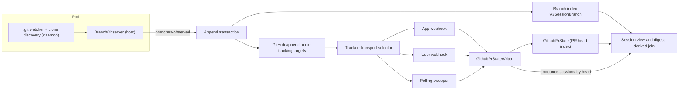

# PR tracking

A v2 session shows every pull request whose head is a branch the session worked on, in any repo
the pod holds, kept current by whichever GitHub transport covers the repo. Nothing about it depends
on what the agent's tool calls did, on turn boundaries, or on how the PR was opened.

Decided with the operator on 2026-11-18. Replaces the turn-end `PrLinker` and the journaled
`pull-request-linked` link of slice 4 (`04-views.md` §5–§6).

## 1. Goal and acceptance

1. The agent checks out a branch, pushes it and opens a PR mid-turn: the header shows the PR within
   one sweep (≤ 30 s) of GitHub knowing about it, without the turn ending.
2. A PR opened in the GitHub UI on a branch the session worked on appears the same way.
3. A branch the session worked on and then deleted locally keeps its PR on the session.
4. A repo the agent clones mid-session under the workspaces folder is tracked like the launch repo.
   Repos cloned at boot are tracked from runtime start, before the first turn ends.
5. A branch pushed to a fork links to the PR opened against the upstream repo.
6. Installing the GitHub App on a polled repo mid-session moves it to webhooks with no change in
   what the session shows.
7. Tracking never wakes the agent. Only `subscribe` delivers an external event to it.

## 2. Terms

- **Worked branch**: a local branch that was the HEAD of the main checkout or of a worktree, read
  from `.git` (current HEADs plus `checkout: moving from X to Y` reflog lines). Never derived from
  agent tool calls. The base branch is not a worked branch.
- **Head**: a `(headRepo, branch)` pair, `headRepo` the normalized GitHub `owner/name` of the
  branch's push remote (`branch.<n>.pushRemote`, else `remote.pushDefault`, else the upstream's
  remote, else `origin`).
- **Branch index**: control-plane rows `(sessionId, headRepo, branch)`, append-only per session.
- **PR head index**: `GithubPrState` looked up by `(headRepoFullName, headBranch)`.
- **Tracking target**: a head or PR number the GitHub tracker keeps fresh.
- **Transport**: App webhook, user (repo) webhook, or polling. Chosen per repo by the tracker,
  invisible to everything else.
- **Link**: a branch-index row joined to a `GithubPrState` row with the same head. Derived at read
  time, never stored.

## 3. Decisions

| #   | Decision                                                                                                  | By       |
| --- | --------------------------------------------------------------------------------------------------------- | -------- |
| D1  | The link is derived at read time; v2 stops journaling `pull-request-linked`.                              | operator |
| D2  | The branch index is written in the append transaction of `branches-observed`; the pod never calls GitHub. | agent    |
| D3  | Several PRs on one head: the most recently updated is pinned, the rest stay listed.                       | agent    |
| D4  | Worked branches are one-way: tracked for the session's life, even after local deletion or a rewind.       | operator |
| D5  | Every repo the pod holds is tracked, including mid-session clones.                                        | operator |
| D6  | Repo identity is the branch's push remote; the head index keys on the PR's head repo, so forks match.     | agent    |
| D7  | Clone discovery scans the workspaces folder at any depth, skipping `node_modules`.                        | operator |
| D8  | Tracking is transport-agnostic: App webhook > user webhook > polling, chosen by the server per repo.      | operator |
| D9  | Tracking never wakes the agent; `subscribe` is the only path for external events, for every provider.     | operator |
| D10 | Repos cloned at boot are watched and observed at runtime start.                                           | operator |

## 4. Architecture

Module rules:
- The daemon and host know git, not GitHub. They report observations and nothing else.
- The branch index is core control plane (git, not GitHub). It does not know PRs exist.
- The GitHub plugin owns tracking targets, the transport selector and the transports. Each
  transport writes only through `GithubPrStateWriter`; none knows the others or any session.
- The view read joins the two indexes and does not know which transport wrote a row.

## 5. Slice A: the pod observes worked branches, remotes and clones

**Today.** `readBranchSet` (`apps/daemon/src/ops/git/index.ts:31-51`) reads `refs/heads`, the
current branch and `worktree list`. `watchPathOf` (`apps/daemon/src/ops/git/branch-set.ts:64-78`)
ignores `logs/**`, so a quick checkout and back is never seen and a deleted branch vanishes. No
remote is read. Watched repos are the launch dir plus configured `additionalRepos`, fixed at start
(`apps/api/src/agent/runtime/git-watch.ts:23-27`). `BranchObserver.refreshRepos` only runs from
`refresh()` after a settled turn (`packages/host/src/holder/held-runner.ts:66`), and `git.watch`
returns its first set as a result without publishing it, so the first observation waits for a turn
end.

**Change.**
- `branchSetSchema` (`packages/protocol/src/ops/git.ts:20-27`) gains
  `branches[].pushRemote: string | null`, `remotes: { name, url }[]` and
  `checkouts: string[]` (branch names named as the target of `checkout: moving from X to Y` in
  `logs/HEAD` and every `worktrees/*/logs/HEAD`, deduped, newest first, capped at 200).
- `readBranchSet` adds to its `Promise.all`:
  `for-each-ref --format=%(refname:strip=2)%00%(objectname)%00%(push:remotename)%00%(upstream:remotename) refs/heads`
  (replaces the current `REF_FORMAT` read; `pushRemote` = push remote, else upstream remote),
  `config --get-regexp ^remote\..*\.url$`, and the reflog files read with `deps` file reads
  (no `git reflog` per worktree). Parsers go in `branch-set.ts` next to `parseBranches`.
- `watchPathOf` also accepts `logs/HEAD` and `worktrees/*/logs/HEAD`.
- New op `git.discover { root }` in the git group: arms the `watchGroup` machinery
  (`apps/daemon/src/ops/watch/index.ts:65-93`, missing-ancestor arming) on `root`, and on any change
  scans for directories containing `.git` (a dir or a worktree `.git` file), skipping
  `node_modules` and descending no further into a found repo. It publishes
  `git.repo-found { repoPath }` once per new repo and returns the repos found at arm time.
- `watchWorkspaceRepos` (`git-watch.ts:14`) becomes a live set: it `git.watch`es the boot candidates
  as today, then `git.discover`s `dirname(launchDirectory)` and `git.watch`es each
  `git.repo-found`. `watchedRepos()` returns the current set; `GitWatch` gains
  `onRepo(listener)` so the observer reads a new repo at once.
- `BranchObserver.start()` (`branch-observer.ts:53`) calls `refreshRepos()` once after subscribing,
  and on each `onRepo` reads that repo, so boot repos are observed at runtime start (D10).
- `branchesObservedSchema` (`packages/core/src/record/branches.ts:19-26`) and `BranchObservation`
  carry the new fields; `observationChanged` includes them.
- Core gains pure `workedHeadsOf({ observation, base })` in `packages/core/src/record/worked-heads.ts`:
  names = worktree branches ∪ `head` ∪ `checkouts`, minus `base`; each mapped to
  `{ headRepo, branch }` through its `pushRemote` (else `origin`) and `githubRepoOfRemoteUrl`
  (moved from `apps/api/src/agent/runtime/workspace-repos.ts` into
  `packages/core/src/github/`, keeping `normalizedPrRepo` rules). Non-GitHub remotes are dropped.

**Validation.**
- `apps/daemon` specs: a repo with a fork push remote reports `pushRemote`; checkout A → B → A
  inside one debounce window reports `checkouts` containing B; a deleted branch stays in
  `checkouts`; `git.discover` reports a clone created after arming, ignores one under
  `node_modules`, and reports a nested clone once.
- `packages/core` specs for `workedHeadsOf`: base excluded, fork push remote, https and ssh URLs,
  non-GitHub remote dropped.
- `packages/host` spec: the observer appends `branches-observed` for each watched repo at start,
  with no turn.

## 6. Slice B: the branch index and the derived link

**Today.** `appendToViewIn` writes `V2SessionPullRequest` from `pull-request-linked`
(`packages/control/src/session-view-ops.ts:168-173`, insert at
`packages/control/src/postgres/postgres-views.ts:46-60`). `pullRequestsWithState`
(`packages/control/src/session-view-read.ts:127-137`) joins `GithubPrState` per link; the digest
takes the latest link (`packages/control/src/session-digest-view.ts:32-46`). `GithubPrState`
already stores `headBranch` and nullable `headRepoFullName`
(`packages/db/src/prisma/schema/github/github-pr-state.prisma:8,10`) for every `pull_request`
delivery (`apps/api/src/api/cloud/github/github-delivery.service.ts:159-188`), with no index on
them.

**Change.**
- Prisma: `v2.V2SessionBranch { sessionId, headRepo, branch, firstSeenSeq, @@id([sessionId,
  headRepo, branch]), @@index([headRepo, branch]) }`, cascade from `V2Session`. Index
  `GithubPrState @@index([headRepoFullName, headBranch])`. Drop `V2SessionPullRequest`.
- `appendToViewIn` replaces the link extraction with `workedHeadsOf` over each `branches-observed`
  and inserts `ON CONFLICT DO NOTHING` (port method `insertSessionBranchesIn`, postgres and memory).
  Rows are never deleted: not on rewind, not on branch deletion (D4).
- Port read `readTrackedPullRequestsIn({ sessionIds })`: `V2SessionBranch` join `GithubPrState` on
  `headRepoFullName = headRepo AND headBranch = branch`, returning
  `{ repo: repoFullName, number, url, branch, state }` with
  `url = https://github.com/{repo}/pull/{number}`. `sessionsTrackingHeadIn({ tx, headRepo, branch })`
  replaces `sessionsLinkedToIn`.
- `readSessionViewIn` (`session-view-read.ts:186`) and the digest (`session-digest-view.ts:32`)
  read through it. Order: open/draft first, then most recently updated (D3); the digest takes the
  first. `SessionViewOutput.pullRequests` (`packages/protocol/src/api.ts:318-335`) keeps its shape.
- The session view fold drops `stepPullRequestLinks` (`packages/core/src/record/views/session-view.ts:62`)
  and `pullRequests` from `SessionViewState`; `SESSION_VIEW_VERSION` becomes 6 so stored rows
  rebuild. Old `pull-request-linked` events in v2 journals are ignored; the core schema stays for v1.
- `GithubPrStateWriter.writeState` (`apps/api/src/api/cloud/github/github-pr-state-writer.ts:106-109`)
  announces `sessionsTrackingHeadIn` for the written row's head.

**Validation.** Control conformance (`packages/control/src/testing/conformance/conformance-views.ts`,
memory and Postgres): a `branches-observed` with a worked branch plus a matching `GithubPrState` row
shows the PR; a later observation without the branch keeps it; a rewind keeps it; a fork head
matches the upstream PR; two PRs on one head order open first; a state write for a tracked head
announces the session, one for an untracked head announces nothing; a rolled-back append leaves no
branch row. Web specs keep passing unchanged.

## 7. Slice C: the GitHub tracker

**Today.** Routing precedence exists as `trackingOf` (App > User > Polled,
`apps/api/src/api/cloud/github/github-repo-coverage.ts:12-34`), used by the refresh queue built from
`GithubSubscription` rows (`github-refresh-queue.ts:46-55,108,132`). Branch subscriptions resolve to
a number with `GET pulls?head=` (`github-refresh-queue.ts:60-83`). The pod finder qualifies `head`
with the base owner (`plugins/github/src/pod/finder.ts:41-42`), so fork PRs are invisible.

**Change.**
- Prisma: `GithubTrackingTarget { id, userId, kind: EGithubTargetKind (Head | PullRequest),
  repoFullName, branch String @default(""), prNumber Int?, lookedUpAt DateTime?, attemptedAt DateTime?,
  liveUntil,
  @@unique([userId, kind, repoFullName, branch, prNumber]) }`.
- Plugin control append hook `trackingTargetHook` in `plugins/github/src/control/`, registered beside
  `subscriptionLeaseHook` (`plugins/github/src/control/index.ts:10-13`): on `branches-observed`,
  upserts a `Head` target per `workedHeadsOf` head for the session owner, `liveUntil = now + 7 d`.
  `subscriptionLeaseHook` also upserts a `PullRequest` target for the subscribed PR, so subscribe
  and tracking share one freshness path and subscribe keeps only delivery.
- `TransportSelector` (`plugins/github` control side, or `apps/api/src/api/cloud/github/tracking/`
  if it needs Nest services) wraps `trackingOf`; it is the only caller of coverage.
- The refresh queue reads `GithubTrackingTarget` instead of `GithubSubscription`:
  - every target with `lookedUpAt = null` gets one REST lookup whatever its transport (a PR that
    existed before the App was installed must still appear);
  - after that, only targets whose repo selects polling are polled, within the existing budget;
  - a `Head` lookup queries `GET /repos/{headRepo}/pulls?head={headOwner}:{branch}&state=all` and,
    when `headRepo` is a fork, the same on its `parent` (repo metadata cached per repo), then writes
    each found PR through `GithubPrStateWriter.recordAndPush`.
- The sweeper schedule is unchanged (30 s); `lookedUpAt = null` targets are taken first.
- Delete `PrLinker`, `GithubPullRequestFinder`, `PullRequestSource` and `hasLink` bookkeeping
  (`packages/host/src/holder/pr-linker.ts`, `plugins/github/src/pod/finder.ts`,
  `packages/host/src/holder/ports.ts:63-76`, `record-bookkeeping.ts:57`, wiring at
  `held-runner.ts:104-120,148` and `session-runtime-factory.ts:341-344`).
- No transport, tracker or writer posts inbox entries. Wakes stay `noticeV2Sessions` over live
  subscriptions (`github-v2-notice.ts`), unchanged (D9).

**Validation.** API specs against real Postgres: a new `Head` target on an App-covered repo is looked
up once and never polled; on an uncovered repo it is polled each sweep; installing the App flips it
to webhook-only with no target change; a fork head finds the upstream PR; a target past `liveUntil`
is not polled; tracking never inserts a `GithubPrEventDelivery` or inbox row. Hook spec next to
`lease-hook.spec.ts`.

## 8. Live check (production)

In one v2 session: boot with an additional repo, branch and push in the launch repo and open a PR
mid-turn; open a PR from the GitHub UI on a second worked branch; clone a third repo into the
workspaces folder and open a PR there; delete the first branch locally; install the App on a polled
repo. Each PR shows in the header and sidebar with live state, none starts a turn, and the
deleted branch's PR stays. Record session id and PR numbers here.

## 9. Out of scope

- v1 PR linking (`packages/harness/src/plugins/github/links.ts`) and the v1 thread DTO path.
- Non-GitHub hosts. A GitLab remote is dropped by `workedHeadsOf` until a provider exists.
- Clones outside the workspaces folder.
- Changing subscribe delivery or notice text.
