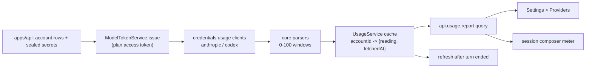

# Spec: account plan-usage meters (v2)

> **Approved by Dennis 2026-11-23.** Meters show in the session and on Providers, show the amount used, and use colour only (no warnings).

Status: **draft for Dennis**, 2026-11-23. Owner: `packages/credentials` (the HTTP clients),
`packages/core` (the parsers and the meter maths), `apps/api` (the service, the router and the
refresh), `apps/web` (Providers and the session composer). Anchors were read at `ee5fdfdef` in
`/atlas/workspaces/atlas`.

This spec sits on `@dltech/atlas-credentials`, the package that `docs/slices/classifier.md` §3
defines (built in #2576): it holds the account rows, `chosenFor`,
and the provider sign-in flows, and it may not import the model catalogue. A usage client reads one
credential and calls one provider endpoint, so it belongs there and nowhere else.

---

## 1. Product contract

- **The meter says how much of the plan is spent.** For each connected plan account: the 5-hour
  window and the 7-day or weekly window, as the share already used (0–100 %), with the time it
  resets.
- **Only what the provider states.** A window the provider does not report reads `—`. It never
  reads 0 %, and Atlas never estimates one.
- **Unmetered is a normal state, not an error.** An API key account has no plan window and shows no
  meter at all. So does a provider Atlas has no reader for. Nothing is logged as a failure and
  nothing is shown as a fault.
- **The control plane fetches it.** With the account's own credential, in the API process. Never in
  the sandbox, never in the web browser, never with a key that a client sent.
- **Freshness without a client poll.** A reading is served from a server cache that is at most
  20 s old. The server refreshes an account after a turn that spent it, and the client refetches on
  the `turn-ended` event it already receives. No timer on the client, and no request per render.
- **A meter is decoration.** A failed read leaves the previous reading with its age, and never takes
  a turn, a page or a session down.
- **Where it shows.** Settings → Providers, one meter per account; and one small meter for the
  account a session uses, in the composer's context row. Nothing in the header.
- **Multi-account is explicit.** One reading per account id. The Providers page shows every
  account. A session shows the account its provider resolves to, named, so it cannot be mistaken
  for another.

**Exit criteria**
1. With a Claude plan connected, Settings → Providers shows two meters with a percentage and a
   reset time, and the value matches what the provider's own client shows at that moment.
2. With a ChatGPT plan connected, the same two rows appear from the Codex endpoint.
3. With only API keys connected, no meter row renders anywhere, and no request leaves the API.
4. A session in flight shows the meter of its own provider's account, and the number moves after a
   turn ends without a page reload.
5. A revoked grant, a 401, a 404, a timeout and a broken body all leave the last reading (or no
   meter), never an error, never a thrown exception into a turn.
6. `grep` finds no access token, no refresh token and no API key in a `V2Event`, a transcript row,
   an API response or a log line.

---

## 2. Evidence

### 2.1 What v1 built, and where it runs

| Part                  | Where                                                                                                                                                                                              | What it does                                                                                                                                                                                                                         |
| --------------------- | -------------------------------------------------------------------------------------------------------------------------------------------------------------------------------------------------- | ------------------------------------------------------------------------------------------------------------------------------------------------------------------------------------------------------------------------------------ |
| Read port             | `packages/core/src/ports/account-usage.port.ts:6-8`                                                                                                                                                | `read({accountId?}) → UsageReading \| null`                                                                                                                                                                                          |
| Vocabulary            | `packages/core/src/usage/window.ts`                                                                                                                                                                | `EUsageWindow.FiveHour \| SevenDay`, `UsageWindow {utilization, resetsAt}`, `UNMETERED`, `worstWindow`                                                                                                                               |
| Banding and format    | `packages/core/src/usage/meter.ts:1-56`, `format.ts:1-30`                                                                                                                                          | `EMeterBand`, thresholds per window, `formatUtilization`, `formatCountdown`                                                                                                                                                          |
| Cache and poll policy | `packages/harness/src/usage/account-usage-service.ts:10-12`, `:30-119`                                                                                                                             | 20 s floor, 60 s live interval, one reading per key, `track` while a turn is in flight, forced refresh when it ends                                                                                                                  |
| Routing by account    | `packages/harness/src/usage/routed-account-usage.ts:16-57`                                                                                                                                         | `activeFor(provider)` when no account is named; `UNMETERED` for a non-metered account                                                                                                                                                |
| Claude reader         | `packages/harness/src/usage/anthropic-usage-client.ts:20`, `:24-65`                                                                                                                                | `GET https://api.anthropic.com/api/oauth/usage`, bearer plan token, `anthropic-beta`, `user-agent: claude-code/<version>`                                                                                                            |
| Codex reader          | `packages/harness/src/usage/codex-usage-client.ts:17`, `:21-62`                                                                                                                                    | `GET https://chatgpt.com/backend-api/wham/usage`, bearer plan token, `ChatGPT-Account-ID`, `user-agent: codex-cli/<version>`                                                                                                         |
| Parsers               | `packages/harness/src/usage/parse-anthropic-usage.ts:22-39`, `parse-codex-usage.ts:43-53`                                                                                                          | Anthropic: `five_hour`, worst of `seven_day`, `seven_day_opus`, `seven_day_sonnet`, utilisation already 0–100. Codex: `rate_limit.primary_window` / `secondary_window`, `used_percent`, `reset_at` (unix s) or `reset_after_seconds` |
| Composition           | `packages/harness/src/composition/account-bindings.ts:99-107`                                                                                                                                      | one service, both clients, in the harness process                                                                                                                                                                                    |
| Where it renders      | `apps/tui/src/ui/components/footer.tsx:31-46` (`meterSpans`), `apps/tui/src/composition/use-usage-meters.ts:22-41`, tracking driven by `apps/tui/src/composition/use-workspace-lifecycle.ts:41-49` | the TUI footer only                                                                                                                                                                                                                  |
| v1 web                | `apps/web/src/features/threads/composer-dock.tsx:21-24`                                                                                                                                            | the context-window token count only. **No plan meter in the v1 web at all**                                                                                                                                                          |

Two facts follow from that table.
- v1 fetches usage **in the surface's own process**. For a cloud session that process is serve
  inside the sandbox, with the plan token delivered there. v2's rule is the opposite: the sandbox
  never holds a credential, so the reader must move to the control plane (the API), which already
  holds the connection rows and mints plan tokens
  (`apps/api/src/agent/tokens/model-token-service.ts:46-73`).
- v1 has no meter in the web surface. So "show it in Settings → Providers" is new work, not a port.

### 2.2 Do these endpoints still work? (checked 2026-11-23)

**Codex / ChatGPT — yes, and it is a documented-in-source endpoint.**
codex-rs calls it itself: `rate_limit_status_url()` builds `{base}/wham/usage` for the
`ChatGptApi` path style (and `/api/codex/usage` for `CodexApi`)
— [openai/codex `backend-client/src/client/rate_limit_resets.rs`](https://github.com/openai/codex/blob/main/codex-rs/backend-client/src/client/rate_limit_resets.rs).
The same file reads `rate_limit`, `primary_window`, `secondary_window` and the reset fields, which
is exactly what `parse-codex-usage.ts:43-53` parses. The endpoint wants a plan bearer token, the
ChatGPT account id and a user agent, which v1 sends (`codex-usage-client.ts:39-47`).

**Claude — undocumented, still what Claude Code itself shows.**
`https://api.anthropic.com/api/oauth/usage` is not in Anthropic's public API reference. What the
public reference documents is the per-request rate-limit headers on the Messages API
(`anthropic-ratelimit-tokens-*`, `anthropic-ratelimit-input-tokens-*`,
`anthropic-ratelimit-output-tokens-*`, each with a `-limit`, `-remaining` and `-reset` form) —
[platform.claude.com/docs/en/api/rate-limits](https://platform.claude.com/docs/en/api/rate-limits).
Those are **per-minute limits for an API key**, not the plan's 5-hour and 7-day windows, and v1
records that inference responses carry no such headers while the usage endpoint reports headroom
(`anthropic-usage-client.ts:15-21`). So the 5-hour and 7-day percentage has no documented source,
and the endpoint can change without notice. The design treats it as best effort: a `!response.ok`
or a body without `five_hour` reads as "no meter", never as 0 %.

**For an Anthropic API key there is no plan window.** Organisation usage and cost are on the Admin
API (`/v1/organizations/usage_report/messages`, `/v1/organizations/cost_report`), which needs an
`sk-ant-admin` key or an `org:admin` OAuth token — neither of which Atlas holds
— [platform.claude.com/docs/en/manage-claude/usage-cost-api](https://platform.claude.com/docs/en/manage-claude/usage-cost-api).
An api-key Claude account therefore shows no meter.

**Gateway credits — not cheap, so not in this slice.** AI Gateway spend appears in AI Gateway Logs
in the Vercel dashboard, with up to 90 s of lag; there is no documented endpoint for the remaining
credit balance
— [vercel.com/docs/ai-gateway/getting-started](https://vercel.com/docs/ai-gateway/getting-started).
v1 never read a gateway meter either. If Dennis wants spend, the honest source is Atlas's own turn
ledger, which is a different feature (§9).

**Not verified live here.** A live call needs the operator's plan grant, and I did not send one. The
live check in §7 is the verification, and it is the first thing to run before the slice is called
done.

### 2.3 What a model response would give for free

Nothing usable. The plan windows are not in the inference headers (v1's recorded finding, above),
so a refresh "after each model call that already returns the headers" is not available. The cheap
version is: refresh because the turn ended, not because a header arrived.

---

## 3. The model: keep v1's vocabulary, add an age

No new vocabulary. `AccountUsage`, `UsageWindow`, `UNMETERED`, `meterBand` and `formatCountdown`
already exist in core and are tested. One type is added, because a cached meter without its age
lies:

```ts
// packages/core/src/usage/report.ts
export type UsageReport = {
  reading: AccountUsage | typeof UNMETERED
  fetchedAt: string | null // null when nothing has been read yet
}
```

`meterBand` keeps its thresholds (`DEFAULT_WARN_PERCENT`: 65 % for 5 h, 70 % for 7 d,
`meter.ts:14-17`). The web renders the band as a colour and the number as a percentage, so the web
holds no threshold of its own.

---

## 4. Where it is fetched, and how it stays fresh



**The clients move, with no behaviour change.** `anthropic-usage-client.ts`,
`codex-usage-client.ts` and `routed-account-usage.ts` move to
`packages/credentials/src/usage/`; `AccountUsagePort` stays in core. The two parsers move to
`packages/core/src/usage/parse-anthropic-usage.ts` and `parse-codex-usage.ts`, because they are pure
and both the API and the v1 harness must agree on them. `packages/harness` re-exports the moved
modules, so v1 composes exactly as today and its suite proves the move changed nothing.

**The service.** `apps/api/src/agent/usage/usage-service.ts`:

```ts
export type UsageReader = {
  report(args: { userId: string; accountId: AccountId | null }): Promise<UsageReport>
  refresh(args: { userId: string; accountId: AccountId }): Promise<void>
}
```

- One `Map<AccountId, {reading, fetchedAt}>` per process. No table: a reading 60 s old is worthless
  as history and must not become state.
- `report` answers from the cache when it is younger than `USAGE_POLL_FLOOR_MS` (20 s, kept from
  `account-usage-service.ts:10`), else reads once. `accountId: null` means "the plan account of the
  session's provider", resolved by `chosenFor` (`selection.ts:34-54`).
- A read gets its token from `ModelTokenService.issue` (`model-token-service.ts:46-73`), which
  refreshes an expiring grant and throws `CredentialError` when the grant is refused. The service
  swallows every error into the previous reading: a meter is decoration
  (`anthropic-usage-client.ts:36-37` keeps that rule).
- Single flight per account: two readers of the same account share one promise, so a page with ten
  rows sends one request.

**Freshness, without a client poll.**
1. After a turn ends, the holder reports the account that answered, and the API calls `refresh` for
   it. The account id is already on the model config (`model-config.ts:80-86`) and on the failure
   provenance; the ledger row knows the route. One refresh per finished turn, not per step.
2. The web reads `api.usage.report` and refetches when the session's `turn-ended` arrives (the
   client already folds it) and when the window regains focus. That refetch is normally a cache hit.
3. Nothing else. No interval on the client, and no interval in the API while no session runs.

**Why not push it through the session stream.** A `V2Event` is a fact about the session's record.
A plan percentage is a fact about an account, shared by every session, and it changes at times the
session does not own. Putting it in the record would grow the log, break replay equality and make
every fold care about a number it does not use. The query plus the `turn-ended` refetch gives the
same freshness with none of that.

---

## 5. Where it shows

### 5.1 Settings → Providers

Each plan card (`SubscriptionGroup`, `apps/web/src/features/settings/pages/providers.tsx:206-239`)
gains one row under the account: two meters side by side, or stacked at 375 px.

```
 Anthropic                                  [plan]
 dennis@byatlas.io                             ● active
 5-hour  ███████░░░  68%   resets in 42m
 7-day   ████░░░░░░  41%   resets in 2d4h
```

- New component `apps/web/src/features/settings/parts/usage-meter-row.tsx`, fed by
  `meterBand`, `formatUtilization` and `formatCountdown` from core.
- A window the provider does not report shows `—` and no bar.
- An api-key card shows no row at all (§1).
- A reading older than five minutes shows its age in words (`read 7 min ago`) rather than a number
  that looks live.

### 5.2 The session composer

`SessionContext` (`apps/web/src/features/sessions/session-context.tsx:19-40`, mounted at
`session-view.tsx:327`) gains one meter for the session's account, after the context-window readout:
`5h 68% · 7d 41%`, one line, no bar, colour from the band, tooltip with the reset times. It renders
nothing when the account is unmetered. The account is named in the tooltip, because it is the
provider's active account (§6).

### 5.3 Not the header

The header carries session state only (`header-model.ts:8-22`). A percentage there would compete
with `Needs you` and `Running`, and it is not the session's state.

---

## 6. Multi-account behaviour

- **Storage.** Readings are keyed by account id, not by provider, so two Claude accounts each keep
  their own windows.
- **Providers page.** Every account row shows its own reading. This is the one place where a stalled
  account is visible while the other one serves.
- **Session.** Today a client cannot know a per-session account: the account is resolved on the
  server by `chosenFor` (active first, else the healthiest, `selection.ts:34-54`) and the wire
  carries the model choice, not the account. So the session meter shows **the active account of the
  session's provider** and names it in the tooltip. If a per-session account ever exists (the
  credential-repair spec asks Dennis for the global switch), the meter follows the
  `accountId` the session resolves and nothing else changes.
- **A refused or expired account.** The meter keeps its last reading with its age. The repair card
  (credential-repair spec) owns the explanation. The two surfaces do not duplicate copy.
- **Cost.** One request per account per 20 s at the very most, and only while a surface asks or a
  turn ends. Two accounts and one session cost a handful of requests per hour.

---

## 7. Slices

Three PRs. Slice 1 changes no behaviour. Slice 2 is the only server work. Slice 3 is the only
surface work.

| #   | Title                                                               | Contents                                                                                                  | Files                                                                                                                                                                                                                                                                                                                                                                                                                                                                                                                                                   |
| --- | ------------------------------------------------------------------- | --------------------------------------------------------------------------------------------------------- | ------------------------------------------------------------------------------------------------------------------------------------------------------------------------------------------------------------------------------------------------------------------------------------------------------------------------------------------------------------------------------------------------------------------------------------------------------------------------------------------------------------------------------------------------------- |
| 1   | `refactor(credentials): move the usage readers beside the accounts` | the three harness modules and the two parsers move; one new subpath; v1 re-exports so nothing changes     | new `packages/credentials/src/usage/{anthropic-usage-client.ts,codex-usage-client.ts,routed-account-usage.ts}` and `packages/core/src/usage/{parse-anthropic-usage.ts,parse-codex-usage.ts}` + their specs; delete `packages/harness/src/usage/{anthropic-usage-client.ts,codex-usage-client.ts,routed-account-usage.ts,parse-anthropic-usage.ts,parse-codex-usage.ts}`; `packages/credentials/package.json` subpath + `README.md`; `packages/core/src/usage/index.ts`, `packages/core/README.md`; re-export from `packages/harness/src/usage/index.ts` |
| 2   | `feat(usage): read a plan account's usage in the API`               | `UsageService` (cache, floor, single flight, error swallowing), the turn-end refresh hook, the query      | new `apps/api/src/agent/usage/{usage-service.ts,usage-service.spec.ts,usage.router.ts,usage.router.spec.ts,usage.service.ts,usage.module.ts}`; `apps/api/src/api/api.module.ts`; the holder's turn-end report path (`apps/api/src/agent/runtime/session-runtime-factory.ts`, `packages/host/src/holder/held-turns.ts` only if the report needs a new dep)                                                                                                                                                                                               |
| 3   | `feat(web): show plan usage in Providers and the session`           | `usage-meter-row.tsx`, the Providers row, the composer meter, the refetch on `turn-ended`, the query hook | new `apps/web/src/features/settings/parts/usage-meter-row.tsx`, `apps/web/src/features/settings/data/personal/usage-api.ts`, `apps/web/src/features/sessions/data/use-account-usage.ts` + specs; edits `apps/web/src/features/settings/pages/providers.tsx:206-239`, `apps/web/src/features/sessions/session-context.tsx:19-40`, `apps/web/src/features/sessions/data/session-view-model.ts`                                                                                                                                                            |

Integration owner: **slice 3** for the surface, **slice 2** for the contract. Slice 1 must merge
first; 2 and 3 are disjoint by file.

---

## 8. Test plan

**Slice 1 — moved specs keep their cases.**
- `packages/core/src/usage/__tests__/parse-anthropic-usage.spec.ts`: `five_hour` at 1 % stays 1 %
  (the endpoint states 0–100, so no 0–1 heuristic, `parse-anthropic-usage.ts:6-9`); the worst of the
  three 7-day windows wins; a missing window is `null`; a body that is not an object is two nulls.
- `packages/core/src/usage/__tests__/parse-codex-usage.spec.ts`: `used_percent` is used, not
  remaining; `reset_at` in unix seconds and `reset_after_seconds` both become an ISO time; a missing
  `rate_limit` is two nulls.
- `packages/credentials/src/usage/__tests__/*.spec.ts` with a scripted `fetch`: the bearer token and
  the exact headers of each client; `!ok` → `null`; a throw → `null`; the 10 s timeout is set.
- `packages/harness` `bun test` proves the move changed no answer (its existing usage specs run
  unchanged).

**Slice 2 — `apps/api/src/agent/usage/__tests__/usage-service.spec.ts`**
- two reads inside the floor make one request; a read after the floor makes two;
- two concurrent reads of one account share one promise;
- `UNMETERED` for an api-key account, and no client call;
- a 401 leaves the previous reading with the old `fetchedAt`; with no previous reading it returns
  `{reading: UNMETERED, fetchedAt: null}` and does not throw;
- a refused grant (`CredentialError`) never escapes into the turn-end path;
- `refresh` for an account of another user is refused.
- `usage.router.spec.ts`: a bearer's own account answers a reading; another user's account answers
  `404`; no bearer answers `401`.

**Slice 3 — web**
- `usage-meter-row.spec.tsx`: a band colour from a 68 % reading, `—` for a null window, no row for
  `UNMETERED`, the age line after five minutes, and the reset countdown in words at 1 hour and at
  2 days;
- `use-account-usage.spec.ts`: the query runs once per mount, refetches once on `turn-ended`, and
  never on a timer;
- `providers.tsx` spec: an api-key card has no meter, a plan card has two, two accounts on one
  provider show different readings.

**Commands.** `bun test` in `packages/core`, `packages/credentials`, `packages/harness`,
`apps/api`, `apps/web`; `turbo run typecheck`; `bunx biome check --write` on the touched files;
`scripts/check-package-readmes.ts` for the changed package surface. Run each package from its own
directory so the `bunfig.toml` preload applies.

---

## 9. Live check

1. With a Claude plan connected, open Settings → Providers. Two meters appear. Compare them with
   the provider's own client at that minute; they agree within one refresh.
2. Connect a ChatGPT plan. The same two rows appear from the Codex endpoint.
3. Start a v2 session on the Claude plan. The composer shows `5h …% · 7d …%`. Let the turn finish;
   the number changes without a reload.
4. Replace the plan secret with a revoked one (Providers → replace). The meter keeps its reading
   with its age, and the session shows the repair card (credential-repair spec) — no error dialog.
5. Disconnect the plan account and keep only an API key. No meter row renders anywhere, and the API
   log shows no usage request.
6. Search the response bodies for the access token: no match.

If step 1 fails for Claude, the endpoint changed. The failure mode is already defined: the meter
disappears and nothing else breaks.

---

## 10. Questions for Dennis

1. **Is a meter in the session needed at all, or is the Providers page enough?** Recommended:
   **both**. The pressure shows up while working, and one short line in the composer is cheap; the
   Providers page is where a stalled account is diagnosed. Cost: one more query per open session.
2. **Does the number show used or left?** Recommended: **used**, with the reset time. The providers
   report used, so nothing is inverted, and the meter points at the limit the way their own clients
   do. Cost: a full bar means trouble, which a reader may at first read backwards.
3. **Should Atlas warn at a threshold (for example 80 %), or only colour the number?**
   Recommended: **only colour it**. A warning line for a window that resets in 20 minutes is noise,
   and the band already shows pressure. Cost: no proactive nudge before a plan runs dry.

---

## 11. Out of scope

- Gateway credits, and any spend in dollars. No documented credit endpoint exists; the turn ledger
  is the honest source, and that is a separate feature.
- API-key accounts and organisation usage reports: they need an Admin API key Atlas does not hold.
- The TUI footer, serve and the Mac/mobile surfaces. The TUI keeps v1's meters through the moved
  clients; nothing is redesigned there.
- Notifications, routine checks or a background alert when a window is nearly spent.
- Persisting readings, trend lines, history or charts. A reading has one age and no past.
- Estimating a window from token counts, or substituting a local count when the provider is silent.
- Per-session account selection (the meter follows whatever account the session resolves; the
  credential-repair spec owns that question).
