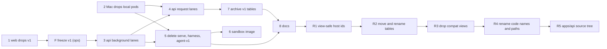

# Spec: v1 retirement (roadmap slice 10)

Status: **approved by Dennis 2026-11-24** (revision 3: no soft-delete step, D10 approved).
Slices 1 to 8 are done; R1 to R5 are in progress.
Anchors are `path:line` at `78e4d7a9e` (origin/main, 2026-11-24). Check an anchor again before you
rely on it. The raw inventories behind this spec are in `docs/research/v1-retirement/`.

## What shipped

| Slice  | PR    | What landed                                                                        |
| ------ | ----- | ---------------------------------------------------------------------------------- |
| spec   | #2865 | This document, its decisions and the inventories                                   |
| 1      | #2881 | Web and Mac render v2 only; the v1 thread route and its 112 files are gone         |
| 2      | #2877 | The Mac host drops the local-pods host and owns its token store                    |
| 3      | #2883 | The API drops the v1 background lanes, the v1 trigger project and the env keys     |
| 4a     | #2885 | The auth seam: the middleware keeps only the session principal                     |
| 4b     | #2886 | Part of the v1 request lanes and their routers                                     |
| 5      | #2887 | `apps/serve`, `packages/harness` and `packages/agent-v1` deleted                   |
| 4c     | #2888 | The rest of the v1 request lanes; the API carries none                             |
| 6      | #2891 | The sandbox image and the release drop the serve leftovers                         |
| 7-prep | #2892 | Schema prep for the archive                                                        |
| 7      | #2896 | The v1 tables move to the `v1_archive` schema                                      |
| 8      | this  | The docs: the whole `v2` directory up to `docs/`, the v1 architecture docs retired |

Slice 5 shipped before 4c, though §4 draws it after 4: harness and serve called 73 v1 procedures
through the typed router, so the routers could not go until their callers did.

## 1. Product contract

After this work the repository has one architecture: client ↔ control plane (`apps/api`) ↔ pod
(`packages/agent`, `packages/host`, `apps/daemon`, `plugins/*`). No code, table, workflow step or
doc keeps v1 alive. After the rename slices R1 to R5 (§4), no name carries a `v2` or `V2` prefix
that exists only because v1 existed (project memory `v2-replaces-v1-independently-no-v2-prefix`).

**Rule: never hard-delete historical data.** The v1 code goes. The v1 rows stay, read-only, in the
`v1_archive` schema, for statistics and metrics later (skill use, charts). No client loads them:
no query, no list, no hidden filter. Nothing writes to them.

The operator sees these changes:
- The web app and the Mac app show only v2 sessions. The engine picker and the `v1` badges go.
- A v1 thread cannot be opened, resumed or woken. Its rows stay in the database, in the
  `v1_archive` schema. No client loads them.
- The Mac app stays a full v2 cloud client: sign-in, APNs push, notification clicks and deep links
  work as before. The unwired local-pods host goes. Local sessions stay "coming soon".
- TUI self-update and Mac auto-update keep working with no action from the operator.

Out of scope:
- Local sessions (roadmap slice 9, local half).
- A general dead-export sweep of the shared packages. The routine `abstraction-police` covers it.

## 2. What v1 is today

v1 is three workspaces that must go together, plus the server lanes that feed them:
- `apps/serve` (365 files): the server that runs in each v1 cloud sandbox. Its entry point is the
  harness supervisor (`apps/serve/src/main.ts:1`).
- `packages/harness` (2,131 files): the v1 agent host. 219 serve files import it.
- `packages/agent-v1` (87 files): the v1 loop. 52 harness files import it.
- In `apps/api`: the `ApiModule` v1 tree (`apps/api/src/api/api.module.ts:116-122`), the v1
  trigger.dev project (`apps/api/trigger.config.ts:5`, `apps/api/src/trigger/**`), and the tables
  `Thread`, `Event`, `Session`, `Turn`, `ThreadRead`, `ContextFile`, `SandboxBootStep`,
  `CloudSandbox`, `LocalPodLease`, `PushDevice`.
- In `apps/web`: the `/threads/[threadId]` route and 112 v1-only files in `features/threads`.
- In `apps/mac`: the local-pods host (`apps/mac/src/host/pods/**`) and the token store
  (`apps/mac/src/host/auth/token-store.ts:2`).

No v2 code imports v1. `apps/api/src/agent`, `packages/{agent,core,host,control,protocol,pods,db,github}`,
`apps/daemon`, `apps/trigger` and `plugins/*` have zero harness imports
(`apps/api/src/api/harness-boundary.spec.ts:22-30` enforces part of this). No `v2` table has a
foreign key to a `public` v1 table, and no id overlaps between them (production check, §7).

## 3. Inventory

Action: **delete**, **edit** (keep the file, remove the v1 part), **move**, or **keep**.

### 3.1 Workspaces and root config

| Path                                                                                                  | What it is                            | What reads it                                                                | Action                                                                                          |
| ----------------------------------------------------------------------------------------------------- | ------------------------------------- | ---------------------------------------------------------------------------- | ----------------------------------------------------------------------------------------------- |
| `apps/serve`                                                                                          | v1 sandbox server                     | sandbox boot through `packages/wire/src/sandbox-serve-install.ts:17-70`      | delete (slice 5)                                                                                |
| `packages/harness`                                                                                    | v1 agent host                         | serve, `apps/mac` (11 files)                                                 | delete (slice 5)                                                                                |
| `packages/agent-v1`                                                                                   | v1 loop                               | harness only                                                                 | delete (slice 5)                                                                                |
| `packages/wire`                                                                                       | shared wire types                     | api 267, web 375, github 9, client 31, trigger 2                             | keep. Delete only `serve-env.ts`, `sandbox-serve-{install,launch,upload}.ts` (slice 3)          |
| `packages/client`                                                                                     | client runtime                        | web, tui, mobile, harness                                                    | keep. Delete `./channel-fixture` if no importer is left (slice 5)                               |
| `packages/credentials`                                                                                | provider credentials                  | api, harness                                                                 | keep. Delete `./usage` if no importer is left (slice 5)                                         |
| `packages/core/src/settings/registry.ts:29`                                                           | `ESettingId`                          | all                                                                          | edit: prune the v1-only ids (slice 5)                                                           |
| `packages/harness/src/settings/v1-only-definitions.ts`                                                | v1 setting rows (#2851)               | harness only                                                                 | delete with harness. DB rows stay and have no effect                                            |
| `packages/core/src/ports/registry.ts`                                                                 | v1 port manifest                      | harness and serve only (537 uses, zero in v2)                                | delete (slice 5)                                                                                |
| `packages/core/src/version/release-affected.ts:1`                                                     | `SHIPPED_APP_DIRS`                    | release job                                                                  | edit: `['apps/tui','apps/mac']` (slice 5)                                                       |
| `apps/web/package.json:19`, `apps/web/next.config.ts:47`, `apps/web/__tests__/next-config.spec.ts:29` | stale harness dep                     | no source import                                                             | delete (slice 1)                                                                                |
| `evals/package.json:23`                                                                               | stale harness dep                     | no source import                                                             | delete (slice 5)                                                                                |
| `scripts/split-guard/rules.ts:26-97`                                                                  | 8 import rules                        | `scripts/check-package-split.ts`, CI `check` (`.github/workflows/ci.yml:35`) | edit: delete the two v1 rules and the serve entries (`:41,47,61`), keep the other six (slice 5) |
| `apps/api/src/api/harness-boundary.spec.ts`                                                           | api-may-not-import-harness test       | CI                                                                           | delete (slice 5)                                                                                |
| `scripts/check-envelope.ts`                                                                           | `PROSE_MENTIONS` harness entry        | lint                                                                         | edit (slice 5)                                                                                  |
| `lefthook.yml:16-18`                                                                                  | regenerates harness plugin types      | pre-commit                                                                   | delete the step (slice 5)                                                                       |
| `.github/workflows/claude-code-version.yml:32-33`                                                     | rewrites a harness file               | weekly                                                                       | edit: point at the v2 file or delete the workflow (slice 5)                                     |
| `scripts/package-readmes/audit.ts:7`, `docs/package-readmes.md:19-20`                                 | `README_EXEMPT` for harness, agent-v1 | readme check                                                                 | delete the entries (slice 5)                                                                    |

### 3.2 apps/api, apps/trigger and packages/github

| Path                                                                                                                                                                                                          | What it is                                                                                                                                                                                                                 | What reads it                                                                          | Action                                                                                                                                                               |
| ------------------------------------------------------------------------------------------------------------------------------------------------------------------------------------------------------------- | -------------------------------------------------------------------------------------------------------------------------------------------------------------------------------------------------------------------------- | -------------------------------------------------------------------------------------- | -------------------------------------------------------------------------------------------------------------------------------------------------------------------- |
| `apps/api/src/api/platform/sessions/*` (routers `threads`, `threadEvents`, `threadTurns`, `contextFiles`)                                                                                                     | v1 threads                                                                                                                                                                                                                 | web v1 view only                                                                       | delete (slice 4)                                                                                                                                                     |
| `apps/api/src/api/platform/sessions/session-or-sandbox.middleware.ts:30-101`                                                                                                                                  | session, sandbox-token and pod-token auth for 15+ cloud routers                                                                                                                                                            | v2 clients use the session half. Only serve and the Mac pods use the token halves      | edit: keep session auth, delete the sandbox and pod principals and the `sandboxReachable`/`podReachable` meta. Move the middleware out of `SessionsModule` (slice 4) |
| `apps/api/src/api/platform/sandboxes/*` except `preview-tunnel.service.ts`, `preview-teardown.service.ts`                                                                                                     | `CloudSandbox` CRUD, `sandboxSelf`, `sandboxes`, `sandboxCheckpoint`, token principals                                                                                                                                     | serve, web v1 settings page                                                            | delete. Keep the preview wiring in a module the v2 host imports (slice 4)                                                                                            |
| `apps/api/src/api/cloud/sandbox-provisioning/*` (`threadSandbox`, `threadPod`, `threadMessages`, `sandboxRollover`)                                                                                           | v1 provisioning on Vercel Sandbox                                                                                                                                                                                          | web v1 view                                                                            | delete (slice 4)                                                                                                                                                     |
| `apps/api/src/api/platform/pod-leases/*` (`podLeases`)                                                                                                                                                        | BYO local pod lease                                                                                                                                                                                                        | Mac pods host only                                                                     | delete (slice 4)                                                                                                                                                     |
| `apps/api/src/api/platform/presence/*` (`presence`)                                                                                                                                                           | v1 presence                                                                                                                                                                                                                | web v1 view. v2 uses `platform/control/presence-registry.ts`                           | delete (slice 4)                                                                                                                                                     |
| `apps/api/src/api/platform/notifications/{push-devices.router,notifications.service,push-ledger,push-send-run,push-send.contract}.ts`                                                                         | v1 push to `PushDevice`                                                                                                                                                                                                    | web v1. v2 push is `V2PushDevice` (`platform/control/notify-devices.service.ts:21-57`) | delete (slice 4)                                                                                                                                                     |
| Routers with `podReachable` and no v2 caller found: `githubSubscriptions`, `githubPrs`, `sandboxConfig`, `publishedBundles`, `projectWorkspace`, `oauthConnections`, `accountLease`, `credentialAvailability` | read by harness or serve                                                                                                                                                                                                   | grep found no caller in web, tui, mobile, mac, client, plugins                         | delete the router when a grep confirms no caller. Keep a service that `src/agent` or a package reads (slice 4)                                                       |
| `apps/api/src/api/cloud/composer-drafts/*` (`composerDrafts`), `composer-uploads/*`                                                                                                                           | drafts and uploads                                                                                                                                                                                                         | TUI (`apps/tui/src/app/session-api.ts:172-181`), mobile                                | keep                                                                                                                                                                 |
| `apps/api/src/api/cloud/github/github-sandbox-wake*.ts`, `github-local-pod-wake.ts`, `github-thread-activity.ts`                                                                                              | v1 PR wake: boots serve                                                                                                                                                                                                    | v1 trigger task, webhook controllers                                                   | delete (slice 3)                                                                                                                                                     |
| `apps/api/src/api/cloud/github/github-hook.controller.ts:83-96`, `github-app-hook.controller.ts:53`                                                                                                           | webhook, one URL for v1 wake and v2 delivery                                                                                                                                                                               | GitHub                                                                                 | edit: pass only `deliveries` (slice 3)                                                                                                                               |
| `packages/github` `GithubLegacyEffects`, legacy outbox kinds (`README.md:24,52,95-96,121-122`)                                                                                                                | v1 seams                                                                                                                                                                                                                   | the v1 wake                                                                            | delete (slice 3)                                                                                                                                                     |
| `apps/api/src/trigger/**`, `apps/api/trigger.config.ts`, `bun run trigger:deploy`                                                                                                                             | v1 trigger.dev project `proj_yvwotwceptrneuuasamk`: `github-v1-wake-sweep`, `pod-provision`, `stuck-session-sweep`, `archived-sandbox-sweep`, `orphan-sandbox-sweep`, `thread-archive-cleanup`, `push-send`, `atlas-smoke` | trigger.dev schedules. CI does not deploy it (`apps/api/AGENTS.md:368`)                | stop the schedules in step F, delete the code in slice 3, keep the project disabled, never delete it                                                                 |
| Env `ATLAS_CLOUD_URL`, `SANDBOX_IMAGE`, `ATLAS_TELEMETRY_PEPPER` (`_core/config/env/sections/sandbox.ts:4,8,14`)                                                                                              | v1 sandbox boot                                                                                                                                                                                                            | wake launch, pod provision                                                             | delete from schema and every `.env.*.enc` (slice 3)                                                                                                                  |
| Env `PLATFORM_VERCEL_TOKEN/_TEAM_ID/_PROJECT_ID` (`sandbox.ts:9-11`), `EXPO_ACCESS_TOKEN` (`sections/expo.ts:4`)                                                                                              | v1 provisioning, v1 push                                                                                                                                                                                                   | v1 only                                                                                | delete (slice 4)                                                                                                                                                     |
| Env `SANDBOX_TTL_MINUTES`, `SANDBOX_MAX_SESSION_MINUTES`, `SANDBOX_MAX_ACTIVE_PER_USER` (`sandbox.ts:5-7`)                                                                                                    | no reader                                                                                                                                                                                                                  | none                                                                                   | delete (slice 3)                                                                                                                                                     |
| `apps/api/src/api/cloud/agent37/*`, `AGENT37_*`, `PreviewTunnel`, `PreviewRoute`, Cloudflare env                                                                                                              | v2 pods and previews                                                                                                                                                                                                       | v2 host, `apps/trigger/src/previews`                                                   | keep                                                                                                                                                                 |

### 3.3 Clients

| Path                                                                                                                                                                                       | What it is                                                                                                                         | What reads it                                                                        | Action                                                                       |
| ------------------------------------------------------------------------------------------------------------------------------------------------------------------------------------------ | ---------------------------------------------------------------------------------------------------------------------------------- | ------------------------------------------------------------------------------------ | ---------------------------------------------------------------------------- |
| `apps/web/src/app/(private)/(shell)/threads/[threadId]/page.tsx`                                                                                                                           | v1 thread route                                                                                                                    | sidebar fallback                                                                     | delete (slice 1)                                                             |
| `apps/web/src/features/threads/*`: 112 v1-only files (list in `docs/research/v1-retirement/inventory-clients.md` §B2)                                                                      | v1 view, serve channel, pod chip                                                                                                   | the v1 route only                                                                    | delete (slice 1)                                                             |
| `apps/web/src/features/threads/*`: 80 shared files (transcript, composer, model picker, panel stack, context viewer, preview browser)                                                      | presentation layer                                                                                                                 | `features/sessions`, `shell`, `settings`, `routines`, `app/(private)/layout.tsx:8-9` | keep in place. "Thread" is a v2 glossary term                                |
| `features/threads/data/{threads-api,thread-backend,thread-signals,pod-connect,live-thread-view}.ts`                                                                                        | v1 data files whose **types** v2 imports (`SessionNode`, `ThreadBackend`, `SubscribeThreadStream`, `PodConnectResult`, `LiveSend`) | v2 session files                                                                     | move the types next to their v2 users, then delete the files (slice 1)       |
| `apps/web/src/features/shell/{use-live-list,live-list,live-stream,live-list-publisher,created-threads,activity-overrides}.ts`, v1 half of `thread-partition.ts`, `archive-thread.ts:14-19` | sidebar feed from `api.threads.live`                                                                                               | `use-shell-entries.ts:16-38`                                                         | delete or edit: the sidebar reads `useV2Sessions()` only (slice 1)           |
| `apps/web/src/features/sessions/runtime-menu.tsx:17-44,82-88`                                                                                                                              | `ERuntime.V1` engine radio                                                                                                         | new-thread view                                                                      | edit: drop V1 (slice 1)                                                      |
| `apps/web/src/features/threads/new-thread-view.tsx:11-12,79,90-134,195`                                                                                                                    | creates v1 by default, This Mac toggle                                                                                             | `/threads/new`                                                                       | edit: always create a v2 session (slice 1)                                   |
| `apps/web/src/features/shell/shell-thread-row-body.tsx:162-180`, `thread-header.tsx:59-112`                                                                                                | `v1` badge, `LocalPodIcon`                                                                                                         | sidebar                                                                              | edit / delete (slice 1)                                                      |
| `apps/web/src/features/desktop/{desktop-wire,runner-toggle,use-local-pod,local-thread,local-thread-backend,local-thread-source,create-local-thread,first-message}.ts(x)` and their specs   | This Mac local-pod UI                                                                                                              | unreachable today: the Mac host has no pods handler                                  | delete. Trim `use-desktop.ts` to `present = isDesktopHost(window)` (slice 1) |
| `apps/web/src/features/settings/data/personal/sandboxes-api.ts:26,31` and its page                                                                                                         | v1 sandboxes list                                                                                                                  | settings                                                                             | delete (slice 1)                                                             |
| `apps/web/src/features/threads/data/boot-view.ts:29-37`                                                                                                                                    | `'Start Atlas'` serve boot step, shared with `sessions/data/session-boot-view.ts:15`                                               | v2 boot view                                                                         | edit: drop the `Serve` step if v2 never emits it (slice 1)                   |
| `apps/mac/src/host/pods/**` (11 sources, 6 specs)                                                                                                                                          | local-pods host                                                                                                                    | not wired: `src/desktop-host/index.ts:33-54` passes no `pods`                        | delete (slice 2)                                                             |
| `apps/mac/src/host/index.ts:17-19,29,54,112-115,172`, `src/host/desktop-routes.ts:131,146,173`                                                                                             | pods plumbing                                                                                                                      | host                                                                                 | edit (slice 2)                                                               |
| `apps/mac/src/host/auth/token-store.ts:2`                                                                                                                                                  | sign-in token store on harness `FileSecretsStore` + `SecretCipher`                                                                 | `auth-service.ts:49`                                                                 | edit: own ~60-line store in `apps/mac`, same file format (slice 2)           |
| `apps/mac/scripts/pack-host.ts:4,76`                                                                                                                                                       | bundles the harness shell supervisor                                                                                               | `pack:host`                                                                          | edit: drop the supervisor bundle (slice 2)                                   |
| `apps/mac/{apns,notification-clicks,deep-links,main}.js`, `src/host/apns-routes.ts`, `src/host/auth/*`                                                                                     | push, clicks, deep links, sign-in                                                                                                  | Electron main                                                                        | keep. None imports harness                                                   |
| `apps/mobile`, `packages/ui-native`, `apps/tui`                                                                                                                                            | v2 clients                                                                                                                         | —                                                                                    | keep. No v1 code                                                             |

### 3.4 Releases and the sandbox image

| Path                                                                                                                                                                                                                | What it is                                                                                                     | Action                                                                           |
| ------------------------------------------------------------------------------------------------------------------------------------------------------------------------------------------------------------------- | -------------------------------------------------------------------------------------------------------------- | -------------------------------------------------------------------------------- |
| `.github/workflows/ci.yml:113`                                                                                                                                                                                      | `--app apps/serve` in app-reach                                                                                | delete (slice 5)                                                                 |
| `.github/workflows/ci.yml:62-75`                                                                                                                                                                                    | regenerates harness plugin types and skills                                                                    | delete (slice 5)                                                                 |
| `.github/workflows/ci.yml:126-140`, `:451-463`, serve args at `:478-481`                                                                                                                                            | serve binaries `atlas-serve-linux-{x64,arm64}`                                                                 | delete (slice 5)                                                                 |
| `.github/workflows/ci.yml:402-541`                                                                                                                                                                                  | `release` job: tag `tui-v<X.Y.Z>`, TUI assets, Mac carry-forward, "every release is latest" (#2797), R2 mirror | keep unchanged                                                                   |
| `.github/workflows/ci.yml:483-487`, `sandbox-image.yml:107-221`                                                                                                                                                     | release dispatches a sandbox image retag that pins the Agent37 template                                        | move the pin into the `publish` job, delete the dispatch (slice 6, decision D5)  |
| `.github/workflows/sandbox-image.yml:71-74`                                                                                                                                                                         | `sed` rewrite to `apps/serve/sandbox-image/` that keeps tree tags stable                                       | delete in the same PR as the Dockerfile edit, so tree tags change once (slice 6) |
| `infra/sandbox-image/Dockerfile:291-293`                                                                                                                                                                            | `/opt/atlas` mode 777 for the serve download                                                                   | delete (slice 6)                                                                 |
| `scripts/sandbox-image/verify-vcr-image.ts:9`                                                                                                                                                                       | path to a bake-id file that does not exist                                                                     | delete the line (slice 6)                                                        |
| `install.sh:12,19,36-47`                                                                                                                                                                                            | `serve` flavour of the installer                                                                               | delete (slice 5)                                                                 |
| `apps/tui/scripts/release-version.ts`, `apps/tui/src/boot/update-check.ts:23-60`, `apps/tui/src/build/self-update.ts:16,151-174`, `apps/mac/electron-builder.yml:55-61`, `scripts/mirror-release.ts`, `web-ota.yml` | updaters and mirror                                                                                            | keep unchanged                                                                   |

### 3.5 Docs

Done in slice 8.

| Target                                                                                                                           | What changed                                                                                                                                                                       |
| -------------------------------------------------------------------------------------------------------------------------------- | ---------------------------------------------------------------------------------------------------------------------------------------------------------------------------------- |
| the `docs/` tree that held the old `v2` docs                                                                                     | Moved up one level: `architecture.md`, `roadmap.md`, `slices/`, `research/` and `handoffs/`; the old directory's `README.md` became the index at `docs/README.md` (decision D6)    |
| the v1 `docs/architecture.md`                                                                                                    | Deleted. "What Atlas is" moved into the new `docs/architecture.md`, whose §2 already carried the two rules                                                                         |
| the v2 pods doc (deleted, serve boot)                                                                                            | Its pod boundary and "what crosses at birth" list were rewritten against the v2 pod in `docs/architecture.md` §3, with every claim re-checked in `packages/pods` and `apps/daemon` |
| `docs/core-contract.md`                                                                                                          | The v1 disclaimer is gone; the harness anchors point at their `packages/agent`, `packages/host` and `packages/control` equivalents                                                 |
| `docs/realtime-pr-ci.md`                                                                                                         | The serve and wake sections are gone; what reaches a session is the control plane's delivery                                                                                       |
| `docs/artifacts.md`                                                                                                              | The artifact tools are described where they live now, under `plugins/`                                                                                                             |
| `docs/README.md`, `docs/architecture.md`                                                                                         | "How v1 and v2 coexist" and "Running v1 and v2 side by side" are deleted; §1 of the architecture is a short history paragraph                                                      |
| `docs/roadmap.md`                                                                                                                | Slice 10 Done; a row for the R1–R5 rename slices, In progress                                                                                                                      |
| Decision records 0001–0009 that named harness or serve                                                                           | Anchors retargeted, or marked superseded by the retirement                                                                                                                         |
| Root `AGENTS.md`, `apps/api/AGENTS.md`, `apps/tui/AGENTS.md`, `apps/trigger/README.md`, the package READMEs, `.atlas/routines/*` | Every line that named harness or serve as current is rewritten; HTTP paths such as `/v1/trpc` and the live `atlas-serve` cgroup name stay                                          |
| `CONTEXT.md`                                                                                                                     | Kept: no glossary term is v1-owned                                                                                                                                                 |

## 4. Slices

Each slice is one PR, leaves main green and deployable, and can be read in one sitting. Slices 1
and 2 can run in parallel. The order after that is fixed by who reads what. Slices 1 to 8 remove
v1. Slices R1 to R5 then remove the `v2` prefix.

### Slice 1 — The web app and the Mac renderer show only v2

Goal: no client can create, open or list a v1 thread.
- Delete the `/threads/[threadId]` route and the 112 v1-only files under
  `apps/web/src/features/threads` (list: `inventory-clients.md` §B2).
- Move the five types that v2 imports out of `threads-api.ts`, `thread-backend.ts`,
  `thread-signals.ts`, `pod-connect.ts`, `live-thread-view.ts` before you delete those files.
- The sidebar reads `useV2Sessions()` only. Delete `useLiveList` and its helpers (§3.3).
- `/threads/new` always creates a v2 session. Drop `ERuntime.V1`.
- Delete the This Mac local-pod UI in `features/desktop` and the v1 sandboxes settings page.
- Delete the stale harness entries in `apps/web/package.json:19` and `next.config.ts:46-47`.

Validation: `bun test` in `apps/web`; `bun run typecheck --filter @dltech/atlas-web`; `next build`.
Live check on production web after deploy, and on the Mac after the `web-ota` payload lands: the
sidebar lists v2 sessions only; a new chat opens a v2 session; `/threads/<old v1 id>` shows the
not-found page; a Mac push notification click opens its session; `atlas://open?...` opens a session.

### Slice 2 — The Mac host drops the local-pods host (parallel to slice 1)

- Delete `apps/mac/src/host/pods/**`. Remove the `pods` option from `createDesktopHost`
  (`src/host/index.ts:17-19,29,54,112-115,172`, `src/host/desktop-routes.ts:131,146,173`). Move
  `defaultDesktopHome` (used by `src/desktop-host/index.ts:7,35,38`) into `src/host/`.
- Replace `token-store.ts`. Write the store in `apps/mac/src/host/auth/`. It must read and write the
  same file: `<home>/secrets.json` = `{version:1,secrets:{name:"<nonce>.<tag>.<ciphertext>"}}`,
  AES-256-GCM, base64, key = 32-byte hex in `<home>/key` (harness `credentials/secret-cipher.ts:13-16`,
  `secrets/file-secrets-store.ts:13-14,63-73`, `secrets/secrets-file.ts:3-8`). Write to `.tmp`,
  then rename. A spec reads a fixture that the harness store wrote, so a signed-in Mac stays signed
  in after the update.
- Drop `writeSupervisorBundle` from `scripts/pack-host.ts:4,76` and the harness dep from
  `apps/mac/package.json:19`. Keep `@dltech/atlas-wire` for `apns-routes.ts:3`.

Validation: `bun test` in `apps/mac`; `bun run pack:host`. Live check on the released DMG (Dennis):
the app updates and is still signed in; a push arrives and its click opens the session; a deep link
opens a session.

### Step F (ops) — Freeze v1

Do this after slice 1 is live and before slice 3 merges. No PR.
1. Disable every schedule of the v1 trigger.dev project `proj_yvwotwceptrneuuasamk` with
   `TRIGGER_ACCESS_TOKEN` (project memory `trigger-dev-api-quirks`). Record the schedule ids in the
   PR of slice 3.
2. Stop every Vercel sandbox whose id is in a `CloudSandbox` row that is not retired. Select by those
   ids only: v2 pods can use the same Vercel team (project memory
   `v2-sandboxes-platform-credentials-only`). Record the count.

Validation: the trigger dashboard shows no v1 run after the freeze; the Vercel list has none of the
`CloudSandbox` ids running.

### Slice 3 — The API drops the v1 background lanes

- Delete the v1 GitHub wake (§3.2) and `packages/github`'s legacy seams. The webhook controllers pass
  only `deliveries` to `handleSupplementaryEvent`.
- Delete `apps/api/src/trigger/**`, `apps/api/trigger.config.ts` and the `trigger:*` scripts of
  `apps/api`.
- Delete `packages/wire/src/{serve-env,sandbox-serve-install,sandbox-serve-launch,sandbox-serve-upload}.ts`
  and their README lines.
- Delete the env keys `ATLAS_CLOUD_URL`, `SANDBOX_IMAGE`, `ATLAS_TELEMETRY_PEPPER` and the three
  dead `SANDBOX_*` keys from the schema and every `apps/api/.env.*.enc` in the same PR
  (`apps/api/test/env-alignment.spec.ts`).
- If a deleted file is still imported by slice-4 code, keep that file for slice 4.

Validation: `bun test` in `apps/api` and `packages/github`; regenerated
`packages/api-router/src/generated/server.ts`. Live check: subscribe a v2 session to a PR, push a
commit, and the session gets the CI notice; `GET /v1/health` is 200.

### Slice 4 — The API drops the v1 request lanes

- The auth seam first: `SessionOrSandboxMiddleware` keeps only the session principal. Delete the
  sandbox and pod principals (`platform/sandboxes/{token-principal,sandbox-principal-*,sandbox-register,sandbox-token.middleware}.ts`)
  and the `sandboxReachable`/`podReachable` meta (`_module/trpc/procedure-meta.ts`). Move the
  middleware into a module that does not hold v1 code, and point the 15+ cloud modules at it.
- Delete the routers `threads`, `threadEvents`, `threadTurns`, `contextFiles`, `sandboxSelf`,
  `sandboxes`, `sandboxCheckpoint`, `podLeases`, `presence`, `pushDevices`, `threadSandbox`,
  `threadPod`, `threadMessages`, `sandboxRollover`, and their services.
- Delete the podReachable-only routers from §3.2 after a grep shows no caller outside v1.
- Keep the preview wiring (`preview-tunnel.service.ts`, `preview-teardown.service.ts`) in a module
  the v2 host imports.
- Remove every reader of `PushDevice`, including `auth-session-hooks.ts:4`. Do not touch the schema:
  the tables move in slice 7.
- Delete `PLATFORM_VERCEL_*` and `EXPO_ACCESS_TOKEN`.

If the PR is too large to review in one sitting, split it at the auth seam (4a) and the router
deletion (4b).

Validation: `bun test` in `apps/api`; regenerated router; web, mobile and TUI typecheck against it.
Live check: web settings (secrets, MCP, memories, skills, projects) load and save; TUI composer
draft round-trip; mobile image upload; a v2 session runs bash and a sub-agent; a Mac and an iOS push
arrive.

### Slice 5 — Delete serve, harness and agent-v1

- Delete `apps/serve`, `packages/harness`, `packages/agent-v1`.
- Edit everything in §3.1 and the serve rows of §3.4. `SHIPPED_APP_DIRS` and the serve build steps
  change in the same PR, or a release can be skipped (`ci.yml:470-474`).
- Split guard: delete the rules "v2 must not depend on v1" and "v1 must not depend on v2" and the
  serve entries. Keep the other six rules. Reason: with the packages gone, an import of
  `@dltech/atlas-harness` cannot resolve (isolated linker, no such workspace), so typecheck fails. A
  rule that guards a path that does not exist adds nothing.
- Prune the v1-only `ESettingId` members. First prove with a test that the settings reader skips a
  stored row with an unknown id, because production has such rows.
- Delete `@dltech/atlas-client/channel-fixture`, `@dltech/atlas-credentials/usage` and
  `packages/core/src/ports/registry.ts` if no importer is left. Update each package README.
- Root `AGENTS.md` Boundaries and `apps/tui/AGENTS.md:33-35` change here, because they name deleted
  paths.

Validation: `bun run lint`, `bun run typecheck`, `bun run test` at the root; CI `binaries`. Live
check after the release: the new `tui-v` release has `atlas-{darwin-arm64,darwin-x64,linux-x64}`
with their `.sha256` files and the carried `latest-mac.yml`, zip and dmg;
`curl -fsI https://install.byatlas.io/releases/latest/download/latest-mac.yml` is 200; an installed
TUI self-updates to it.

### Slice 6 — The sandbox image drops the serve leftovers

- Delete `infra/sandbox-image/Dockerfile:291-293` and the `sed` rewrite in
  `sandbox-image.yml:71-74` together, so the tree tag changes once.
- Move the Agent37 template pin and the VCR push from the `retag` job into the `publish` job. Delete
  the `retag` job and the release dispatch (`ci.yml:483-487`). Keep `atlas-boot.sh` unchanged: it must
  stay PID 1 (project memory `agent37-instance-stops-when-main-command-exits`).
- Delete `scripts/sandbox-image/verify-vcr-image.ts:9`.

Validation: the `publish` run pushes `sha-`, `tree-` and `latest`, and pins the template to the new
digest. Live check: a new v2 session boots on the new template, the daemon connects, and bash runs.

### Slice 7 — Archive the v1 tables

Nothing is dropped. The v1 tables move to a new schema `v1_archive`, keep every row, column, index
and foreign key. No client loads them, so no row needs `archivedAt` or `deletedAt`.

Ship this **after slices 3 and 4 are live in production**. The `migrate` job runs while the old
image still serves (`.github/workflows/release.yml:58-134`). If the archive shipped with the reader
removal, the old image would get `relation "public.Thread" does not exist` for some minutes.

Why a separate schema and not `public` (decision D2): the rename slices need the names `Session`,
`Thread`, `Event`, `ContextFile` and `PushDevice` in `public` for the v2 tables. An archive schema
also makes it clear to an analyst that the data is frozen. `prisma db verify --strict` introspects
only the schemas the contract declares, so an undeclared `v1_archive` passes verify
(`docs/research/v1-retirement/rename-plan.md` §1.2).
1. Migration `packages/db/migrations/app/<ts>_archive_v1/`, hand-written with `rawSql` (the planner
   cannot move a table to another schema; it would plan drop and create; rename-plan §1.5). One
   transaction:
   - `SET LOCAL lock_timeout = '5s'`.
   - `CREATE SCHEMA v1_archive`, then `ALTER TABLE public."<T>" SET SCHEMA v1_archive` for
     `Session`, `Thread`, `Event`, `Turn`, `ThreadRead`, `ContextFile`, `SandboxBootStep`,
     `CloudSandbox`, `LocalPodLease`, `PushDevice`, `ComposerDraft`, `OauthConnectionSandbox`. This
     is a catalog change: it does not copy the 2.8 GB. Indexes, constraints, owned sequences and
     foreign keys move with the table.
   - `COMMENT ON TABLE` and `COMMENT ON COLUMN` for every archived table and column, so the
     database documents itself.
2. The contract deletes `packages/db/src/prisma/schema/threads/{session,thread,event,turn,thread-read,context-file,sandbox-boot-step,composer-draft}.prisma`,
   `sandboxes/{cloud-sandbox,local-pod-lease}.prisma`, `user-config/push-device.prisma`,
   `provider-accounts/oauth-connection-sandbox.prisma`, and the relation fields that point at them
   (`auth/user.prisma`, `projects/project.prisma:22`, `provider-accounts/oauth-connection.prisma:14`).
   The one v1 reader left in code, the sandbox assignment gate in
   `apps/api/src/api/platform/oauth-connections/oauth-connections.service.ts`, is removed in the
   same PR.
3. `ComposerDraft` is archived too: slice 4c deleted the v1 `composerDrafts` router, and the TUI
   composer draft is local state. `PreviewTunnel` and `PreviewRoute` stay in `public` because v2
   reads them.
4. `GithubSubscription`, `GithubTrackingTarget` and `GithubPrEventDelivery` rows that name a v1
   thread id stay. Add a spec that proves the v2 GitHub sweeps skip a thread id that has no
   `V2Thread` row.
5. Write `docs/data/v1-archive.md`: one table per archived table, its columns, their meaning, the
   foreign keys, and three example analytics queries (threads per day, tool calls per tool from
   `Event`, skill loads). Link it from `packages/db/AGENTS.md`.
6. The v1 trigger.dev project stays disabled (step F). It is not deleted.

Validation: `bun test` in `packages/db` against a migrated test database; a spec that runs the
migration on a fixture and asserts row counts and foreign keys are unchanged; `prisma db verify
--strict`. Live check: `GET /v1/health` is 200; the row counts in `v1_archive` equal the counts in
§7; a v2 session runs; a TUI draft saves; Dennis
and the App Review account (`review@byatlas.io`) sign in on iOS and see their v2 sessions.

### Slice 8 — Docs

Everything in §3.5, and decision D6: `docs/*` moves up to `docs/` (the v1
`docs/architecture.md` is replaced by `docs/architecture.md`, the slices go to `docs/slices/`).
One `sed` rewrites the links. `bun scripts/check-package-readmes.ts` passes. The roadmap marks
slice 10 Done and adds the rename slices.

### Rename slices: remove the `v2` prefix

The facts behind this plan are in `docs/research/v1-retirement/rename-plan.md`. In short:
- The surface: 24 tables in schema `v2`; `orm.v2.` 210 times in 65 files; raw SQL that names
  `"v2"."V2…"` in 105 lines of 41 files (54 in `packages/control/src/postgres`); about 27,000
  `V2…` identifiers in TS and TSX; 96 file and folder names with `v2` outside the migrations and
  the docs.
- No public contract carries `v2`: no tRPC router or procedure, HTTP route, env var, trigger.dev
  task id or NOTIFY channel. So installed TUI, Mac and iOS builds need no alias.
- Old and new images run against one database during each deploy. A view in the **old** schema
  under the **old** name keeps the old image working, and `db verify --strict` ignores it. A view
  under a new name in a declared schema fails verify, so the move and the contract change ship in
  one deploy.
- Applied migration folders keep their names (`20261102T0507_v2_record_core` and so on). They are
  history.

Target names: every `v2` table moves to `public`, and its `V2` prefix goes: `V2Session` becomes
`Session`, `V2Thread` becomes `Thread`, `V2Host` becomes `Host`, `V2PushDevice` becomes
`PushDevice`, `V2DiagramRepair` becomes `DiagramRepair`, and so on. One exception:
`V2ComposerDraft` becomes `SessionDraft`, because `public."ComposerDraft"` stays live for the TUI
and the router is already called `sessionDrafts`. R2 checks the full list against `public` for
other collisions before it writes the migration.

#### Slice R1 — Make the old code safe behind a view

No schema change. `apps/api/src/agent/presence/pg-host-presence.ts:81` calls
`pg_get_serial_sequence('"v2"."V2Host"', 'id')`, which returns NULL through a view. Change the
insert to omit `id` and use `RETURNING id`. After R1, every statement the API runs on a `v2` table
works through a single-table view (`SELECT`, `INSERT … ON CONFLICT`, `UPDATE`, `DELETE`,
`SELECT … FOR UPDATE`).

Validation: `bun test` in `apps/api`; a spec runs the host-presence insert against a view over
`V2Host` in the test database.

#### Slice R2 — Move and rename the tables (one deploy)

1. A hand-written migration, one transaction: `SET LOCAL lock_timeout = '5s'` and
   `statement_timeout = '30s'`; for each table, `ALTER TABLE "v2"."V2X" RENAME TO "X"` then
   `ALTER TABLE "v2"."X" SET SCHEMA public`; then `CREATE VIEW "v2"."V2X" AS SELECT * FROM
   public."X"` for each table, so the old image and an old `apps/trigger` build keep reading and
   writing; then recreate the append-only trigger and its function on `public."Event"`
   (`20261119T2253_v2_event_append_only/migration.ts:21-44`).
2. The contract: the `namespace v2 { … }` blocks in `packages/db/src/prisma/schema/v2/*.prisma`
   become plain models with the new names. Move the files to `schema/sessions/` and the other
   feature folders.
3. The code, in the same PR: `db.orm.v2.V2X` becomes `db.orm.public.X`; every raw `"v2"."V2X"`
   becomes `"public"."X"`; `packages/db/src/testing/test-database.ts:91` truncates `public` only.
   A codemod script does this, and the PR includes it.

If the migration hits the lock timeout, it fails before the deploy and changes nothing. Run it at a
quiet hour.

Validation: `bun run typecheck` and `bun run test` at the root; `prisma db verify --strict`. A spec
on the test database runs the old statements through the views and the new statements on the
tables. Live check during the deploy: a v2 session keeps running while the images change (the turn
finishes, no stall); after the deploy: a new session, a sub-agent, a routine run, a PR notice, a
Mac and an iOS push, an image upload.

#### Slice R3 — Drop the compatibility views

Ship after R2 is live and the `apps/trigger` deploy of the same commit is done (an hour is enough).
A `rawSql` migration drops the 24 views in `v2`, the old trigger function, and the schema `v2` if it
is empty. Validation: `prisma db verify --strict`; live check as in R2.

#### Slice R4 — Rename the code names and paths

Mechanical, no behaviour change, no schema change. One PR for each area, so each one is readable:
R4a `packages/{control,host,agent,pods,github,protocol,client}`, R4b `apps/api` and `apps/trigger`,
R4c `apps/web`, `apps/mobile`, `apps/tui`, `apps/mac`.
- Type and function names: `V2SessionRow` becomes `SessionRow`, `useV2Sessions` becomes
  `useSessions`, `isV2Session` and `v2SessionHref` lose the prefix, and so on. Where the name
  without the prefix is taken by a deleted v1 name, the v1 name is already gone after slice 5.
- File and folder names: for example `packages/github/src/github-v2-notice.ts`,
  `packages/pods/src/pods/v2-pod-sweep.ts`, `packages/host/src/holder/record/v2-once-ledger.ts`,
  `apps/web/src/features/shell/v2-rows.ts`. The full list of 96 is in rename-plan §4.
- `.github/workflows/trigger-v2.yml` becomes `trigger.yml`. Update the branch protection check
  name if it names the job.
- Web `localStorage` keys (`V2_SESSIONS_*`): rename the constants, keep the stored key strings, so
  no client loses its cache.
- The split-guard and the boundary specs that name `v2` paths follow the rename.

Validation: `bun run lint`, `bun run typecheck`, `bun run test` at the root; CI `binaries`; a
grep that finds no `V2[A-Z]` identifier and no `v2` path outside migrations and `docs/research`.

#### Slice R5 — The apps/api source tree

`apps/api/src/api` was "the v1 app" and `apps/api/src/agent` the v2 runtime
(`apps/api/AGENTS.md:156`). After slice 4, `src/api` holds the cloud and platform modules, and the
v2 session surface sits in `src/api/platform/control`. R5 starts with a one-page inventory, then
moves modules so the tree names features, not generations (decision D10). It updates
`apps/api/AGENTS.md`. No behaviour change.

Validation: `bun test` in `apps/api`; regenerated router with no procedure name change (a spec
compares the procedure list before and after).

## 5. Decisions

Dennis answered and approved on 2026-11-24.
- **D1, v1 history: archived, never hard-deleted.** The rows stay for statistics in
  `v1_archive`. No client loads them, so no soft-delete columns are set. This is a general rule for
  all data (§1).
- **D2, where the v1 tables go:** recommendation: a separate schema `v1_archive` (slice 7). Reasons:
  the rename needs the names in `public`; verify ignores an undeclared schema; analysts see at once
  that the data is frozen. Foreign keys and columns stay as they are, and `COMMENT ON` plus
  `docs/data/v1-archive.md` document them.
- **D3, dump:** not needed, because nothing is dropped.
- **D4, users with v1 rows:** `dennislysenko@hotmail.com`, `tofik@trycomp.ai` (stopped on
  2026-10-31), `review@byatlas.io` (App Review demo account) and two `factory+…@atlas.internal`
  service users (the v1 factory, last used on 2026-09-25). Their v1 rows are archived like all
  others. Their `User` rows stay. The two factory users keep their `User` rows and have nothing
  else to use. Atlas does not delete or disable them. The App Review account keeps working, and
  slices 7 and R2 sign in with it as a live check.
- **D5, Agent37 template pin:** pin when the image changes (approved).
- **D6, docs:** move `docs/*` up to `docs/` in slice 8 (approved).
- **D7, release tag:** keep `tui-v` (approved).
- **D8, old serve downloads:** accept the 404 (approved).
- **D9, the `v2` prefix:** removed in this work, in slices R1 to R5 (§4), with no downtime.
- **D10, the apps/api tree (approved):** keep the name `src/agent`, because it names the
  agent host and not a generation. Rename what names a generation (`src/api` as "the v1 app",
  `platform/control` as the v2 surface) in R5, after a one-page inventory.

## 6. Risks

| Risk                                                                                           | Where                                     | Mitigation                                                                                          |
| ---------------------------------------------------------------------------------------------- | ----------------------------------------- | --------------------------------------------------------------------------------------------------- |
| A release becomes latest without the Mac files, and the Mac feed 404s                          | `ci.yml:500-530`                          | Slice 5 does not touch the carry-forward step. Live check `latest-mac.yml` after the first release. |
| A rename of the tag, asset names or `.sha256` strands every installed TUI                      | `self-update-asset.ts:3-8`                | D7. Slice 5 changes no asset name.                                                                  |
| `SHIPPED_APP_DIRS` and the serve build steps change apart, and a release is skipped            | `release-affected.ts:1`, `ci.yml:470-474` | Same PR (slice 5).                                                                                  |
| A signed-in Mac loses its token after the update                                               | `token-store.ts`                          | Same file format, fixture spec, atomic write (slice 2).                                             |
| Mac push or clicks break                                                                       | `apps/mac/*.js`, `apns-routes.ts`         | Not edited. Live check in slices 1, 2, 4 and R2.                                                    |
| Cloud routers lose auth when the v1 modules go                                                 | `session-or-sandbox.middleware.ts`        | The seam moves first in slice 4.                                                                    |
| The GitHub webhook stops v2 deliveries                                                         | `github-hook.controller.ts:83-96`         | Edit the call, not the controller. Live check in slice 3.                                           |
| The archive migration breaks the image that still serves                                       | `release.yml:58-134`                      | Slice 7 ships after slices 3 and 4 are live.                                                        |
| The planner turns a schema move into drop and create, and data is lost                         | Prisma 8 rc.19                            | Slices 7 and R2 use hand-written `rawSql` moves. A fixture spec asserts row counts.                 |
| A user delete cascades into the archive                                                        | archived FKs to `User`                    | Accepted: FKs stay as they are (D2). Atlas does not delete users.                                   |
| R2 waits on a lock and stalls live traffic                                                     | R2 migration                              | `lock_timeout` 5 s. The migration fails before the deploy and changes nothing.                      |
| `verify --strict` fails after R2 has changed the schema, and the deploy stops                  | `scripts/predeploy.mjs`                   | The compat views keep the old image working. Fix forward. A test-database spec runs verify first.   |
| An old image or an old `apps/trigger` build writes through a view in a way a view cannot serve | R1, R2                                    | R1 removes the one known case. R3 waits for the trigger deploy.                                     |
| The v1 trigger project keeps waking sandboxes against deleted code                             | `proj_yvwotwceptrneuuasamk`               | Step F disables it before slice 3.                                                                  |
| Orphan Vercel sandboxes keep costing money                                                     | Vercel team                               | Step F stops them by id.                                                                            |
| A new sandbox image breaks pod boot                                                            | `infra/sandbox-image`                     | Slice 6 changes the image once and keeps `atlas-boot.sh`. Live boot check.                          |

## 7. Production state (read-only, 2026-11-24)

- v1 tables: 2.80 GB of 5,363 MB. `Event` has 1,086,758 rows (2,765 MB); `Thread` 3,478;
  `Session` 990; `CloudSandbox` 455; `ContextFile` 1,988; `SandboxBootStep` 17,840. All of it stays
  (D1).
- v1 activity: 25k to 75k events a day from 11-03 to 11-19, 3,898 on 11-20, none on 11-21 and
  11-22, 412 on 11-23. The newest v1 event is 2026-11-23 22:41 UTC.
- `CloudSandbox`: 455 rows, 433 retired, 448 parked, 7 marked running but not touched since
  2026-09-25. 434 rows are Dennis's. The newest serve version is 1.331.0.
- Five user ids have v1 rows (D4).
- v2 is live: 608 sessions, the newest on 2026-11-24.
- No `v2` table has a foreign key into `public`, and no id is shared between v1 and v2 rows.
