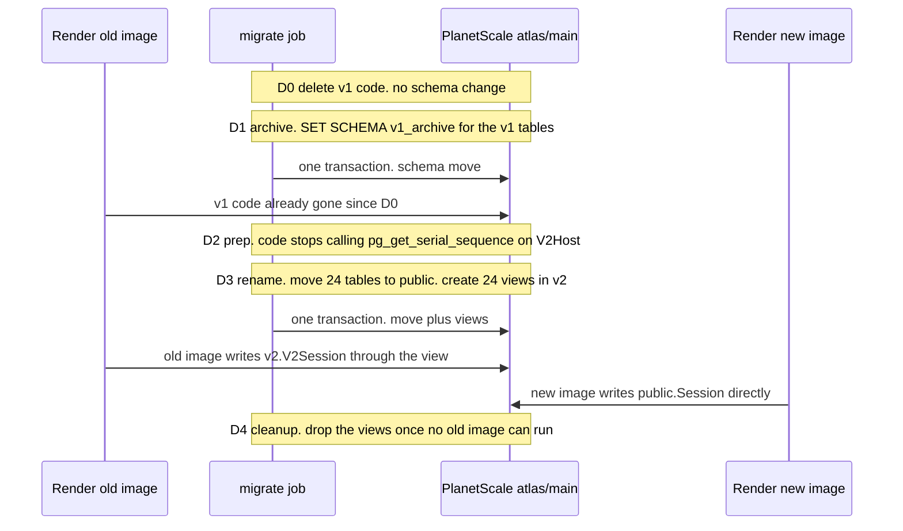

# v1 archive + v2 → public rename — feasibility and zero-downtime plan

Read-only research. Repo: `/atlas/workspaces/atlas/.atlas/worktrees/dennis/v1-retirement-spec`
(`dennisofficial/atlas`, HEAD of `main`). No repo file was edited.

**Method note.** The worktree has no `node_modules` (`bun install` was not run), so the Prisma
implementation was read from the published tarballs of exactly the pinned versions
(`packages/db/AGENTS.md:105-107`): `prisma@8.0.0-rc.24`, `@prisma/orm-toolchain@8.0.0-rc.19`,
`@prisma/orm-target-postgres@8.0.0-rc.19`, `@prisma/orm-postgres@8.0.0-rc.19`,
`@prisma/orm-family-sql@8.0.0-rc.19`. Tarballs are under
`$ATLAS_SESSION_DIR/scratch/pv/`. File names below are the hashed `dist/*.mjs` names of those
tarballs; the hash suffix changes between releases, so search by symbol name, not by file name.

Interpretation I chose where the brief left room: "the v2 rename" means one migration that
(a) moves every `v2."V2*"` table into `public` under its unprefixed name and (b) changes the
contract from `namespace v2 { model V2X }` to `model X`. I treat the v1 archive move as its own
deploy, because it cannot share a deploy with the code deletion (see §5).

---

## 1. What this Prisma's `db verify --strict` does

### 1.1 The check, end to end

`executeDbVerify` (`@prisma/orm-toolchain/dist/ref-DLqjHXyn-CsLViutC.mjs:2436-2462`) does three
things:
1. loads the contract-space aggregate from disk;
2. reads the marker rows, then introspects the database **with the aggregate's own contract**:
   `familyInstance.introspect({ driver, contract: collectAggregateNamespaces(aggregate) })`;
3. runs `verifyMigration` (`@prisma/orm-toolchain/dist/aggregate-B9HIfbq6.mjs:1058-1140`).

`collectAggregateNamespaces` (`aggregate-B9HIfbq6.mjs:155-180`) returns only the **union of the
namespaces the contract declares**. So introspection is contract-scoped, not database-scoped.

`combineVerifyResults` (`toolchain/dist/cli.mjs:2506-2545`) then applies the strictness rule, and
its doc comment states it plainly (`cli.mjs:2488-2493`):

> **Unclaimed disposition.** In strict mode a non-empty `unclaimed` list fails the combined
> verdict (`ok: false`); in lenient mode it is carried for informational rendering only.

`unclaimed` is built in `verifyMigration`
(`aggregate-B9HIfbq6.mjs:1053`) from diff issues whose outcome is `not-expected`, deduplicated
across spaces and filtered by `aggregate.declaresEntity` — i.e. live elements that **no** contract
space declares. In lenient mode the same elements surface as `warnings` instead
(`cli.mjs:1580`: `const status = inputs.strict ? "error" : "warn"`). The `--strict` help flag reads:
"Treat schema elements not present in the contract as an error" (`cli.mjs:2783`).

`db verify` also rejects an orphan marker row (`prisma_contract.marker` row whose `space` is not a
contract space) — `ref-DLqjHXyn-CsLViutC.mjs:2607`.

### 1.2 An extra schema with tables (`v1_archive`) does not fail strict verify

Two independent reasons, both in `@prisma/orm-target-postgres`:
- **Introspection walks only the contract's schemas.**
  `PostgresControlAdapter.introspect` (`target-postgres/dist/contract-contributions-CRCEK7Dx-DQWxpLgr.mjs:480-505`)
  computes `declaredTables = extractContractTableNames(contract)` and introspects exactly
  `resolveNamespaceSchemas(...)` — one entry per namespace id the contract declares
  (`:539-556`, `:1004-1016`). A schema no contract space declares is never queried for tables,
  columns, constraints or indexes. Only the _names_ of all non-system schemas are read
  (`listExistingSchemas`, `:517-534`).
- **That name list is used only one way.** `verifyPostgresNamespacePresence`
  (`target-postgres/dist/planner-Dzp0sfa8-BQQk49Bc.mjs:284-300`) emits a `not-found` issue for a
  declared namespace that is missing from the live list, and nothing for a live schema that no
  namespace declares. `diff-database-schema-BjbxFQr1-CxXB4GhI.mjs:251-272` scopes `not-expected`
  findings to `ownedSchemaNames(expected)` = the contract's own schemas, and prunes the expected
  tree to namespaces that declare tables.

So `v1_archive` with tables in it is invisible to `db verify --strict`, to `migration plan`, and to
the planner (which therefore never plans a `DROP` for it). The corollary matters more: **do not
declare `v1_archive` in the contract**. If you do, verify guards it as a managed namespace forever,
and the tables inside it become subject to planning.

### 1.3 A compatibility VIEW named like an old table does not fail strict verify

`introspectSchema` builds table nodes only from
`information_schema.tables WHERE table_schema = $1 AND table_type = 'BASE TABLE'`
(`contract-contributions-CRCEK7Dx-DQWxpLgr.mjs:582-589`) and then iterates exactly those rows
(`:744-746`). Views are never turned into schema nodes, so:
- a view in a declared namespace produces **no** `not-expected` issue — strict verify passes;
- a view is never a planning target — `migration plan` will not try to drop it;
- the columns/constraints/indexes queries do return view columns (`:590-612` selects from
  `information_schema.columns` unfiltered), but they are attached per table name from
  `tablesResult.rows`, so orphan view columns are dropped on the floor.

Consequence: a `v2` schema holding 24 compat views is invisible **provided the contract stops
declaring namespace `v2`**. That is the crux of the plan in §5.

The same asymmetry bites in the other direction: if the contract declares `public."Session"` while
the database has a _view_ of that name, verify reports the table as `not-found` and fails. So a
view can stand in for an _old_ name, never for a declared _new_ name.

### 1.4 A migration can run arbitrary SQL

Yes, through `rawSql` from `@prisma/orm-postgres/migration`. Repo precedents:
- `packages/db/migrations/app/20261124T1539_pg_squeeze_github_webhook_inbox/migration.ts:10-45` —
  a `rawSql({ id, invariantId, label, operationClass: 'data', target, precheck, execute, postcheck })`
  whose `execute[].sql` is a `DO $$ … $$` block that creates an extension and inserts a row. Its
  comment (`:14-19`) documents the self-edge/invariant rule for a data-only package.
- `packages/db/migrations/app/20261119T2253_v2_event_append_only/migration.ts:21-44` —
  `CREATE OR REPLACE FUNCTION "v2"."V2Event_append_only"()`, `DROP TRIGGER IF EXISTS`, `CREATE TRIGGER … ON "v2"."V2Event"`.
- `packages/db/migrations/app/20261123T1956_preview_tunnel_per_pod/data-steps.ts:1-20` — a helper
  that builds `rawSql` operations, imported into `migration.ts` (`:6`, `:12`).

So `ALTER TABLE … SET SCHEMA`, `ALTER TABLE … RENAME`, `CREATE VIEW`, `DROP VIEW`, `CREATE SCHEMA`
and `GRANT` are all reachable. `packages/db/AGENTS.md:60-66` confirms the authoring flow:
`bunx prisma migration new --name <slug> --from <hash>` for a hand-written package, then run the
`migration.ts` to self-emit `ops.json`, and `MIGRATION.HASH_MISMATCH` catches a forgotten self-emit.
`packages/db/AGENTS.md:80` also states the property the whole plan depends on: **"On Postgres a
`db migrate` run is one transaction."**

### 1.5 Native support: rename yes (same schema), schema move no

- **Same-schema table rename is planned natively.** A `migration plan --rename old:new` statement
  becomes a `renameTable` operation: `op-factory-call-B5_tnifS-BGaMVQ8g.mjs:984-1004` renders
  `ALTER TABLE schema.from RENAME TO to` with prechecks and postchecks. A hand-written migration can
  also call it directly: `packages/db/migrations/app/20261029T1819_auth_session_rename/migration.ts:13`
  → `this.renameTable({ schema: 'public', table: 'Session', to: 'AuthSession' })`.
- **A schema move is refused, by design, in this release.** `StatementPlanner.#planModel`
  (`@prisma/orm-family-sql/dist/control-CF-KJYTH.mjs:1739-1742`) returns
  `Moving a model to another namespace is not supported in this release: "v2.V2Session" to "public.Session"`
  with the fix "move the table yourself in a hand-written migration". There is **no**
  `ALTER TABLE … SET SCHEMA` operation factory anywhere in the toolchain: grepping
  `ALTER TABLE|ALTER SCHEMA|SET SCHEMA` over `@prisma/orm-target-postgres` and
  `@prisma/orm-postgres` returns only RENAME forms, RLS forms, and column forms.
- **A model rename also requires the table's control policy to be `managed`**
  (`control-CF-KJYTH.mjs:1729-1733`): "Statements rename only tables, and columns of tables, whose
  control policy is `managed`". This repo uses no control policy today (`grep -rn '@@rls'`
  `packages/db/src/prisma/schema` → 0 hits, no `control:` annotations), so everything is managed.

Without the statement, the planner pairs nothing and plans `not-found` (create) + `not-expected`
(drop) — i.e. **drop+create, data loss**, for anything it can see. A namespace move looks exactly
like that: the destination contract declares nothing in `v2` and the source tree has the 24 tables
there. That is why the move must be a hand-written `rawSql` migration whose end contract is the
new one; the migration runner records the new marker, and `db verify --strict` proves the result
afterwards.

---

## 2. Postgres facts (cited)

**Auto-updatable views.** `simple views are automatically updatable: INSERT, UPDATE, DELETE and
MERGE … in the same way as on a regular table`, provided one `FROM` entry, no `WITH/DISTINCT/GROUP
BY/HAVING/LIMIT/OFFSET`, no set operations, no aggregates/window/SRF in the select list.
<https://www.postgresql.org/docs/18/sql-createview.html> ("Updatable Views" section).

**`ON CONFLICT` through a view.** Supported. The same section: `If the view is automatically
updatable the system will convert any INSERT, UPDATE, DELETE, or MERGE statement on the view into
the corresponding statement on the underlying base relation. INSERT statements that have an ON
CONFLICT UPDATE clause are fully supported.` One caveat: if the view has a `WHERE` condition, the
conflicting base row must be visible through it, else an error. Our compat views are plain
`SELECT * FROM <table>` with no `WHERE`, so `DO NOTHING` and `DO UPDATE` both work, and
`RETURNING` returns the base row (the statement _is_ the base statement).
<https://www.postgresql.org/docs/18/sql-insert.html> for the `ON CONFLICT`/`RETURNING` semantics.

**Privileges.** `the user performing the insert, update or delete on the view must have the
corresponding … privilege on the view. In addition, by default, the view's owner must have the
relevant privileges on the underlying base relations` — unless the view is `security_invoker`.
Same page.

**`SET SCHEMA`.** `This form moves the table into another schema. Associated indexes, constraints,
and sequences owned by table columns are moved as well.`
<https://www.postgresql.org/docs/18/sql-altertable.html>. So a serial/identity sequence follows the
table; a column default keeps pointing at it (defaults store the sequence as a regclass OID, not a
name), and nothing is rewritten.

**`RENAME`.** `There is no effect on the stored data.` Same page. Triggers belong to the table and
follow it; a trigger _function_ lives in its own schema and does not move.

**Locks.** `An ACCESS EXCLUSIVE lock is acquired unless explicitly noted` — both `RENAME` and
`SET SCHEMA` take it, for the duration of the transaction. Both are metadata-only operations
(µs–ms per table), but they block every query on that table until commit, and because
`db migrate` runs in one transaction the locks accumulate across all statements. Also:
`RENAME`, `SET SCHEMA`, `ATTACH PARTITION` and `DETACH PARTITION` cannot be combined with other
ALTER TABLE actions in one statement — use two statements per table.
Requires table ownership plus `CREATE` on the target schema, and the connection role must be able
to own the new views.

**What does _not_ follow.** `pg_get_serial_sequence('v2."V2Host"', 'id')` resolves a sequence from a
real table's column; against a view it returns `NULL`. The old image calls it:
`apps/api/src/agent/presence/pg-host-presence.ts:81`. This is the one old-code statement a
compat view cannot satisfy (see §5, D2).

---

## 3. Raw SQL and database objects that name `v2` tables

`grep -rn '"v2"\.' --include=*.ts packages apps plugins commands` → **105 lines in 41 files**.
By area:

| area                                              | files      | lines | what                                                                                                                                                                                                                                                                                                                                                                                                                                        |
| ------------------------------------------------- | ---------- | ----- | ------------------------------------------------------------------------------------------------------------------------------------------------------------------------------------------------------------------------------------------------------------------------------------------------------------------------------------------------------------------------------------------------------------------------------------------- |
| `packages/control/src/postgres/*`                 | 13         | 54    | the whole Postgres control store: `postgres-claim-candidates.ts` (12), `postgres-append.ts` (7), `postgres-digests.ts` (6), `postgres-changes.ts` (6), `postgres-terminals.ts` (4), `postgres-session-writes.ts` (4), `postgres-views.ts` (3), `postgres-context-files.ts` (3), `postgres-blobs.ts` (3), `postgres-session-buckets.ts` (2), `postgres-peers.ts` (2), `postgres-pod-retire-lock.ts` (1), `postgres-live-pod-sessions.ts` (1) |
| `packages/github/src/*`                           | 3          | 6     | `github-watch-scope.ts:90,96`, `github-tracked-head-renewal.ts:18,20`, `github-lapsed-subscriptions.ts:17,38` — these run in the **trigger.dev worker** (`apps/trigger`, project `proj_wcjbubibkotgsclldnyz`, `apps/trigger/trigger.config.ts:5`)                                                                                                                                                                                           |
| `apps/api/src/agent/*` + `api/platform/control/*` | 5          | 8     | `presence/pg-host-presence.ts` (3), `presence/pg-host-watch.ts` (2), `stream/session-surface.ts:7`, `media/pg-media-signing-windows.ts:25`, `api/platform/control/media-registry.ts:36`                                                                                                                                                                                                                                                     |
| tests / fault rigs                                | 17         | ~19   | incl. `packages/db/src/__tests__/v2-smoke.spec.ts`, `v2-namespace.spec.ts`, `apps/api/src/agent/testing/fault-rig.ts:130`, `apps/api/src/agent/__tests__/faults/lease-fault-support.ts:126`                                                                                                                                                                                                                                                 |
| migrations                                        | 6 packages | 18    | `20261103T1907_v2_sessions_placement`, `20261104T0715_v2_blob_refs`, `20261116T1549_pin_v2_session_model`, `20261119T0140_v2_session_pr_tracking`, `20261119T2053_allowlist_and_session_provider`, `20261119T2253_v2_event_append_only`                                                                                                                                                                                                     |

Note the shape: the v2 control store is _mostly_ raw SQL (`tx.raw.sql`), not the ORM, so the rename
is a mechanical replacement of `"v2"."V2X"` → `"public"."X"` there, and an identifier change of
`db.orm.v2.V2X` → `db.orm.public.X` elsewhere.

**Upserts.** 14 non-test `ON CONFLICT` call sites write v2 tables: `postgres-views.ts:79,85,101`,
`postgres-blobs.ts:9,42`, `postgres-context-files.ts:51`, `postgres-changes.ts:21,120`,
`postgres-append.ts:125`, `apps/api/src/agent/media/pg-media-signing-windows.ts:25`,
`apps/api/src/api/platform/control/media-registry.ts:36`, `packages/github/src/github-pr-event-claim.ts:13`
(plus one in a spec, `packages/db/src/__tests__/skill-userfile-backfill.spec.ts:190`). All of these
must survive through a compat view — they do (§2).

**LISTEN/NOTIFY.** Channels are `atlas_session_wake`, `atlas_session_changed`, `atlas_host_change`
(`packages/protocol/src/bus.ts:7-11`), used through `pg_notify(…)` and `LISTEN` in
`packages/control/src/postgres/postgres-notify.ts:7,17`, `postgres-append.ts:130` and
`apps/api/src/agent/bus/pg-listener.ts:104`. Channels carry a session id, never a table name, so a
table rename does not touch them. No dual-running needed.

**Triggers and functions.** Exactly one pair exists, in
`packages/db/migrations/app/20261119T2253_v2_event_append_only/migration.ts:26-42`:
`FUNCTION "v2"."V2Event_append_only"()` plus `TRIGGER "V2Event_append_only" BEFORE UPDATE OR DELETE ON "v2"."V2Event"`.
The trigger follows the table on `SET SCHEMA`/`RENAME`; the function does not. Since the function's
body only raises, it stays correct through a view (INSERTs are rewritten to the base table and the
trigger fires on it).

**Constraint worth knowing.** The `pg_squeeze` schedule and its `DO` block name
`public."GithubWebhookInbox"` (`20261124T1539_pg_squeeze_github_webhook_inbox/migration.ts:26-44`) —
a kept table; unaffected.

**Nothing on the v2 path reads a v1 table.** `grep -rn 'orm\.public\.\(CloudSandbox|LocalPodLease|PushDevice|Thread|Event|Session|Turn|ThreadRead|ContextFile|SandboxBootStep|ComposerDraft\)'`
over `packages/control/src packages/host/src apps/api/src/agent packages/github/src` returns 6 hits,
all in test fixtures (`apps/api/src/agent/config/__tests__/config-reader.fixture.ts:53-64`,
`packages/github/src/github-linked-pr.fixture.ts:14-20`). Production v2 code reads only `v2` and
non-v1 `public` tables.

---

## 4. Rename surface

Counts, from `git ls-files` and `grep -o` over the worktree:

| measure                                                                            | count                                                                                                                                                                                                                                                                                                                                                                                                                                                                                             |
| ---------------------------------------------------------------------------------- | ------------------------------------------------------------------------------------------------------------------------------------------------------------------------------------------------------------------------------------------------------------------------------------------------------------------------------------------------------------------------------------------------------------------------------------------------------------------------------------------------- |
| `orm.v2.` occurrences (TS/TSX)                                                     | **210**, in **65** files                                                                                                                                                                                                                                                                                                                                                                                                                                                                          |
| `V2[A-Z]\w+` identifier occurrences, TS/TSX under `packages apps plugins commands` | **26,915**                                                                                                                                                                                                                                                                                                                                                                                                                                                                                        |
| top identifiers                                                                    | `V2Session` 4525, `V2Event` 3478, `V2Thread` 1969, `V2InboxEntry` 1935, `V2Lease` 1555, `V2Routine` 1527, `V2SessionPullRequest` 1157, `V2SessionView` 1113, `V2Blob` 952, `V2WorktreeChangedFile` 951, `V2RoutineRun` 924, `V2Host` 837, `V2WorktreeChanges` 802, `V2BlobRef` 788, `V2Terminal` 779, `V2SessionBranch` 680, `V2SandboxRun` 651, `V2Body` 554, `V2ChangeBlob` 477, `V2PushDevice` 235, `V2DiagramRepair` 194, `V2ContextFile` 182, `V2OperatorRequest` 146, `V2ComposerDraft` 128 |
| same, including `.prisma .json .yml .md` (contract snapshots dominate)             | 39,351                                                                                                                                                                                                                                                                                                                                                                                                                                                                                            |
| tracked paths with `v2` in the name                                                | **362** total; **96** outside `packages/db/migrations` and `docs/`                                                                                                                                                                                                                                                                                                                                                                                                                                |
| v2-named migration directories                                                     | 37                                                                                                                                                                                                                                                                                                                                                                                                                                                                                                |

Tables to move: **24** in namespace `v2` (`packages/db/src/prisma/schema/contract.json`
`storage.namespaces.v2.entries.table`): `Media`, `MediaSigningWindow`, `V2Blob`, `V2BlobRef`,
`V2ChangeBlob`, `V2ComposerDraft`, `V2ContextFile`, `V2DiagramRepair`, `V2Event`, `V2Host`,
`V2InboxEntry`, `V2Lease`, `V2PushDevice`, `V2Routine`, `V2RoutineRun`, `V2SandboxRun`,
`V2Session`, `V2SessionBranch`, `V2SessionPullRequest`, `V2SessionView`, `V2Terminal`, `V2Thread`,
`V2WorktreeChangedFile`, `V2WorktreeChanges`. `public` holds **57** tables today, including the v1
names the rename collides with: `Session`, `Thread`, `Event`, `Turn`, `ThreadRead`, `ContextFile`,
`SandboxBootStep`, `CloudSandbox`, `LocalPodLease`, `PushDevice`, `ComposerDraft`.

**Main v2-named paths** (dirs and files, outside migrations and docs):
- dirs: `apps/mobile/src/thread/v2/` (41 files incl. `__tests__`), `packages/db/src/prisma/schema/v2/`
  (24 model files), `docs/v2/` (`docs/v2/research/v1-retirement/` already exists — see the five
  `inventory-*.md` files there), plus 37 migration dirs whose name contains `v2`.
- files: `apps/web/src/features/shell/{use-v2-sessions.ts,v2-rows.ts,v2-status.ts}`,
  `apps/web/src/features/shell/__tests__/v2-*`, `apps/mobile/src/sessions/v2-sessions.ts`,
  `apps/mobile/src/thread/v2/use-v2-{agent,session,session-commands,session-screen}.ts`,
  `packages/github/src/github-v2-notice.ts` + `github-v2-run-notice.ts`,
  `packages/host/src/holder/record/v2-once-ledger.ts`,
  `packages/pods/src/pods/v2-pod-sweep.ts` (+ fixture and two specs),
  `packages/db/src/__tests__/v2-{namespace,smoke}.spec.ts`,
  `.github/workflows/trigger-v2.yml`.

**Which are public contracts needing an alias?** None of them, which is the good news:
- **tRPC procedure and router names**: no alias or procedure contains `v2`. The full alias list is
  `account accountLease accounts artifacts classifier composerDrafts composerUploads contextFiles
  contextMirror credentialAvailability desktopAuth diagrams faults github githubPrs githubRepos
  githubSubscriptions harnessSecrets mcpOauth mcpServers media memories models notifications
  oauthConnections operatorRequests podLeases presence probe projectResources projectWorkspace
  projects providerSignIn publishedBundles pushDevices rate routines sandboxCheckpoint sandboxConfig
  sandboxRollover sandboxSelf sandboxes secrets services sessionDrafts sessionStream sessions
  settings skillCatalogue skills sshSigningKey terminal terminalStream threadEvents threadMessages
  threadPod threadSandbox threadTurns threads usage userFiles`. The v2 semantics already live under
  unprefixed aliases (`sessions`, `sessionDrafts`, `notifications`, …), so a DB rename changes no
  installed client's API.
- **HTTP routes**: no `/v2/` route in `apps/api` or `packages` (the only `/v2/` strings are artifact
  blob path segments in `apps/api/src/api/cloud/artifacts/artifacts.commit-publish.spec.ts:197,240`).
- **Env vars**: no key with `V2` in `apps/api/src/_core/env/` nor in the `.env.*.enc` key names.
  The `V2_SESSIONS_*` hits are web constants: `apps/web/src/features/shell/sidebar-cache.ts:5-7`
  (`localStorage` key `atlas:sidebar-v2-sessions`) and `apps/web/src/lib/cloud-keys.ts` — a client
  cache; renaming only costs one cache miss.
- **trigger.dev task ids**: `repo-mcp-server-sweep`, `github-poll-sweep`, `github-hook-sweep`,
  `github-webhook-reconcile`, `preview-reconcile`, `agent37-usage-reconcile`,
  `composer-upload-sweep`, `orphan-pod-sweep`, `routine-sweep`, `changes-gc` — none contains `v2`.
  Only the project and the workflow file are named `trigger-v2`.
- **LISTEN channels**: unprefixed (§3).
- **Persisted string literals**: the only `v2`-bearing runtime strings are SQL (`"v2"."V2X"`) and
  test fixture names (`atlas-v2-other-sandbox`, `atlas-v2-conformance` — sandbox names in tests).
  No wire discriminator, no JSON field name, no Prisma enum value.

So the rename is internally free of client-compatibility shims; the only compatibility surface is
the **database itself**, which the installed TUI/Mac/iOS clients reach through unprefixed tRPC.

---

## 5. Proposed sequence

Deploy facts that constrain it: `.github/workflows/release.yml` runs `migrate` (line 95-118:
`bun run --cwd apps/api db:migrate:predeploy`) before `render-deploy` (`needs: [api-image, migrate]`,
line 120-121). `db:migrate:predeploy` = `scripts/predeploy.mjs`: migrate with 3 retries, then
`prisma db verify --strict` on `DIRECT_URL`; a non-zero exit aborts the deploy **after** the schema
has already changed. Render then keeps the old container serving until the new one is healthy. So
there is always a window in which old code and new code hit the same database, and the database is
never rolled back (`apps/api/AGENTS.md`: "Fix forward, never roll back").
`apps/trigger` deploys after `render-live` (`.github/workflows/trigger-v2.yml`), so an old trigger
build can also run against the migrated schema for a few minutes.

### (a) Archiving the v1 tables — two deploys, no views needed

- **D0 (code only, no schema change).** Delete the v1 app: `apps/api/src/api/platform/sessions/*`,
  `sandboxes/*`, `pod-leases/*`, `thread-events/turns/context-files` routers, the v1 push router,
  `src/api/cloud/sandbox-provisioning/*`, plus `apps/serve`, `packages/harness`'s cloud client and
  the web v1 thread UI. **Keep** `apps/api/src/api/cloud/composer-drafts/*` (below). The contract
  still declares the v1 models, so `verify --strict` is unchanged and the old image is happy.
  Do **not** delete the v1 models here: that would change DDL in the same deploy, and the planner
  would then plan `DROP TABLE` for tables the still-serving old image is reading.
- **D1 (schema + contract).** One hand-written migration:
  `CREATE SCHEMA IF NOT EXISTS v1_archive;` then, per table,
  `ALTER TABLE public."Session" SET SCHEMA v1_archive;` … for `Thread`, `Event`, `Turn`,
  `ThreadRead`, `ContextFile`, `SandboxBootStep`, `CloudSandbox`, `LocalPodLease`, `PushDevice`.
  Owned sequences and the tables' FK constraints move with them (docs, §2), so
  `CloudSandbox.userId → User.id` and `Session.userId → User.id` keep working across schemas.
  In the same deploy the contract deletes `packages/db/src/prisma/schema/threads/*.prisma`,
  `sandboxes/{cloud-sandbox,local-pod-lease}.prisma` and `user-config/push-device.prisma`, and drops
  the matching relation fields (`auth/user.prisma:37,39`, `projects/project.prisma:21`).
  `db verify --strict` passes because `public` no longer has them and `v1_archive` is not declared.
  This migration cannot ship in D0: its predeploy migrate runs while the _v1_ image is still
  serving, and the v1 code would get `relation public."Thread" does not exist`.

**Two exceptions, both because a shipped client still calls them:**
- `public."ComposerDraft"` — the installed TUI calls `composerDrafts.get/put/clear`
  (`apps/tui/src/app/session-api.ts:172,177,181`) and that alias writes `public."ComposerDraft"`.
  Move the table, then leave `public."ComposerDraft"` as a compat view over
  `v1_archive."ComposerDraft"` (same trick as below), and drop the view once no TUI build without
  `sessionDrafts` can connect.
- `podLeases` (Mac) and `pushDevices` (v1 web push): if any shipped build still calls them, either
  keep the routers (and leave the tables in `public` for now) or archive with the same compat view.

### (b) Moving and renaming the v2 tables — one deploy, one transaction, with compat views

- **D2 (code only, no schema change): make the old code view-safe.** One statement is not:
  `apps/api/src/agent/presence/pg-host-presence.ts:81`
  `SELECT nextval(pg_get_serial_sequence('"v2"."V2Host"', 'id'))`. Through a view it returns NULL
  and `nextval(NULL)` raises. Change the insert to omit `id` and take `RETURNING id` (or fall back
  to `nextval('v2."V2Host_id_seq"')`), so the statement works before and after the move. Everything
  else the old image runs is name-driven and works through a view: plain `SELECT`/`INSERT`/
  `UPDATE`/`DELETE`, `INSERT … ON CONFLICT`, `UPDATE … FROM`, `DELETE`, `SELECT … FOR UPDATE` on
  single-table views.
- **D3 (the rename).** One hand-written migration (`bunx prisma migration new --name v2_to_public
  --from <db ref>`), whose emitted contract is the new one (`model Session`, … in the default
  `public` namespace; `packages/db/src/prisma/schema/v2/*.prisma` files replace
  `namespace v2 { model V2Session` with `model Session`, and the `V2` prefix drops everywhere
  except where the name would collide with nothing). Operations, in this order, all in the one
  transaction:
  1. `SET LOCAL lock_timeout = '5s'` and `SET LOCAL statement_timeout = '30s'` as the first steps
     (a blocker fails the migration fast instead of pinning locks).
  2. Per table: `ALTER TABLE "v2"."V2Session" RENAME TO "Session";` then
     `ALTER TABLE "v2"."Session" SET SCHEMA public;` (two statements; `RENAME` and `SET SCHEMA`
     cannot be combined).
  3. Per table: `CREATE VIEW "v2"."V2Session" AS SELECT * FROM "public"."Session";` so the old
     image, and any old trigger.dev build, keeps reading and writing. `GRANT SELECT, INSERT, UPDATE,
     DELETE ON "v2"."V2Session" TO <app role>` if the app connects as a role other than the owner —
     the view owner needs the base-table privileges, which it has.
  4. The append-only guard: `CREATE OR REPLACE FUNCTION public."Event_append_only"() …`, then
     `DROP TRIGGER "V2Event_append_only" ON public."Event"` and
     `CREATE TRIGGER "Event_append_only" BEFORE UPDATE OR DELETE ON public."Event" …` so the
     function no longer depends on schema `v2`.
  5. Code in the same deploy: `db.orm.v2.V2X` → `db.orm.public.X` (210 sites, 65 files) and
     `"v2"."V2X"` → `"public"."X"` (54 lines in `packages/control`, 6 in `packages/github`, 8 in
     `apps/api`).
     `db verify --strict` then introspects only `public`, sees 24 `BASE TABLE`s whose shape never
     changed, and ignores the 24 views in `v2` — it passes.
- **D4 (cleanup, data-only).** After D3 is live and past the longest-lived old connection (Render
  rollout + one trigger.dev deploy, so an hour is generous), a `rawSql` package with an
  `invariantId` (same pattern as
  `20261124T1539_pg_squeeze_github_webhook_inbox/migration.ts:10-45`) drops the 24 views, drops the
  leftover `public."V2Event_append_only"`-era function if it was not replaced, and — only if empty —
  `DROP SCHEMA v2`. Also update `packages/db/src/testing/test-database.ts:91`
  (`TRUNCATED_SCHEMAS = ['public', 'v2']` → `['public']`; `pg_tables` excludes views, so the test
  lane never truncates a view).

### Does a view-based expand work with this Prisma's verify?

Yes, in this direction, and only in this direction:
- **Views under the OLD names in the OLD namespace: invisible, passes.** The contract stops
  declaring `v2`; introspection walks `public` only (§1.2, §1.3). The renamed tables are real base
  tables under their declared names, so the declared side matches exactly.
- **Views under the NEW names in `public`: fails.** The contract would declare `public."Session"` as
  a table; the BASE TABLE filter would not see the view, `verify --strict` would report it
  `not-found` and abort the deploy — after the schema had already changed. So the "create views
  first, then ship the new code, then move the tables" order (expand in the new namespace) is not
  available here. The move and the contract change must ship together, with the escape hatch left
  in the old namespace.

If compat views are rejected for some reason, the fallback order is: (1) two-deploy copy
(create the new tables, dual-write, backfill, switch reads, drop the old) — weeks of code and a
backfill over the busiest tables, and `V2Event` is append-only with a guard trigger so dual-writing
it is awkward; (2) a stop-the-world rename, which is not a maintenance window you can schedule
safely because agent hosts hold leases and the pod-sleep behaviour keeps writers around. The
metadata itself costs milliseconds: 24 `RENAME` + 24 `SET SCHEMA` with no table rewrite (§2).

### Failure modes

1. **Verify fails after the migration commits.** The deploy aborts, the database stays migrated, and
   the old image keeps serving — which is exactly why the views must be in the same transaction.
   If a view is missing, some old-code path breaks; if the contract declares something absent,
   every subsequent deploy also fails verify until fixed forward.
2. **Lock pile-up.** One long-running query on `Event` (the append-only guard means `Event` is
   insert-only and busy) blocks the `ALTER TABLE`; since all statements share one transaction,
   the tables already altered stay locked behind it. `lock_timeout` converts this into a fast
   retryable failure (the predeploy retries three times).
3. **Privileges.** The migration connects on `DIRECT_URL`, the app on `DATABASE_URL` (the pooled
   endpoint). If those are different roles, the views need explicit grants and the app role needs
   `USAGE` on schema `v2`. Check before D3, not after.
4. **`pg_get_serial_sequence`** (§2, D2) — the one statement that cannot survive a view.
5. **`TRUNCATE`** anywhere in the app or test lane against a v2 table breaks through a view; the
   lane builds its list from `pg_tables`, so it degrades to "nothing to truncate" rather than an
   error, which would silently leak rows between specs. Update `TRUNCATED_SCHEMAS` in D3, not D4.
6. **Row-level security.** None is in play: no `@@rls` and no policies in the contract, so the view
   rewrite cannot trip policy checks owned by another role.
7. **Old trigger build.** `apps/trigger` deploys after `render-live`, so the previous worker build
   can execute for a few minutes after D3. Its raw SQL (`packages/github/src/*`) is covered by the
   views — provided D2 shipped first.
8. **A future `migration plan`.** With `v2` undeclared, the planner cannot see anything left there.
   Anything accidentally left in `v2` (a table that the migration forgot to move) is invisible to
   both verify and the planner — so the D3 migration must be generated from an explicit table list
   (`storage.namespaces.v2.entries.table` in `contract.json`) and checked once against
   `information_schema.tables WHERE table_schema = 'v2'` after the move, e.g. a precheck that the
   `v2` schema holds no `BASE TABLE` any more.
