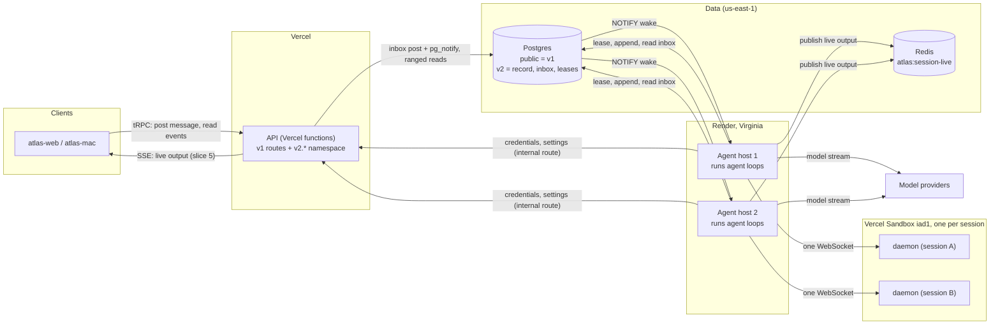
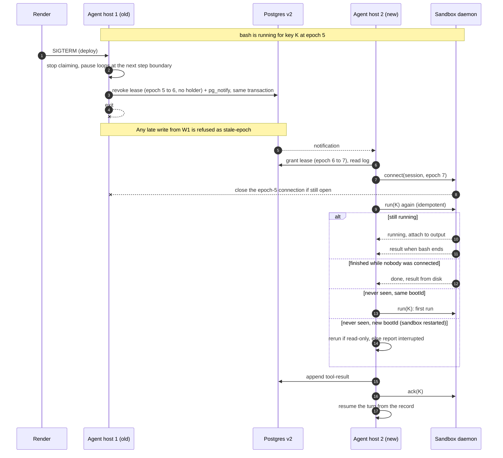

# Slice 3 spec: agent host and sandbox daemon

Status: **approved 2026-11-02** and simplified the same day after a design review (per-event appends, `run` replaces collect, no Redis stop, one-row blobs; DB-clock leases, boot-only pruning, zombie `ack` refused) (operator: "tests and spikes will prove it"); hardened after a
codebase-design pass (deep modules, one `OnceLedger`, the fake daemon held to the real one).
Sibling to [roadmap.md](../roadmap.md) slice 3.
Applies [0021](../../decisions/0021-v2-loop-runs-on-the-agent-host.md) (D8),
[architecture.md](../architecture.md) §3, §5, §11–§13, and builds on slice 1
([record core](01-record-core.md)) and slice 2 ([agent](02-agent.md)). Anchors read at `6cf3be0e3`.

**Built 2026-11-04; superseded text is marked below.** Slice 3 was built to this spec with these changes:
- Wakes are Postgres `LISTEN`/`NOTIFY`, not a Redis channel (points 3, 5, 9 and 10, the diagrams, the
  Redis row of the failure table, F9, F20). Redis carries live frames only. No inbox poll or stop poll
  exists; a stop is a wake. See [0021](../../decisions/0021-v2-loop-runs-on-the-agent-host.md), Amendments.
- The agent host imports nothing from `harness` or `wire`; the tools, model port, prompt fragments and
  sandbox helpers were copied into `apps/agent-host` (point 1).
- A new session is prepared (clone, setup script) before its first turn, and an idle session stays
  parked across an agent-host deploy ([architecture §13](../architecture.md)).
- The `v2` prefix was dropped from names: `sessions.*`, `agentHost.*`, the task `reconcile-holders`.
- Where the slice stands: the roadmap's Current state and [handoffs/slice-4.md](../handoffs/slice-4.md).

## Goal

A v2 session runs end to end in the cloud with no v1 code path in it. An agent host on Render holds
the session's lease, runs the `agent` loop, and appends hash-chained events straight into the
control plane's Postgres. A small daemon in the session's Vercel sandbox runs the tools. When a
agent host restarts or dies, another agent host picks the turn up from the record, and no tool runs twice.
There is no client yet (slice 5): the slice is driven by scripts and tests through a small v2 API
namespace.

Out of scope: views (slice 4), clients and the v2 toggle UI (slice 5), commands (slice 6), moving
shells, services, MCP, sub-agents and GitHub into plugins (slice 7), local runtimes (slice 9).

## What exists today

- **The control plane library** is done and poll-only: `ControlPlane`
  (`packages/control/src/control-plane.ts:57`) has `append`, `readEvents` (≤1000 per page),
  `post`, `readInbox`, `grant`/`renew`/`revoke` (explicit `ttlMs`, no default) and
  `currentLease`. Nothing wakes a reader. Postgres adapter: `src/postgres/postgres-store.ts`.
- **The record has three v2-only events** (`packages/core/src/record/event.ts:22-31`):
  `history-rewound`, `history-summarised`, `input-consumed`. There is nothing for a hook
  decision, a retry deadline or an aborted model stream.
- **The loop** (`packages/agent`, `LoopTurnRunner(TurnDeps)`, `loop/run-turn.ts:50`) takes its
  record, model context, intake and output through ports. `tool-dispatched` is appended before a
  tool runs, and dispatch fails closed if that append fails (`tools/dispatch-drafts.ts:12`). Crash
  recovery reruns read-only calls and reports the rest as interrupted
  (`loop/dispatch-recovery.ts:29`). The pause is checked once, at the top of each loop iteration
  (`loop/tracked-turn.ts:88`). Retry backoff is an in-memory `setTimeout`
  (`loop/retrying-step.ts:63`, injectable `RetryDeps.sleep`).
- **The tools already sit on ports.** `ProcessPort` (`packages/core/src/ports/process.port.ts:27`),
  `FileSystemPort`/`AgentFileSystemPort` (`filesystem.port.ts:14`, `agent-filesystem.port.ts:4`),
  and in harness `ShellLauncherPort`/`ShellRegistryPort` (`shells/port.ts:75,80`), `TerminalPort`
  (`terminal/terminal.port.ts:7`), `OperatorInputPort` (`operator-input/port.ts:20`). The two gaps
  are MCP stdio, which spawns a Bun subprocess directly (`mcp/transport/stdio.ts:38`), and the
  concrete `DockerEngine`.
- **Sandbox boot** is shared code in `packages/wire`: `mountWithRetries`
  (`sandbox-mount.ts:32-154`, region `iad1`, port 3000, persistent with resume), retries and
  error classes. The v1 cgroup split and priorities are in
  `packages/harness/src/execution/workload-cgroups.ts` (`atlas-serve` weight 500, `atlas-work`
  weight 20, `pids.max` 16384, `memory.max` = RAM − max(1.5 GiB, 25%)), `serve-priority.ts:6`
  (−900, nice −5) and `workload-priority.ts:35-60` (+800, nice 10, a `w-<pid>` box per workload
  with `memory.oom.group=1`, killed through `cgroup.kill`). v1 has no watchdog.
- **Infrastructure the API already runs:** Upstash Redis (`REDIS_URL`,
  `apps/api/src/_lib/redis/redis.service.ts`, pub/sub precedent in
  `api/cloud/github/github-pr-fanout.transport.ts`), Vercel Blob (`BLOB_READ_WRITE_TOKEN`,
  composer uploads), trigger.dev. Production Postgres is `aws-us-east-1` (PlanetScale Postgres);
  the API is `https://api.byatlas.io`.
- **No `engine` field or feature-flag system exists anywhere.** Web and Mac already read their API
  origin from `ATLAS_API_ORIGIN` (`apps/web/src/lib/api-origin.ts`, `apps/mac/src/host/api-origin.ts`);
  web proxies `/api/*` and `/v1/*` to it (`apps/web/next.config.ts:60-64`).
- **The 4 MB body cap** (`apps/api/src/_lib/body-limits.ts:1`) applies to requests into the
  Vercel API. Production's largest single event is 2.9 MB.

## Measurements (first deliverable)

Measured 2026-11-02 from a temporary Render Background Worker (Virginia, Starter plan), three
runs, written up in [research/d8/rtt-render.md](../research/d8/rtt-render.md) and compared 1:1
with the Vercel → Vercel baseline ([rtt.md](../research/d8/rtt.md)).

| Path (p50, ms)                             | Render → Vercel `iad1` (3 runs) | Vercel → Vercel baseline |
| ------------------------------------------ | ------------------------------- | ------------------------ |
| Tool call over one WebSocket: exec         | 6.5 / 17.0 / 19.3               | 6.5                      |
| Tool call over one WebSocket: read / write | 3.0–15.5                        | 3.6–3.7                  |
| Tool call over one WebSocket: grep         | 19.3 / 29.9 / 39.4              | 18.2                     |
| Per-call `runCommand` (no daemon)          | 63–96                           | 57–81                    |
| HTTPS to `api.byatlas.io`                  | 15.3–16.6 (p99 51–66)           | not measured             |
| Postgres `SELECT 1` transaction            | 5.5 (p99 8.4)                   | not measured             |
- **A tool call costs 5–20 ms p50 from Render**, which is 0 to 13 ms more than from inside Vercel,
  depending on where Render places the instance. At production's p50 of 10 sequential calls per
  turn, that is at most a fifth of a second against a median turn of 3.5 minutes. D8 holds.
- The persistent WebSocket stays 4–10× cheaper than `runCommand`, and the proxy held an idle
  connection for 180 s in every run. Connecting takes 25–90 ms, once per sandbox.
- **Postgres is closer than the API** (5.5 ms against 16 ms p50), which supports point 2.
- Variance between runs on the Starter plan is large; exit test 1 re-measures on the production
  plan.
- Two facts for the builder: Render restarts a Background Worker whose process exits, and
  `Bun.SQL` silently connected to PlanetScale without TLS. The agent host uses `@dltech/atlas-db`,
  which is on `pg`, and a spec asserts TLS is on.

## How it fits together

**Who talks to whom.** Durable data and wakes go through Postgres; Redis carries live output only, and
losing a Redis message loses nothing durable. (Redis also carried wakes and stops in the first design;
superseded 2026-11-04. The diagrams below show what was built.)



**Pickup and one turn.** Both agent hosts hear the notification; the epoch compare-and-swap on the lease row
lets exactly one win.

```mermaid
sequenceDiagram
  autonumber
  participant C as Client
  participant API as API (Vercel)
  participant PG as Postgres v2
  participant R as Redis
  participant W1 as Agent host 1
  participant W2 as Agent host 2
  participant D as Sandbox daemon

  C->>API: v2.sessions.post(message)
  API->>PG: insert inbox entry (inboxId 7) + pg_notify(atlas_session_wake), one transaction
  PG-->>W1: notification on commit
  PG-->>W2: notification on commit
  par both try to claim
    W1->>PG: grant lease (epoch 4 to 5)
    PG-->>W1: won, epoch 5
  and
    W2->>PG: grant lease (epoch 4 to 5)
    PG-->>W2: CAS failed, drop it
  end
  Note over W2,PG: A notification lost in a dropped connection is recovered by the resync on reconnect; a crashed holder by the 1-minute reconcile task
  W1->>PG: read log in pages, read inbox
  W1->>D: connect(session, epoch 5), or boot sandbox + upload daemon
  loop every 5 s while holding
    W1->>PG: renew lease (TTL 30 s)
  end
  W1->>W1: model step (stream from provider)
  W1-->>R: live tokens (atlas:session-live)
  W1->>PG: append [input-consumed 7, assistant-said, tool-called, tool-dispatched]
  Note over W1,PG: tool-dispatched must commit before the tool starts
  W1->>D: run(key = runId:callId, bootId)
  D->>D: write "running" to disk, then spawn bash in its own box
  D-->>W1: output chunks (forwarded to atlas:session-live)
  D->>D: write "done" + result to disk
  D-->>W1: result
  W1->>PG: append tool-result
  W1->>D: ack(key), daemon deletes it
  W1->>PG: append next step ... turn end
  Note over W1,PG: Each event is appended as it happens; tool-dispatched commits before run
```

**An agent host restarts mid-tool.** The tool keeps running; the new holder collects it.



## Points to agree

### 1. The packages and services (the `pod` rename)

| Where                           | What                                                                                                                                                                                                                                    |
| ------------------------------- | --------------------------------------------------------------------------------------------------------------------------------------------------------------------------------------------------------------------------------------- |
| `packages/protocol`             | New. Zod schemas only: agent host ⇄ daemon frames and the v2 API inputs. `wire` is not touched; it becomes `protocol` at cutover (0019)                                                                                                 |
| `packages/host`                 | New, replaces 0019's `pod`. The agent host library: claiming and renewing leases, the per-thread record cache and per-event appends, inbox wake, running `agent`, the daemon client and the daemon-backed tool ports, the clean handoff |
| `apps/agent-host`               | New. The Render service: plain Bun, composes `host` with the model adapters and builtin tools (copied from `harness` on 2026-11-04; the host imports no v1 code). No Nest, no tRPC                                                      |
| `apps/daemon`                   | New. The in-sandbox daemon. Built into one JavaScript file that the agent host ships inside its own image and uploads to the sandbox                                                                                                    |
| `apps/trigger`, `packages/jobs` | New (0022). trigger.dev app with one task, `v2-reconcile-holders` (point 3); its contract in `packages/jobs` (zod only)                                                                                                                 |
| `apps/api`                      | Gains a `v2` tRPC namespace (point 9). No v1 route changes                                                                                                                                                                              |

Plain terms: the "pod" package splits in two because the two halves now run on different machines.
`host` is everything the agent host does; the daemon is everything the sandbox does.

**Daemon delivery.** v1 downloads serve from a GitHub release. The daemon instead travels with the
agent host: the agent host image holds the daemon bundle built from the same commit, and uploads it when it
boots a sandbox or finds a different daemon version running. The sandbox image already has Bun
(`/opt/mise/shims/bun`), so the daemon runs as a bundled script, about 1–2 MB, not a 60 MB compiled
binary. The agent host and the daemon can then never disagree about the protocol, and the release
workflow does not change.
**Alternative:** a compiled `atlas-daemon` in the GitHub release, like serve. That costs a release
workflow change and brings v1's version-skew problem back.

### 2. The agent host talks to Postgres directly, and to the API only for v1-owned config

The agent host is part of the control plane (0021), so it uses the `ControlPlane` library over
`PostgresControlStore` itself. It does not send appends through the Vercel API.
- One less hop on every append, and no 4 MB request cap on the write path.
- Fencing (epoch and seq) is enforced inside the Postgres transaction, so it holds no matter how
  many agent hosts or API instances there are.
- The API uses the same library for v2 reads and inbox posts. Two callers, one library, one set
  of rules.

**v1's API stays the only writer of users, projects, credentials and settings.** The agent host never
writes a `public` table. It asks the API for what it needs over an internal route authenticated by
a shared agent-host token (`AGENT_HOST_TOKEN`, set on Render and Vercel): model credentials (the API
refreshes OAuth tokens, because a refresh is a write), Vercel sandbox credentials, the GitHub
token for the clone, and a settings snapshot with its revision. The agent host caches each until it
expires.

**Alternative:** the agent host reads `public` tables directly. Rejected: credential decryption and
OAuth refresh would gain a second home, which is the kind of fork v2 exists to remove.

### 3. Placement: agent hosts claim sessions themselves

There is no separate scheduler. Claiming is part of the agent host; the periodic safety net is a
trigger.dev task, because the agent host runs no timers of its own beyond its sessions' loops
([0022](../../decisions/0022-v2-background-jobs-in-apps-trigger.md)):
- **Wake (built 2026-11-04).** Posting to a session's inbox (message or stop), creating a session, and a
  revoke that leaves work behind each call `pg_notify('atlas_session_wake', sessionId)` inside the write
  transaction, so a notification exists only if the write committed. Every agent host `LISTEN`s on one
  direct connection (`DATABASE_DIRECT_URL`). One below its capacity tries to `grant` the lease, and the CAS
  on the epoch lets exactly one win; the others drop it. Every reconnect emits a resync: the host claims
  `sessionsNeedingHolder` and each held session re-reads its inbox.
- **Reconcile (in `apps/trigger`, not the agent host).** A crashed holder emits no event, so a trigger.dev
  scheduled task, `reconcile-holders` (first named `v2-reconcile-holders`), runs every minute (trigger.dev's
  finest schedule). It finds sessions with unconsumed inbox entries, an unfinished turn or an unprepared
  workspace and no live lease (one store query, `sessionsNeedingHolder({ limit })`, backed by an index) and
  notifies for each through `ControlPlane.wake`. It claims nothing itself; the agent hosts claim as for
  any wake. Its contract lives in `packages/jobs`, its logic (the query) in `packages/control`, so
  neither app imports the other. Slice 3 scaffolded `apps/trigger` (own `trigger.config.ts`, own tier file,
  own trigger.dev project) with this one task; it needs only `DATABASE_URL`.
- **Superseded 2026-11-04:** the first design published `atlas:session-wake` on Redis, from the API and from
  the reconcile task. Pub/sub is fire-and-forget, and with Redis down no wake path existed, because
  reconcile published through Redis too. See 0021, Amendments.
- **What stays in the agent host** is what belongs to a session's loop: lease renewal, the sandbox
  keep-alive and the idle rule's per-session deadline. The stop poll during a turn is gone (superseded
  2026-11-04); a stop is a wake.
- **Holding.** The holder renews every 5 s with a 30 s TTL. Lease times (`renewedAt`, expiry) use
  the database's clock (`now()` in the transaction), never a machine's own, so clock skew between
  hosts cannot shorten or stretch a lease. The lease now lives on the agent host, so
  a saturated sandbox cannot make it lapse (R4 becomes easy). A clean restart hands its sessions
  over immediately (point 5). A crash is noticed by the next reconcile run after the TTL, so its
  sessions resume within about 90 s (30 s TTL + up to 60 s), unless a new message wakes them
  sooner.
- **Release when idle.** After v1's 30-minute quiet rule, the agent host stops the sandbox and
  releases the lease together (point 7). The next message wakes both.
- **Capacity.** Each agent host takes at most `AGENT_HOST_MAX_SESSIONS` (start at 25; slice 3 measures
  memory per held session and sets it).

**Why not a job queue (BullMQ) or trigger.dev.** A queue hands out jobs that run to completion;
a session is held for hours, renewed, and must be taken away from a holder that stops renewing.
A queue would still need the epoch fence on top, because it cannot stop a zombie consumer from
writing. The lease in Postgres already is that fence, so a queue would be a second source of
truth about who owns a session. trigger.dev runs bounded tasks (this project caps them at 300 s,
`apps/api/trigger.config.ts`) and checkpoints by freezing the process, which drops the daemon
WebSocket; turns run p50 3.5 min and p90 32 min. trigger.dev keeps its v1 jobs (crons, sweeps)
for session holding; v2's one periodic job, the reconcile pass, is a trigger.dev task (0022). The
whole mechanism is three parts: the lease row (exists), a Postgres notification (latency; a Redis wake message in the first design, superseded 2026-11-04), and the
one-minute reconcile task (safety net).

### 4. The record cache and append latency (~1 s)

- On claim, the agent host reads the thread's visible log in pages (`readEvents`, 1000 per page) into
  memory. The loop's `ownEvents` and `ModelContextPort` read that cache, and appends extend it.
  At the design size (~20k events, tens of MB) this is a one-off read of about 20 pages per claim.
  The exit criterion measures claim time at 20k events.
- **Each event is appended as it happens**, in its own transaction (Postgres is 5.5 ms away and a
  turn produces tens of events, so batching would buy nothing and would add an unflushed tail to
  lose on a crash). `tool-dispatched` commits before the tool runs, as today. Exit check: the time
  from an event's `at` to its commit stays under 1 s at p99.
- **Refused versus unreachable.** A _refusal_ (`stale-epoch`, `lease-expired`) means the lease is
  gone: the loop stops and the host drops the session at once. _Unreachable_ (a network error or
  timeout) is retried with backoff; an append is idempotent by `(threadId, seq)` and hash, so a
  retry after an unknown outcome is safe. Past TTL − 5 s without success the host self-fences
  (point 5). Any other refusal is a bug and fails the turn loudly.
- **Live output** (token deltas, tool output as it streams) is not an event. The agent host
  publishes it on Redis `atlas:session-live:<sessionId>`. Slice 5 serves it to clients over SSE; slice 3
  publishes it and tests that it arrives.

**Alternative:** materialized per-step checkpoints on `V2Thread` (§12 L3) so a claim never reads
past the tail. Deferred to slice 4, where folds become materialized views anyway; the in-memory
cache is the simplest correct thing for a single holder.

### 5. An agent host restart is a clean handoff; a crash is a slower one

| What happened to the agent host          | Who notices                                               | New holder starts                    | Lost                                   |
| ---------------------------------------- | --------------------------------------------------------- | ------------------------------------ | -------------------------------------- |
| SIGTERM (deploy, Render restart)         | The agent host itself: revokes, notifying if work remains | ~1 s after it lets go                | Nothing; a step past 270 s is re-asked |
| Crash, OOM, host lost, network partition | Nobody until the lease expires                            | ≤ ~90 s (30 s TTL + 1 min reconcile) | The in-flight model step (re-asked)    |

In both cases running tools keep running in the daemon and are collected (point 6), and every
event already appended stays. A crashed agent host that comes back, or a partitioned one that never
noticed, is fenced twice: Postgres refuses its appends (old epoch) and the daemon has closed its
connection (point 6, rule 4). It also **fences itself**: if it has not renewed successfully for
TTL − 5 s, it stops starting tools and stops its loops before anyone else can take over, so even
its own clock never lets two holders act at once.

On SIGTERM (Render deploy or restart; grace set to Render's maximum, 300 s):
1. Stop claiming sessions.
2. A loop between steps pauses at once (the existing pause check).
3. A loop waiting on a tool is left as it is. The tool keeps running in the daemon (point 7).
4. A loop waiting on the model may finish its **current model step** (one streamed response: some
   text and the tool calls it asks for) until the drain deadline (grace minus 30 s, so 270 s). It
   does not finish the turn; the turn's remaining steps run on the next holder. Most steps end
   long before the deadline; the deadline exists for long thinking. Past it the stream is
   aborted, the partial output is appended marked `aborted: 'handoff'`, and the next holder asks
   again. Appends after the abort get a 10 s grace past the drain deadline (0021, third amendment). PR 1 measures step duration from production `assistant-said` timestamps.
5. Revoke every held lease (epoch + 1), then exit.

Revoking is what makes this safe. After step 5, anything a leftover loop tries to write is refused
as `stale-epoch`, so the old agent host cannot fork the record, even if it is slow to die.

**`RelocationPaused` is renamed `HandoffPaused`; its wire value stays `'relocation-paused'`.**
v1 clients parse the string, never the TypeScript name
(`packages/wire/src/turn-outcome-wire.ts:11`), so renaming the member is a mechanical edit of seven
files (`agent`, `client`, `harness`, `serve`, `wire`) with no change on the wire. The string is
renamed at cutover, when no v1 client is left to read it.

### 6. A new holder resumes the turn, and no tool runs twice

On claim, if the thread's last turn did not end (a consumed input without a turn end, or calls
dispatched without a result), the agent host calls the loop's existing `resume`. Dispatch recovery
gains one step: before it treats a call as crashed, it sends the call's `run` again by its key
(`runId:callId`).

**The call protocol.** Four rules, each enforced in one place:
1. **No run without a record.** The agent host sends `run` only after `tool-dispatched` has committed
   at its epoch (today's fail-closed dispatch). An agent host whose lease lapsed cannot commit, so it
   cannot start a tool.
2. **The daemon writes before it spawns.** On `run(key)` the daemon writes `running` for
   the key to disk and fsyncs, then spawns. On exit it writes `done` with the result, then
   replies. A `run` for a key it already has never spawns again: it attaches (running) or returns
   the result (done). `run` is the only way to ask about a call: sent again, it attaches or returns, so there is no
   separate collect.
3. **Record before ack.** The agent host sends `ack(key)` only after the `tool-result` has committed.
   The daemon deletes the key on `ack`. Until then the result waits on disk. Unacknowledged results
   are pruned only when the daemon boots (a new `bootId`, so recovery treats a pruned key as a
   sandbox restart, never as "never arrived").
4. **The daemon follows the highest epoch.** A connection at a higher epoch closes the older one;
   `run`, `ack` and `cancel` from an older epoch are refused (a late `ack` from a zombie must not
   delete a result the new holder has not recorded yet). Rule 2 makes even a late duplicate harmless.

`tool-dispatched` gains the daemon's `bootId`, which the host learns from the daemon's hello reply
(it is not sent per call). A sandbox tool's `tool-dispatched` is therefore committed only after the
daemon has answered, so every dispatched call names the boot it went to (an optional field v1 never writes; the only change
to an existing event body).

**What the new holder does for each unfinished call.** It first reads the record, then sends `run` again and reads the
daemon's answer:

| Record has                   | Daemon says                    | New holder                                                                  |
| ---------------------------- | ------------------------------ | --------------------------------------------------------------------------- |
| `tool-result`                | anything                       | Sends `ack` (cleanup only)                                                  |
| `tool-dispatched`, no result | done                           | Appends the result, then `ack`                                              |
| `tool-dispatched`, no result | running                        | Attaches to the output stream and waits, as for any running call            |
| `tool-dispatched`, no result | never seen, same `bootId`      | The call never arrived. Runs it: this is its first run                      |
| `tool-dispatched`, no result | never seen, different `bootId` | The sandbox restarted. v1's rule: read-only calls rerun, others interrupted |

**The interleavings you asked about:**

| What happens                                                          | Why it is safe                                                                                            |
| --------------------------------------------------------------------- | --------------------------------------------------------------------------------------------------------- |
| Agent host rotates after bash finished, before the result is recorded | The result is on the daemon's disk (rule 2); the new holder collects and records it (row 2)               |
| Agent host rotates after recording, before `ack`                      | The record has the result; the new holder only acks (row 1). Nothing runs                                 |
| Agent host rotates while bash runs                                    | Bash keeps running; the daemon drops the old connection at the new epoch; the new holder attaches (row 3) |
| Bash finishes in the gap between the two connections                  | The daemon writes `done` with nobody connected; the new holder collects it (row 2)                        |
| The old agent host's result append races the revocation               | Either it committed (row 1) or Postgres refused it as `stale-epoch` (row 2). Never both                   |
| Old and new agent host both send `run` for the same key               | Rule 2: the second attaches. One spawn                                                                    |
| The old agent host never learned it lost the lease                    | Its appends are refused (rule 1) and its connection is closed (rule 4)                                    |
| The daemon dies between writing `running` and spawning                | Its `bootId` changes; row 5 applies, the same as a sandbox death                                          |

**Code shape: three deep modules, each with a small interface.** The protocol is the riskiest code
in the slice. It lives in three modules; each hides a lot behind a few methods, and nothing outside
them knows how calls are stored, reattached or recovered. The smaller files inside each module are
internal and never imported from outside it.

| Module (interface)                                                                                                                         | Hides                                                                                                         | Tested through                                            |
| ------------------------------------------------------------------------------------------------------------------------------------------ | ------------------------------------------------------------------------------------------------------------- | --------------------------------------------------------- |
| **Call protocol** (`core/src/record/calls`): `step(state, input) -> { state, effects }` and `recover(recordFacts, daemonAnswer) -> action` | The call states, the four rules, the recovery table. Pure                                                     | The simulation (below) and its invariant checks           |
| **Call ledger** (daemon, `apps/daemon/src/calls`): `run(key, op)` (idempotent: spawn, attach or return), `ack(key)`, `cancel(key)`         | The journal on disk with fsync, output offsets, spawning into a cgroup box, pruning at boot                   | The daemon conformance suite over the WebSocket           |
| **Remote calls** (host, `packages/host/src/calls`): `invoke(key, op, signal) -> result` and `recoverOpen(calls)`                           | The WebSocket link (epoch hello, ping, reconnect, reattach at offset), `ack` after commit, the recovery steps | The host exit seam, with the fake daemon and the real one |

The call ledger and remote calls both drive the pure call protocol, so the rules live in one place
and the simulation checks the same code the processes run. The `agent` loop sees none of this: the
daemon-backed tool ports are thin adapters over `invoke`, and dispatch recovery calls
`recoverOpen`.

**The fake daemon is held to the real one.** Host tests use an in-memory daemon so they run fast.
The daemon conformance suite runs against **both** the real daemon and the fake, so the fake can
never behave differently from the real thing (two adapters, one suite, as slice 1 did for the
control store).

**The agent host's other deep module: the session holder.** `packages/host` exposes one more
interface, `SessionHolder { start(), drain(deadline) }`, which hides claiming (on wake),
renewal, self-fencing, the record cache and per-event appends, sandbox lifecycle and the idle rule.
`apps/agent-host` is its only production caller: it builds the adapters, calls `start()`, and calls
`drain()` on SIGTERM. Time, Redis and the control store are injected, so every lease case runs on a
fake clock in milliseconds.

**How it is proven, not argued.** The protocol is a pure state machine in `core` (the call states,
the agent host's recovery table, and the rules above). A simulation test drives two agent hosts, one
daemon and the record through every ordering of their steps, with a crash injected at **every**
step, exhaustively for one and two calls and by fast-check beyond that. After each schedule it
checks three invariants: each key spawned at most once while the daemon's `bootId` is unchanged;
every `tool-dispatched` ends with exactly one `tool-result`; and no record write lands at a stale
epoch. The real daemon and agent host then run the same scenarios with real processes killed by
signal (exit tests 4, 5 and 12). A builder that changes the protocol changes the state machine
first, and the simulation tells it what broke.

### 7. The daemon

**The daemon lives as long as the sandbox; each tool's process lives as long as its call.** Legacy
Atlas started one engine process per turn inside the sandbox. Here the loop is not in the sandbox,
so there is nothing per-turn to start. Each tool call spawns its own process in its own cgroup box,
which ends when the call ends or is cancelled. The daemon itself stays up because it holds the
WebSocket (reconnecting costs 25–90 ms; a per-call `runCommand` costs 63–96 ms against 5–20 ms
over the socket), keeps results across agent host deaths (point 6), and owns what outlives a single
call: background shells, services, MCP servers, the terminal and the OOM watch. If the daemon
dies anyway, the agent host re-uploads and restarts it and point 6's `bootId` rule applies.

**One persistent WebSocket per sandbox**, on port 3000 behind the `*.vercel.run` proxy (measured to
hold idle for at least 180 s). The agent host pings every 10 s and reconnects with backoff. A dropped
connection loses nothing: calls are keyed, so after reconnecting the agent host collects them.

**Fencing at the daemon too.** The connection opens with `{ sessionId, epoch }` and a bearer token.
The daemon accepts the highest epoch it has seen and closes any older connection. A zombie agent host
that lost its lease cannot start tools. The token is `HMAC(DAEMON_SECRET, sandboxName)`, so any
agent host can work it out and nothing is stored.

**Operations** (schemas in `protocol`):

| Group    | Operations                                                                                                      | Backs                                       |
| -------- | --------------------------------------------------------------------------------------------------------------- | ------------------------------------------- |
| Calls    | `run(key, op)` (idempotent), `ack(key)`, `cancel(key)`; output streams as base64 chunks with a byte offset      | Every tool call                             |
| Exec     | `exec` (argv, cwd, env, timeout, streamed output)                                                               | `ProcessPort`, `bash`                       |
| Files    | stat, readFile/readBytes/readTextForEdit, writeFile, remove, mkdir, rename, readDirectory, glob, grep (ripgrep) | `FileSystemPort`, read/write/edit/grep/glob |
| Shells   | launch, read, write input, kill, list, endings                                                                  | `ShellLauncherPort` / `ShellRegistryPort`   |
| Services | start, stop, list, exposed port URL                                                                             | Declared services                           |
| MCP      | spawn a stdio server; frames relayed both ways                                                                  | MCP stdio (closes the gap above)            |
| Terminal | open, write, resize, close, output                                                                              | `TerminalPort`                              |
| Git refs | a watch on `refs/heads`, `packed-refs` and the worktree list of every clone; pushes changes                     | Branch tracking (point 11)                  |
| Health   | ping, `bootId`, daemon version, cgroup memory and OOM events                                                    | Liveness, the watchdog (point 10)           |

**Results survive.** The daemon writes each call's state and result to disk under its key, so a
finished result survives an agent host death and a reconnect. It deletes it on `ack`; unacknowledged results are pruned only at daemon boot (rule 3). A second `run` with a known key never runs it again; it returns or attaches.

**What the agent host wires in slice 3:** bash, read, write, edit, multi_edit, grep and glob, which
together are about 90% of production tool calls ([prod-tool-calls](../research/d8/prod-tool-calls.md)).
The daemon implements and tests every operation above; the shells, services, MCP and terminal
tools are wired when their plugins move (slice 7).

**Tools that run in the agent host** (task_write, skill, web fetch, and later agent and memory tools)
need no daemon. Dispatch recovery's v1 rule covers them.

**The agent host owns the sandbox's lifecycle.**
- **Wake.** On claim the agent host resumes or creates `atlas-v2-<sessionId>` through `wire`'s
  `mountWithRetries` (persistent, resume from snapshot, the existing retries). It asks the daemon
  for its health (version, `bootId`); if no daemon answers or the version differs from the bundle
  the agent host carries, it uploads the bundle and starts it, then applies the cgroup layout (point
  10). Runtime setup (clone, setup script) runs once per sandbox disk, recorded in the log.
- **Prewarm: the model starts while the sandbox wakes** (operator idea, 2026-11-02). Waking a
  parked sandbox and the first model step both take seconds, and the loop no longer lives in the
  sandbox, so on claim the agent host starts both at once. The sandbox is a `ready` promise inside
  remote calls: a tool call issued before it resolves waits for it (status "Starting sandbox"),
  and everything that does not touch the sandbox (the model, agent host-side tools) proceeds.
  - **What the first step needs from the sandbox disk** (instruction files, skills) is already in
    the record as `context-loaded` from earlier turns, so a resumed session never waits for it.
    A brand-new session's first turn has no copy yet, so it waits for the clone before its first
    step, as v1 does today.
  - **Durable and resumable without new state.** Waking is idempotent: the sandbox is found by
    its name (`atlas-v2-<sessionId>`), and `mountWithRetries` resumes it or returns the running
    one. An agent host that dies mid-wake leaves nothing half-done that matters; the next holder calls
    the same wake again and gets the same sandbox. The model step was in flight, so it is re-asked
    (point 5). No tool can have started, because no tool runs before `ready` (point 6, rule 1
    still holds: a sandbox tool call waits for `ready` and the daemon's hello, then `tool-dispatched`
    commits with its `bootId`, then `run`). The model step itself never waits.
  - **A wake that fails** retries with backoff (the existing `wire` retries); the waiting tool
    call stays pending, and status shows the reason. After the retries are spent the call ends
    with a typed `sandbox-unavailable` result, so the model sees why, never a hang.
  - Exit test: a parked session's first model token arrives before the sandbox is ready, and a
    holder killed mid-wake is resumed by another that reuses the same sandbox (fault matrix F21).
- **Keep alive.** While a turn, a shell or a service is running, the agent host extends the Vercel
  session deadline (`renewSessionDeadline`, `packages/wire/src/sandbox-sdk.ts:184`), as serve does
  today.
- **The 30-minute quiet rule stays.** The agent host applies v1's rule (`serveIdleDue` in `core`,
  `apps/serve/src/idle-stop.ts`: 30 minutes with no turn, no running shell or service, no pending
  input and no client attached). When it is due, the agent host stops the sandbox (Vercel snapshots
  it) and then releases the lease. This replaces point 3's 10-minute release: the lease and the
  sandbox go idle together. The next message wakes both.

**Bad networks are the normal case, not an error path.**

| Link                           | What goes wrong                       | What happens                                                                                                                                                                                                                                                      |
| ------------------------------ | ------------------------------------- | ----------------------------------------------------------------------------------------------------------------------------------------------------------------------------------------------------------------------------------------------------------------- |
| Agent host ⇄ daemon            | Drop, proxy restart, half-open socket | Ping every 10 s, dead after 3 missed. Reconnect with backoff and jitter (250 ms to 10 s, forever while holding). Calls keep running; on reconnect the agent host collects every open key                                                                          |
| Agent host ⇄ daemon            | Output lost during the gap            | Output chunks carry a byte offset; the daemon keeps each running call's output on disk; the same holder resumes from the last offset it saw; a new holder after a crash re-reads the output from offset 0 off the daemon's disk, so nothing is missing or doubled |
| Agent host ⇄ daemon            | Slow (high latency, low bandwidth)    | No call has a network timeout shorter than its own tool timeout; slowness delays, never fails. Large reads stream in chunks                                                                                                                                       |
| Agent host ⇄ Postgres          | Blip, failover, slow query            | Appends and renewals retry with backoff inside the lease TTL. An append is idempotent by `(threadId, seq)` and hash, so a retry after an unknown outcome is safe. Past TTL − 5 s the agent host self-fences                                                       |
| Agent host ⇄ Postgres `LISTEN` | Connection dropped                    | Reconnect with capped backoff; every reconnect resyncs (claim `sessionsNeedingHolder`, re-read each held inbox), so a missed notification is recovered by an event, not a timer. The reconcile task covers a crashed holder                                       |
| Agent host ⇄ Redis             | Down or a message lost                | Redis carries live frames only, so an outage loses live deltas and nothing else; clients recover from the record. Wakes and stops are Postgres notifications (superseded 2026-11-04: a reconcile-task wake and a 2 s stop poll)                                   |
| Agent host ⇄ API config        | API slow or down                      | Cached credentials and settings are used until they expire; a model call that needs a fresh token waits and shows "waiting for credentials"                                                                                                                       |
| Agent host ⇄ model             | Provider errors, stalls               | The existing retry machinery, with each retry deadline recorded through `OnceLedger` (point 8)                                                                                                                                                                    |
| Daemon restarted               | Sandbox OOM, resume, upload           | New `bootId`; point 6's last row                                                                                                                                                                                                                                  |

**The sandbox disk is one session.** The workspace clone and the session's files sit at the home
root, with no `sessions/<id>/` level; each thread gets `threads/<threadId>/`. The sandbox is named
`atlas-v2-<sessionId>`. The holder provisions it through `wire`'s `mountWithRetries`, with no Vercel
credentials inside, then uploads and starts the daemon.

### 8. Durable hooks, timers and aborted output

A hook decision and a retry deadline are the same kind of fact: decided once, then read back
after a restart instead of being decided again. So there is **one** optional port on `TurnDeps`,
not one per feature:

```ts
export abstract class OnceLedger {
  abstract once<T>(args: { key: string; decide: () => Promise<T> }): Promise<T>
}
```

`once` returns the recorded value for `key` if there is one; otherwise it runs `decide`, records
the value (first write wins) and returns it. The v2 adapter records `fact-recorded { key, kind,
value }` in the log and reads its own cache; the test adapter is in memory. v1 leaves the port
unset, and the loop then just calls `decide`, so v1 writes no new event and behaves exactly as
today.

| Fact           | Key                              | Value                      | After a restart                                      |
| -------------- | -------------------------------- | -------------------------- | ---------------------------------------------------- |
| Hook decision  | `hook:<hookId>:<runId>:<callId>` | allow or deny, with reason | The hook is not consulted again                      |
| Retry deadline | `retry:<runId>:<step>:<attempt>` | `notBefore`, reason        | The new holder waits until `notBefore`, then retries |

The third change is an optional field: `assistant-said` with `aborted: 'handoff'` for a stream cut
by a handoff; assembly leaves aborted output out of the next request.

The PR delivery buffer uses the same port when the subscriptions plugin moves (slice 7).

### 9. The v2 API namespace and the toggle

**The API gains `sessions.*` and `agentHost.*` tRPC procedures.** For slice 3, only what scripts and tests need:
`sessions.create`, `sessions.list`, `sessions.post` (an inbox entry and a `pg_notify`, one transaction), `sessions.events`
(a ranged read) and `sessions.status` (the lease and its liveness). The agent host's internal route
is `agentHost.config` (point 2). Open to every signed-in user; each procedure checks the caller owns the session (decided 2026-11-03).

**The toggle is per session, with a badge** (decided 2026-11-02). The engine is chosen when a
session is created (v1 by default) and never changes. One sidebar lists both kinds, and v2
sessions carry a small `v2` badge, so you can build in a v1 session and test in a v2 one side by
side, and move over gradually.

The engine is where the session lives, not a column: v2 sessions are rows in the `v2` schema
(`V2Session`), v1 sessions stay in `public.Session`. The client fetches both lists (the v1 list
and `v2.sessions.list`) and merges them; opening a v2 session goes through `v2.*`. No v1 table,
route or query changes, and v1 never sees a v2 session. Slice 3 adds `v2.sessions.list` and the
allowlist; slice 5 builds the merged sidebar, the badge and the engine choice on "new session".

**Rejected:** clients talking to Render directly (the agent host would need a public address, every
agent host deploy would drop client connections, and Render's load balancer cannot route a connection
to the session's holder); an app-wide mode (switching back and forth to use both is the friction
you named).

### 10. The daemon outranks its workloads (§11)

v1's cgroup code moves from `harness/src/execution/workload-cgroups.ts`, `serve-priority.ts` and
`workload-priority.ts` into a shared module that v1 serve and the daemon both import, unchanged
(v1 keeps its behaviour). The daemon applies it on every boot, because snapshot and resume discard
it:
- The daemon runs in `atlas-serve` at `oom_score_adj` −900. Workloads run in `atlas-work`, each in
  its own `w-<pid>` box, at +800 with `pids.max` and `memory.max`.
- **Kill scope (R3): one box per workload, as in v1.** The kernel OOM-kills the hog's box and
  nothing else. Stop and `cancel` use `cgroup.kill` on the box, so a `setsid` escapee dies too.
- **The watchdog** reads each box's `memory.events` and reports an OOM kill on the call's output
  stream. The agent sees "killed: out of memory" in the tool result, and the operator sees it in
  the transcript. The daemon kills nothing itself; the kernel does, inside `atlas-work`.
- **Stop.** The API writes the stop to the inbox; the holder, woken by the notification (it polled every 2 s in the first design; superseded 2026-11-04), aborts the
  turn and sends `cancel` to the daemon, which kills the box.

### 11. Branch and PR tracking from git refs

The daemon watches the `.git` directory of every clone it made: `refs/heads/`, `packed-refs`,
`HEAD` and `worktrees/` (Linux inotify through `fs.watch`). Linked worktrees share their main
clone's refs, so one watch per clone covers every worktree. A burst of changes (a rebase writes
many refs) is debounced for 500 ms, then the daemon reads the truth with
`git for-each-ref refs/heads` and `git worktree list --porcelain` and pushes the branch set.
Watchers can miss events, so the same read also runs at every turn end. When the set differs from the last one
logged, the agent host appends `branches-observed { repo, branches, worktrees }`. Slice 4 folds it into
the session view (every local branch except the default branch), and the github plugin joins PR
state onto it.

### 12. Large payloads: never refused, spilled to a side table in the same database

The 4 MB cap is a limit on requests into Vercel functions. Every v2 write path avoids it: the
agent host talks to the daemon over its WebSocket and to Postgres directly (point 2). It still bounds
what one client read through the API can carry, and a fat event slows every page it sits in.

No event is ever refused for its size, because a refused append would wedge the turn. Instead:
- **Any field over 256 KB** (a tool output, an image, raw provider data) is moved into
  `v2.V2Blob { hash @id, bytes, size }` in the **same append transaction**, one row per payload.
  The event keeps a reference (`{ blob: hash, size, preview }`). No Vercel Blob, no second store,
  no second failure mode: the event and its payload commit or roll back together.
- The agent host resolves references when it builds the model's context, so the model sees exactly
  what it saw before. Clients get the preview in the page and fetch the full payload on demand
  (`v2.blobs.read`, byte-range reads so each response stays under the cap).
- Ranged reads are bounded by bytes as well as count (`maxBytes`, default 2 MB, §12 L1).

The threshold is a setting; the agent host logs every spill so slice 8 can see how often it happens.

### 13. Render service

| Setting   | Value                                                                                                         |
| --------- | ------------------------------------------------------------------------------------------------------------- |
| Name      | `atlas-agent-host`                                                                                            |
| Type      | Background Worker, region Virginia, workspace Comp AI (`tea-cvi2tf7noe9s73aqppe0`)                            |
| Instances | 2 (the handoff tests need two; also the minimum for zero-gap deploys)                                         |
| Plan      | Standard (2 GB). Not lowered until v2 is in daily use and memory per session is known                         |
| Shutdown  | `maxShutdownDelaySeconds: 300`                                                                                |
| Deploys   | Auto-deploy from `main`, filtered to `apps/agent-host`, `apps/daemon` and the packages the agent host imports |
| Env       | `DATABASE_URL`, `REDIS_URL`, `AGENT_HOST_TOKEN`, `DAEMON_SECRET`, `ATLAS_API_ORIGIN`                          |

It is created through the Render API once `apps/agent-host` exists on a branch. Render's GitHub app
can see `dennisofficial/atlas` (granted by the operator 2026-11-02, this repository only).

### 14. What the user sees

The user should not notice a handoff, but must always see a true state. Status is computed from
the record and the lease (P6), never written separately, so it cannot drift. `v2.sessions.status`
returns one of these, with a reason and a since-time; slice 4 makes it a view and slice 5 renders
it.

| State                   | Comes from                                                          | Shown as                             |
| ----------------------- | ------------------------------------------------------------------- | ------------------------------------ |
| Sent                    | Inbox entry exists, not consumed                                    | The message, marked sent             |
| Starting                | Lease held, sandbox booting or daemon connecting                    | "Starting sandbox"                   |
| Thinking                | Input consumed, model step in flight                                | "Thinking" (live tokens if any)      |
| Running a tool          | `tool-dispatched` without a result                                  | The tool and its live output         |
| Waiting to retry        | A recorded retry deadline with `notBefore` in the future            | "Retrying in 12 s" and the reason    |
| Waiting for credentials | The agent host could not get a usable model credential              | "Waiting for model account"          |
| Resuming                | An unfinished turn and no live lease (crash or handoff in progress) | "Reconnecting…", for at most one TTL |
| Idle                    | Turn ended, nothing pending                                         | Nothing                              |
| Failed                  | `run-failed`, with its typed failure                                | The failure card                     |

A clean handoff shows "Resuming" for about a second, or not at all if no client polls in that
window. A crash shows it for up to about 90 s. A tool that kept running through the handoff keeps
streaming its output once the new holder attaches.

## Seams under test

1. **The host** (`SessionHolder` and remote calls), driven through `apps/agent-host`'s composition with
   the in-memory `ControlPlane`, the scripted model from `agent/testing`, a fake clock, and either
   the fake daemon or a real daemon process on loopback. This is the exit seam; claim, renew,
   self-fence and release are tested here, never through internals.
2. **The daemon**, through its WebSocket protocol: one conformance suite over every operation, run
   on Linux CI against the real daemon **and** the fake. The cgroup tests run only where cgroup v2
   is writable (a Vercel sandbox, gated).
3. **The call protocol**: the simulation and its invariants (pure, in `core`).
4. **`OnceLedger`, aborted output and `bootId`**: through the `agent` runner with the in-memory
   adapter, plus the v1-no-change proof (harness's loop specs pass unchanged).
5. **The live path**, gated by `ATLAS_LIVE_V2=1`: Render agent hosts, production Postgres `v2` schema,
   a real Vercel sandbox.

## Exit tests

1. **RTT measured** from Render into `iad1` and written up (done first).
2. **Scripted session:** a multi-turn session with bash, read, write, edit and grep runs through
   the daemon, locally (two agent-host processes, test Postgres, local daemon) and live once.
3. **Kill mid model stream:** SIGKILL the holder; the second agent host takes over within the TTL and
   finishes the turn. With SIGTERM instead, the partial output is in the record marked aborted.
4. **Kill mid tool:** SIGKILL the holder while `bash` sleeps; the call keeps running, the next
   holder collects its result, and the daemon's run count for that key is 1.
5. **Never delivered:** the holder dies after `tool-dispatched` is appended but before the daemon
   got the call; the next holder runs it exactly once.
6. **Hook and retry survive:** a deny decision and a pending retry backoff are read back after a
   restart; the hook runs no second time and the retry waits out its `notBefore`.
7. **Second writer** at the same seq is refused (`seq-mismatch`); a zombie agent host at an old epoch
   is refused by Postgres and by the daemon.
8. **Append latency:** event `at` to commit stays under 1 s at p99 over the scripted session.
9. **Under a hog** (CPU spin and a memory balloon in `atlas-work`): the lease never lapses, daemon
   ping p99 stays under 50 ms, stop lands in under 2 s, and the kernel kills the hog's box, not the
   daemon. The OOM shows in the tool result.
10. **Scale:** claim time and one step at 20k events, recorded; claim under 2 s.
11. **v1 unchanged:** every existing suite passes; no `public` table, v1 route or wire value
    changes.
12. **Call protocol simulation:** every schedule of two agent hosts, one daemon and the record, with
    a crash at every step, holds the three invariants of point 6 (exhaustive for one and two
    calls, fast-check beyond).
13. **Bad networks and crashes** (the fault matrix below), run locally against real processes
    through a fault proxy, and the starred rows live on Render with a real sandbox.
14. **Large payloads:** a 10 MB tool output is appended, spilled, read back by the model unchanged
    and paged to a client under the cap.

### The fault matrix

A small fault proxy (`packages/host/testing/fault-proxy.ts`, plain Bun TCP/WebSocket relay) sits
between agent host and daemon, and between agent host and Postgres. It can add latency and jitter,
throttle bandwidth, drop the connection, black-hole it (half-open: no FIN, no data) and refuse new
connections for a while. Each row runs the scripted session and must end with the three
invariants holding, the turn completed, and the user-visible states in the expected order.

| #   | Fault                                                                       | Expected                                                                                                            |
| --- | --------------------------------------------------------------------------- | ------------------------------------------------------------------------------------------------------------------- |
| F1  | 300 ms latency ± 200 ms jitter on agent host ⇄ daemon for the whole session | Completes; no call fails; slower only                                                                               |
| F2  | 64 KB/s bandwidth while a tool streams 5 MB of output                       | Completes; output complete and in order                                                                             |
| F3  | Daemon link dropped mid-bash, back in 3 s                                   | Reattach at the offset; output not doubled or missing                                                               |
| F4  | Daemon link black-holed (half-open) for 40 s mid-bash                       | Detected in ≤ 30 s; reconnect; result collected                                                                     |
| F5  | Link flaps every 2 s for a minute                                           | Completes; one spawn per key                                                                                        |
| F6  | Postgres unreachable for 10 s mid-turn                                      | Appends retry; no lease loss; completes                                                                             |
| F7  | Postgres unreachable for 45 s                                               | Agent host self-fences at 25 s; another agent host resumes; no double run                                           |
| F8  | Append commits but the reply is lost                                        | Retry recognised as already committed; no fork                                                                      |
| F9  | Redis down for the whole session                                            | Unaffected: wakes and stops are Postgres notifications; only live frames are lost; completes (rewritten 2026-11-04) |
| F10 | SIGKILL the holder mid model stream *                                       | Resumed ≤ ~90 s; step re-asked; "Resuming" shown                                                                    |
| F11 | SIGKILL the holder mid bash *                                               | Bash survives; collected; run count 1                                                                               |
| F12 | SIGTERM during a 5-minute bash *                                            | Handoff ~1 s; bash collected by the new holder                                                                      |
| F13 | SIGKILL the holder between `tool-dispatched` and `run`                      | New holder runs it once (same `bootId`)                                                                             |
| F14 | SIGKILL the holder after bash ends, before the result is appended           | Result collected from the daemon's disk                                                                             |
| F15 | SIGKILL the holder after the result is appended, before `ack`               | Only `ack`; nothing reruns                                                                                          |
| F16 | Old holder partitioned (not killed) while the new holder takes over         | Old one self-fences; its writes and `run`s refused                                                                  |
| F17 | Kill the daemon mid bash                                                    | New `bootId`; bash reported interrupted; read-only calls rerun                                                      |
| F18 | Stop the sandbox mid turn (Vercel side) *                                   | Agent host resumes the sandbox, sees a new `bootId`, continues                                                      |
| F19 | Both agent hosts restarted at once (a deploy of both) *                     | Sessions resume when the first comes back; nothing lost                                                             |
| F20 | Stop pressed during F3's outage                                             | Stop lands when the link returns, or at once via the inbox wake; bash killed                                        |
| F21 | Holder killed while waking a parked sandbox, model already streaming *      | New holder reuses the same sandbox; step re-asked; no tool ran                                                      |

## Delivery

Four PRs, each green with v1 unchanged. I ask before each push, PR and merge.
1. `docs` + `protocol` + `core` events + the call protocol and its simulation test + the
   `OnceLedger` port (no-op in v1) + the `HandoffPaused` rename + the RTT write-up.
2. `apps/daemon`, the shared cgroup module, the daemon conformance suite.
3. `packages/host`, `apps/agent-host`, the `v2.*` API namespace, the store query for placement,
   `packages/jobs` and `apps/trigger` with the `v2-reconcile-holders` task (0022). Then
   the Render service is created.
4. The live exit tests, the docs (roadmap Current state, 0021 amended for the rename deferral and
   the toggle, architecture §5 updated: the agent host appends to Postgres directly) and the handoff.

Status 2026-11-05: PRs 1 to 4 are merged and every live exit test has run on production
([research/slice-3/live-exit-tests.md](../research/slice-3/live-exit-tests.md)). Passed live: 8, 10, F10, F11,
F19, F21 and a deploy mid-turn with a stream client. Failed live, so the slice is not done:
- Test 9: an OOM kill reaches the model as `Exit code: 1`.
- F12: a SIGTERM-drained agent host exits 1 five seconds in, before `holder.drain` hands off; sessions recover
  only through the presence-loss path.
- F18: a sandbox stopped under a live holder is never re-woken, and the resumed daemon re-runs the
  interrupted call.
- Also found: keep-alive never renews a sandbox (Vercel session id compared with the Atlas session id), and
  `sessionStatusOf` reports `thinking` after the reply when a record-only event follows it.

The slice closes when those five are fixed and test 9, F12 and F18 pass live again.

Release note: PR 3 adds API routes the released serve never calls, so it needs no release-forcing
title (CLAUDE.md, "A change the released serve or TUI cannot talk to").

## Open, not blocking

- Agent host memory per held session, which sets `AGENT_HOST_MAX_SESSIONS` and the Render plan.
- Whether `ownEvents` needs the materialized checkpoint before slice 4, if claim at 20k is slow.
- Superseding a thinking-only request (slice 2 follow-up) is independent of this slice.
