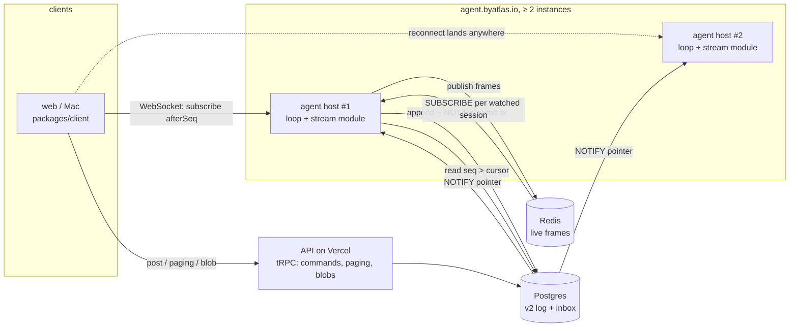

# Slice 5 design: real-time delivery to v2 clients

Status: **design, 2026-11-05, for the operator to approve.** Docs only; nothing here is built. Applies
[architecture.md](../architecture.md) §5 (protocol), §6 (views), §12 (L1, L7) and records its one
large choice in [0024](../../decisions/0024-v2-realtime.md). Sibling to
[roadmap.md](../roadmap.md) (slice 5 row). Anchors are `path:line` at `c79066038`.

Operator decision (2026-11-05): the v1 API stays on Vercel, the agent host on Render; real-time is
"whatever is best practice and scalable"; **no client polling**. `pgbase`
(github.com/dennisofficial/pgbase) is the reference for the WAL alternative, argued below.

Operator answers (2026-11-05, after review): the stream runs **inside the agent host**, which
becomes a web service at **`agent.byatlas.io`**; clients stream reasoning as well as text; the
session list ships now with title and last activity, status follows in slice 4; `max_connections`
goes to 100 before this slice ships; lease transitions announce (0025). The agent host's platform
(Render today, DigitalOcean App Platform under evaluation) does not change this design.

## The decision in one screen

1. **Change source: `NOTIFY` a seq pointer in the append transaction; readers read by seq.** The
   control library announces `{sessionId, threadId, headSeq}` on one channel inside the transaction
   that wrote the event (Postgres delivers it on commit only). Stream nodes `LISTEN`, then read
   `events where seq > cursor`. The notification carries no data, so the 8,000-byte `NOTIFY` limit
   and a 2.9 MB event do not matter. Logical replication stays out; the seam
   (`ChangeFeed`, below) keeps the door open.
2. **Where it runs: a module inside the agent host (`apps/agent-host/src/stream/`), served at
   `agent.byatlas.io`.** The agent host becomes a web service with one public port. The module owns
   its own `LISTEN` connection and read pool and shares nothing with the loop but the process, so it
   can move to its own service later without a rewrite. Not `apps/api` (Vercel cannot hold sockets).
   Stream state is per socket and per node: any instance serves any client.
3. **Transport: one WebSocket per client, multiplexing subscriptions** (open sessions and the
   sidebar), JSON text frames, no socket.io. Commands stay tRPC mutations into the inbox (P7).
4. **Fan-out across instances: none between instances.** Every node `LISTEN`s the same channel and
   serves its own sockets. Cost per node is O(notifications), not O(notifications × subscribers).
   No sticky routing, no Redis in the durable path.
5. **Resume is by `(seq, hash)`.** The log is the buffer: a subscriber holds a cursor, never a
   queue. A reconnect, a lost `LISTEN` connection, a slow client and a deploy all reduce to "read
   from the cursor". Resync exists only for a forked hash or a client too far behind (then: reset to
   the tail).
6. **Two channels, never mixed.** Durable events come from Postgres by seq. Token streaming is a
   separate ephemeral overlay: the agent host publishes batched text/reasoning deltas (new frames)
   to Redis (`PUBLISH` plus an `APPEND`ed step buffer, one pipeline, ≤ 10 flushes/s per step); a node
   joins with `SUBSCRIBE` then `GET`, forwards offset-keyed deltas, and a reconnecting client is
   re-snapshotted, not resumed. The durable `assistant-said` replaces the overlay. Redis down costs
   token streaming and nothing else.
7. **Auth: bearer token in the first frame, verified against `AuthSession` in Postgres**, re-checked
   on a timer; ownership checked per subscription against `V2Session.userId`.
8. **Session list: the same mechanism**, one `sessions` subscription per client: snapshot, then
   `upsert`/`remove` rows recomputed from the pointer. It needs slice 4's materialized status row.



## 1. The change source

### Facts that decide it

- The record is an append-only log keyed `(threadId, seq)` (`packages/db/src/prisma/schema/v2/event.prisma`).
  The head moves in the same transaction as the insert, under a row lock and a compare-and-swap
  (`packages/control/src/append-ops.ts:23-79`, `postgres-store.ts:112`). So committed events are
  contiguous: `seq > cursor and seq <= head` is a gap-free read.
- Every writer is the `control` library (P1). We own every write path, so we own the announcement.
- Load (v1 data): peak 879 events/min (14.7/s), 23 sessions active in a minute, p99 thread 2,221
  events / 7.7 MB. `NOTIFY` is at four orders of magnitude of headroom.
- Wakes already use `pg_notify` in the write transaction
  (`packages/control/src/postgres/postgres-store.ts:278`) and a `LISTEN` loop with
  reconnect-and-resync (`apps/agent-host/src/bus/pg-wake-listener.ts`). The pattern is proven here.

### Why NOTIFY + read-by-seq

- **The pointer is the whole change.** For a log, "what changed" is "the head moved from a to b".
  WAL would hand us the inserted row; we would then discard it and read by seq anyway (the
  `canonical` column is large, and `V2Blob` bytes would be in the stream).
- **Resumption is exact.** pgbase has no resumption ("a subscriber that cannot be proven correct is
  told to refetch", `src/live/CLAUDE.md`) because a row stream has no cursor a client can hold. A
  seq is such a cursor and the hash chain (P3) proves it.
- **No new failure mode in the production database.** A logical slot pins WAL until acknowledged;
  a stalled consumer fills the disk and takes the database down unless `max_slot_wal_keep_size`
  is set (pgbase README). The slot is also a single leader: a `SIGKILL` costs up to
  `wal_sender_timeout` of blackout, and every deploy is a leader handover. `LISTEN` has no
  server-side retention to pin.
- **WAL would not remove the fan-out problem.** Only the slot's holder sees the stream, so the
  leader must hand changes to the other nodes. pgbase's own transport for that is `NOTIFY`
  (`src/transport/postgres.ts`) or Redis. We would run both mechanisms.
- **WAL cannot see what the sidebar needs most.** Status is `fold(log) ∧ lease liveness` (P6).
  Liveness is a lock fact (section 27) and a TTL expiry; neither writes a row. WAL emits nothing
  when a holder dies.
- **Portability.** D2 (the local control plane over SQLite) has no WAL stream. A port-level
  announcement works over both.

### Costs we accept, said plainly

- `NOTIFY` is lossy across a listener disconnect, and a transaction that notifies takes a
  database-wide lock during commit, serializing notifying commits. At 15 appends/s that is
  irrelevant; PR 1 records commit latency with and without the announcement at 100 appends/s so the
  number is on file, not assumed.
- A `LISTEN` session must never hold a transaction open, or the notification queue (8 GB) fills
  and notifying commits start failing. The listener connection runs no queries.
- Every node receives every notification. At 15/s × 150 B × N nodes this is negligible. Beyond
  about ten nodes, one relay node publishing pointers to Redis replaces N `LISTEN`s; the
  `ChangeFeed` seam makes that a swap.

### When WAL becomes the right answer

Adopt logical replication, behind the same `ChangeFeed`, only if one of these becomes true. None is
true today.
- A live view needs a predicate or join over rows that are **not** written through `control` with
  a pointer we author (arbitrary live queries, the pgbase case; a second writer that bypasses the
  library).
- The measured commit cost of `NOTIFY` matters (the benchmark above).
- A view spans users or an organization, so routing by `sessionId → owner` no longer finds every
  interested subscriber.

### The seam

```ts
type Change = { sessionId: string; threadId?: string; headSeq?: number }
interface ChangeFeed {
  onChange(listener: (change: Change) => void): () => void
  onGap(listener: () => void): () => void
}
```

`onGap` fires when notifications may have been missed (listener reconnected). The Postgres
implementation is `startPgListener({ channel })`, a generalization of `startPgWakeListener`
(which hard-codes `PG_WAKE_CHANNEL`). Writers announce through the port:
`ControlTx.announce(change)`, next to `notifyWake`. The Postgres store `pg_notify`s on
`atlas_session_changed`; the in-memory store (and later SQLite) emits on commit.

**What announces, in the write transaction:** an append batch (one notification with the final
head, however many events it wrote), session creation, inbox post and take-back, and every lease
transition (claim, release, revoke). **What never announces:** lease renewals (one per 5 s per
session would be noise; liveness is not a row event, see "Leases" below).

Delivery order is commit order, and a thread's commits are serialized by its row lock, so pointers
for one thread arrive with non-decreasing `headSeq`. Subscribers do not depend on it: a stale
pointer reads nothing.

## 2. Protocol

Schemas live in `packages/protocol/src/stream.ts` (zod, imported by server and client). Version
negotiation follows [0017](../../decisions/0017-wire-protocol-skew.md): `hello` carries `v`, the
newer side talks down, and a client ignores message kinds it does not know.

**Client → server**

| Message       | Fields                                                  | Meaning                                            |
| ------------- | ------------------------------------------------------- | -------------------------------------------------- |
| `hello`       | `v, token`                                              | First frame within 5 s; otherwise close 4401       |
| `subscribe`   | `id, kind: 'session', sessionId, afterSeq?, afterHash?` | Follow a session's main thread                     |
| `subscribe`   | `id, kind: 'sessions', projectId?`                      | Follow the sidebar                                 |
| `unsubscribe` | `id`                                                    |                                                    |
| `resnap`      | `id`                                                    | The client saw a delta gap: send a fresh `overlay` |
| `ping`        |                                                         | Optional; server also pings                        |

**Server → client**

| Message                          | Fields                                           | Meaning                                                                 |
| -------------------------------- | ------------------------------------------------ | ----------------------------------------------------------------------- |
| `ready`                          | `v, connectionId`                                | Auth done                                                               |
| `events`                         | `id, events[], head: {seq, hash}, live: boolean` | A page in seq order; `live: true` once caught up                        |
| `reset`                          | `id, reason, tailFrom`                           | Drop the cache for this session; a tail page follows                    |
| `view`                           | `id, name: 'status', at: seq, value`             | Server-computed view at a log position (P6)                             |
| `overlay`                        | `id, key, blocks[{block, kind, text}]`           | Ephemeral snapshot of the in-flight step; replaces the client's overlay |
| `delta`                          | `id, key, block, kind, from, text`               | Ephemeral text appended at offset `from`                                |
| `overlay-clear`                  | `id, reason`                                     | `holder-lost` or `lost`; drop the overlay                               |
| `frame`                          | `id, frame: LiveFrame`                           | Other ephemeral frames (`tool-output`, `retrying`); no seq              |
| `snapshot` / `upsert` / `remove` | `id, rows` / `row` / `sessionId`                 | Sidebar                                                                 |
| `error`                          | `id?, code`                                      | `not-found`, `forbidden-limit`, `bad-frame`, `internal`                 |
| `going-away`                     | `reconnectAfterMs`                               | Deploy drain, then close 1001                                           |

Events cross the wire as the same `V2Event` JSON the events API returns
(`sessionEventsOutputSchema`). Blob bytes never ride the stream: events carry blob references and
the client fetches them through `sessions.blob` on Vercel. Frames from the client over 64 KiB are
refused.

```mermaid
sequenceDiagram
  participant C as Client
  participant S as atlas-stream
  participant P as Postgres
  C->>S: hello(token)
  S->>P: AuthSession by token
  S-->>C: ready
  C->>S: subscribe(id, sessionId, afterSeq=412, afterHash)
  S->>P: owner check; hash at 412
  S->>P: read seq > 412 (page, bounded)
  S-->>C: events(413..530, live=false)
  S->>P: read seq > 530
  S-->>C: events(531..540, live=true)
  Note over S,P: NOTIFY {s,t,q=541} on commit
  S->>P: read seq > 540
  S-->>C: events(541, live=true)
```

### Subscribe, catch-up, live: one loop

A subscription is `{cursor, dirty, socket}` and one pump:

```
pump(sub): while sub.dirty:
  sub.dirty = false
  while true:
    await socket drained (bufferedAmount < HIGH)
    page = read(thread, afterSeq = cursor, limit 200, maxBytes 1 MiB, visible)
    if page empty: break
    send events(page, live = page reaches head); cursor = last seq
```

A notification (or a gap, or the initial subscribe) only sets `dirty` and schedules the pump. Because
reading is idempotent from the cursor, there is no ordering race between "catch-up" and "live" and
nothing to buffer: register first, then pump.
- **Open at the tail.** `subscribe` without `afterSeq` is the L7 tail-first open: the last events
  that fit 1,000 events / 1 MiB, `live` after. Older history is paged on demand with the existing
  `sessions.events` over HTTP (paging, not following).
- **Resume.** `afterSeq` + `afterHash` is the client's cache position. The server reads that one row
  and compares the hash. Match: stream from there. Mismatch (a fork) or `afterSeq > head`: `reset`.
  Behind by more than 1,500 events (the TUI's page size) or 4 MiB: `reset{too-far-behind}` and the
  tail page, so a long-parked client never replays a day of history.
- **Rewind.** Rewind is an appended event (P5). The server reads with `visible: true` as the events
  API does (`packages/control/src/read-events.ts`); the client applies core's `stepVisibility` to the
  events it receives, so the cached range a rewind hides is dropped client-side. A property test
  covers cache + stream = fresh tail across a rewind.
- **Park.** The stream reads Postgres, not the holder, so a parked session streams and resumes
  exactly like a running one. This is half the slice's first milestone.

### Views (status)

`view{status}` is the session's `sessionStatusOf` result plus lease liveness
(`packages/protocol/src/api.ts` `sessionStatusOutputSchema`), computed server-side because the client
never infers state (P6) and lease liveness is not in the log. A node computes it once per session
per pointer, coalesced to at most one per 250 ms, and fans it to local subscribers, sending only on
change. Before slice 4, the node folds the bounded tail it already read, as
`sessions.service.ts:142` does. After slice 4 it reads the materialized view row and stamps `at`.
The client discards a view whose `at` is behind its cursor.

### Two channels, never mixed

|               | Durable channel                           | Ephemeral channel                                                               |
| ------------- | ----------------------------------------- | ------------------------------------------------------------------------------- |
| Carries       | `V2Event`s of the log, status views       | Assistant text and reasoning deltas, tool output, `retrying`, `status` frames   |
| Source        | Postgres: `NOTIFY` pointer, read by seq   | Redis: the agent host publishes (`sessionLiveChannel`)                          |
| Order         | Total, by `seq`, hash-chained             | Per step, by character offset; no relation to `seq`                             |
| Delivery      | Exactly-once view by cursor; resumable    | At-most-once delivery; recoverable from a Redis buffer; losable                 |
| Truth         | Yes. The client never needs anything else | No. A decoration that the durable event replaces                                |
| Wire messages | `events`, `reset`, `view`                 | `overlay`, `delta`, `overlay-clear`, `frame`                                    |
| Redis down    | Unaffected                                | Token streaming stops; the answer appears whole when its `assistant-said` lands |

The client keeps them in two stores: the event window (durable) and the overlay (ephemeral). The
overlay is never written to the cache and never read by anything that needs a fact.

### Token streaming (the delta path)

Today nothing publishes assistant text or reasoning. `liveFrameSchema` (`packages/protocol/src/bus.ts:7`)
has `tool-output`, `retrying` and `status`, and the holder's `liveOutput()`
(`packages/host/src/holder/held-turns.ts:59`) maps exactly those two agent events. The model's
chunks stream through `ModelPort.step({ onChunk })` (`packages/core/src/ports/model.port.ts:11`), a
`ChunkFilter` that hooks can rewrite or drop; the loop passes it at `run-turn.ts:91`,
`tracked-turn.ts:210` and `retrying-step.ts:186`.

**Producer.** The loop emits a new `AgentOutputEvent`, `{ type: 'chunk', step: StepKey, chunk }`,
for `text-*` and `reasoning-*` chunks, taken _after_ the `onChunk` filter so a redacted chunk never
leaves the host. `liveOutput()` hands them to a pure `LiveStepBuffer` in `packages/host` (injected
clock and timers; no I/O). Tool-input deltas are not streamed: the durable `tool-called` is the first
sight of a call. Tool output keeps today's tail-only behaviour: a client joining mid-call sees output
from then on and the durable `tool-result` completes it.

**Frame shape** (new members of `liveFrameSchema`, strict like the rest):

```ts
type StepKey = { runId: string; step: number; attempt: number }
// step = the loop's per-run step counter; attempt increments on a retried step
{
  type: 'step-start'
  key: StepKey
}
{
  type: 'delta'
  key: StepKey
  block: string
  kind: 'text' | 'reasoning'
  from: number
  text: string
}
{
  type: 'step-end'
  key: StepKey
  reason: 'finished' | 'aborted'
}
```

`block` is the provider chunk `id` within the step; `from` is the block's length in UTF-16 code
units before this text, so a frame is idempotent: apply the part after what you already have.

**Replacement by the durable event.** The overlay is the single in-flight step of a session (the
model streams one step at a time). It is closed by the first of: a durable `assistant-said` or
`run-failed` for `key.runId` (read from the event window, however the client got it); a later
`step-start`; `step-end`; or the status view leaving a model-working state. A closed key is
remembered as a high-water mark, and any frame at or below it is dropped. The durable event always
wins, including when hooks changed the final text. No event schema changes: the key lives on the
ephemeral side only. This also removes a lingering overlay after a holder crash: the status view
goes non-live and the stream sends `overlay-clear{holder-lost}`; a drain-aborted step
(`aborted: 'handoff'`) is itself durable and closes the overlay by the first rule.

**Batching, to bound Redis commands.** `LiveStepBuffer` coalesces text per block and flushes on the
earlier of **100 ms since the last flush or 4 KiB pending**; the first delta of a step flushes at
once so time-to-first-token is not delayed. A flush is one pipelined `MULTI` (one round trip):
`APPEND` the frame JSON plus `\n` to the step buffer key, `PUBLISH` the same frame, and `EXPIRE 600`
at most once a second. Ceiling: 10 flushes/s per streaming step, about 30 Redis commands/s; at the
v1 peak of 23 concurrent sessions, under 700 commands/s if every one streamed at once, which they do
not. Whether the Redis plan tolerates this is open question 3; the cadence is one constant, set from a
measurement in PR 4a.

**Who holds the in-progress text.** Redis, written by the producer, not any stream node: a node
that has never seen the session (a client reconnected to another instance, or a first open mid-step)
has nothing else to ask, and the agent host has no inbound address (0021: no client-to-agent-host
routing). The buffer key `atlas:session-live-buf:{sessionId}` holds the current step's frames, one JSON
per line, and `step-start` replaces it with `SET`. It is capped at 512 KiB of text: past the cap the
producer stops writing and publishing deltas for that step, and the client shows the text it has
until the durable event lands. It expires 10 minutes after the last flush.

**Join, reconnect and the race.** The node, on the first local interest in a session:

```
SUBSCRIBE sessionLiveChannel(sessionId)     -- first, so nothing published after this is missed
GET atlas:session-live-buf:{sessionId}      -- frames up to now
fold the buffer into blocks; remember have[block] = length
send overlay{id, key, blocks}               -- the snapshot, once per client subscription
then for each pubsub frame: drop if key is older; if from + text.length <= have: drop (seen);
  if from > have: a gap -> re-GET, send a fresh overlay; else forward delta (overlap trimmed)
```

Because `APPEND` and `PUBLISH` are one `MULTI`, a frame is in the `GET` result, on the subscription,
or both; offsets make "both" harmless. There is no window where text is neither. A client that
connects, drops and reconnects runs the same join and gets an `overlay` with the text so far; it
needs no frame cursor. The ephemeral channel is not resumed, it is re-snapshotted.

**Ordering against the log.** None is needed, by construction. A delta before its durable event
paints; the durable event replaces; a delta after it is dropped by the high-water mark. The same
holds across nodes and across the two transports, which have no common clock.

**When the delta stream loses frames.**

| Loss                                                                         | Detection                                                  | Recovery                                                                                                      |
| ---------------------------------------------------------------------------- | ---------------------------------------------------------- | ------------------------------------------------------------------------------------------------------------- |
| A `PUBLISH` dropped between host and node (subscriber reconnect, Redis blip) | `from > have` on the next frame                            | Node re-`GET`s the buffer and sends a full `overlay`; the client replaces its blocks                          |
| Last frame of a step lost                                                    | Undetectable                                               | Harmless: the durable event replaces the overlay                                                              |
| Redis restarted, buffer gone                                                 | `GET` empty while status says the step is streaming        | `overlay-clear{lost}`; the client shows the working state with no text until the durable event                |
| Node's Redis subscriber reconnects                                           | ioredis reconnect event                                    | `onGap` for the ephemeral side: re-`SUBSCRIBE`, re-`GET`, `overlay` to every local subscriber of an open step |
| Slow client socket                                                           | Socket above the high-water mark                           | Drop its queued deltas; when it drains send one `overlay` (a snapshot is smaller than the backlog)            |
| Host publishes a malformed frame                                             | `liveFrameSchema` parse in the producer (already) and node | Dropped and logged; counts as loss above                                                                      |

**Node cost.** One ref-counted `SUBSCRIBE` per session with a local follower (not a pattern
subscription); per-session state is `have[block]` lengths and the closed key, not the text.

### Backpressure and limits

| Pressure                       | Mechanism                                                                                                                                                                                    |
| ------------------------------ | -------------------------------------------------------------------------------------------------------------------------------------------------------------------------------------------- |
| Slow client, durable data      | No queue exists. The pump awaits `bufferedAmount < 1 MiB` before the next read; a socket above it for 30 s is closed with 4408 `slow-consumer` and resumes by cursor                         |
| Slow client, ephemeral         | Per-subscription bounded queue (256 KiB); on overflow drop it and send one `overlay` when drained; durable pages never wait on it                                                            |
| Many subscribers on one thread | A per-node `ThreadFeed` reads `(minCursor, head]` once per pointer and fans out from a small ring (256 events / 4 MiB); a subscriber behind the ring reads for itself                        |
| Huge catch-up                  | Page limits above; `too-far-behind` reset                                                                                                                                                    |
| Reconnect storm after deploy   | `going-away{reconnectAfterMs: random 0..5000}` and client jitter; each reconnect is one cheap read                                                                                           |
| Abuse                          | Per connection: ≤ 32 session subscriptions + 1 sidebar, ≤ 20 `subscribe`/s. Per user: ≤ 20 connections. Per node: connection cap with `503` on upgrade and `/healthz` failing when saturated |

## 3. Where it runs and how it scales

- **Service.** The stream module runs in the agent host, which changes from a background worker to
  a web service at `agent.byatlas.io` (operator, 2026-11-05). No v2 load exists yet to size this
  against; the agent host's measured usage reflects test sessions only, and the expected load is
  extrapolated from v1 (peak ~15 events/s, 23 concurrent sessions). The load gate (PR 7) measures
  loops and sockets together on one instance before v2 carries real work. Accepted costs: an agent-host deploy closes every socket (clients resume
  by seq within a second or two), and a socket flood shares the CPU with loops (bounded by the
  per-connection, per-user and per-node caps in §2). Splitting it into its own service later moves
  the module, not the protocol.
- **Statelessness.** A node holds sockets and cursors, nothing durable. Any node serves any client,
  so Render's load balancer needs no affinity. At least two instances so a deploy is invisible.
- **Deploy.** On SIGTERM the stream module stops accepting, sends `going-away` and closes 1001 at
  once, while the loop drains its leases (up to 270 s). Clients reconnect to another instance and
  resume by seq; they never wait for the drain.
- **Connections to Postgres.** Per node: one **direct** connection for `LISTEN`
  (`DATABASE_DIRECT_URL`; PgBouncer transaction mode cannot `LISTEN`) and a small read pool of ≤ 4 on
  the pooled URL (reads are plain queries). Production has `max_connections` 50 and the agent hosts
  already spend a pool + `LISTEN` + lock + waiters each (section 27); the stream module adds ~5 per
  instance. `max_connections` goes to 100 before this slice ships (operator, 2026-11-05).
- **Scale shape.** Work per node is O(notifications) plus O(sockets) memory (cursor, small
  buffers). Target: 5,000 sockets and 100 appends/s per node on a 1 GB instance. These are targets,
  proven or revised by the load gate (PR 8), not measurements. Past about ten nodes, relay pointers
  through Redis from one `LISTEN` node.
- **Heartbeat.** Server pings every 20 s; a client that sees no frame for 45 s reconnects. The
  existing `packages/client/src/channel/keepalive.ts` pattern (injected scheduler) is reused. Render's
  idle timeout is not measured here; the ping interval is set from a measurement in PR 3.
- **Observability.** One SLI: **commit-to-socket latency** (append commit time to the frame leaving a
  node), p50/p99, plus connections, subscriptions, max `headSeq − cursor`, dirty-pump queue depth,
  slow-consumer closes and `LISTEN` reconnects. Target p99 ≤ 250 ms in region, so the roadmap's
  "latest event within ~1 s" has margin.

### Failure behavior

| Failure                   | Result                                                                                                                             |
| ------------------------- | ---------------------------------------------------------------------------------------------------------------------------------- |
| `LISTEN` connection drops | `onGap`: every subscription set dirty, sidebar subscriptions re-snapshotted. Same as the wake listener's resync-as-event; no timer |
| A node dies               | Sockets close; clients reconnect elsewhere with `(seq, hash)`                                                                      |
| Postgres failover         | Reads fail, `LISTEN` reconnects with backoff, then `onGap`; clients stay connected and show `reconnecting`                         |
| Redis down or restarted   | No deltas or frames; the buffer may be gone (`overlay-clear{lost}`); durable stream unchanged                                      |
| Notification queue full   | Notifying commits fail loudly. Prevented by the listener holding no transaction                                                    |
| Agent host dies mid-turn  | No stream event; status follows the lease design below                                                                             |

## 4. Auth

- **Token in the first frame, never in the URL** (URLs are logged). Browsers cannot set an
  `Authorization` header on a WebSocket, and cookies would be cross-site; with no cookie auth,
  cross-site WebSocket hijacking does not apply. The server still checks `Origin` against
  `TRUSTED_ORIGINS` for browsers.
- **Verification straight from Postgres** (operator fact): the better-auth bearer token resolves to
  an `AuthSession` row by the unique `token` index (`packages/db/src/prisma/schema/auth/session.prisma`),
  giving `userId` and `expiresAt`. better-auth keeps every session row in Postgres
  (`storeSessionInDatabase`, `auth.server.ts`), so a revoked session is simply absent. The node does
  not import `auth.server.ts` (it throws without the Google, Resend and secret env). A
  `StreamAuthPort` adapter holds the lookup, with a conformance test that signs in through the real
  better-auth and checks it resolves. PR 3 pins the exact bearer-token encoding; the design needs
  only token → row.
- **Re-check.** Each connection's session is re-read every 5 minutes (one indexed query) and the
  socket closed with 4401 on revoke or expiry. This is server-side revocation, not client polling.
- **Ownership.** `subscribe` loads the session once (`readSession`) and requires
  `session.userId === auth.userId`; otherwise `not-found` (no existence leak). Ownership is immutable
  and cached for the subscription. Sidebar rows are only the user's own sessions.
- **Rejected:** API-minted short-lived tickets. They avoid a `StreamAuthPort` but add a hop to every
  connect, depend on the Vercel API being up for a reconnect, and cannot see a revocation on a
  multi-hour socket.

## 5. The session list

What a sidebar row is: `{sessionId, projectId, title, status, lastEventAt, headSeq}`. What changes it:
an append (status, `lastEventAt`, a `title-set` event), session creation, an inbox post (`sent`) and
a lease transition. All of them announce `{sessionId}` through the same channel.
- **Subscribe:** `subscribe{kind:'sessions', projectId?}` returns `snapshot{rows}` (the existing
  `listSessions` bounds, ≤ 100), then deltas.
- **Per change:** the node maps `sessionId → owner` (cached, immutable), and if that user has a
  sidebar subscription on this node it recomputes the one row and sends `upsert` only when the row
  differs. Archive and delete send `remove`.
- **Resume:** a sidebar is a set, not a log. Reconnect and gap both mean a fresh `snapshot`; the
  client diffs it. 100 small rows is cheaper than versioning deltas.
- **Why not WAL here.** This is the pgbase shape: a live query over rows. But the predicate is one
  equality (`userId = me`), every writer is the control library, and the row is a fold recomputed
  from a pointer. WAL would deliver the same pointer plus a leader to keep alive. The conditions
  under which that flips are listed in §1.
- **Dependency:** a snapshot of 100 rows must not fold 100 tails. It reads slice 4's materialized
  status row, written in the append transaction. The sidebar PR therefore lands after slice 4's view
  table; open-session streaming does not wait for it.

### Leases (section 27)

Connection-bound leases (design in progress; operator session context, section 27, and ADR 0023-v2-connection-bound-leases when it lands) are not redesigned here.
What this design asks of them:
1. Every lease transition (claim, release, revoke) announces `{sessionId}` in its transaction.
2. A holder's death writes no row (the lock simply frees), so the survivors' death scan must
   **announce** the holderless sessions it finds, not only wake them. Otherwise the stream, like any
   WAL consumer, would show `working` until the next claim.
3. `currentLease(...).live` stays the one liveness read the status view uses.
   Until section 27 lands, a TTL expiry emits nothing, so the sidebar can show a dead holder as live
   until the reconcile wake; this is true of every change source and is not made worse here.

## 6. Client SDK (`packages/client`)

New subpath `./stream`; browser-safe (`browser-safe.spec.ts` applies; the package adds a dependency
on `@dltech/atlas-protocol`, and PR 5 checks the protocol root is browser-safe or exports a `/stream`
subpath). v1's `./channel` is untouched.

```ts
const connection = createStreamConnection({ url, getToken, webSocket, scheduler, cache })
const session = connection.follow({ sessionId }) // SessionFollower
session.subscribe(listener)
session.getSnapshot() // useSyncExternalStore-compatible
// snapshot: { events (window), cursor: {seq, hash}, status, overlay, connection }
const sessions = connection.followSessions({ projectId })
```

- **Connection** is a pure state machine (`connecting → authenticating → open → backoff → closed`)
  with an injected `WebSocket` factory, scheduler and clock, in the style of `keepalive.ts`.
  Reconnect uses exponential backoff with jitter capped at 15 s; it resubscribes every follower with
  its cursor. This is reconnection, not polling.
- **Follower** keeps a window per L7 (1,500-event pages, 3,000 retained, eviction), applies
  `stepVisibility`, merges the live overlay, and exposes `connection: 'live' | 'catching-up' |
  'reconnecting' | 'offline'` so the UI never claims freshness it lacks.
- **Cache port** `SessionCache` keyed by session, storing the window and `(seq, hash)`: IndexedDB on
  web, a file on Mac, memory by default. Open = paint the cache, then `afterSeq` catch-up (warm) or
  tail (cold). The agent host is never on the open path.
- **Commands** stay `sessions.post` over tRPC (`SessionPostOutput.inboxId`); the echo is the
  `input-consumed` event, and until then status reads `sent`. Paging older history and blobs stay on
  the HTTP endpoints.
- **Gap:** transcript derivation (`packages/client/src/transcript`) consumes v1 `Event`, not
  `V2Event`. A v2 adapter is a prerequisite for "basic chat and tools" and is its own PR (7).
- **Web and Mac behind `engine: v2`:** v2 sessions use a `useV2Session(sessionId)` hook over the
  follower in place of the v1 thread stream; v1 code is unchanged. Whether the Mac app shares the web
  bundle is checked in PR 7; the client package is the shared layer either way.

## 7. Test plan

| Layer                                   | What                                                                                                                                                                                                                                                     |
| --------------------------------------- | -------------------------------------------------------------------------------------------------------------------------------------------------------------------------------------------------------------------------------------------------------- |
| Pure                                    | Pump/cursor/dirty state machine, `ThreadFeed`, backpressure policy, view coalescing, frame-merge rule: plain data, no sockets or database                                                                                                                |
| Control conformance (memory + Postgres) | Every write path announces; a rolled-back transaction announces nothing (as `conformance-wakes.ts`); one notification per append batch; payload stays under 8,000 B                                                                                      |
| Postgres integration                    | Append from one connection reaches a WebSocket client; `pg_terminate_backend` on the `LISTEN` session recovers with no lost event; two nodes, one client moving between them                                                                             |
| Property                                | Random appends racing a subscribe at random moments: the client's sequence is contiguous, with no duplicate and no gap; cache + stream equals a fresh tail across a rewind                                                                               |
| Resume                                  | Drop mid catch-up and resume; forked hash → `reset`; far behind → `reset` + tail; park and resume                                                                                                                                                        |
| Backpressure                            | A fake socket that never drains: reads stop, memory stays bounded, close at 30 s; frames dropped before durable pages                                                                                                                                    |
| Auth                                    | Bad, expired and revoked (mid-connection) tokens; another user's session → `not-found`; every limit                                                                                                                                                      |
| Delta path (pure)                       | `LiveStepBuffer`: coalescing at 100 ms / 4 KiB with a fake clock, first-delta immediate, offsets contiguous, 512 KiB cap, retry increments `attempt`                                                                                                     |
| Delta path (Redis)                      | Join mid-step gets text so far; a publisher racing the join yields no gap and no duplicate (property test over random join points); dropped `PUBLISH` → `resnap` recovers; buffer flushed → `overlay-clear{lost}`; Redis down → durable stream unchanged |
| Overlay merge (client)                  | Durable `assistant-said` closes the overlay; a late delta below the high-water mark is dropped; hook-rewritten final text wins; holder crash clears via status; a drain-aborted step closes via its durable event                                        |
| Drain                                   | SIGTERM sends `going-away`; clients land on the other node and resume with no visible gap                                                                                                                                                                |
| Client                                  | Connection machine with a fake `WebSocket` and clock; browser-safe spec; warm and cold cache                                                                                                                                                             |
| Scale gate (L7, roadmap)                | A seeded 20k-event thread: tail open ≤ 1 s cold and warm; 1,000 followers on one thread at 100 appends/s on one node: record p99 commit-to-socket, CPU and RSS in this doc                                                                               |
| Slice exit                              | A real cloud session on v2 from the web with chat and tools, resumable after the stream drops and after a park                                                                                                                                           |

## 8. PR breakdown

Each is reviewable in one sitting and lands in order unless noted.
1. `refactor(control): announce changes through the port`: `ControlTx.announce`, Postgres
   `pg_notify` on `atlas_session_changed` in append, create, inbox and lease paths, in-memory
   emitter, conformance tests, `startPgListener` generalized from `startPgWakeListener`, the
   `NOTIFY` commit-cost benchmark. Asks section 27's lease code to call `announce`.
2. `feat(protocol): stream messages`: `stream.ts` schemas and fixtures.
3. `feat(stream): follow a session`: the `apps/agent-host/src/stream/` module, `StreamAuthPort`,
   `hello`, `subscribe`, pump, `ThreadFeed`, limits, drain, health, the agent host as a web service
   at `agent.byatlas.io`, Postgres integration and resume tests.
   4a. `feat(host): publish assistant deltas`: `step-start`/`delta`/`step-end` in `liveFrameSchema`, the
   `chunk` agent-output event emitted after the `onChunk` filter, `LiveStepBuffer`, the buffered
   pipelined publisher in `redis-live-frames.ts`, the Redis command-rate measurement. Independent of
   PRs 1-3; testable with a Redis and no stream node.
   4b. `feat(stream): status view and the live overlay`: status computation and coalescing, the Redis
   subscriber with the join protocol, `overlay`/`delta`/`overlay-clear`/`resnap`.
4. `feat(client): stream connection and session follower`: `./stream` subpath, cache port, tests.
5. `feat(stream): the session list`: after slice 4's view table. `sessions` subscription and
   `followSessions`.
6. `feat(web): open v2 sessions behind engine v2`: the `V2Event` → transcript adapter (may split
   in two) and the hook; Mac follows.
7. `test(stream): scale and chaos gate`: the seeded-thread and 1,000-follower runs; numbers written
   into this doc.

PR 3's title is `feat` only if a user can use it that day; otherwise `refactor`/`fix` per the repo's
release rule. The stream service ships dark until PR 7.

## 9. Operator answers (2026-11-05)

1. **Where and hostname:** inside the agent host, at `agent.byatlas.io`.
2. **`max_connections`:** raised to 100 before this slice ships (needs a Postgres restart, scheduled
   by the operator).
3. **Reasoning:** streamed to clients as well as text. The Redis cadence starts at 100 ms; PR 4a
   measures it.
4. **Leases:** lease transitions and the death scan announce
   ([0025](../../decisions/0025-v2-connection-bound-leases.md)).
5. **Architecture §5:** SSE is replaced by this WebSocket (0024).
6. **Session list:** ships now with title and `lastEventAt`; status follows slice 4.
