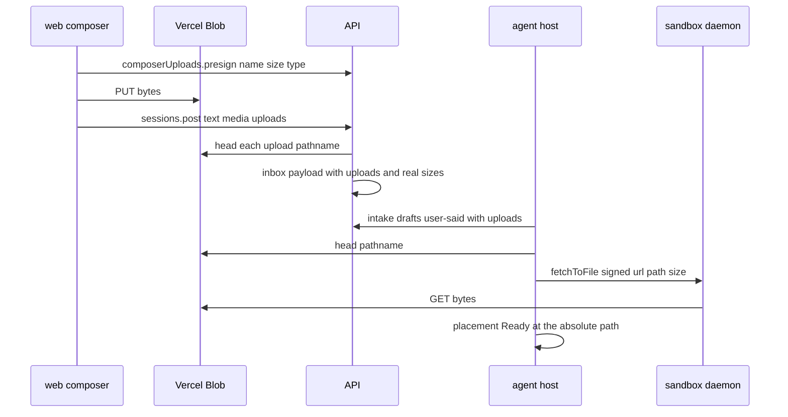

# File uploads in v2 sessions

Status: **design, 2026-11-07, approved in scope by Dennis (2026-11-06: "do this now, before slice C").**
Follows [media-urls.md](media-urls.md) slice B. Anchors are `path:line` at `0ff58be6d`.

## Goal

A v2 session accepts any attached file, not just images, and treats it as v1 does: the browser
uploads it to private Blob, the file is in the sandbox at `/atlas/home/uploads/<uploadId>/<name>`
before the step that needs it runs, and the model is told that path.

Out of scope: remembering v2 attachments in drafts across a reload (open question with Dennis),
attachments on queued-message chips (`sessionQueuedMessageSchema` carries text only, the same gap
images have), downloading an upload from the v2 transcript, mobile and TUI (no v2 composer).

## What exists

- Core, shared by v1 and v2: `user-said.uploads` (`saidUploadSchema`,
  `packages/core/src/events/part-schema.ts:81`; `schema.ts:72`), `uploadsBlock` tells the model each
  path (`packages/core/src/assembly/rules/uploads-block.ts:31`), fed by a placement map that the
  `agent` loop already asks for: `assembleStep` calls `deps.uploads.place(...)` when a
  `SaidUploadsPort` is given (`packages/agent/src/loop/step-prepare.ts:150`, port at
  `packages/agent/src/uploads/said-uploads.port.ts`, turn dep `uploads` at
  `packages/agent/src/loop/turn-deps.ts:41`). Nothing in v2 binds that port today.
- v1 upload API, usable without a thread: `composerUploads.presign` and `discard`
  (`apps/api/src/api/cloud/composer-uploads/composer-uploads.service.ts:26`, `:53`). Pathname
  `composer-uploads/<userId>/<uploadId>/<name>`; swept after 30 days
  (`apps/api/src/trigger/composer-uploads/composer-upload-sweep.ts`).
- v1 placement, read for semantics only: `packages/harness/src/uploads/said-uploads.ts:61`
  (`placeOne`: malformed → `Missing`; already on disk → `Ready`; a failure on an upload of the
  current message throws, on an older one becomes `Missing`; results are remembered per process).
- The agent host signs Blob GETs with one `'*'` delegation per 6-day window
  (`apps/agent-host/src/media/media-signer.ts:40`), and the daemon writes text only
  (`packages/protocol/src/ops/files.ts:23`).

## Design

- **Upload.** v2 web uses the existing `composerUploads.presign` for every attachment that is not
  a model-supported image (`SUPPORTED_IMAGE_MEDIA_TYPES`: png, jpeg, gif, webp). Those keep going
  through `media.presign` and reach the model as images. SVG, HEIC and everything else are files.
- **Ownership** is one pure rule in core: `isOwnedUpload({ upload, userId })`
  (`packages/core/src/uploads/upload-blob.ts`): the pathname is exactly
  `composer-uploads/<userId>/<uploadId>/<name>`, the id is a UUID, and the name has no separator,
  control character, `.` or `..`. The API checks it on post; the agent host checks it again before
  placing, because events are its input.
- **Post.** `sessions.post` takes `uploads: SaidUpload[]` (≤ `MAX_MESSAGE_UPLOADS`, and media plus
  uploads together ≤ `MAX_MESSAGE_UPLOADS`). The API refuses a foreign or malformed upload, heads
  each blob (missing → 400 "file <name> was not uploaded"), and writes the head's size into the
  inbox payload, so `size` in the event is the stored size, not the browser's claim.
- **Intake** copies `uploads` onto the `user-said` draft, as it does `media`.
- **Placement** (agent host, `SandboxSaidUploads extends SaidUploadsPort`): per upload, not owned →
  `Missing`; remembered → that; already a file at the target → `Ready`; blob head null →
  `Missing`; else sign a GET for the pathname and call the daemon's new `fetchToFile
  { url, path, size }`, which streams to `<path>.part`, checks the size and renames. A failure
  throws for an upload of the current message and is `Missing` for an older one (v1's rule). The
  bytes go Blob → sandbox and never cross the agent host.
- **Path**: `SANDBOX_HOME_PATH + '/' + uploadPathOf(upload)` = `/atlas/home/uploads/<uploadId>/<name>`.
  No session id: a sandbox belongs to one session. `<uploadId>` keeps two files of one name apart.
  It is outside `WORKSPACE_PATH`, so an upload never rides a `git add`. `read` and `bash` accept
  absolute paths with no workspace restriction (`resolveToolPath`,
  `apps/agent-host/src/agent-tools/file-text.ts:66`).
- **Web**: one hook routes each attached file to images or files, and the composer keeps send
  disabled while anything uploads (Dennis's choice). The new-session screen's refusal of leftover
  v1 attachments goes: every v1 attachment already has a `SaidUpload` (v1 uploads images too), so
  v2 sends those as files.

## Slices

| Slice | PR                                                  | Spec               |
| ----- | --------------------------------------------------- | ------------------ |
| D0    | core ownership rule + this doc                      | —                  |
| D1    | `sessions.post` accepts uploads; intake copies them | session section 07 |
| D2    | daemon `fetchToFile`, agent-host placement, wiring  | session section 08 |
| D3    | v2 web composer sends files from both entry points  | session section 09 |

D1 and D2 are independent; D3 needs D1's protocol types.

## Decisions

- Reuse the v1 upload API and Blob layout instead of a v2 copy: the API surface is the same, the
  30-day sweep keeps working, and v1 attachments switched into v2 stay sendable.
- Images the model can see stay `media`; every other file is an upload.
- The API heads each upload at post time and records the stored size.
- Placement waits on the daemon, not the workspace clone: the uploads folder is outside it.
