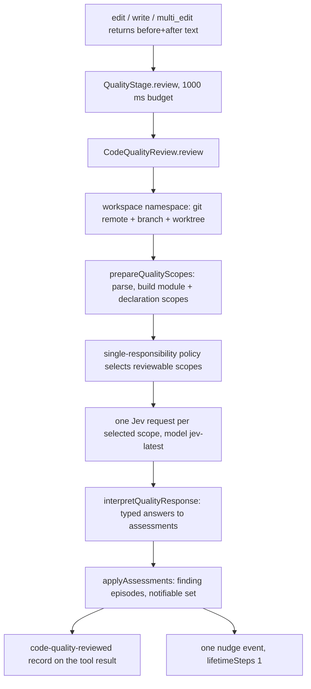

# Spec: advisory code quality in v2, reviewed by Jev

> **Approved by Dennis 2026-11-23.** On when the classifier is available; example recording dropped; web shows the indicator line. Built after the classifier role's slice 2.

Status: **approved**, 2026-11-23; built in PR 1 and PR 2 (§5). Owner: new `packages/quality` plus `packages/host`.
Anchors read at `ee5fdfdef` (repo `/atlas/workspaces/atlas`). "Jev" is the product name for this
review; the model that answers is whichever classifier the operator chose (Jev direct, Jev through
a gateway, or OpenAI Decisions).

**This module does not own a classifier.** The port, its transports (Jev direct, Jev through Vercel
AI Gateway, OpenAI Decisions), its setting and its availability rule are owned by
`classifier.md`. This review is one caller of that port: it asks typed questions
about one changed scope and reads the answers. If the classifier is off, this review is off.

---

## 1. Product contract

After a **successful direct file write**, Atlas may ask its classifier three typed questions about
the scope the write changed, under the code-quality policies that are switched on. If the classifier
says the edit introduced or worsened a problem, the model gets **one** short advisory note on its
next step. The note is advice: nothing is blocked, reverted or failed, and a write that already
succeeded keeps its successful result whatever the review says.
- It reviews **the write**, not the turn: `write`, `edit` and `multi_edit` outcomes that carry
  before and after text. Shell, MCP and external-editor edits are not attributed.
- It reviews **complete named scopes** in TypeScript and JavaScript: the file's module scope plus
  each changed top-level class or named function. A policy decides which scopes are worth asking
  about; the first policy is single responsibility.
- It is **silent** by default: no changed scope, no policy on, no answer in time, an unreadable
  answer, an answer from a model other than the configured one — each of those is a recorded
  coverage outcome and no note.
- **Two conditions turn it on.** The master switch (`quality.enabled`) and each policy's own
  switch. In v2 the master switch defaults **on**, which means **on when the classifier is
  available**: with no classifier model chosen, or its provider not connected, the review captures
  nothing, calls nothing and records nothing, and the settings page shows why (question 1).
- The model sees one block: the note, for one step only. The operator sees a one-line indicator on
  the tool call. The durable record is event bookkeeping, never prompt content.

---

## 2. How v1 works, with evidence

### 2.1 The chain



- **The stage.** `QualityStage` (`packages/harness/src/tools/quality-dispatch.ts:225-264`) wraps
  `QualityReviewPort.review` in a budget and converts anything that comes back into validated
  drafts plus at most one `nudge`. It runs only when the outcome succeeded and carried file
  changes or capture faults (`:125-128`). The write tools capture before/after text only when the
  stage says so first: `captureEnabled()` (`:86-89`, called at `packages/agent/src/tools/dispatch.ts:213`)
  asks the review port, and the engine answers `enabled || recordExamples`
  (`packages/harness/src/quality/engine.ts:86-89`).
- **Wiring.** Main agent `packages/harness/src/container/create-harness-container.ts:227`, child
  agent `packages/harness/src/agents/registry/child-runner.ts:228`. Both build
  `new QualityStage({ quality, logPort })`, so sub-agents are reviewed identically.
- **The engine.** `CodeQualityReview.review` (`engine.ts:91-141`): resolve the workspace namespace,
  fold the finding ledger out of the thread's `code-quality-reviewed` records, take a review item
  per captured change, run one `ScopeJob` per selected scope, then `finish` (`:143-156`) validates
  the records and renders the note.
- **The scope.** `prepareQualityScopes` (`packages/harness/src/quality/source/scope-adapter.ts:145-297`)
  parses both sides with the TypeScript compiler, builds the module scope plus a scope per matched
  declaration, hashes each side and renders a diff. Skips are coverage outcomes, never clean
  reviews: unsupported language, declaration-only file, outside the workspace, oversized source
  (1 MiB, `source/capture-text.ts:7`), invalid syntax, ambiguous identity.
- **The questions.** `prepareQualityRequest` (`packages/core/src/quality/request.ts:69-96`) serialises
  the scope (before, after, diff, evidence, imports) as `state` and adds the policy's typed
  questions under `<policyId>:<questionKey>`. The single-responsibility policy asks three
  (`packages/core/src/quality/policies/single-responsibility.ts:16-22`): current concern probability,
  impact (7-way choice), focus. Answers are validated (`request.ts:120-141`) and then handed to the
  policy's own `interpret`.
- **The model.** `DecisionPort.decide` is called with `model: JEV_QUALITY_MODEL`
  (`scope-review.ts:90-99`), which is `JEV_MODEL = 'jev-latest'`
  (`packages/core/src/quality/request.ts:13`, `packages/core/src/policy/classifier/jev.ts:6`). An
  answer that reports a different model is recorded `Inconclusive` / `UncalibratedModel`
  (`scope-review.ts:124-131`) — the review refuses to claim calibration it does not have. In v2 the
  model id comes from the classifier role: the port asks for it and the answer must echo it.
- **The client.** v1's `ProtocolDecisionClient` and `JevDecisionClient`
  (`packages/harness/src/classifier/decision-backend.ts:32-63`,
  `packages/harness/src/classifier/jev-client.ts:10`, `:39-96`: `@typesafe-ai/sdk`,
  `retry.maxRetries = 0`, 2 000 ms) and `OpenAiDecisionClient` are **not ported here**. The
  classifier role owns the transports, the endpoints, the key and the timeouts
  (classifier spec §4.3). This module consumes `ClassifierPort`.
- **Endpoint and token.** Also owned by the classifier role: one settings value
  (`classifier.model`) and one provider account. v1's `decisions.provider`, `decisions.url`,
  `decisions.model`, `decisions.token.<provider>` and `classifier.mode` rows are deleted with that
  role, because no v2 code reads them (classifier spec §2.2, §6.2).
- **Wiring of the port.** `bindQuality` registers the engine and the git workspace identity
  (`packages/harness/src/composition/compose-quality.ts:24-57`); the policy registry is built from
  `singleResponsibilityPolicy` (`:29`) and policy toggles are registered as settings from the policy
  descriptors (`packages/harness/src/quality/settings.ts:35-49`).

### 2.2 Cost and latency

- The whole review shares one budget, `QUALITY_REVIEW_BUDGET_MS = 1000`
  (`quality-dispatch.ts:21`), joined to the turn's abort signal; a deadline abort gets a 10 ms
  settlement grace (`packages/harness/src/quality/deadline.ts:1,97-145`).
- One Jev call **per selected scope**, and each call gets its own request with the policy's full
  question text repeated. Measured on this repo with the real policy and source adapter
  (probe output, `packages/harness` + core, 2026-11-23):

  | Change                                     | Selected scopes | Request bytes                          |
  | ------------------------------------------ | --------------- | -------------------------------------- |
  | new 14-line file, one exported function    | 1               | 9 969                                  |
  | one-line edit inside `ledger.ts`           | 1               | 11 739 (state 3 498 + questions 8 241) |
  | extra comment only, no declaration changed | 0               | 0                                      |

  The three questions are a fixed 8 241 bytes; the scope state runs 1.7–3.5 KB for a function. So
  **about 2 500–3 000 input tokens per call**, tens of tokens back. Bounds: `state + longest
  question ≤ 24 KB`, `state + all questions ≤ 48 KB` (`review-scopes.ts:17-18`); a scope over the
  bound is skipped `OversizedRequest` rather than trimmed. A change with several top-level
  functions costs one call each, inside the same 1 s budget.
- The review sits between the tool result and the next model step (`dispatch.ts:221-232`), so a
  write delays the next step by at most about a second, and a review that misses the deadline
  still reports `ReviewDeadline` bookkeeping.

### 2.3 What the model sees

One `nudge` event with `lifetimeSteps: 1` (`engine.ts:154`), rendered by `renderNudge`
(`packages/harness/src/quality/review-records.ts:111-132`):

```
Code quality note: src/a.ts was written successfully. This advisory review is not a failure and nothing was reverted.

Single responsibility
- src/a.ts class Checkout: <the policy's guidance for this assessment> (evidence: pay, notify)

If the current structure is justified, leaving it unchanged is fine.
```

Only findings that are **newly** notifiable appear (`review-records.ts:234-240`,
`packages/core/src/quality/ledger.ts:88-140`): the same debt on a later write re-notifies nothing.
The note is one step of context, roughly 60–120 tokens.

### 2.4 What the operator sees

- `code-quality-reviewed`, source-free, attached to the tool result (`packages/core/src/quality/schema.ts:16-33`,
  `packages/core/src/events/schema.ts:127`) and — in v1 — also emitted as its own event
  (`engine.ts:152`). Rewind discards it (`packages/core/src/events/rewind-disposition.ts:24`).
- The TUI already renders it in v2: `qualityNoticeOf` reads `call.qualityReviews`
  (`apps/tui/src/ui/components/blocks/quality-indicator.tsx:41-65`) and shows
  `⚠ Single responsibility` or `✗ review <fault>` (`:69-78`). The web transcript shows nothing.
- v1 additionally had a health projection (`packages/core/src/quality/health.ts:48-69`) and a TUI
  quality panel (`apps/tui/src/composition/use-workspace-quality-health.ts`).
- Settings already exist in both surfaces: `quality.enabled` and `quality.recordExamples`
  (`packages/core/src/settings/registry.ts:941-963`) and the v2 web page
  (`apps/web/src/features/settings/pages/quality.tsx:17-27`, fixtures at
  `apps/web/src/features/settings/fixtures/settings-fields.ts:92-107`).

---

## 3. Questions for Dennis

1. **Does the review start switched on in v2, once a classifier is available?** v1 shipped it off
   pending efficacy evidence. Recommended: **on** — the master switch defaults on, and the review
   runs as soon as the classifier role is on, so a v2 session with a classifier needs no second
   setting to find. Clearing the classifier's model, or disconnecting its provider, turns the
   review off as well. Risk if on: one classifier call per changed function after every write, and
   a note on the next step that you did not ask for — the transcript indicator is how you will
   notice it.
2. **Keep "Record code-quality examples"?** v1 wrote a JSON copy of each reviewed scope, before and
   after, under the conversation's data directory, for the `evals/` corpus. `evals/` is v1-only and
   nothing in v2 reads those files. Recommended: **drop the setting and the writer** in v2, and say
   so in the release note. Keeping it means writing source copies into a sandbox with no reader.
3. **Should the web transcript show the same one-line indicator the TUI does?** Recommended: **yes**
   — the same `⚠ Single responsibility` / `✗ review <fault>` line on the tool call, because you
   daily-drive web. It is a small transcript change in `packages/client` plus a web renderer.

---

## 4. Design

### 4.1 Where each part runs

| Part                                                                                     | Home                                                                                                                        | Why there                                                                                                                          |
| ---------------------------------------------------------------------------------------- | --------------------------------------------------------------------------------------------------------------------------- | ---------------------------------------------------------------------------------------------------------------------------------- |
| Policies, request building, answer interpretation, finding ledger, record schema, health | `packages/core/src/quality/*` (exists, unchanged)                                                                           | pure, plain data, already v2-safe; only `zod`                                                                                      |
| Review engine, deadline, scope planning, records, source adapter                         | **new `packages/quality`**                                                                                                  | pure code that must not reach the sandbox, the host's session state or a network client; stays after `packages/harness` is deleted |
| Workspace identity probe, the `QualityStagePort` implementation, per-session wiring      | `packages/host/src/quality/*`                                                                                               | the host owns the daemon calls; the review runs on the agent host, never in the sandbox                                            |
| The classifier port, its transports, its key and its availability                        | `packages/core/src/ports/classifier.port.ts`, `packages/classifier/*`                                                       | owned by `classifier.md`; this review is one caller                                                                                |
| Setting and secret rows → session config                                                 | `apps/api/src/agent/config/*`                                                                                               | the API already reads the user and project setting rows per session                                                                |
| Before/after text capture                                                                | sandbox-side tools, unchanged (`apps/api/src/agent/agent-tools/edit.ts:86-93`, `write.ts:130-132`, `multi-edit.ts:139-141`) | the text arrives in the tool outcome; the review needs no file read of its own                                                     |
| `code-quality-reviewed` on the tool result, nudge draft                                  | `packages/agent/src/tools/dispatch.ts:246-256` (exists)                                                                     | the seam is already there and already emits `tool.quality`                                                                         |
| Transcript indicator                                                                     | `apps/tui` (exists), `packages/client` + `apps/web` (question 3)                                                            | surfaces own rendering                                                                                                             |

The review therefore adds **no daemon protocol op and no sandbox code**. The only daemon traffic it
adds is the git identity probe (§4.5), which uses the existing `exec` op.

### 4.2 The seam

`packages/agent/src/tools/quality-stage.ts:16-31` already defines `QualityStagePort` and
`NO_QUALITY_STAGE`, and `HookedToolDispatcher` already accepts `quality`
(`packages/agent/src/tools/dispatch.ts:80-97`) and calls it (`:213`, `:221-232`, `:246-256`). Three
places must pass one in:
1. `packages/host/src/holder/hooked-tools.ts:4-13` — add the field:

```ts
export const hookedToolsOf = (args: {
  registry: ToolRegistry
  hooks: HookChain
  quality?: QualityStagePort | undefined
  trace?: TracePort | undefined
}): HookedToolDispatcher =>
  new HookedToolDispatcher({
    registry: args.registry,
    hooks: args.hooks,
    ...(args.quality === undefined ? {} : { quality: args.quality }),
    ...(args.trace === undefined ? {} : { trace: args.trace }),
  })
```

2. `packages/host/src/holder/held-runner.ts:218` — `hookedToolsOf({ registry: pod.tools, hooks: pod.hooks, quality: runtime.quality, trace: runtime.trace })`.
3. `packages/host/src/holder/crew/child-runner.ts:83` — the same argument, so a sub-agent's writes
   are reviewed exactly as v1 reviewed them (`packages/harness/src/agents/registry/child-runner.ts:228`).

`SessionRuntime` gains one optional field (`packages/host/src/holder/ports.ts`, beside
`daemonTools` at `:93`):

```ts
quality?: QualityStagePort | undefined
```

built once per runtime in `apps/api/src/agent/runtime/session-runtime-factory.ts`. The runtime holds
no review state; the stage is a stateless adapter over the event log, the config and the Jev client.

### 4.3 `packages/quality`

New workspace package. `package.json` dependencies: `@dltech/atlas-core`, `typescript`. No
`node:fs`, no network, no clock of its own (`clock` and `deadlineMs` are injected). A
`README.md` follows `docs/package-readmes.md`.

Moved without behaviour change, imports re-pointed, specs moved with them:

| v1 file                                               | New file                                                                                                                                      |
| ----------------------------------------------------- | --------------------------------------------------------------------------------------------------------------------------------------------- |
| `packages/harness/src/quality/deadline.ts`            | `packages/quality/src/deadline.ts`                                                                                                            |
| `packages/harness/src/quality/review-scopes.ts`       | `packages/quality/src/review-scopes.ts`                                                                                                       |
| `packages/harness/src/quality/scope-review.ts`        | `packages/quality/src/scope-review.ts`                                                                                                        |
| `packages/harness/src/quality/review-records.ts`      | `packages/quality/src/review-records.ts`                                                                                                      |
| `packages/harness/src/quality/coverage-records.ts`    | `packages/quality/src/coverage-records.ts`                                                                                                    |
| `packages/harness/src/quality/workspace-namespace.ts` | `packages/quality/src/workspace-namespace.ts`                                                                                                 |
| `packages/harness/src/quality/settings.ts`            | `packages/quality/src/settings.ts` (minus `qualitySettingDefinitions`, which needs `ESettingPage` registration that v2 does not do from here) |
| `packages/harness/src/quality/source/*`               | `packages/quality/src/source/*` (all six files, unchanged)                                                                                    |
| `packages/harness/src/quality/engine.ts`              | `packages/quality/src/engine.ts` (changed as below)                                                                                           |

`engine.ts` keeps `CodeQualityReview` and drops two things:

```ts
export type CodeQualityReviewDeps = {
  classifier: ClassifierPort
  requestedModel: string
  source: QualitySourceAdapter
  registry: QualityRegistry
  settings: () => Readonly<Record<string, unknown>>
  workspaceIdentity: WorkspaceIdentityPort
  clock: () => number
  deadlineMs: number
}
```

- `classifier` is `SessionRuntime.classifier` (classifier spec §6.3). When it is off the stage is
  not built at all, so `captureEnabled()` never asks a write tool for text that nothing will read.
  The question and answer types do not change: `ClassifierQuestion` is `DecisionQuestion` without
  the `score` kind (classifier spec §4.1), and this policy uses only `noul` and `choice`
  (`single-responsibility.ts:155-200`). `interpretQualityResponse` therefore reads `DecisionAnswer`
  unchanged — that is why the port reuses the type instead of introducing a parallel one.
- `examples` disappears from the deps (§4.6, question 2), so `recordExamples`, `recordExamples()`
  (`engine.ts:370-396`) and the `evidencePath` plumbing go with it.
- `captureEnabled()` becomes `enabled` alone (it was `enabled || recordExamples`).

- `requestedModel` is the model of `SessionRuntime.classifierStatus` (`{ on: true; model }`). An answer
  whose `model` differs is recorded `Inconclusive` / `UncalibratedModel`, as v1 did against its
  `jev-latest` constant.

`CodeQualityReview` extends core's `QualityReviewPort` (`packages/core/src/ports/quality-review.port.ts`),
which is already the narrow contract the host needs, so the host depends on that abstract class and
not on the engine. No separate `ReviewEngine` type is added.

### 4.4 Durable state, or dropped with the reason

| v1 state                                                                                               | Where it lived                                                                    | v2                                                                                                                                                                                                                                                                                                                   |
| ------------------------------------------------------------------------------------------------------ | --------------------------------------------------------------------------------- | -------------------------------------------------------------------------------------------------------------------------------------------------------------------------------------------------------------------------------------------------------------------------------------------------------------------- |
| assessment cache (`packages/harness/src/quality/evaluation-cache.ts:39-51`, `Map`, 256 entries)        | process memory                                                                    | **dropped.** Hosts keep nothing between turns, and the key is a scope hash with its policy versions, so it only ever saved a repeat call for content already reviewed in the same process. A restart would have lost it anyway. Cost of dropping: one extra Jev call if the same scope and content is written twice. |
| review records                                                                                         | events (`code-quality-reviewed` on the tool result, plus standalone events in v1) | **durable, unchanged:** `tool-result.qualityReviews` (`packages/core/src/events/schema.ts:127`) is the record; the loop already writes it (`dispatch.ts:252`).                                                                                                                                                       |
| finding ledger                                                                                         | folded from records (`core/src/quality/ledger.ts:142-153`)                        | **derived, unchanged:** folded from the thread's events on each review. In v2 the dispatcher receives `record.composedEvents({ threadId })` (`packages/agent/src/loop/settle-pending.ts:92`), so the ledger spans the whole thread, not just the run.                                                                |
| coverage records                                                                                       | events                                                                            | **durable, unchanged.**                                                                                                                                                                                                                                                                                              |
| example files (`packages/harness/src/quality/example-sink.ts:10-116`)                                  | `threadDataDirectory` in the harness store                                        | **dropped** with the setting (question 2): no v2 reader exists, and writing source copies into a sandbox to be read by nobody is cost without a consumer.                                                                                                                                                            |
| git layout cache (`packages/harness/src/quality/git-workspace-identity.ts:238-241`, `Map`, 64 entries) | process memory                                                                    | **dropped.** The probe is five `git` reads per reviewed write (six when `core.worktree` is read), all inside one 750 ms bound (`:11`); the cache is exactly the cross-turn memory v2 forbids.                                                                                                                        |

The workspace namespace string keeps v1's shape — `<normalised remote>#<branch>:<worktree
relative path>` (`git-workspace-identity.ts:262-272`, `workspace-namespace.ts:62-64`) — so finding
identity does not change meaning across the port.

### 4.5 Host side: `packages/host/src/quality/`

**No Jev client and no decision factory here.** v1's `jev-client.ts` and `decision-backend.ts` move
to the classifier role (classifier spec §4.3), together with the endpoint table, the provider key,
the `/v1/systemone` route strip and the timeouts. The engine asks the port and nothing else:

```ts
const outcome = await classifier.classify({
  state: request.state,
  questions: request.questions,
  signal,
})
```

`request.questions` narrows to `Record<string, ClassifierQuestion>`; `prepareQualityRequest`
(`packages/core/src/quality/request.ts:69-96`) keeps its shape and `assertChoiceWithinLimit`
(`:25-40`) still guards the 255-option limit. Two files remain in this directory:
`workspace-identity.ts` and `quality-stage.ts`.

**`workspace-identity.ts`** — `DaemonWorkspaceIdentity implements WorkspaceIdentityPort`
(`packages/core/src/ports/workspace-identity.port.ts:3-8`), ported from
`git-workspace-identity.ts:233-282` with the `layouts` map removed. It probes with the existing
daemon process port (`packages/host/src/calls/ports/process.ts:69`, built at
`apps/api/src/agent/runtime/session-runtime-factory.ts:188`) with v1's reads unchanged:
`git rev-parse --show-toplevel --git-common-dir --is-shallow-repository`,
`git worktree list --porcelain -z`, `git rev-list --max-parents=0 HEAD`,
`git config --get remote.origin.url` and `git symbolic-ref --short -q HEAD` (plus
`git config --get core.worktree` for some layouts), all inside one 750 ms probe.

**`quality-stage.ts`** — the adapter the dispatcher sees:

```ts
export const qualityStageOf = (args: {
  review: QualityReviewPort
  clock: () => number
  logPort?: LogPort | undefined
  budgetMs?: number | undefined
}): QualityStagePort
```

It is a line-for-line port of `packages/harness/src/tools/quality-dispatch.ts:225-264` plus
`qualityReviewFor` (`:113-221`): the same gate (`ok` outcome with changes or faults), the same
budget/`settleReview` handling, the same `reviewOutcomeOf` validation (only `code-quality-reviewed`
drafts for this `callId` and exactly one one-step `nudge`), the same contained logging. Keeping this
shape is deliberate — it is the part that has already survived v1 fault injection, and it is what
guarantees a review fault can never replace a committed write's result.

**No `decision-backend.ts` either.** The role has one transport per chosen model, decided by
`DECISION_MODELS` (classifier spec §3.2), so there is no protocol to switch on here.

### 4.6 Config: the quality switches reach the host

`AgentHostConfig` (`apps/api/src/agent/config/agent-host-config.ts:49-58`) gains one field of its own:

```ts
quality: {
  enabled: boolean
  policies: Readonly<Record<string, boolean>>
}
```

The classifier's transport, endpoint, model id and key are **not** repeated here:
`AgentHostConfig.classifier` comes from the classifier spec (§3.5) and carries them. This spec adds
no second credential read.

`ConfigReader.read` (`apps/api/src/agent/config/config-reader.ts:88-124`) fills the quality field
from the settings map it already builds (`settingsOf`, `:198-209`): decode each stored value with
`decodeSettingValue` (`packages/core/src/settings/cloud/setting-codec.ts:11`), then run the ported
`qualitySwitches` (`packages/quality/src/settings.ts`).

Consequence, stated plainly: **a toggle change applies at the next runtime build**, i.e. the next
session start or pod restart. That matches the copy the settings page already carries — "Every
sandbox loads these when it starts" (`apps/web/src/features/settings/pages/quality.tsx:15`) — and it
costs no per-write database read. The alternative, reading rows inside `captureEnabled()` and again
in `review()`, would put two database queries in front of every write.

`session-runtime-factory.ts` is already over 300 lines, so the assembly lives in
`apps/api/src/agent/runtime/quality-stage.ts` (`qualityStageFor`), and the factory calls it with
the daemon process port and returns the result on the runtime:

```ts
if (!args.classifierStatus.on || !args.quality.enabled) return undefined
return qualityStageOf({
  review: new CodeQualityReview({
    classifier: args.classifier,
    requestedModel: args.classifierStatus.model,
    source: { prepareQualityScopes },
    registry: qualityRegistry,
    settings: () => ({
      ...args.quality.policies,
      [ESettingId.QualityEnabled]: args.quality.enabled,
    }),
    workspaceIdentity: new DaemonWorkspaceIdentity({ process: args.processes }),
    clock: args.clock,
    deadlineMs: QUALITY_REVIEW_BUDGET_MS,
  }),
  clock: args.clock,
  ...(args.log === undefined ? {} : { logPort: args.log }),
})
```

The gate is the master switch alone: a policy switch without the master switch builds no stage,
because the engine would answer `captureEnabled() === false` for every write anyway.

With the classifier off there is no stage at all: no capture, no call, no record. That is the v2
shape of "off", and the reason is shown once, on the settings page (classifier spec §7.1), instead
of being recorded as a per-write `DecisionUnavailable` on every file write. `deps.timers.now()` keeps
the review on the host's clock seam rather than `Date.now()`.

### 4.7 What the model and the operator see in v2

- **Model.** The nudge draft is returned after the result draft (`dispatch.ts:246-256`) and renders
  through `nudgeBlock` (`packages/core/src/assembly/rules/nudge-block.ts:4-5`) as a system notice.
  `lifetimeSteps: 1` is unchanged. Prompt cost: the note, once, for one step — roughly 60–120 tokens.
- **Operator.** `code-quality-reviewed` lands on the tool result and the TUI already draws it
  (`quality-indicator.tsx:41-78`). Web needs the change in question 3.
- **Nothing else changes.** No new event type, no protocol frame, no new badge, no new pane.

### 4.8 Cost and latency, restated for v2

Per file-writing tool call, in the host process:

| Situation                                                       | Classifier calls                             | Added latency                                                  |
| --------------------------------------------------------------- | -------------------------------------------- | -------------------------------------------------------------- |
| no classifier, review off, or policy off                        | 0                                            | 0 (no capture either, so the write sends no before/after text) |
| write changed no reviewable declaration (comment, import, docs) | 0                                            | source parsing only, ~1 ms                                     |
| write changed one top-level function or class                   | 1                                            | up to 1 s, typically 200–600 ms                                |
| write changed N functions/classes                               | N                                            | still one shared 1 s budget; the rest record `ReviewDeadline`  |
| classifier unreachable or slow                                  | up to N attempts, all inside the same budget | at most the budget                                             |

Input tokens per call: ~2 500–3 000 (measured: 9 969 and 11 739 bytes of request across two shapes,
of which 8 241 bytes are the fixed policy questions). Output: three typed answers. No retry, no
streaming. At the classifier's prices that is about $0.00013 per scope on Jev and about $0.0000003 on
OpenAI `gpt-6-luna` (classifier spec §4.5).

---

## 5. Slices

Two PRs. PR 1 is the feature; without both halves of it nothing works, so the engine and the host
wiring travel together. PR 2 is surface polish and the two setting answers. Both depend on the
classifier role's slice 2 (`classifier.md` §8): this module cannot run without a port.

| #   | Contents                                                                                                                                                                                                                                                                                                                                                                                                          | Files                                                                                                                                                                                                                                                                                                                                                                                                                           |
| --- | ----------------------------------------------------------------------------------------------------------------------------------------------------------------------------------------------------------------------------------------------------------------------------------------------------------------------------------------------------------------------------------------------------------------- | ------------------------------------------------------------------------------------------------------------------------------------------------------------------------------------------------------------------------------------------------------------------------------------------------------------------------------------------------------------------------------------------------------------------------------- |
| 1   | `packages/quality`: engine, deadline, scope planning, records, source adapter, settings, specs, README. Host: daemon workspace identity, stage adapter, specs. Seam: `hookedToolsOf`, `held-runner`, `crew/child-runner`, `SessionRuntime.quality`. Config: `AgentHostConfig.quality`, `ConfigReader.read`, runtime assembly gated on `config.classifier.on`. READMEs for `packages/quality` and `packages/host`. | `packages/quality/**`, `packages/host/src/quality/**`, `packages/host/src/holder/hooked-tools.ts:4-13`, `packages/host/src/holder/held-runner.ts:218`, `packages/host/src/holder/crew/child-runner.ts:83`, `packages/host/src/holder/ports.ts:93`, `apps/api/src/agent/runtime/session-runtime-factory.ts:249-330`, `apps/api/src/agent/config/agent-host-config.ts:49-58`, `apps/api/src/agent/config/config-reader.ts:88-124` |
| 2   | Web transcript indicator on the tool call; `quality.recordExamples` removed with its fixture and registry entry if question 2 says drop; master-switch default and description per question 1.                                                                                                                                                                                                                    | `packages/client/src/transcript/**`, `apps/web/**` transcript block, `apps/web/src/features/settings/fixtures/settings-fields.ts:92-107`, `packages/core/src/settings/registry.ts:941-963`                                                                                                                                                                                                                                      |

Ownership: PR 1 owns the integration; PR 2 depends on it and touches only surfaces. No v1 file is
edited by either — the port copies from `packages/harness` and leaves it alone until v1 is deleted.
No file outside these lists grows past 300 lines.

---

## 6. Test plan and live check

**Pure (`packages/quality/src/__tests__/`).** Move the existing v1 specs and keep them as plain
data: `deadline.spec.ts`, `engine-review.spec.ts`, `engine-requests.spec.ts`,
`engine-switches.spec.ts`, `support-modules.spec.ts`, `source/scope-adapter.spec.ts`,
`source/typescript-parser.spec.ts`, `source/capture-text.spec.ts`. Drop `example-sink.spec.ts` and
the git-identity layout/routing specs that assert the removed cache. Add:
- `engine-config.spec.ts`: `quality.enabled` false → `captureEnabled()` is false and no classify
  call happens; a classifier answer whose `model` is not the configured one → `UncalibratedModel`;
  a classifier that answers `{ ok: false, fault: 'rejected' }` → OperationalError and no nudge.
- one spec asserting the question bytes stay under the 24 KB / 48 KB bounds for a 200-line function.

**Host (`packages/host/src/quality/__tests__/`).** Add `workspace-identity.spec.ts` with a fake
`ProcessPort` (a real repo, a linked worktree, a detached HEAD, a probe that exceeds 750 ms →
deadline failure) and `quality-stage.spec.ts`: a successful outcome with no changes → no drafts;
malformed review drafts are replaced and logged; a late review records `ReviewDeadline` and produces
no nudge; a rejected review never touches the result draft. The classifier clients' own specs live
with the classifier role (classifier spec §8).

**Seam (`packages/agent/src/tools/__tests__/dispatch*.spec.ts`).** A fake `QualityStagePort`:
reviews land on `tool-result.qualityReviews`, the nudge follows the after-tool drafts, and
`captureEnabled()` false sends no `captureFileChanges` to the tool.

**Config (`apps/api/src/agent/config/__tests__/`).** The quality switches are read from the setting
rows, project over user. `apps/api/src/agent/runtime/__tests__/quality-stage.spec.ts`: a classifier
status of `{ on: false }` → no stage; on with the master switch off → no stage; on with it on → a
stage whose `captureEnabled()` is true.

**Commands.** `bun test` in `packages/quality`, `packages/host`, `packages/agent`, `apps/api`;
`turbo run typecheck`; `bunx biome check --write` on the touched files.

**Live check (a v2 session on this repo, review on, a classifier connected).**
1. Ask for an edit that mixes two independent responsibilities in one function. Expect: the TUI tool
   call shows `⚠ Single responsibility`, the next step's prompt carries the note once, and the event
   log holds one `code-quality-reviewed` record with `requestedModel` and `resolvedModel` both
   `jev-latest`.
2. Edit the same function without removing the mix. Expect: a record whose finding is already
   `notified`, and no second note.
3. Read the trace: one `tool.quality` span per write, under 1 s, with one Jev call.
4. Turn the switch off, start a new session, edit the same file. Expect: no `code-quality-reviewed`
   record, no `tool.quality` span, and no request at the endpoint. Confirm the write itself carries
   no before/after text (the sandbox tool capture is gated by `captureEnabled`).
5. Disconnect the classifier's provider in Settings, start a new session, edit the same file. Expect:
   writes still succeed, no review runs, and the settings row says the review is off and why.

---

## 7. Out of scope

- **The loop watchdog and judge-based loop cutting.** Dropped by Dennis; v1's
  `packages/agent-v1/src/loop/loop-watchdog.ts` and `JevJudge`/`RoutedJudge`/`HaikuJudge` routing
  are not touched and not ported.
- **The rest of the v1 classifier**: prefilter, replay, workspace facts, judge memo, occupancy,
  critique, evidence collector, facts cache, `openai-decision-client`. Only what the quality review
  calls is ported.
- **A classifier of this module's own.** The port, its transports, its model setting and its
  availability belong to `spec-classifier.md`; this module only calls it. The tool-call judge that
  v1 also drove from `DecisionPort` (`classifier.mode`) stays out and its setting row is deleted.
- **Writes this module never attributed in v1, and still does not:** `bash`, MCP edits, external
  editors, `agent_spawn` side effects.
- **Languages other than TypeScript and JavaScript**, and the module scope as a review subject.
- **Example recording and the `evals/` corpus** (question 2), and any efficacy claim from it.
- **Any host-side cache, memo or timer that outlives a call.**
- **A new protocol op, frame or compatibility bump.** The review reuses `tool.quality`,
  `code-quality-reviewed` and the existing `exec` daemon op.
