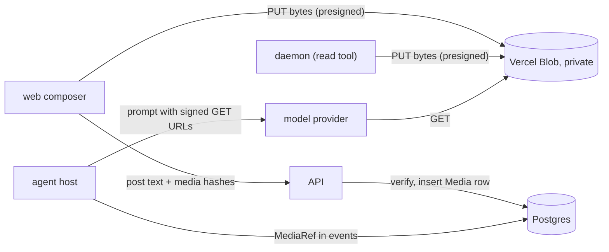

# Media as signed URLs: images in v2 without bytes on the agent host

Status: **design, 2026-11-06, for the operator to approve.** Docs only; nothing here is built.
Applies [architecture.md](../architecture.md) §12 L5 (large payloads live out of line). Evidence:
[research/image-urls/](../research/image-urls/README.md) (live spike, Anthropic and codex, private
Vercel Blob). Anchors are `path:line` at `e836d1d84`.

## Goal

v2 sessions accept images (pasted in the web composer, read by the agent with `read`). The bytes
live once in a private Vercel Blob store. Events carry only a small reference, and the agent host
sends the model a short-lived signed URL. No image bytes pass through the agent host or Postgres
on a model request.

Out of scope: mobile composer images, PDFs and other files (the design admits them: Anthropic's
`supportedUrls` already lists `application/pdf`), deleting media when a session is deleted (the
`Media` table below makes it a later sweep), and v1, which keeps inline base64.

## What exists today

- `ImagePart` and `FilePart` carry base64 in `data: string` (`packages/core/src/message/parts.ts:12`
  and `:22`). Events carry them the same way: `user-said.images` (`packages/core/src/events/schema.ts:69`,
  schema `saidImageSchema` at `packages/core/src/events/part-schema.ts:54`) and `tool-result.modelParts`
  (`packages/core/src/events/schema.ts:106`, `toolResultPartSchema` at `part-schema.ts:31`).
- Assembly turns them into model parts: `saidContent`
  (`packages/core/src/assembly/rules/messages-from-events.ts:132`) and the modelParts branch at `:89`.
  It keeps the newest `MAX_IMAGE_BLOCKS = 20` (`packages/core/src/assembly/rules/images.ts:20`).
  Corruption checks (`:62`) and token estimates (`packages/core/src/assembly/tokens.ts:19`) decode
  the base64 on every assembly.
- The agent host always sends `{ type: 'data' }` (`apps/agent-host/src/model/message-conversion.ts:72`,
  `:79`, tool results at `:44`) through `streamText` (`apps/agent-host/src/model/ai-sdk-model-port.ts:107`).
- `read` on an image pulls the whole file from the daemon as base64 (`apps/agent-host/src/agent-tools/read-image.ts:129`,
  daemon op `apps/daemon/src/ops/files/index.ts:66`) and puts it in `modelParts`.
- v2 posting is text only: `sessionPostInputSchema` (`packages/protocol/src/api.ts:14`),
  `inboxMessageSchema` (`:56`), `SessionsService.post` (`apps/api/src/api/platform/control/sessions.service.ts:91`),
  `InboxIntake.prepare` (`packages/host/src/holder/inbox-intake.ts:36`). The v2 web view passes no
  attachments to `ThreadComposer` (`apps/web/src/features/sessions/session-view.tsx:149`).
- Private Blob signing exists for v1 composer uploads:
  `apps/api/src/api/cloud/composer-uploads/vercel-composer-upload-blob-store.ts` (PUT and GET
  presign, `access: 'private'`). The agent host has no `BLOB_READ_WRITE_TOKEN` (its env:
  `apps/agent-host/src/config/env.ts:86`).

## What the spike settled (research/image-urls)

1. Anthropic and codex both fetch a private signed Blob URL.
2. Anthropic caches on image content: a re-signed URL, or base64 of the same bytes, still hits the
   cache. Re-signing is free there.
3. OpenAI fetches the URL on every request, and an expired URL fails the whole request with a 400.
   Anthropic does the same for a URL it has never seen.
4. `presignUrl` is a local HMAC (~0.1 ms) once a delegation is held, and is deterministic for the
   same delegation and `validUntil`. A new delegation gives a new URL for the same blob. The
   delegation scope is one exact pathname or `'*'`.
5. A delegation lives at most 7 days (`validUntil cannot be more than 7 days after the request
   time`); 6.9 days was accepted and served.

## Design



### The reference

```ts
// packages/core/src/media/media-ref.ts
export type MediaRef = {
  hash: string // sha256 hex of the stored bytes
  mediaType: SupportedImageMediaType
  size: number
  width: number
  height: number
}

// packages/core/src/message/parts.ts
export type MediaPart = {
  type: 'media'
  media: MediaRef
  source?: string | undefined // the path or file name the model is told about
  providerOptions?: ProviderOptions | undefined
}
```

`MediaPart` joins `ImagePart | FilePart` everywhere the user content and tool-result value unions
appear (`parts.ts`, `events/body.ts:119` and `:148`, both zod schemas). It is a separate part
type, not a variant of `ImagePart`, so every existing `part.data` reader stays correct and the
compiler lists every switch that must learn it. v1 never produces one. Its conversion
(`packages/harness/src/model/message-conversion.ts`) renders it as the text line
`imagePathLine` (`packages/core/src/images/attached.ts:17`) instead of failing.

Width and height are measured once, when the image is stored, so assembly never decodes anything
for a `MediaPart`. The image cap and the token estimate read `media.width`/`media.height`.

### Storage layout and the registry

- Pathname: `media/<userId>/<hash>`. It is content-addressed per user, so the same screenshot is
  stored once across sessions, and the user prefix is the ownership check (the same rule as
  `assertOwnPathname` in `composer-uploads.service.ts:16`).
- Table `"v2"."Media"` (`packages/db/src/prisma/schema/v2/media.prisma`; no `V2` prefix, by the
  naming rule): `userId`, `hash`, `mediaType`, `size`, `width`, `height`, `createdAt`, primary key
  `(userId, hash)`. A row exists only for bytes that were uploaded **and validated**. An event may
  reference a hash only when that row exists. The host and API insert it; nothing else does.
- Validation, once, at store time: `decodesAsImage` and `imageSize`
  (`packages/core/src/images/limits.ts:260`, `:213`), `size <= MAX_INLINE_BYTES` (`:23`), and
  `planDelivery` (`:44`) must say `Inline`. An image that fails never gets a row; it is named to the
  model as a text line, as today.

### Signing (agent host)

URLs change once a week, and every agent host builds byte-identical URLs within that week, so a
provider that keys its cache on the URL text loses it at most once per 6 days per session. Prompt
caches expire within an hour anyway, so a week-long session already misses far more often than
that (operator, 2026-11-06).
- Windows are 6 days, aligned to the epoch: `windowStart(now) = floor(now / 6d) * 6d` and
  `validUntil = windowStart + 7d`, pure functions in core (`packages/core/src/media/sign-window.ts`).
  Issuing at any time inside the window stays within Blob's 7-day cap, and every URL handed out has
  at least a day left.
- The delegation is shared, not per process: a new delegation means new URLs, so per-host
  delegations would break the cache on every deploy, restart and extra instance. Table
  `"v2"."MediaSigningWindow"` (`packages/db/src/prisma/schema/v2/media-signing-window.prisma`):
  `windowStart` (primary key), `validUntil`, `sealed` (the `IssuedSignedToken` JSON, sealed with the
  host's `SecretCipher`, `apps/agent-host/src/config/secret-cipher.ts`), `createdAt`.
- `MediaSigner` (`apps/agent-host/src/media/media-signer.ts`): `await signer.ready()` before each
  request. If the window in memory is current, that's all. Otherwise it reads the row for
  `windowStart(now)`; if there isn't one, it calls `issueSignedToken({ pathname: '*', operations:
  ['get'], validUntil })`, inserts with `ON CONFLICT ("windowStart") DO NOTHING`, and reads the row
  back, so concurrent hosts all adopt the first writer's delegation. Then `signer.urlOf(ref)` is a
  synchronous `presignUrl` with `validUntil` from the row.
- Signing happens at request build time only. URLs are never stored in events. Rows older than two
  windows can be deleted by the same later sweep that deletes media.

### Request building

- `toModelMessages(messages, { urlOf })` maps a `MediaPart` to
  `{ type: 'file', data: { type: 'url', url: new URL(urlOf(ref)) }, mediaType }`, in user content and
  in tool-result content.
- The model's `supportedUrls` decides the rest. Anthropic declares `image/*` over https
  (`anthropic-oauth.ts:159`), so the provider fetches. A model without URL support makes the AI SDK
  download the URL on the host and inline it: still correct, just no saving. That is the only
  fallback, and it needs no code. When codex reaches v2, its `supportedUrls: {}`
  (`packages/harness/src/providers/openai-oauth.ts:182`) becomes `{ 'image/*': [/^https:\/\//] }`; the
  spike shows codex fetches.
- A missing blob (deleted out of band) must not wedge a session. The provider answers 400
  "Unable to download" / "Upstream status code: 403". The host classifies that as
  `media-unavailable`, `head`s each referenced hash, and drops the missing ones from the session's
  media set (in memory, plus a `fact-recorded` so a new holder knows). Missing media assemble as
  `[image unavailable: <source>]`, and the step retries once. Any other cause fails the step as
  today.

## Slices

Each slice is one branch with one or two PRs and leaves v1 untouched apart from the `MediaPart`
case in the harness conversion. Order: A, then B and C in either order (B is the first one Dennis
can see).

### A. Media foundation and URL requests

Files: `packages/core/src/media/*` (new), `packages/core/src/message/parts.ts`,
`packages/core/src/events/{body,schema,part-schema}.ts`,
`packages/core/src/assembly/rules/{images,messages-from-events}.ts`,
`packages/core/src/assembly/tokens.ts`, `packages/db/src/prisma/schema/v2/media.prisma` and
`media-signing-window.prisma` (+ migration),
`packages/media/` (new: `MediaStore` port with `presignPut`, `head`, `delete`, plus a
`VercelMediaStore` adapter on `@vercel/blob` 2.8.2, the same calls as
`vercel-composer-upload-blob-store.ts`), `apps/agent-host/src/media/media-signer.ts`,
`apps/agent-host/src/model/message-conversion.ts`, `apps/agent-host/src/model/ai-sdk-model-port.ts`,
`apps/agent-host/src/config/env.ts`, `apps/agent-host/.env.{local,production}.enc`
(`bunx dotenvx set BLOB_READ_WRITE_TOKEN …`, the value copied from `apps/api/.env.production.enc`;
setup change, note it in the PR), `packages/harness/src/model/message-conversion.ts` (text-line
case).

Done when:
- Core specs: the image cap counts `MediaPart`s, tokens come from `media.width/height`,
  `windowStart`/`validUntil` boundaries (never more than 7 days after any instant in the window),
  and `user-said`/`tool-result` events with `media` parse and round-trip.
- An agent-host spec with a fake store: a `MediaPart` becomes a URL file part; two builds in one
  window give identical URLs; two signers racing on an empty window issue twice but both adopt the
  stored row and produce the same URL; a rolled window issues once more.
- A media-unavailable spec: a provider 400 of the spiked shape leads to a head, a dropped hash, a
  text line, and one retry.
- Live: `docs/v2/research/image-urls/probe.ts`, adapted to build the prompt through
  `toModelMessages` with a real `MediaSigner`, reads the code word on Anthropic.

### B. Composer images on v2 web

Files: `packages/protocol/src/api.ts` (`sessionPostInputSchema` gains
`media: z.array(hash).max(MAX_MESSAGE_UPLOADS).optional()`, `inboxMessageSchema` gains
`media: MediaRef[]`, new `mediaPresign` and `mediaUrl` procedures),
`apps/api/src/api/platform/control/` (`sessions.service.ts:91` post: check the session is owned,
for each hash read the `Media` row (missing means 400), and write the refs into the inbox payload;
a new `media.service.ts` for presign and validate), `packages/host/src/holder/inbox-intake.ts:36`
(draft `user-said` with `media`),
`apps/web/src/features/sessions/session-view.tsx` (attachments on `ThreadComposer`, reusing
`encodeImage` at `apps/web/src/features/threads/data/image-encode.ts:28` and
`MAX_IMAGE_EDGE = 2000`), and v2 transcript image rendering through `mediaUrl`.

Upload flow: the browser encodes the image (PNG or JPEG, ≤ 2000 px edge), hashes it with
`crypto.subtle.digest('SHA-256')`, and calls `mediaPresign({ hash, size, mediaType })`. The answer
is `{ exists: true }` when this user already has the hash, or a PUT URL (15 min) to
`media/<userId>/<hash>`. After the PUT, `mediaPresign` confirms the upload: the API downloads the
bytes once (≤ 5 MB), validates, and inserts the `Media` row with measured dimensions. Only then
does the composer allow sending.

Done when API specs cover a foreign hash, a missing row, an oversized image and a valid post; the
web spec covers presign → put → confirm → post; and live: an image pasted into a v2 session is
described by the agent, and the agent host's egress for that request is the JSON prompt only.

### C. Images the agent reads

Files: `packages/protocol/src/ops/files.ts` (two new ops beside `readBytesOpSchema` at `:15`:
`hashMedia { path }` → `{ ok: true, ref: MediaRef } | { ok: false, reason }` and
`putMedia { path, url }` → `{ ok }`), `apps/daemon/src/ops/files/index.ts` (implements both beside
`readBytes` at `:66`; `hashMedia` validates with core's `imageMediaType`, `decodesAsImage` and
`imageSize`, then hashes), `packages/host/src/calls/ports/agent-filesystem.ts:30` (matching port
methods),
`apps/agent-host/src/agent-tools/read-image.ts:105` (returns a `MediaPart` and inserts the `Media`
row, instead of calling `readBytes`).

The daemon can't hold the Blob token, so the host presigns. The flow: `hashMedia`; if the user
has no `Media` row for the hash, the host presigns a PUT to `media/<userId>/<hash>` and calls
`putMedia`, then inserts the row. Bytes go sandbox → Blob directly and never cross the host.

Before building, verify that Anthropic accepts a URL image **inside `tool_result`** (the SDK emits
it, `@ai-sdk/anthropic` `dist/index.js:2566`, but the spike only tested user content). Extend
`probe.ts` with one tool round. If it is refused, `toModelToolResultOutput` keeps the URL part and
the AI SDK downloads on the host for that case only.

Done when the daemon op specs (valid PNG, corrupt PNG, over the size limit, existing hash) and the
read-tool spec (a `MediaPart` with no `readBytes` call) pass; and live: the agent screenshots a
preview with Playwright, reads it, and describes it.

## Decisions

- Store: **Vercel Blob, private** (paid by the company and already wired; Dennis, 2026-11-06). R2
  would only change the adapter.
- URLs are minted per request from one delegation per 6-day window, shared by every host through
  Postgres, and never persisted in events. A cache miss once a week is accepted (operator,
  2026-11-06); Blob caps delegations at 7 days.
- Validate once at store time; a `Media` row means valid.
- Media is per user and content-addressed; deletion is a later sweep over `Media` rows that no
  live session references.
