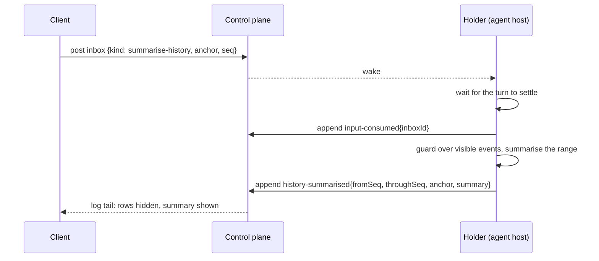

# Design: summarise at a message

Status: **design, 2026-11-03, needs operator approval.** A design section, not a roadmap slice: it
is built as one native command in slice 6 (`commands/`), on top of slice 3 (holder, inbox) and
slice 5 (client SDK). Anchors are `path:line` at `ac1dfb7e6`; re-check before relying on one.

## What the operator does

Under any of their own messages, a **Summarise** button opens a menu with **Summarise up to here**
and **Summarise from here**. Picking one opens a confirm dialog naming what becomes one summary.
On confirm, the covered messages and their replies leave the transcript and the model's context,
replaced by one summary. This is the TUI rewind picker's `summarise up to here` /
`summarise from here` verbs (`apps/tui/src/ui/rewind-model.ts:17-22`), on every surface.
- **Up to here** (`anchor: prefix`) covers everything before the message: `fromSeq` = first
  uncovered seq, `throughSeq` = message seq − 1. Offered when at least one earlier message is
  uncovered.
- **From here** (`anchor: suffix`) covers the message and everything after it: `fromSeq` = message
  seq, `throughSeq` = head when the holder runs it. Offered when the message and at least one
  later message are uncovered (one message summarised into one summary saves nothing).

## What exists in v1 (shipped)

- Pure guards: `compactionTarget` (`packages/core/src/compaction/compaction-target.ts:43`) and
  `suffixCompactionTarget` (`suffix-target.ts:6`) refuse a target outside the log, under an
  existing summary, splitting a tool call, or (suffix) saving nothing.
- Pure points: `summarisePoints` (`packages/core/src/compaction/summarise-points.ts`) maps each
  user message to its up-to / from reach `{ anchor, seq, messages }`. Web and the TUI rules agree.
- The harness op: `summariseAt` (`packages/harness/src/composition/compact-turn.ts:107`) →
  `compactThread({ destructive: true })` (`packages/harness/src/store/compact.ts:101`), which
  summarises the range, **deletes** the covered rows, raises the rewind floor
  (`replacedThrough`, `packages/core/src/compaction/watermark.ts:52`) and removes sub-agents
  spawned in the range that have not ended (`delegationsCutBy`, `compact.ts:76`).
- Transport: `EClientRequest.SummariseHistory` (`packages/wire/src/channel-wire.ts:136`), params
  `{ threadId, operationId, anchor, seq }` (`packages/wire/src/compaction-wire.ts:24`), answered by
  serve (`apps/serve/src/compaction-requests.ts:29`) under `holdHistory`, which refuses while a turn
  runs (`apps/serve/src/history-admission.ts:40`). Cancel is `CancelCompaction` by `operationId`.
  Client timeout 10 min (`packages/client/src/channel/request-timeout.ts:5`).
- Surfaces: TUI rewind picker; web `UserMessage` summarise menu
  (`packages/ui/src/ai/internal/summarise-action.tsx`), `useSummarise` + `SummariseDialog`
  (`apps/web/src/features/threads/data/use-summarise.ts`,
  `apps/web/src/features/threads/transcript/summarise-dialog.tsx`).

## v2 shape

### Record (core)

`history-summarised{ fromSeq, throughSeq, anchor, summary }` already exists
(`packages/core/src/record/event.ts:24-30`) and its visibility rule hides the range while keeping
`SURVIVES_SUMMARY` types (`packages/core/src/record/visibility.ts:32-39`). Nothing is deleted
(P5). Two additions:
1. **v2 guards.** `compactionTarget` / `suffixCompactionTarget` / `summarisePoints` read the floor
   from v1's `history-compacted` (`compactedThrough`, `watermark.ts:40`). Generalise them to take
   the floor as a parameter, with a v2 floor function over `history-summarised` events and the
   visible events (`visibleEvents`, `visibility.ts:94`). v1 passes `compactedThrough(events)` and
   does not change.
2. **A refusal outcome.** Today the only outcome record is `input-consumed{inboxId}`
   (`event.ts:31`). Add `input-refused{ inboxId, reason }` so a refused inbox command has an
   answer in the log. It is generic: rename and model change need the same thing. **Decision for
   the operator** (alternative: an optional `refusal` on `input-consumed`).

### Flow

- **Inbox, not a request (D4).** The client posts `summarise-history{ anchor, seq }`. There is no
  reply channel and no 10-minute request timeout: the client shows the entry as pending from the
  inbox, then the outcome from the log.
- **Settled only.** The holder consumes it between turns, like v1's `holdHistory`. While it is
  summarising it accepts no new turn: later sends stay in the inbox and are consumed after. The
  client still only offers the button when the session is settled, as v1 web does.
- **Consume first, then the outcome.** `input-consumed` is appended when work starts, so a
  take-back after that is a request to the holder (P2). Cancelling is the stop path (holder polls
  its inbox every 2 s), which appends `input-refused{reason: cancelled}`.
- **Guard at consumption time.** The holder runs the v2 guards over the visible events at the
  moment it consumes. A refusal appends `input-refused{ inboxId, reason }`; the client shows the
  reason. Suffix `throughSeq` is the head at that moment.
- **Crash mid-summary.** A consumed `summarise-history` with neither `history-summarised` nor
  `input-refused` after it is re-run by the next holder. The summariser has no side effects, so
  re-running is safe; this is the "no tool run twice" rule's easy case and needs no `OnceLedger`
  entry.
- **Sub-agents in the range.** v1 removes children spawned in the range that have not ended. In
  v2 agents belong to the crew plugin (slice 7). Until then the guard **refuses** a range holding a
  running agent ("stop the agent first"); slice 7 decides whether summarise stops them instead.

### Rewind across a summary changes meaning

In v1 summarising deletes rows, so a rewind can never reach back past the summary (the TUI copy
says "deletes rows"). In v2 a `history-rewound{toSeq}` with `toSeq` before the summary drops the
summary's span (`visibility.ts:23`), so the summarised rows come back. Summarise becomes
undoable by rewinding to before it. **Decision for the operator:** accept this (recommended: it
follows from P5 and loses nothing), or have the v2 rewind guard keep v1's floor. The confirm copy
("can no longer be rewound to") changes with the decision.

### Command package (0019)

`commands/summarise/`:

| File        | Holds                                                                                                                  |
| ----------- | ---------------------------------------------------------------------------------------------------------------------- |
| `spec.ts`   | Inbox payload schema `{ anchor, seq }`, the command name, settled-only timing                                          |
| `pod.ts`    | The holder handler: guard, summarise with the compaction role's model, append outcome; reuses the v1 summariser prompt |
| `client.ts` | `summarisePoints` over the v2 view, the pending/outcome state from inbox + log, the confirm copy (moved from web)      |
| `web.tsx`   | The `UserMessage` summarise menu and `SummariseDialog` already shipped in v1 web                                       |
| `tui.tsx`   | The rewind picker verbs                                                                                                |

## Validation

- Core: property test that `visibleEvents` after `history-summarised` from either anchor equals a
  reference model (extend `packages/core/src/record/__tests__/visibility.spec.ts`); guard specs for
  the v2 floor beside the existing `compaction-target.spec.ts` / `suffix-target.spec.ts`;
  `summarisePoints` with a v2 floor.
- Holder (with slice 3's scripted model and in-memory record): prefix and suffix each append
  `input-consumed` then `history-summarised`; a split tool call appends `input-refused`; a send
  posted mid-summary is consumed after; killing the holder after `input-consumed` re-runs the
  summary on the next holder exactly once.
- Client: the button appears only on points; the pending state shows from the inbox entry; a
  refusal shows its reason.

## Out of scope

Fork-from-here (a separate command), auto-compaction (assembly, L4), GC of hidden rows (P5 storage
policy).
