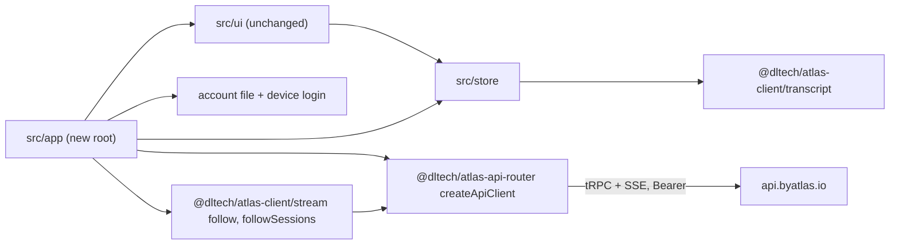

# Spec: the TUI as a v2 client

Status: **approved, 2026-11-23**. Anchors are at `0d7082dc8`; check one again before you
rely on it. Evidence for the census: the four research notes that this spec summarises (TUI census,
v2 client map, sign-in, install and build), kept in the session that wrote it.

## Decisions (Dennis, 2026-11-23)

1. **Pane actions.** The pane actions that v2 has no route for become shared v2 commands or routes
   in slice 8, so web gets them too: message, stop or resume a sub-agent; kill a background shell;
   stop, restart or read the log of a service; and the context-file viewer. Fork is dropped, of any
   kind: v1's fork goes with v1 (Dennis, 2026-11-23).
2. **`atlas` is the TUI only.** It keeps self-update, `--version`, `--continue`, `--resume`,
   `--model` and `--cwd`. `atlas classify` (the v1 harness classifier in-process) and `atlas push`
   (it publishes local `~/.atlas` skills, `ATLAS.md` and `mcp.json`, which v2 manages on the account)
   are dropped. `install.sh` keeps its `serve` flavor and the `atlas-serve-*` assets until the v1
   removal deletes `apps/serve`, because v1 sandboxes download that asset at boot.
3. **Preferences live on the account.** Accent, logo, sidebar width, thinking blocks, smooth
   streaming and the other appearance settings are personal settings (`settings.set`, the
   `CloudSetting` table). The last copy is cached in `account.json`, so the first frame is in the
   operator's palette.

## Goal

The TUI (`apps/tui`) becomes a client of v2 cloud sessions, like web, Mac and iOS. It signs in to an
Atlas account and reaches v2 only through `@dltech/atlas-client` and `@dltech/atlas-api-router`.
It keeps its look, its keys and its flows. Only its transport and its data source change.

**Exit criteria**
1. A signed-out `atlas` shows the device-code sign-in and nothing else. A signed-in `atlas` lists the
   account's v2 sessions, creates one, chats in it, stops, retries, rewinds and changes the model,
   against production.
2. Every feature in the census (§2) works on v2, or this spec names it as cut and gives the reason.
3. `apps/tui/package.json` has no `@dltech/atlas-harness`, `@dltech/atlas-wire` channel import,
   `tsyringe` or `reflect-metadata`. A spec fails if one comes back.
4. The released `atlas` binary runs no agent loop, no Docker and no plugin loader.
5. Web, Mac and mobile behave as before. Logic that the TUI shares with web moves below both
   surfaces. It is not copied.

**Out of scope**
- Local sessions. They are "coming soon" (roadmap slice 9, D2). Nothing in this spec makes a pod
  depend on the cloud, so a local control plane can serve this client later.
- User and project plugins. The plugin loader is not ported.
- Local provider sign-in (Claude or Codex OAuth on this machine). Providers live on the account.
- A headless mode (`atlas` without the UI, for scripts). A possible future item; not built here.
- Approval prompts. The TUI has none today (approvals arrive decided,
  `apps/tui/src/store/log-accumulator.ts:87-89`), and v2 has no approval route.

## 1. What exists today

- **Boot.** `apps/tui/src/main.tsx:23` promotes a staged update, sends `classify` and `push` to
  their own commands (`main.tsx:40-43`), and calls `bootAtlas` (`composition/boot.tsx:62`).
  `resolveConfig` reads `--continue/-c`, `--resume`, `--model`, `--execution-location` and `--cwd`
  (`composition/config.ts:30-96`). Settings load from disk before the first frame (`boot.tsx:95`,
  `packages/harness/src/composition/settings-binding.ts:34`).
- **Two v1 data paths.** A local session composes the whole v1 harness in the process
  (`composition/compose.ts:126` → `composeHarness`). A pod session speaks the v1 WebSocket protocol to
  `apps/serve` (`compose.ts:149-156`, frames in `packages/wire/src/channel-wire.ts:69-158`), through
  the `Remote*` port adapters in `packages/harness/src/cloud`. `composition/live-pod.ts:92-97` picks
  a Docker pod or an API pod.
- **The store is already shaped for v2.** `src/store` (2.1k lines) is a pure derivation over one
  `DeltaChannel.subscribe` (`store/conversation-store.ts:178-181`) and full snapshots through
  `setEvents`/`resetLog` (`:213-229`). It builds `TranscriptEntry[]` with
  `@dltech/atlas-client/transcript`, and `ui/components/entry-view.tsx:53` renders by `EEntryKind`.
  The renderers already speak the v2 transcript model.
- **v2 already has the client.** `@dltech/atlas-client/stream` is pure TS (no DOM, no React).
  `createStreamConnection` (`packages/client/src/stream/stream-connection.ts:57`) takes a transport and
  opens no socket. `follow({sessionId, threadId, log})` gives a `SessionSnapshot` (events, pending
  inbox, status, view, overlay, shells, connection; `stream/follower-state.ts:21-35`) and `loadOlder`.
  `followSessions()` gives the live session list. `transcriptEventsOf` (`stream/transcript-events.ts:65`)
  turns v2 events into the `Event[]` that the TUI store reads, and `overlayStepOf`
  (`transcript/overlay-step.ts:23`) turns the live overlay into `InFlightStep[]`.
- **The API client.** `createApiClient` (`packages/api-router/src/client.ts`) sends
  `authorization: Bearer` (`:52-55`) and takes an injected `EventSource` that carries the same header
  (`:62-81`). Bun has no global `EventSource` (`typeof EventSource === 'undefined'` on Bun 1.4.2).
  `sessionStreamTransport` (`packages/api-router/src/stream.ts:93-116`) is the SSE transport that web
  and mobile use. Mobile is the closest analogue to the TUI: a non-DOM renderer over the same client
  (`apps/mobile/src/thread/v2/session-stream.ts:12-29`).
- **Commands.** `sessions.commands()` serves the catalogue. `sessions.command({sessionId, name, args})`
  runs host and control commands. The `tui` profile hides `summarise` and picks `rewind`
  (`packages/commands/src/surface.ts:27-31`). Client actions are `ModelPicker | CommandList`
  (`packages/commands/src/spec.ts:15-18`). The design is `docs/v2/slices/slash-commands.md`,
  §4.2 and §4.6 (the TUI rewind drawer stays).
- **Sign-in.** The API runs better-auth's RFC 8628 device flow
  (`apps/api/src/api/platform/auth/auth.server.ts:118-124`, approval page `apps/web/src/app/(public)/(auth)/device/page.tsx`).
  The TUI already drives it from Settings → Cloud (`packages/harness/src/cloud/device-login.ts:5,53-136`,
  `apps/tui/src/composition/use-settings-cloud-login.ts:132-148`,
  `apps/tui/src/ui/components/settings/cloud-sign-in.tsx:21-95`). The result is a better-auth session
  token: opaque, 7-day sliding expiry, no refresh token. Mac and mobile use loopback or app-scheme
  PKCE (`desktopAuth.authorize/exchange`), which needs a browser on the same machine.
- **Size.** `src` is about 55.8k lines: `ui` 26.8k, `composition` 24.6k, `store` 2.1k. There are 513
  spec files. UI specs render with `testRender` from `@opentui/core/testing`. App flows run through
  `composition/__tests__/fake-app.ts` and `app-fixture.tsx`.

## 2. Census and v2 mapping

"Today" names the v1 port or request (`EClientRequest.*` in `packages/wire/src/channel-wire.ts:103-158`).
"v2" names the client call or route. Routes are in `packages/api-router/src/generated/server.ts`.

### 2.1 Sessions and chat

| Feature                                              | Owner (apps/tui/src)                                                                                 | Today                                                                  | v2                                                                                                                                                                                                                                                              |
| ---------------------------------------------------- | ---------------------------------------------------------------------------------------------------- | ---------------------------------------------------------------------- | --------------------------------------------------------------------------------------------------------------------------------------------------------------------------------------------------------------------------------------------------------------- |
| Boot curtain, crash screen                           | `composition/boot-screen.tsx`, `crash-boundary.tsx:28`                                               | `EBootStep` from `open-session.ts:114-165`                             | Steps become: account, connect, open session. Crash screen unchanged                                                                                                                                                                                            |
| Session list, `/sessions`, `--continue`, `--resume`  | `composition/use-threads.ts:39-113`, `ui/components/threads.tsx:188`, `cloud/cloud-listing.ts:12-60` | `ThreadStorePort.list` → `ReadThreads`, v1 `threads.list`              | `connection.followSessions()` + `createSessionsFeed` (`stream/sessions-feed.ts:7`). A row is a `StreamSessionRow` (title, status, model, PR, sandbox, `spawnedBy`). `--continue` opens the newest row                                                           |
| New session (`ctrl+n`, `/new`), project prompt       | `use-thread-birth.ts:32-193`, `use-project-prompt.ts:174`, `cloud/use-project-resolution.ts:108`     | `createWithFirstEvents`, v1 `CloudClient.listProjects/createProject`   | `projects.list/create`, then `sessions.create({projectId, model, effort, fast, provider, firstMessage})` (`packages/protocol/src/api.ts:93-101`). The cwd's git remote still picks the project                                                                  |
| Transcript, tool blocks, diffs, streaming reveal     | `ui/components/transcript.tsx`, `blocks/*`, `diff/*`, `store/*`                                      | `DeltaChannel.subscribe` + `EventLogPort.read`                         | `follow(...)` snapshot → `transcriptEventsOf(events, pluginTypes)` → store `setEvents`. Live steps from `overlayStepOf(snapshot.overlay)`. Older pages from `loadOlder`                                                                                         |
| Composer, `@` file mentions                          | `ui/components/composer.tsx`, `use-file-menu.ts`                                                     | `ListMentionFiles/ReadMentionFile`                                     | `files.search/tree/read` (`server.ts:536`)                                                                                                                                                                                                                      |
| Drafts                                               | `use-composer-draft-sync.ts`                                                                         | composer-draft sync                                                    | `composerDrafts.get/put` (`server.ts:45`), as web does (`apps/web/src/features/threads/data/composer-drafts-api.ts:11-21`)                                                                                                                                      |
| Attachments (pasted images, files)                   | `ui/clipboard-image.ts`, `use-composer-paste.ts`                                                     | `SaidImage` in the send body                                           | `media.presign/confirm` + PUT for images, `composerUploads.presign` for other files, then `sessions.post({..., media, uploads})`                                                                                                                                |
| Send, steer, queued messages                         | `use-conversation-send.ts:202-212`, `use-driven-turn.ts:181`                                         | `TurnRunner.say`, `EClientFrame.Send`, `TakeBackPending/RemovePending` | `sessions.post` with a `clientId`. Staged rows from `stagedPlacementOf`/`stagedOutcomesOf` (`stream/outgoing-messages.ts:92`). The queue is `snapshot.pending`. Take back is `sessions.withdraw({sessionId, inboxId})`                                          |
| Stop (`esc`, `ctrl+c`)                               | `use-turn-driver.ts:224`                                                                             | `EClientFrame.Interrupt`                                               | `sessions.stop`                                                                                                                                                                                                                                                 |
| Retry, run attention                                 | `use-turn-driver.ts:92`, `use-run-attention.ts:23-80`                                                | re-send, `ERunRemedy`                                                  | `sessions.retry` for a failed run; the run-attention Resume posts the `resume` command ([resume.md](resume.md)). "Switch account" becomes `accounts.setActive`                                                                                                  |
| Rewind drawer (`/rewind`, up, enter, enter)          | `use-rewind.ts:29-99`, `ui/rewind-model.ts`, `ui/components/rewind.tsx`                              | `EClientRequest.Rewind`                                                | The drawer stays. "Rewind to here" posts `sessions.command({name:'rewind', args:{toSeq}})`. The rewound text goes back into the composer with `rewoundMessageOf` + `mergedDraftOf` (lifted from `apps/web/src/features/sessions/data/session-rewind.ts:36-113`) |
| Summarise up to here (drawer verb)                   | `ui/rewind-model.ts:99-110`                                                                          | `SummariseHistory`                                                     | `sessions.command({name:'summarise', args:{throughSeq}})`                                                                                                                                                                                                       |
| Model and effort picker (`ctrl+p`, `/model`)         | `use-switcher.ts:60-140`, `ui/components/switcher.tsx`                                               | `ModelCatalogue`, `SetThreadModel`                                     | `models.list`, then `sessions.command({name:'model-set', args})`, as in `apps/web/src/features/sessions/data/use-session-model-choice.ts:13,36-37`. A new session takes the model in `sessions.create`                                                          |
| Rename (`/rename`), resize                           | `commands/registry.ts`                                                                               | `RenameThread`                                                         | `sessions.command` `rename`, `resize`                                                                                                                                                                                                                           |
| Operator input prompt                                | `use-operator-input.ts:53-146`, `ui/components/operator-input.tsx`                                   | `ProvideOperatorInput`                                                 | Entries from the operator plugin client slot. Answer with `operatorRequests.answer`, cancel with `{cancel:true}`                                                                                                                                                |
| Connection states (reconnect, offline, parked, wake) | `use-cloud-connection.ts`, `cloud/*` (31 files)                                                      | `Hello/Pause/Resume`, `Parked/Ready/Reload`                            | `snapshot.connection` (`ESessionConnection`) and `snapshot.status` pod state. `/wake` becomes `sessions.wakePod`                                                                                                                                                |
| Other sessions finishing (background wake)           | `app.tsx:106-122`, `cloud/open-thread-waker.ts`                                                      | `watchThreadWakes` SSE                                                 | The session list feed. A row whose status changes makes the same notice                                                                                                                                                                                         |

### 2.2 Panes, footer, header

| Feature                                                | Owner (apps/tui/src)                                                                                      | Today                                                         | v2                                                                                                                                                                                         |
| ------------------------------------------------------ | --------------------------------------------------------------------------------------------------------- | ------------------------------------------------------------- | ------------------------------------------------------------------------------------------------------------------------------------------------------------------------------------------ |
| Sub-agents, `ctrl+g` walk, child transcript            | `use-agents.ts:124-222`, `use-agent-view.ts`, `subagent-transcript.tsx`, `ui/components/sidebar/crew.tsx` | `AgentRegistryPort` → `ListRoster`, child `EventLogPort.read` | `crewOfView(snapshot.view.pluginViews)` for the rows. A child transcript is `follow({sessionId, threadId: agentId})`, as in `apps/web/src/features/sessions/agents/use-agent-stream.ts:18` |
| Message, stop or resume a sub-agent                    | same                                                                                                      | `SayToAgent/StopAgent/ResumeAgent`                            | Resume: `sessions.command({name:'resume', args:{agentId}})` ([resume.md](resume.md)). Say and stop: **no v2 route**, slice 8                                                               |
| Teammates                                              | `teammate-sidebar.tsx`, `teammate-transcript.tsx`                                                         | roster                                                        | Session rows with `spawnedBy` set (`packages/protocol/src/api.ts:231`). A teammate opens as an ordinary session                                                                            |
| Shells drawer (`ctrl+t`), `/shells`                    | `use-shells.ts:96-151`, `ui/components/shells.tsx`                                                        | `ShellRegistryPort` → `ReadShellOutput`                       | `shellsOfView(pluginViews)` and `snapshot.shells` tails. Kill: **no v2 route**, slice 8                                                                                                    |
| Services drawer, previews                              | `use-services.ts`, `use-declared-services.ts`, `ui/components/services.tsx`                               | `ServiceRegistryPort`                                         | `servicesOfView`, `previewsOfView`. Stop, restart, log: **no v2 route**, slice 8                                                                                                           |
| Sidebar plan, tasks, contributed sections              | `ui/components/sidebar.tsx`, `store/sidebar-model.ts`                                                     | folded from the event log                                     | The same fold over `transcriptEventsOf` events and plugin views                                                                                                                            |
| Footer: model, effort, tokens, spend, pod pill         | `ui/components/footer.tsx`, `use-workspace-footer.ts`                                                     | `TurnLedgerPort`, `ExecutionContextState`                     | Session row `model`, `view.spend`, `view.context`, `status.pod`. The location pill shows the pod (cloud only)                                                                              |
| Header: repo, branch, diff stat                        | `ui/components/header-bar.tsx`, `ui/hooks/use-diff-stat.ts`                                               | `ReadGitChanges`                                              | `view.checkouts` and `sessions.changes`                                                                                                                                                    |
| Context viewer, context tree                           | `use-context-tree.ts`, `ui/components/context-viewer.tsx`                                                 | `ListContextFiles/ReadContextFile`                            | System-context entries still render from events. The file viewer has **no v2 route** (`contextFiles.*` is v1). Slice 8                                                                     |
| GitHub PR pill, subscriptions bell, app-install notice | `plugins/github/*`, `plugins/subscriptions/*`                                                             | `PullRequestPort`, `ListSubscriptions/Subscribe`              | Session row `pullRequest`, `view.pullRequests`, `view.subscriptions`, `sessions.subscribe/unsubscribe`, github plugin client slot                                                          |
| Notices (toasts)                                       | `ui/notice-store.ts`, `notice-binding.ts`                                                                 | the surface's own `NoticePort`                                | Unchanged                                                                                                                                                                                  |
| Keys, mouse, selection, markdown, images               | `global-bindings.ts`, `ui/keys/*`, `ui/hooks/*`, `ui/markdown/*`, `ui/images/*`                           | local                                                         | Unchanged                                                                                                                                                                                  |
| Self-update, `/restart`, what's new                    | `build/self-update.ts`, `update-check.ts`, `use-whats-new.ts`                                             | GitHub releases                                               | Unchanged                                                                                                                                                                                  |

### 2.3 Settings, accounts and slash commands

| Feature                 | Today                                                                              | v2                                                                                                                                                                                                           |
| ----------------------- | ---------------------------------------------------------------------------------- | ------------------------------------------------------------------------------------------------------------------------------------------------------------------------------------------------------------ |
| `/settings` drawer      | `SettingsService` over `~/.atlas/settings.json`, `<cwd>/.atlas/settings.json`, env | Personal settings on the account: `settings.list/set/remove` (decision 3). Secrets: `secrets.*`. GitHub: `github.*`. Signing key: `sshSigningKey.*`. Cloud row: shows the email and signs out                |
| `/auth` accounts drawer | local vault, local Claude/Codex OAuth                                              | `accounts.list/create/setActive` and `providerSignIn.begin/poll/complete` (paste-code and device-code flows), as `apps/web/src/features/settings/data/personal/accounts-api.ts` does. Same drawer, same keys |
| Onboarding              | local settings + accounts                                                          | Signed out: the sign-in screen. Signed in with no provider account: the same onboarding screen, which opens `/auth`                                                                                          |
| `/skills`               | `app.skillRegistry`                                                                | A panel over `skillCatalogue.list`. Skills also show in the slash menu, as on web                                                                                                                            |
| `/mcp`                  | harness MCP registry                                                               | A panel over the session's MCP state and sign-in entries (`mcpSignInEntries`), with `mcpOauth.begin`                                                                                                         |

The slash menu becomes the session catalogue for the `tui` profile (`catalogueForSurface`) plus skills
(`catalogueOf`). App navigation that is not a session command stays a TUI-local entry, as a sidebar
button is on web: `/new`, `/sessions`, `/settings`, `/auth`, `/exit`, `/restart`. `/resume` is not
one of them: it is the shared host command that resumes a stopped turn ([resume.md](resume.md)), and
the session picker it used to open is `/sessions`. `/skills`, `/mcp`
and `/shells` join the shared table as client commands, as `slash-commands.md` §4.2 planned for this
slice. Web, Mac and mobile hide them with `because: 'panel'`.

| v1 command                                                     | v2                                                                                     |
| -------------------------------------------------------------- | -------------------------------------------------------------------------------------- |
| `/help`, `/model`, `/rewind`, `/rename`                        | catalogue commands (`help`, `model`, `rewind`, `rename`)                               |
| `/new`, `/sessions`, `/settings`, `/auth`, `/exit`, `/restart` | TUI-local entries                                                                      |
| `/resume`                                                      | catalogue host command `resume` ([resume.md](resume.md)), sent with `sessions.command` |
| `/skills`, `/mcp`, `/shells`                                   | new client commands                                                                    |
| `/wake`                                                        | TUI-local entry → `sessions.wakePod`                                                   |
| `/compact`                                                     | cut: the drawer's "summarise up to here" verb, as the `tui` profile already decided    |
| `/rotate`                                                      | catalogue host command `rotate` ([rotate.md](rotate.md)), sent with `sessions.command` |
| `/cd`, `/container`                                            | cut: local placement (§4)                                                              |

## 3. Sign-in and the token

- **Flow.** The device flow, unchanged on the API: `POST /api/auth/device/code` with
  `client_id: 'atlas-tui'`, show the URL and the user code, try to open the browser, poll
  `POST /api/auth/device/token`, then read the email from `GET /api/auth/get-session`. It works over
  SSH. The operator types the code on any machine. Loopback PKCE is not used: it needs a browser on
  the same machine and a local listener.
- **Code home.** `device-login.ts` is fetch-only. It moves from `packages/harness/src/cloud` to
  `packages/client/src/account/device-login.ts` (subpath `@dltech/atlas-client/account`) with an
  injected `fetch`. Harness imports it from there until v1 goes.
- **Gate.** Boot reads the account file. With no token, or when any call returns 401, the TUI shows
  only the sign-in screen (the current `cloud-sign-in.tsx` view, full screen). A 403 "awaiting access"
  shows that sentence and a sign-out key. Sign-out calls `POST /api/auth/sign-out` and deletes the file.
- **Storage.** `~/.atlas/account.json` (or `$ATLAS_HOME/account.json`), mode `0600`:
  `{version, apiUrl, email, token, preferences}`. The token is not sealed. The v1 store seals it with a
  key file in the same directory (`packages/harness/src/cloud/cloud-session.ts:21-78`), which protects
  nothing. The old `cloud.json` is not read. You sign in once more.
- **API URL.** `ATLAS_API_URL` when set, else `https://api.byatlas.io`. The device page is
  `https://byatlas.io/device` (from the device-code response).
- **Client.** One `createApiClient({baseUrl, token, clientVersion: ATLAS_VERSION, EventSource})` per
  process. `EventSource` is the `eventsource` ponyfill (already used by
  `packages/harness/src/cloud/sse-stream-client.ts`), so the SSE stream carries the bearer header.

## 4. What is cut

| Cut                                                                     | Where (to delete in slice 9)                                                                                                                            | Why                                                                 |
| ----------------------------------------------------------------------- | ------------------------------------------------------------------------------------------------------------------------------------------------------- | ------------------------------------------------------------------- |
| In-process harness host                                                 | `composition/compose.ts:126-294`, `open-session.ts`, `port-bindings` use                                                                                | v2 runs the loop on the pod                                         |
| Docker pods, sandbox sweep, `/container`, `--execution-location`, `/cd` | `composition/live-pod.ts`, `open-session.ts:70-88`, `use-workspace-location.ts`, `container-move*.ts`, `directory-move.ts`, `use-execution-location.ts` | Local sessions are coming soon, and will go through a control plane |
| Local `settings.json`                                                   | `boot.tsx:95` settings load                                                                                                                             | Settings live on the account                                        |
| MCP and skills from `ATLAS_HOME`                                        | `use-workspace-commands.ts:61-95`, `scripts/generate-skills.ts`                                                                                         | v2 serves both from the account and the pod                         |
| Plugin loader and manifest                                              | `src/plugins/*`, `scripts/generate-manifest.ts`, `bin/atlas-dev:53-59`                                                                                  | Dennis's decision                                                   |
| Local provider OAuth and vault                                          | `use-accounts.ts` OAuth paths, `use-browser-login.ts`                                                                                                   | Providers live on the account                                       |
| v1 cloud attach                                                         | `composition/cloud/*`, every `Remote*` adapter use                                                                                                      | Replaced by the stream connection                                   |
| Exit guard                                                              | `use-exit-guard.ts`, `ui/components/exit-guard.tsx`                                                                                                     | Quitting detaches. The pod keeps running                            |
| `atlas classify`, `atlas push`                                          | `composition/classify*.ts`, `push*.ts`, `src/push/*`                                                                                                    | Decision 2                                                          |
| Scratch                                                                 | `scratch1.txt`, `scratch2.json`, `scratch3.md`, `prototype/`, `scripts/bench-*`, `probe-*`, `proto-*`                                                   | No runtime role                                                     |

## 5. Install and build after v1

- `install.sh` installs one binary, `atlas`, for `darwin-arm64`, `darwin-x64` and `linux-x64`
  (`install.sh:46-57`), checks its `.sha256` and adds the PATH line. This is the same as today.
- The release job builds the three TUI binaries (`ci.yml:425-438`) with `apps/tui/scripts/build.ts`.
  The build loses the plugin and skills generation in `build:prepare` and the supervisor bundle
  (`scripts/build.ts:45`). It keeps the vendored-asset hazard check: tree-sitter grammars load by
  `{type:'file'}` import (`@dltech/atlas-syntax`). The vendored `rg` goes, because the TUI no longer
  searches files locally.
- Tags stay `tui-v<semver>`, in step across `update-check.ts:25` and `install.sh:72`.
- The `serve` flavor, `ci.yml:440-451` and `apps/serve` in `SHIPPED_APP_DIRS`
  (`packages/core/src/version/release-affected.ts:1`) are removed by the v1 removal, not here.

## 6. Architecture



- **A new composition root, `src/app/`, beside `src/composition/`.** The v1 composition is built
  around `HarnessApp` and local placement. An adapter under it would keep that shape. The new root
  reuses `src/ui` and `src/store` and ports the hooks that only hold UI state (drawers, composer,
  menus, keys). It writes new data hooks over the snapshot. Boot picks the root: the new one when
  `ATLAS_TUI_NEXT=1`, until slice 9 makes it the only one and deletes the flag.
- **One store seam.** The store reads one stream of `ChannelSignal`s for live steps
  (`store/conversation-store.ts:138-181`) and takes durable events through `setEvents`/`resetLog`.
  Both stay. Only the signal source changes: `ConversationStoreArgs.channel: DeltaChannel`
  (`store/conversation-store-types.ts:41`) becomes `signals: SignalFeed`:

  ```ts
  export type SignalFeed = { subscribe(listener: (signal: ChannelSignal) => void): Unsubscribe }
  ```

  The v1 adapter is `channel.subscribe({threadId, listener})`. The v2 adapter turns each snapshot's
  overlay into the same signals with a pure `overlaySignalsOf({previous, next})` in
  `packages/client/src/stream/overlay-signals.ts` (`step-started`, `chunk` text and reasoning deltas,
  `step-ended`, `turn-working` from `isSessionWorking(status)`), so paced reveal, the step tracker and
  the turn clock work unchanged. Durable events go to `setEvents` through `transcriptEventsOf`.
  `ChannelSignal`, `StepSignal`, `EStepEnd`, `TurnSpend` and `Unsubscribe` are imported from
  `@dltech/atlas-client` instead of the harness re-exports.
- **One connection, one client.** `src/app/session-client.ts` holds the `ApiClient`, the
  `StreamConnection` (`memorySessionLog()`, `systemStreamScheduler`, the TUI's plugin list) and the
  typed calls the hooks use. Hooks never call `createApiClient` themselves. Specs replace it with a
  fake over `createFakeTransport` from `@dltech/atlas-client/stream-fixture`.
- **Plugins.** `src/app/registered-plugins.ts` lists the client and core slots of crew, github, mcp,
  operator, services, sessions, shells and skills, as `apps/web/src/features/sessions/registered-plugins.ts`
  does. This is the client half of each plugin, not the plugin loader.
- **Stream surface.** Add `Terminal = 'terminal'` to `EClientSurface` (`packages/core/src/notify/surface.ts`),
  pass it to `sessionStreamTransport`, and report presence like web
  (`apps/web/src/features/sessions/data/use-presence-report.ts`), so the phone stays quiet while you
  watch in the terminal.
- **Boundary.** `apps/tui` may import `@dltech/atlas-client/*`, `@dltech/atlas-api-router`,
  `@dltech/atlas-protocol` (types and enums), `@dltech/atlas-commands`, `@dltech/atlas-core`,
  `@dltech/atlas-models`, `@dltech/atlas-syntax`, `@dltech/atlas-observability` and
  `@dltech/atlas-plugin-*/client|core`. `AGENTS.md` changes "`tui` never reaches past `harness`" to
  this list in slice 9. `src/__tests__/package.spec.ts` checks it.

## 7. Slices

Each slice is one PR. The default `atlas` keeps working after each one: slices 3 to 8 build the new
root behind `ATLAS_TUI_NEXT=1`, and slice 9 flips it. Each slice runs `bun test` in every package it
touches and `bun run typecheck`.
1. **Lift shared session logic below web.** Move `postInputOf`, `messageInputOf`,
   `readyMediaOf`, `storeImage` (taking bytes, not a DOM `File`) from
   `apps/web/src/features/sessions/data/session-media.ts:58-235`, and `seqByEventIdOf`,
   `rewoundMessageOf`, `rewindLanded`, `rewindRefused`, `mergedDraftOf`, `restorePlanOf`,
   `requestRewind` from `session-rewind.ts:36-113`, into `packages/client/src/session/` (new subpath
   `@dltech/atlas-client/session`). Move `device-login.ts` to `@dltech/atlas-client/account`. Web and
   harness import them. No behaviour change. Their specs move with them.
2. **Store seam.** Replace `channel` with `signals: SignalFeed` (§6) in
   `store/conversation-store.ts:178-181` and its args. Add `src/composition/channel-signal-feed.ts`, the
   v1 adapter. Move the store's type imports that `@dltech/atlas-client` already owns off the harness.
   All store and app specs stay green with no change to what they assert.
3. **Account and list (flag).** `src/app/account/` (file store, device login screen, 401 gate,
   sign-out), `src/app/session-client.ts`, `registered-plugins.ts`, boot selection in `main.tsx`.
   The first screen after sign-in is the resume picker over `followSessions()`. Opening a row shows
   the live transcript, read-only, through `overlaySignalsOf` (new, in `packages/client`, with specs). Adds the `eventsource` dependency.
4. **Chat (flag).** Send, steer, the pending queue and take back, stop, retry, run attention,
   attachments, `@` mentions, drafts, operator input, connection states, `/wake`.
5. **New session, model and commands (flag).** Project prompt over `projects.*`, `sessions.create`,
   the model picker over `models.list` and `model-set`, the slash menu from `sessions.commands()` plus
   skills, the rewind drawer (rewind and summarise verbs), rename.
6. **Panes (flag).** Crew rows and child transcripts, teammates, shells and services drawers
   (read side), sidebar, footer spend and context, header checkouts and diff stat, PR pill and
   subscriptions, notices for other sessions, the `terminal` surface and presence.
7. **Account settings (flag).** `/settings` over personal settings with the cached preferences,
   `/auth` over `accounts.*` and `providerSignIn.*`, onboarding, `/skills` and `/mcp` panels and the
   three new client commands in `packages/commands`.
8. **Pane actions (shared).** Four commands for the gaps decision 1 leaves: `agent say` and
   `agent stop`, `shell kill`, and `service stop`/`service restart`, each with its control or pod
   handler, its plugin README, a web presentation where web has the pane, and the TUI key it
   replaces. Resume is not here: it is the `resume` host command ([resume.md](resume.md)), built with
   the crew's `PodCrew.resume`. The service log reads the existing `services.log` route and the
   context viewer the existing `files.tree`/`files.read` with `root: 'context'`
   (`packages/protocol/src/files.ts:4`), so neither needs a new command. No fork.
9. **Flip and delete.** Make `src/app` the only root, delete the flag, `src/composition`, the v1
   adapter, `src/plugins`, `src/push`, `classify*`, the scratch files and the cut list in §4. Remove
   `@dltech/atlas-harness`, `tsyringe` and `reflect-metadata` from `package.json`, the plugin and
   skills generation from `build:prepare`, and the vendored `rg`. Update `apps/tui/AGENTS.md`, the
   root `AGENTS.md` boundary line, the TUI README and roadmap slice 9. Titled `feat(tui)`, because
   it changes what `atlas` is.

## 8. Test plan

- **Pure logic in packages.** Lifted helpers keep their specs in `packages/client`. Device login is
  tested with an injected `fetch` covering pending, slow down, denied, expired and success.
- **Store.** `overlaySignalsOf` is tested with plain overlay states. The store is tested with v2
  events and overlays in: the same `TranscriptModel` out as the v1 path gives for the same
  conversation (one fixture shared by both adapters).
- **App flows.** A `fake-session-client.ts` over `createFakeTransport` replaces `fake-app.ts` for the
  new root. Every v1 app spec that names a kept flow (`app-send`, `app-rewind`, `app-switcher`,
  `app-settings`, resume, operator input, crew walk) gets a twin over the fake client and asserts the
  same rows on screen with `testRender`. The rewind twin asserts `/rewind`, up, enter, enter posts
  `rewind` with the right `toSeq` and restores the draft.
- **Boundary.** `package.spec.ts` fails on a forbidden dependency.
- **Build.** CI builds the three binaries. A smoke step runs `atlas --version` on linux-x64.

## 9. Live check (production)

Use the installed release binary against `https://api.byatlas.io`, signed in as Dennis. Record each
step in `evidence/`.
1. Fresh `ATLAS_HOME`: `atlas` shows the sign-in code. Approve it at `byatlas.io/device`. The session
   list appears.
2. The list matches web's sidebar. Open an existing session: the transcript matches web.
3. `ctrl+n` in a clone of `dennisofficial/atlas`: the project is picked from the remote. Send
   "list the files in the repo root". The reply streams in.
4. Send a long task, then press `esc`: the run stops. Web shows the same stop.
5. Force a failure (a model the account cannot use), then retry: the run attention row offers retry
   and it runs.
6. `/rewind`, up, enter, enter: the message returns to the composer, and web shows the rewind.
7. `ctrl+p`, pick another model: the footer and web show the new model. The next reply uses it.
8. Spawn a sub-agent: `ctrl+g` walks to its transcript.
9. Quit with work running: `atlas -c` opens the same session, still running.
10. Sign out from `/settings`: the next start shows the sign-in code.
