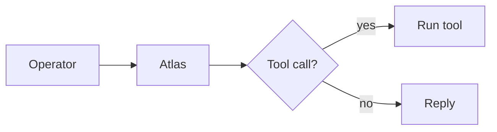

# Markdown Render Test

This message covers the common Markdown features. Each section says what it tests, so anything that renders wrong is easy to spot.

## 1. Inline formatting

This is **bold**, this is _italic_, and this is **_bold italic_**. Here is ~~strikethrough~~, `inline code`, and **bold text with `code` inside it**. A [link to example.com](https://example.com), an autolink <https://example.com>, and a bare URL https://example.com. Escaped characters: \*not italic\*, \`not code\`, \# not a heading.

Keyboard keys via HTML: <kbd>Ctrl</kbd> + <kbd>C</kbd>. Sub/superscript via HTML: H<sub>2</sub>O and x<sup>2</sup>.

## 2. Headings

### Level 3

#### Level 4

##### Level 5

###### Level 6

## 3. Lists

Unordered, nested:
- First item
- Second item
  - Nested item
    - Deeply nested item with `code`
- Third item

Ordered, with a custom start number:
3. Starts at three
4. Continues
1. Nested ordered
2. Another

Task list:
- [x] Render headings
- [x] Render code fences
- [ ] Render footnotes (we'll see)

A list item with a paragraph and a code block inside it:
1. Install dependencies:

   ```bash
   bun install
   ```

2. Run the tests:

   ```bash
   bun run test
   ```

## 4. Blockquotes

> A single-level quote with **bold** and `code`.
>
> > A nested quote.
> >
> > - with a list inside

> [!NOTE]
> GitHub-style admonition. Some renderers style this; others show the literal `[!NOTE]`.

> [!WARNING]
> A warning admonition.

## 5. Code blocks

TypeScript:

```typescript
enum EHookPhase {
  Before = 'before',
  After = 'after',
}

interface HookResult<T> {
  readonly phase: EHookPhase
  readonly value: T
}

export async function runHook<T>({
  phase,
  run,
}: {
  phase: EHookPhase
  run: () => Promise<T>
}): Promise<HookResult<T>> {
  const value = await run()
  return { phase, value }
}
```

Python:

```python
from dataclasses import dataclass

@dataclass(frozen=True)
class Point:
    x: float
    y: float

    def distance(self, other: "Point") -> float:
        return ((self.x - other.x) ** 2 + (self.y - other.y) ** 2) ** 0.5

print(Point(0, 0).distance(Point(3, 4)))  # 5.0
```

Rust:

```rust
fn main() {
    let words = vec!["atlas", "harness", "render"];
    let lengths: Vec<usize> = words.iter().map(|w| w.len()).collect();
    println!("{:?}", lengths);
}
```

Go:

```go
package main

import "fmt"

func main() {
	ch := make(chan int)
	go func() { ch <- 42 }()
	fmt.Println(<-ch)
}
```

Shell, with a prompt and output:

```console
$ git status --short
 M apps/tui/src/index.tsx
?? scratch.md
```

JSON:

```json
{
  "name": "@dltech/atlas-core",
  "dependencies": { "zod": "^4.0.0" },
  "private": true
}
```

YAML:

```yaml
jobs:
  test:
    runs-on: ubuntu-latest
    steps:
      - uses: actions/checkout@v4
      - run: bun install && bun run test
```

SQL:

```sql
SELECT u.id, COUNT(s.id) AS sessions
FROM users u
LEFT JOIN sessions s ON s.user_id = u.id
GROUP BY u.id
HAVING COUNT(s.id) > 5
ORDER BY sessions DESC;
```

Diff:

```diff
- const timeout = 1000;
+ const timeout = 5000;
  export { timeout };
```

HTML and CSS:

```html
<button class="btn" type="button" onclick="handleClick()">Click me</button>
```

```css
.btn {
  padding: 8px 16px;
  border-radius: 6px;
  transition: background 150ms ease;
}
```

No language tag:

```
plain preformatted text
    with preserved    spacing
```

A very long line, to test horizontal overflow and wrapping:

```text
This line is deliberately very long so you can see whether the renderer wraps it, scrolls it horizontally, or clips it: aaaaaaaaaaaaaaaaaaaaaaaaaaaaaaaaaaaaaaaaaaaaaaaaaaaaaaaaaaaaaaaaaaaaaaaaaaaaaaaaaaaaaaaaaaaaaa
```

A fence containing a fence (four backticks outside):

````markdown
```js
console.log("nested fence");
```
````

Indented code block (four spaces):

    indented code block
    second line

Mermaid (shows as code unless the renderer supports diagrams):



## 6. Tables

| Package   | Depends on | Pure? |
| :-------- | :--------: | ----: |
| `core`    |   `zod`    |    ✅ |
| `harness` |    core    |    ❌ |
| `ui`      |  nothing   |    ✅ |

The colons in the separator row set the column alignment: left, centre, and right.

A table with inline formatting and a long cell:

| Feature   | Notes                                                                                                                       |
| --------- | --------------------------------------------------------------------------------------------------------------------------- |
| **Bold**  | Works in cells                                                                                                              |
| `code`    | Also works                                                                                                                  |
| Long text | This cell holds a long sentence, to test how the table handles wrapping when the content is wider than the available width. |

## 7. Math (if supported)

Inline: $E = mc^2$. Block:

$$
\sum_{i=1}^{n} i = \frac{n(n+1)}{2}
$$

## 8. Footnotes

Here is a sentence with a footnote.[^1] And another.[^note]

[^1]: The first footnote.
[^note]: A named footnote with `code`.

## 9. Horizontal rules

---

---

## 10. Collapsible section (HTML)

<details>
<summary>Click to expand</summary>

Hidden content with **formatting** and a list:
- one
- two

</details>

## 11. Emoji and Unicode

Shortcode :rocket: vs literal 🚀. CJK: 日本語. RTL: مرحبا. Box drawing: ┌─┐ └─┘. Arrows: → ← ↔.

## 12. Line breaks

This line ends with two trailing spaces  
so it should break here.
This line has no trailing spaces, so it should join the previous line.

---

If something renders badly, tell me which section number it's in and I can make a more focused test case for it.
